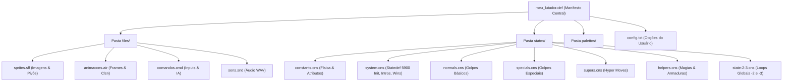
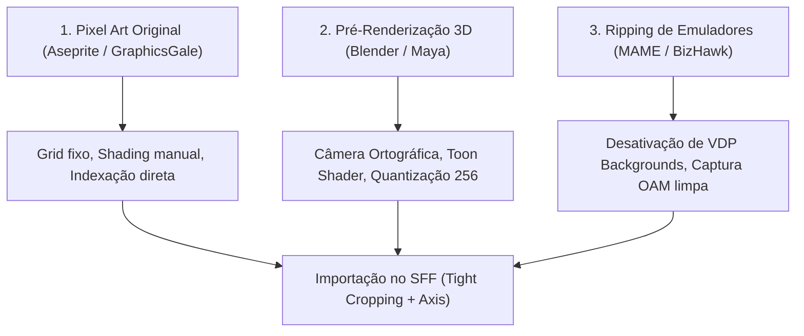
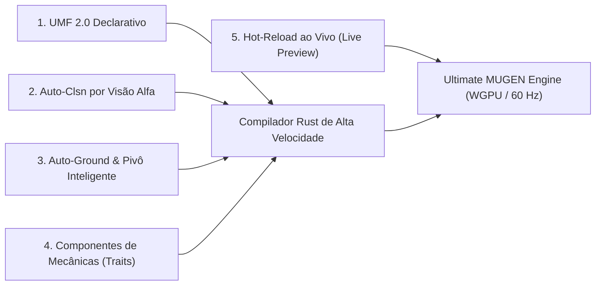

# Enciclopédia Master de Criação de Personagens M.U.G.E.N: Da Sprite ao Motor

Este é o documento definitivo, exaustivo e cumulativo para concepção, desenho, programação, balanceamento e homologação de personagens autônomos para os motores **M.U.G.E.N** (1.0, 1.1), **IKEMEN GO** (CNS + ZSS) e **Ultimate MUGEN**.

Nenhuma informação histórica ou técnica foi descartada. Além da análise detalhada dos pilares históricos, esta edição incorpora o **estudo empírico em larga escala de 2.625 definições `.def` (1.914 pastas únicas de lutadores) em 27 repositórios públicos**, somando **9.130 arquivos `.cns`/`.st`**, **1.827 `.cmd`**, **1.835 `.air`** e **58 `.zss`**:
- **Kung Fu Man / 720 (`kfm`, `kfm720` - Elecbyte)**: O padrão canônico oficial SD/HD (arquitetura limpa, arremessos precisos com failsafe `!gethitvar(isbound)`, flags de combo reutilizáveis).
- **PotS / CvS (`mredraith/CVS-P` - 266 defs / 171 chars)**: O padrão competitivo Capcom/SNK (`localcoord = 428,240`, Tick Fix no `-1`, Corner Push, Parry, Custom Combo, projéteis `Helper`, HitSparks procedurais em 1 sprite via `AngleDraw` e `var(58) = gametime`).
- **Team Z2 (`BuuZ2`, `GohanZ2`, `SSJ_GokuZ2`)**: Arquitetura multi-arquivos de alta maturidade (`config.txt` no `Statedef 5900`, `2OS Helper(2)`, Damage Dampener + Counter-Hit `1.2x`, Super Armor via `Helper`/`HitOverride` e trava `!WinKO`).
- **Gogeta SSJ4 (`Gogeta-Ssj4`) & JoJo (`DIO_K`)**: Voo tridimensional livre (`physics = N`), Ki charge, transformações dinâmicas e Time Stop sincronizado via `Pause`/`SuperPause` (`time = movetime`).
- **JUS / Naruto WOS (`Meiloorun`, `BillsLasa`, `Loco1911`, `Xandrarre`)**: Escala universal por `Helper(999999), Fvar(16)`, transformações por deslocamento `+10000`/`var(11)`, clones/marionetes com `HitOverride`, Burst e IA reativa a projéteis.
- **MvC / MUGENX (`DocDamage/MUGENX` - 1.205 defs) & Ikemen GO ZSS (`kfm_zss`, `ikemenarmor`, `glow.zss`, `tag.zss`)**: Magic Series, Super Jump (`90`), OTG (`MAFD`), Pushblock, e código moderno em **ZSS** (`[Function]`, `let`, `map()`, `[StateDef -4]`, `redlife`/`dizzy`/`guardbreak`).

> **Guias modulares complementares desta skill:**
> - [Estudo Empírico (2.625 `.def`) & 8 Arquétipos da Comunidade](references/estudo_empirico_e_arquetipos.md)
> - [Guia Prático de Ikemen GO & ZSS (Zantei State Script)](references/guia_zss_e_ikemen_go.md)
> - [Checklist de Pré-Voo, 8 Regras de Lint & Diagnóstico](references/checklist_lint_editor.md)
> - [Passo a Passo de Sprites, Paletas e Animações AIR](references/sprites_animacoes_passo_a_passo.md)
> - [Exemplos prontos: `meu_lutador.def`, `constants.cns` e `exemplo_ikemen_zss.zss`](examples/exemplo_ikemen_zss.zss)

---

## Sumário
1. [Engenharia Reversa Comparativa: Os Pilares do MUGEN](#1-engenharia-reversa-comparativa-os-pilares-do-mugen)
2. [Arquitetura de Pastas e Manifesto Modular (`.def`)](#2-arquitetura-de-pastas-e-manifesto-modular-def)
3. [Boilerplate Mestre de Constantes e Física (`constants.cns`)](#3-boilerplate-mestre-de-constantes-e-física-constantscns)
4. [Boilerplate Mestre de Comandos e Buffers (`comandos.cmd`)](#4-boilerplate-mestre-de-comandos-e-buffers-comandoscmd)
5. [Gestão Profunda de Sprites: Métodos de Geração, Dimensões e Codecs](#5-gestão-profunda-de-sprites-métodos-de-geração-dimensões-e-codecs)
6. [Alinhamento de Eixos (Pivô), Matemática e Ferramentas](#6-alinhamento-de-eixos-pivô-matemática-e-ferramentas)
7. [Engenharia de Animações, Caixas Clsn e Tabela Universal de Ações (0 a 5900)](#7-engenharia-de-animações-caixas-clsn-e-tabela-universal-de-ações-0-a-5900)
8. [Guia de Referência: Controladores de Estado (Sctrls) e Gatilhos (Triggers)](#8-guia-de-referência-controladores-de-estado-sctrls-e-gatilhos-triggers)
9. [Mecânicas Avançadas e Padrões Profissionais de Combate](#9-mecânicas-avançadas-e-padrões-profissionais-de-combate)
10. [Biblioteca Mestre de Blueprints Funcionais com Código (10.1 a 10.18)](#10-biblioteca-mestre-de-blueprints-funcionais-com-código)
11. [Programação de Inteligência Artificial (IA) Competitiva](#11-programação-de-inteligência-artificial-ia-competitiva)
12. [Guia de Homologação, Top 10 Bugs Reais e Testes Automatizados](#12-guia-de-homologação-top-10-bugs-reais-e-testes-automatizados)
13. [Lições de 50+ Lutadores (Rápidos vs Fortes) e Comparativo UMF](#13-lições-de-50-lutadores-rápidos-vs-fortes-e-comparativo-umf)
14. [Síntese Empírica do Corpus (2.625 `.def` / 27 Repositórios)](#14-síntese-empírica-do-corpus-2625-def--27-repositórios)
15. [Arquitetura Moderna Ikemen GO / ZSS e Compatibilidade Dual (`st90=`)](#15-arquitetura-moderna-ikemen-go--zss-e-compatibilidade-dual-st90)

---

## 1. Engenharia Reversa Comparativa: Os Pilares do MUGEN

A análise detalhada do corpus histórico e moderno revela a evolução técnica dos principais estilos de programação:

| Critério Técnico | KFM 720 (Elecbyte) | PotS / CvS (`CVS-P`) | Team Z2 (`BuuZ2`, `GokuZ2`) | JUS / WOS (`Meiloorun`, `Xandrarre`) | Ikemen GO (`kfm_zss`, `ikemenarmor`) |
| :--- | :--- | :--- | :--- | :--- | :--- |
| **Resolução (`localcoord`)** | `1280,720` (HD) | `428,240` (16:9 widescreen) | `320,240` (1:1 competitivo) | `320,240` + `Helper(999999)` ou `380,360` | `const240p()` / `const720p()` responsivo |
| **Formato de Sprite** | SFF v2.00 (PNG) | SFF v2 (paletas separadas + `movelist.dat`) | SFF v1/v2 com 69+ `.act` | SFF v1/v2 compacto estilo Jump | SFF v2 + PNG32 / sprites alfa |
| **Organização de Código** | 1 `.cns` limpo | 7–8 `.st` (`System`, `Normal`, `EX`, `Helpers`, `Custom`) | 8 `.cns` + `config.txt` em `Statedef 5900` | Multi-`.cns` por forma/invocação (`Bankai`, `Clones`) | `.zss` modular (`[Function]`, `-4`, `+1`) |
| **Filosofia de Combate** | Capcom clássico | Capcom/SNK (Parry, Dodge, Custom Combo) | VS/DBZ (Focus Armor, EMO, Beams) | Anime/Naruto (Awake `+10000`, Kawarimi, Clones) | Nativo engine (`RedLife`, `Dizzy`, `GuardBreak`, `Tag`) |
| **Projéteis & FX** | `Type = Projectile` | `Helper` com `HitOverride` + Spark 1-sprite `AngleDraw` | `Helper` + `Explod` com `config.txt` FX | `Helper` scaled via `Fvar(16)` | `Helper` ou `ModifyProjectile` + `under: 1` |
| **Gestão de IA & Variáveis** | `AILevel` no `.cmd` | `AILevel` + Tick Fix + `var(58) = gametime` | `AILevel` + `2OS Helper(2)` + dampener | `var(59)` / `AILevel` reativo | `aiLevelF` + `map(nome)` / `teamMap(nome)` |

### Lições Extraídas da Comparação
1. **Kung Fu Man (`kfm` / `kfm720`)**: Padronizou a flag única de combo (`var(1)`) no topo do `[Statedef -1]` e o failsafe `!gethitvar(isbound)` em estados de arremesso.
2. **PotS / CvS (`CVS-P`)**: Introduziu o **Tick Fix** no topo do `[Statedef -1]` (recupera controle no frame exato de `!animtime` sem perder 1 frame), **HitSparks procedurais em 1 sprite** via `AngleDraw scale` + `AddAlpha`, **Projéteis em `Helper` com `HitOverride`/`HitBy`** para colisão real entre magias, e **`var(58) = gametime`** no `-3` para detectar congelamentos.
3. **Team Z2 (`BuuZ2`, `SSJ_GokuZ2`)**: Consolidou `config.txt` em `Statedef 5900` para customização sem editar golpes, o **2OS Helper (`Helper(2)`)** para medição exata de dano por diferença de `life`, e a trava obrigatória **`!WinKO`** em `TimerFreeze`/`RoundNotOver`.
4. **JUS / Naruto WOS (`Meiloorun`, `BillsLasa`, `Xandrarre`)**: Popularizou **`Helper(999999), Fvar(16)`** como escala universal de `Explod` entre resoluções, troca de formas sem duplicar máquina de estados (`anim + var(11)`), e clones/marionetes autônomos protegidos por `HitOverride`.
5. **DIO_K & MvC (`MUGENX`)**: Time Stop via `Pause`/`SuperPause` com `movetime = time`, Super Jump (`Statedef 90`), OTG (`hitflag = MAFD`) e Advancing Guard/Pushblock em blockstun.
6. **Ikemen GO ZSS (`kfm_zss`, `armor.zss`, `glow.zss`, `tag.zss`)**: Substitui índices numéricos frágeis `var(0..59)` por **`map(nome)` / `teamMap(nome)`**, adiciona `[Function]`, `if/switch/for`, blocos `ignoreHitPause {}` e `[StateDef -4]` (ativo mesmo em pausas).

---

## 2. Arquitetura de Pastas e Manifesto Modular (`.def`)



### 2.1. Template Mestre: `meu_lutador.def`

> **Regra de ouro multiplataforma (Linux / Web WASM / Android):** No corpus de **2.625 `.def`**, foram encontradas **287 referências quebradas por divergência de maiúsculas/minúsculas** (ex.: `States/System.cns` vs `states/system.cns`). Sempre use barras `/` (nunca `\`) e exata correspondência de caixa nos caminhos do `.def`.

```ini
;=============================================================================
; Manifesto do Lutador: Padrão Modular Profissional
;=============================================================================
[Info]
name = "MeuLutador"          ; Identificador interno único
displayname = "Mestre Ryu"   ; Nome visível na tela e HUD
versiondate = 01,01,2026     ; Data de compilação
mugenversion = 1.0           ; Sempre 1.0 ou 1.1 (evite datas WinMUGEN por causa do bug Floor(2**n))
author = "SeuNome"           ; Autor
pal.defaults = 1,2,3,4,5,6   ; Ordem preferencial de paletas
localcoord = 1280,720        ; 1280,720 (HD), 428,240 (16:9 PotS/CvS) ou 320,240 (1:1 Lo-Res)

[Files]
sprite   = files/sprites.sff
anim     = files/animacoes.air
sound    = files/sons.snd
cmd      = files/comandos.cmd
cns      = states/constants.cns
stcommon = common1.cns
st       = states/system.cns
st1      = states/normals.cns
st2      = states/specials.cns
st3      = states/supers.cns
st4      = states/helpers.cns
st5      = states/state-2-3.cns
st6      = config.txt
; movelist = movelist.dat              ; Opcional: exibe golpes e custos no menu do Ikemen GO
; st90     = states/ikemen_addon.zss   ; Slot alto: ignorado no MUGEN 1.0/1.1, carregado no Ikemen GO/UME

[Palette Keymap]
x = 1 ; Quadrado / Botão X
y = 2 ; Triângulo / Botão Y
z = 3 ; R1 / Botão Z
a = 4 ; Cruz / Botão A
b = 5 ; Círculo / Botão B
c = 6 ; R2 / Botão C
```

---

### 2.2. Inicialização Segura e Limpeza de Variáveis (`Statedef 5900`)
Localizado em `states/system.cns` ou `config.txt`:

```ini
[Statedef 5900]
type = S

; Reseta variáveis inteiras no Round 1
[State 5900, Reseta Ints]
type = VarRangeSet
trigger1 = !roundsexisted
value = 0

; Reseta variáveis float no Round 1
[State 5900, Reseta Floats]
type = VarRangeSet
trigger1 = !roundsexisted
fvalue = 0.0

; Configurações padrão do usuário
[State 5900, Damage Dampener Ativo]
type = VarSet
trigger1 = 1
var(10) = 1 ; 1 = Ativado, 0 = Desativado

; Transição imediata para a Pose de Introdução
[State 5900, Fim da Inicializacao]
type = ChangeState
trigger1 = 1
value = 190
```

---

## 3. Boilerplate Mestre de Constantes e Física (`constants.cns`)

> **Modas empíricas do corpus (`2.625 .def`):** `life = 1000` (1.518x), `power = 3000` (848x), `airjuggle = 15` (1.486x), `IntPersistIndex = 60` (nenhuma `var` persiste — 750x) ou `50` (persiste `50..59`), `FloatPersistIndex = 40` (1.037x), `yaccel = .44` em 240p (703x). **Atenção ZSS:** variáveis locais `let` no ZSS do `ume-engine` usam `var(40..59)`; se combinar `.zss` e `.cns`, prefira `map(nome)` para persistência e `IntPersistIndex = 40`. Em MUGEN 1.0+/Ikemen, prefira `volumescale = 100` em vez do legado `volume = 0`, ou normalize velocidades com `const240p()`.

```ini
;=============================================================================
; CONSTANTES GLOBAIS DE BIOMETRIA E FÍSICA (Padrão 1280x720 HD)
; Para 320x240 ou 428x240 (16:9), divida velocidades/posições por 4 (yaccel = 0.44)
; ou use const240p(x) nas expressões de movimento em MUGEN 1.0+/Ikemen GO.
;=============================================================================

[Data]
life = 1000                  ; Vida total
power = 3000                 ; Barra de Super máxima (3000 = 3 barras)
attack = 100                 ; Multiplicador de dano de ataque base (%)
defence = 100                ; Multiplicador de defesa base (%)
fall.defence_up = 50         ; Bônus de defesa ao ser derrubado no chão (%)
liedown.time = 60            ; Duração do estado deitado antes de levantar
airjuggle = 15               ; Pontos do pool de juggle aéreo
sparkno = 2                  ; Spark de impacto padrão
guard.sparkno = 40           ; Spark de defesa padrão
KO.echo = 0                  ; Eco sonoro no K.O. (0 = não, 1 = sim)
volumescale = 100            ; MUGEN 1.0+/Ikemen (substitui 'volume = 0' legado em dB)
IntPersistIndex = 50         ; var(50..59) sobrevivem entre rounds (use 60 para resetar todas)
FloatPersistIndex = 40       ; fvar() resetadas entre rounds (use 30 para preservar fvar(30..39))

[Size]
xscale = 1                   ; Escala horizontal
yscale = 1                   ; Escala vertical
ground.back = 50             ; Largura para trás no chão
ground.front = 50            ; Largura para frente no chão
air.back = 45                ; Largura para trás no ar
air.front = 45               ; Largura para frente no ar
height = 240                 ; Altura física do lutador
attack.dist = 640            ; Distância para o oponente erguer guarda
proj.attack.dist = 360       ; Distância para projéteis acionarem guarda
proj.doscale = 0             ; Projéteis herdam escala (0 = não, 1 = sim)
head.pos = -10, -290         ; Coordenada aproximada do centro da cabeça
mid.pos = -15, -170          ; Coordenada aproximada do peito/umbigo
shadowoffset = 0             ; Deslocamento vertical da sombra no chão
draw.offset = 0, 0           ; Ajuste visual milimétrico da sprite

[Velocity]
walk.fwd  = 9.5              ; Caminhada para frente
walk.back = -8.5             ; Caminhada para trás
run.fwd  = 18.0, 0           ; Corrida para frente (vx, vy)
run.back = -17.5, -14.0      ; Salto evasivo para trás
jump.neu = 0, -33.0          ; Pulo vertical neutro (vy negativo sobe)
jump.back = -10.0, -33.0     ; Pulo diagonal para trás
jump.fwd = 10.5, -33.0       ; Pulo diagonal para frente
runjump.back = -11.0, -32.0  ; Pulo correndo para trás
runjump.fwd = 16.0, -32.0    ; Pulo correndo para frente
airjump.neu = 0, -30.0       ; Pulo duplo vertical
airjump.back = -9.0, -30.0   ; Pulo duplo para trás
airjump.fwd = 9.5, -30.0     ; Pulo duplo para frente

[Movement]
airjump.num = 1              ; Quantidade permitida de pulos duplos
airjump.height = 140         ; Altura mínima do solo para permitir pulo duplo
yaccel = 1.76                ; Gravidade aplicada por tick (HD: 1.76; 240p: 0.44)
stand.friction = 0.85        ; Coeficiente de atrito no chão em pé
crouch.friction = 0.82       ; Coeficiente de atrito agachado
stand.friction.threshold = 8 ; Velocidade mínima para estancar parado
crouch.friction.threshold = 8; Velocidade mínima para estancar agachado
```

---

## 4. Boilerplate Mestre de Comandos e Buffers (`comandos.cmd`)

> **Padrões do corpus (`1.827 .cmd`):** `[Remap]` aparece em **1.091** arquivos; `[Defaults]` mais usado é `command.time = 15` (652x) e `command.buffer.time = 1` (680x). Modificadores críticos: `~` (release / negative edge, **71.225** usos), `/` (hold), `$` (qualquer direção próxima / 4-way), `+` (botões simultâneos) e `buffer.time = 3..6` por comando especial (**3.146** usos).

```ini
;-| Remapeamento de Botões |------------------------------------------------
[Remap]
x = x
y = y
z = z
a = a
b = b
c = c
s = s

[Defaults]
command.time = 15
command.buffer.time = 1

;-| Super Motions (Buffer de 30 ticks) |-------------------------------------
[Command]
name = "SuperHadouken"
command = ~D, DF, F, D, DF, F, x
time = 30
buffer.time = 4

[Command]
name = "SuperShoryuken"
command = ~D, DF, F, D, DF, F, y
time = 30
buffer.time = 4

;-| Special Motions (Buffer de 15 a 16 ticks) |-----------------------------
[Command]
name = "DragonPunch"
command = ~F, D, DF, x
time = 16
buffer.time = 3

[Command]
name = "Hadouken"
command = ~D, DF, F, x
time = 15
buffer.time = 3

[Command]
name = "Tatsumaki"
command = ~D, DB, B, a
time = 15
buffer.time = 3

;-| Double Tap Dash |-------------------------------------------------------
[Command]
name = "FF"
command = F, F
time = 10

[Command]
name = "BB"
command = B, B
time = 10

;-| Botões Simples |--------------------------------------------------------
[Command]
name = "a"
command = a
time = 1

[Command]
name = "b"
command = b
time = 1

[Command]
name = "c"
command = c
time = 1

[Command]
name = "x"
command = x
time = 1

[Command]
name = "y"
command = y
time = 1

[Command]
name = "z"
command = z
time = 1

[Command]
name = "taunt"
command = s
time = 1

;-| Direções Seguradas |----------------------------------------------------
[Command]
name = "holdfwd"
command = /$F
time = 1

[Command]
name = "holdback"
command = /$B
time = 1

[Command]
name = "holddown"
command = /$D
time = 1

[Command]
name = "holdup"
command = /$U
time = 1

;===========================================================================
; ROTEAMENTO DE ENTRADAS: [Statedef -1]
; Ordem de Prioridade Rígida: Tick Fix -> Supers -> Especiais -> Normais -> Movimento
;===========================================================================
[Statedef -1]

; Tick Fix (Padrão PotS/CvS): elimina 1 frame morto após pouso, backdash, getup e hitstun
[State -1, Tick Fix]
type = CtrlSet
triggerall = !ctrl
trigger1 = (stateno = 52 || stateno = 101 || stateno = 106 || stateno = 5120) && !animtime
trigger2 = (stateno = [200, 499]) && !animtime
trigger3 = (stateno = 5001 || stateno = 5011 || stateno = 151 || stateno = 153) && hitover
value = 1

; Flag Única Reutilizável de Combo (Padrão KFM)
[State -1, Reset Combo Flag]
type = VarSet
trigger1 = 1
var(1) = 0

[State -1, Seta Combo Flag]
type = VarSet
trigger1 = statetype != A && ctrl
trigger2 = (stateno = [200, 299]) && movecontact ; Normais em pé cancelam
trigger3 = (stateno = [400, 499]) && movecontact ; Normais agachados cancelam
var(1) = 1

; 1. SUPERS / HYPERS
[State -1, Super Hadouken]
type = ChangeState
value = 3000
triggerall = command = "SuperHadouken" && power >= 1000
trigger1 = var(1)

; 2. ESPECIAIS
[State -1, Dragon Punch]
type = ChangeState
value = 1100
triggerall = command = "DragonPunch"
trigger1 = var(1)

[State -1, Hadouken]
type = ChangeState
value = 1000
triggerall = command = "Hadouken"
trigger1 = var(1)

; 3. CORRIDA
[State -1, Dash Frente]
type = ChangeState
value = 100
trigger1 = command = "FF" && statetype = S && ctrl

[State -1, Hop Back]
type = ChangeState
value = 105
trigger1 = command = "BB" && statetype = S && ctrl

; 4. GOLPES BÁSICOS EM PÉ
[State -1, Soco Forte]
type = ChangeState
value = 210
triggerall = command = "y" && command != "holddown" && statetype = S
trigger1 = ctrl
trigger2 = stateno = 200 && movecontact ; Chain combo: fraco cancela em forte

[State -1, Soco Fraco]
type = ChangeState
value = 200
triggerall = command = "x" && command != "holddown" && statetype = S
trigger1 = ctrl

; 5. GOLPES AGACHADOS
[State -1, Rasteira Forte]
type = ChangeState
value = 440
triggerall = command = "b" && command = "holddown" && statetype = C
trigger1 = ctrl

[State -1, Soco Agachado]
type = ChangeState
value = 400
triggerall = command = "x" && command = "holddown" && statetype = C
trigger1 = ctrl

; 6. GOLPES AÉREOS
[State -1, Chute Aéreo]
type = ChangeState
value = 630
triggerall = command = "b" && statetype = A
trigger1 = ctrl
```

---

## 5. Gestão Profunda de Sprites: Métodos de Geração, Dimensões e Codecs

O pipeline gráfico é a base de sustentação do personagem. Compreender como os sprites são gerados, empacotados no container SFF e desenhados pelo pipeline de renderização da GPU é indispensável para evitar quedas drásticas de FPS, quebra de paletas ou distorção visual.

### 5.1. Métodos de Geração de Sprites

Existem três caminhos industriais principais para gerar as sprites de um personagem de luta:



#### A. Pixel Art Autêntico (Aseprite / Pyxel Edit / GraphicsGale)
- **Metodologia**: Cada quadro é desenhado do zero em uma grade de pixels.
- **Prática**: Trabalhe sempre com uma paleta mestre unificada desde o rascunho inicial.
- **Anti-Aliasing Manual**: Em 8 bits, o anti-aliasing é feito posicionando pixels com cores intermediárias entre a linha do traço e a cor do preenchimento. Não utilize ferramentas de aerógrafo ou desfoque gaussian, pois elas geram milhares de cores intermediárias incompatíveis com o limite de 256 cores.

#### B. Pré-Renderização 3D para 2D (Estilo Guilty Gear / Donkey Kong Country / SFEX)
- **Câmera**: Deve ser estritamente **Ortográfica (Orthographic)** com ângulo de rotação em $X = 0^{\circ}$ ou ligeiramente inclinado para baixo ($X = 3^{\circ}$ a $5^{\circ}$ para perspectiva arcade clássica). Câmeras em perspectiva causam aberração esférica e distorcem a sensação de distância dos golpes.
- **Iluminação e Shading**: Use materiais Toon/Cel-Shading no Blender com bandas de sombra bem definidas (2 a 3 faixas de cor por material) e iluminação fixa por armature.
- **Renderização e Quantização**: Renderize os quadros em resolução nativa contra fundo verde (`#00FF00`) ou magenta (`#FF00FF`). Aplique quantização para 256 cores garantindo que o tom de fundo seja alocado no **Slot 0**.

#### C. Ripping de Emuladores (Capcom CPS2, NeoGeo, SNES)
- Utilize emuladores com suporte a depuração de vídeo (MAME com debugger, Kawaks ou BizHawk).
- Desative as camadas de fundo (BG Layer 1, 2 e 3) e o plano de HUD/texto no menu de depuração de vídeo do emulador, deixando apenas o layer de sprites ativas (OAM / OBJ layer).
- Capture os quadros quadro a quadro com velocidade desacelerada (frame advance).

---

### 5.2. Padrões de Resolução, Dimensões Médias e Escala

A tabela abaixo define as dimensões padronizadas de sprites de acordo com o arquétipo do lutador e a resolução base do projeto (`localcoord`):

| Resolução Alvo | `localcoord` no `.def` | Altura do Char Médio (Ex: Ryu/KFM) | Altura de Char Pesado (Ex: Zangief/Broly) | Altura de Char Ágil (Ex: Lin/Gotenks) | Fator de Escala Física |
| :--- | :--- | :--- | :--- | :--- | :--- |
| **Lo-Res (Arcade Clássico)** | `320, 240` (ou ausente) | 80px a 105px | 110px a 140px | 60px a 75px | $1.0\times$ (Base) |
| **Medium-Res (CPS3 / Dreamcast)** | `640, 480` | 160px a 210px | 220px a 280px | 120px a 150px | $2.0\times$ |
| **High Definition (720p HD)** | `1280, 720` | 240px a 320px | 330px a 420px | 180px a 220px | $4.0\times$ |
| **Full HD (1080p)** | `1920, 1080` | 360px a 480px | 490px a 630px | 270px a 330px | $6.0\times$ |

#### Conversão Matemática de Parâmetros Físicos entre Resoluções
Ao portar um lutador clássico de 240p para 720p HD:
$$\text{Velocidade}_{720p} = \text{Velocidade}_{240p} \times 4.0$$
$$\text{Posição}_{720p} = \text{Posição}_{240p} \times 4.0$$
$$\text{Gravidade}_{720p} = \text{Gravidade}_{240p} \times 4.0 \quad (\text{Exemplo: } 0.44 \times 4.0 = 1.76)$$
$$\text{Dimensões das Caixas Clsn}_{720p} = \text{Dimensões}_{240p} \times 4.0$$

---

### 5.3. A Estrutura de Baixo Nível do SFF e Codecs Suportados

O arquivo `.sff` armazena o acervo gráfico. A engine `ultimate-mugen` suporta ambos os padrões:

#### SFF v1.01 (Clássico Elecbyte)
- Cabeçalho de 512 bytes com a assinatura `ElecbyteSpr\0`.
- Subarquivos em formato **PCX de 8 bits** linearmente encadeados via ponteiros de offset no cabeçalho de cada sprite.
- Paletas vinculadas diretamente a cada sprite ou compartilhadas via índice do subarquivo anterior.

#### SFF v2.00 e v2.01 (Moderno MUGEN 1.0/1.1 e Ikemen GO)
O SFF v2 separa estritamente a **Tabela de Sprites** da **Tabela de Paletas**:
- As paletas (256 cores RGBA) residem em uma tabela indexada independente. Centenas de sprites apontam para a mesma paleta compartilhada (`palette_index`).
- Cada sprite é comprimida individualmente por um codec específico declarado no byte de formato do cabeçalho da sprite:

```rust
pub mod format {
    pub const RAW: u8 = 0;     // Dados brutos sem compressão
    pub const RLE8: u8 = 2;    // Elecbyte Run-Length Encoding de 8 bits
    pub const RLE5: u8 = 3;    // RLE de 5 bits
    pub const LZ5: u8 = 4;     // Lempel-Ziv de 5 bits (descompressão ultra rápida)
    pub const PNG8: u8 = 10;   // PNG paletado de 8 bits
    pub const PNG24: u8 = 11;  // PNG True-Color de 24 bits
    pub const PNG32: u8 = 12;  // PNG True-Color de 32 bits com Canal Alfa (RGBA)
}
```

> [!TIP]
> **O Padrão de Ouro de Compressão**: Para projetos em 8-bit indexado, o formato **LZ5** ou **PNG8** oferece a melhor taxa de compressão e velocidade instantânea de carregamento. Para projetos em MUGEN 1.1 / Ikemen com semi-transparência, utilize **PNG32**.

---

### 5.4. Otimização de Atlas de Textura e a Regra do Recorte Justo (Tight Cropping)

Um dos erros mais graves de iniciantes é exportar todos os quadros dentro de um retângulo canvas de tamanho fixo idêntico (ex: todas as frames salvas em imagens de $500 \times 500$ pixels, mesmo quando o punho do lutador mede apenas $80 \times 40$ pixels).

```
   CANVAS DESPERDIÇADO (ERRADO)               RECORTE JUSTO (CORRETO)
   +-----------------------------+            +--------------+
   | (Espaço Vazio Transparente) |            |   [Corpo]    | (Apenas os pixels
   |                             |            |     ||       |  reais da imagem
   |          [Corpo]            |            |   [Pernas]   |  são alocados)
   |            ||               |            +------+-------+
   |          [Pernas]           |                   |
   +-------------+---------------+            (Axis_X, Axis_Y) -> Eixo ajustado
                 |                                                restaura a posição
          (Axis_X, Axis_Y)                                        exata no chão!
```

- **Por que o Canvas Fixo é Prejudicial**: O motor aloca texturas em um Texture Atlas da GPU (normalmente $2048 \times 2048$ ou $4096 \times 4096$ pixels). Armazenar espaço transparente vazio desperdiça VRAM, fragmenta o atlas e reduz brutalmente a taxa de quadros (FPS).
- **A Solução Profissional (Tight Crop)**: Recorte a sprite no menor retângulo delimitador possível que contenha apenas os pixels opacos. Em seguida, ajuste o **`Axis X`** e **`Axis Y`** no Fighter Factory Studio para ancorar o pé de contato na mesma coordenada do solo. O motor fará a projeção visual matematicamente idêntica sem gastar memória com pixels invisíveis.

---

### 5.5. Cadência de Animação e Pacing (Frame Data a 60 Hz)

O MUGEN executa a simulação estritamente a **60 ticks por segundo** (1 tick = 16.66 milissegundos). A duração de cada quadro no arquivo `.air` determina as propriedades de equilíbrio (frame data):

```
       STARTUP                  ACTIVE               RECOVERY
|-------------------|-------------------|-----------------------------------|
Quadros preparatórios   Quadros de impacto  Quadros de recolhimento
(Sem Hitbox Clsn1)      (Com Hitbox Clsn1)  (Sem Hitbox Clsn1 - Vulnerável)
```

1. **Respiração / Base Neutra (Stance - Ação 0)**:
   - Cadência suave de 6 a 10 ticks por quadro (ex: 4 a 6 quadros em looping com duração 8 ticks cada).
2. **Caminhada (Walk - Ações 20 e 21)**:
   - Cadência de 4 a 6 ticks por quadro para coincidir com o valor de `walk.fwd` do `.cns`. Se os passos duram 6 ticks, o deslocamento visual do pé no chão deve avançar na mesma proporção em que o lutador desliza na tela, eliminando a sensação de "patinar no gelo".
3. **Golpes Normais Fracos (Jab / Short Kick)**:
   - Startup: 2 a 4 ticks.
   - Active: 2 a 3 ticks.
   - Recovery: 4 a 7 ticks.
4. **Golpes Normais Fortes (Fierce Punch / Roundhouse Kick)**:
   - Startup: 6 a 10 ticks.
   - Active: 4 a 6 ticks.
   - Recovery: 12 a 20 ticks.
5. **O Efeito do Hitstop (`pausetime` no `HitDef`)**:
   - `pausetime = 8, 8` em golpes fracos e `pausetime = 14, 14` em golpes pesados congela temporariamente os quadros de animação do atacante e do defensor no momento do acerto. Esse congelamento artificial confere a sensação física de impacto e peso sem exigir mais quadros desenhados.

---

## 6. Alinhamento de Eixos (Pivô), Matemática e Ferramentas

A renderização na tela ocorre segundo a fórmula matemática:
$$\text{X}_{\text{tela}} = \text{X}_{\text{personagem}} - \text{Axis}_X$$
$$\text{Y}_{\text{tela}} = \text{Y}_{\text{personagem}} - \text{Axis}_Y$$

```
   (0,0 da Imagem) ---------------------------+
   |                                          |
   |              [ Cabeça ]                  |
   |                  ||                      |
   |              [ Tronco ]                  |
   |               /      \                   |
   |           [Perna]  [Perna]               |
   |             |        |                   |
   +-------------+--(X)-+-+-------------------+
                  \____/
             (Axis_X, Axis_Y) -> Ponto de contato no solo (Y = 0)
```

1. **Poses Terrestres**: O eixo $Y$ deve estar rigorosamente na base da sola do pé que toca o chão. O eixo $X$ fica no meio entre os dois calcanhares.
2. **Poses Aéreas**: O eixo $X$ e $Y$ devem ficar centralizados na cintura ou centro de gravidade, preservando a coerência visual ao girar ou sofrer impacto.
3. **Técnica do Onion Skin (Fighter Factory Studio)**:
   - Abra a aba de Sprites (`F5`).
   - Ative a opção **Onion Skin** (exibe a frame anterior semitransparente como guia).
   - Arraste a frame atual até que o pé de apoio coincida exatamente no mesmo pixel da frame anterior. Isso anula 100% de qualquer tremor ou deslize no chão.

---

## 7. Engenharia de Animações, Caixas Clsn e Tabela Universal de Ações (0 a 5900)

### 7.1. Estrutura de Caixas no Arquivo `.air`
- **`Clsn2` (Caixas Azuis - Hurtbox)**: Onde o lutador apanha. Utilize sempre 3 caixas verticais (Cabeça, Tronco e Pernas).
- **`Clsn1` (Caixas Vermelhas - Hitbox)**: Onde o lutador machuca. Só deve existir nos quadros ativos de golpe.

```ini
[Begin Action 200] ; Soco Fraco
Clsn2Default: 3    ; Hurtbox herdada pelas frames
  Clsn2[0] = -30, -320,  30, -260  ; Cabeça
  Clsn2[1] = -45, -260,  45, -120  ; Tronco
  Clsn2[2] = -40, -120,  40,    0  ; Pernas
; Frame 1: Startup
200, 0, 0, 0, 3
; Frame 2: Active (Entra a Hitbox vermelha)
Clsn1: 1
  Clsn1[0] = 35, -250, 140, -200   ; Punho
200, 1, 0, 0, 3
; Frame 3: Recovery (Caixa vermelha removida)
200, 2, 0, 0, 3
```

### 7.2. Tabela Mestra Universal de Ações Obrigatórias do MUGEN

| Grupo / Ação | Nome da Ação | Tipo de Caixa Obrigatória | Função no Motor |
| :--- | :--- | :--- | :--- |
| **0** | Base de Luta (Idle / Stance) | `Clsn2` (Looping) | Estado neutro parado |
| **5** | Virando para trás (Turn) | `Clsn2` | Mudança de orientação horizontal |
| **6** | Virando agachado | `Clsn2` | Mudança de lado agachado |
| **10** | Abaixando (Stand to Crouch) | `Clsn2` | Transição em pé para agachado |
| **11** | Agachado (Crouching) | `Clsn2` (Looping baixo) | Postura agachada sustentada |
| **12** | Levantando (Crouch to Stand)| `Clsn2` | Transição agachado para em pé |
| **20** | Andando para frente | `Clsn2` | Movimentação para frente |
| **21** | Andando para trás | `Clsn2` | Movimentação para trás |
| **40** | Impulso do Salto (Jump Start)| `Clsn2` | Agachamento pré-salto (startup) |
| **41** | Subindo no Pulo Neutro | `Clsn2` | Salto vertical ascendente |
| **42** | Pulo para frente | `Clsn2` | Salto diagonal ascendente |
| **43** | Pulo para trás | `Clsn2` | Salto diagonal recuando |
| **44** | Descendo do Pulo Neutro | `Clsn2` | Queda do salto vertical |
| **47** | Aterrissagem do Pulo | `Clsn2` | Impacto no chão (recovery de pulo) |
| **100** | Corrida para frente (Dash) | `Clsn2` | Deslocamento rápido |
| **105** | Salto para trás (Backdash) | `Clsn2` | Esquiva recuando |
| **120 / 121 / 122** | Guarda em Pé (Start/Hold/End)| `Clsn2` | Bloqueio de golpes médios e altos |
| **130 / 131 / 132** | Guarda Agachado | `Clsn2` | Bloqueio de rasteiras baixas |
| **140 / 141 / 142** | Guarda Aérea | `Clsn2` | Bloqueio no ar |
| **170** | Derrota por Tempo (Time Over)| Sem `Clsn1` | Pose de frustração/derrota |
| **175** | Derrota por K.O. | Sem `Clsn1` | Animação caindo morto |
| **180** | Poses de Vitória (Win Poses) | Sem `Clsn1` | Comemoração de vitória |
| **195** | Provocação (Taunt) | `Clsn2` | Provoca o oponente e enche barra |
| **200–250** | Golpes Normais em Pé | `Clsn2` + `Clsn1` ativa | Socos e chutes fracos, médios e fortes |
| **400–450** | Golpes Normais Agachados | `Clsn2` + `Clsn1` ativa | Golpes rasteiros |
| **600–650** | Golpes Normais Aéreos | `Clsn2` + `Clsn1` ativa | Golpes no ar |
| **5000 / 5001 / 5002**| Dano em Pé Alto (L/M/H) | `Clsn2` | Reação a socos na cabeça |
| **5010 / 5011 / 5012**| Dano em Pé Baixo (L/M/H) | `Clsn2` | Reação a socos no estômago |
| **5020 / 5021 / 5022**| Dano Agachado (L/M/H) | `Clsn2` | Reação agachado |
| **5030 / 5050** | Dano no Ar / Queda Livre | `Clsn2` | Queda desgovernada |
| **5070** | Derrubado por Rasteira (Trip)| `Clsn2` | Pés levantados após rasteira |
| **5100** | Quicando no Chão (Bounce) | `Clsn2` | Impacto com as costas no solo |
| **5110** | Caído no Chão (Lie Down) | `Clsn2` baixa | Imóvel no solo antes de levantar |
| **5120** | Levantando do Chão (Get Up) | `Clsn2` | Recuperação e volta à luta |
| **5150** | K.O. Final Deitado | Sem `Clsn1` | Corpo estirado no chão ao fim da luta |
| **5900** | Inicialização do Motor | Oculto | Configuração de variáveis e paletas |

---

## 8. Guia de Referência: Controladores de Estado (Sctrls) e Gatilhos (Triggers)

### 8.1. Controladores Fundamentais
- **`HitDef`**: Parâmetros de ataque: `attr = S, NA` (Standing Normal Attack), `damage = 50, 10` (dano real, dano na defesa), `animtype = Heavy`, `guardflag = MA` (Mid/Air), `hitflag = MAF` (Mid/Air/Fall), `priority = 4, Hit`, `pausetime = 10, 10`, `sparkno = -1`, `ground.velocity = -6, 0`, `fall = 1`.
- **`ReversalDef`**: Parry/Counter: `reversal.attr = SCA, NA, SA, HA`, `pausetime = 14, 14`, `p1stateno = 1210`, `p2stateno = 1220`.
- **`HitOverride`**: Absorção e armadura: `attr = SCA, NA, SA`, `stateno = 1306`, `time = 1`.
- **`Pause` / `SuperPause`**: Congelamento de tempo: `time = ticks`, `movetime = ticks` (livre para o jogador agir durante a pausa).
- **`Helper`**: Geração de entidade: `helpertype = normal`, `name = "Magia"`, `id = 1005`, `stateno = 1005`, `pos = 60, -120`, `ownpal = 1`.
- **`Explod`**: Efeito gráfico desvinculado: `anim = 8001`, `id = 8001`, `pos = 0, -140`, `postype = p2`, `sprpriority = 6`, `ownpal = 1`, `removetime = -2`.
- **`TargetBind` / `TargetState`**: Manipulação de arremesso: `pos = 40, -10`, `value = 820`.
- **`RemapPal`**: Troca dinâmica de cores: `source = 1, 1`, `dest = 1, 4`.
- **`PlaySnd` / `StopSnd`**: Gestão sonora: `value = 10, 0`, `channel = 0` (Vozes); `StopSnd` com `channel = 0` ao sofrer dano.
- **`NotHitBy`**: Imunidade: `value = SCA, NA, SA, HA, NT, ST, HT`, `time = 1`.
- **`ScreenBound`**: Câmera de supers: `value = 0`, `movecamera = 0, 0`.
- **`Zoom`**: Câmera dinâmica 1.1/Ikemen: `scale = 1.3`, `pos = x, y`.

### 8.2. Gatilhos (Triggers) Mais Utilizados
- `Time = 0`: Primeiro frame do estado.
- `AnimElem = n`: No início exato da frame de animação $n$.
- `AnimTime = 0`: No último tick da animação antes do encerramento.
- `MoveContact`: Se o golpe conectou no oponente (acerto ou defesa).
- `MoveHit = 1`: Somente se causou dano efetivo.
- `MoveGuarded = 1`: Se o golpe foi defendido.
- `EnemyNear,StateType = A`: Identifica se o oponente mais próximo está no ar.
- `Enemy,NumProj > 0`: Detecta projéteis inimigos na tela (ideal para IA de defesa).
- `FrontEdgeBodyDist <= 20`: Detecta se está perto do canto da tela.
- `AILevel > 0`: Identifica se o lutador é controlado pelo computador.
- `GetHitVar(isbound)`: Verifica se o lutador está preso a um arremesso inimigo.

---

## 9. Mecânicas Avançadas e Padrões Profissionais de Combate

### 9.1. O Sistema de Air Juggle e Prevenção de Infinitos
- No `[Data]` do `.cns`: `airjuggle = 15`.
- No `[Statedef]` de cada ataque: `juggle = 4`.
- Cada hit aéreo consome juggle points. Ao chegar a zero, o ataque falha para evitar combos infinitos.
- Supers que devem ignorar a trava usam:
  ```ini
  [State 3000, Ignora Juggle]
  type = AssertSpecial
  trigger1 = 1
  flag = nojugglecheck
  ```

### 9.2. Troca de Paletas Dinâmica (`RemapPal`)
```ini
; Transforma em Modo Sombra (Paleta 4)
[State 2000, Remap]
type = RemapPal
trigger1 = Time = 1
source = 1, 1
dest = 1, 4

; Restaura a paleta original da seleção
[State 2001, Restaura]
type = RemapPal
trigger1 = Time = 1
source = 1, 1
dest = 1, palno
```

### 9.3. Sistema de Parry e Counter (`ReversalDef`)
```ini
[Statedef 1200]
type    = S
movetype= I
physics = S
anim = 1200
ctrl = 0

[State 1200, Parry]
type = ReversalDef
trigger1 = AnimElem = 1, >= 0 && AnimElemTime(2) < 0
reversal.attr = SCA, NA, SA, HA
pausetime = 14, 14
sparkno = S4000
hitsound = S3, 0
p1stateno = 1210 ; Sucesso do defensor
p2stateno = 1220 ; Desestabilização do atacante
```

### 9.4. Física de Canto (Corner Pushback)
```ini
[State 210, Recuo no Canto]
type = PosAdd
triggerall = FrontEdgeBodyDist <= 20
trigger1 = MoveContact = 1
x = -8.0
```

### 9.5. Canais de Áudio e Cancelamento de Voz no Hit
```ini
; Toca voz do golpe no Canal 0
[State 1000, Voz]
type = PlaySnd
trigger1 = AnimElem = 1
value = 10, 0
channel = 0

; No [Statedef -2]: se apanhar, corta a voz imediatamente!
[State -2, Corta Voz]
type = StopSnd
trigger1 = movetype = H
channel = 0
```

### 9.6. Sparks Customizados com Explod
```ini
; Desativa spark padrão no HitDef: sparkno = -1
; ATENÇÃO: Em CNS sempre use '=' para igualdade (nunca '==')!
[State 210, Custom Spark]
type = Explod
trigger1 = MoveHit = 1 && !NumExplod(8001)
anim = 8001
id = 8001
postype = p2
pos = 0, -140
facing = -1
sprpriority = 6
ownpal = 1
removetime = -2
```

---

## 10. Biblioteca Mestre de Blueprints Funcionais com Código

### 10.1. Ataque Normal em Cadeia (Light Punch -> Heavy Punch)
```ini
[Statedef 200]
type    = S
movetype= A
physics = S
anim = 200
ctrl = 0

[State 200, HitDef]
type = HitDef
trigger1 = AnimElem = 2
attr = S, NA
damage = 25, 0
animtype = Light
guardflag = M
hitflag = MAF
priority = 4, Hit
pausetime = 8, 8
sparkno = -1
hitsound = 5, 1
ground.velocity = -4, 0

[State 200, Fim]
type = ChangeState
trigger1 = AnimTime = 0
value = 0
ctrl = 1
```

---

### 10.2. Projétil / Magia via Helper Independente
```ini
; Estado do Lutador que Dispara (Statedef 1000)
[Statedef 1000]
type    = S
movetype= A
physics = S
anim = 1000
poweradd = -500
ctrl = 0

[State 1000, Spawna Fireball]
type = Helper
trigger1 = AnimElem = 3
name = "Fireball"
id = 1005
stateno = 1005
pos = 60, -120
postype = p1
ownpal = 1

[State 1000, Fim]
type = ChangeState
trigger1 = AnimTime = 0
value = 0
ctrl = 1
```

```ini
; Estado da Bola de Fogo (Statedef 1005 - Helper)
[Statedef 1005]
type    = A
movetype= A
physics = N
anim = 1005
sprpriority = 4

[State 1005, Velocidade]
type = VelSet
trigger1 = Time = 0
x = 12.0
y = 0.0

[State 1005, Dano]
type = HitDef
trigger1 = Time = 0
attr = A, SP
damage = 70, 10
animtype = Hard
guardflag = MA
hitflag = MAF
sparkno = 3
hitsound = 5, 3
ground.velocity = -7, -2
air.velocity = -7, -2

[State 1005, Destruicao]
type = DestroySelf
trigger1 = MoveContact || FrontEdgeDist < -50 || Time > 180
```

---

### 10.3. Shoryuken com Invencibilidade e Pouso Controlado
```ini
[Statedef 1100]
type    = A
movetype= A
physics = N
anim = 1100
ctrl = 0
velset = 0, 0

[State 1100, Invencibilidade Inicial]
type = NotHitBy
trigger1 = Time < 10
value = SCA
time = 1

[State 1100, Impulso]
type = VelSet
trigger1 = AnimElem = 2
x = 7.0
y = -24.0

[State 1100, Gravidade]
type = VelAdd
trigger1 = AnimElemTime(3) >= 0
y = 1.4

[State 1100, HitDef]
type = HitDef
trigger1 = AnimElem = 2
attr = A, SA
damage = 120, 15
animtype = Up
guardflag = M
hitflag = MAF
priority = 6, Hit
pausetime = 12, 12
sparkno = -1
hitsound = 5, 4
ground.velocity = -4, -18
air.velocity = -4, -18
fall = 1

[State 1100, Pouso]
type = ChangeState
trigger1 = Vel Y > 0 && Pos Y >= 0
value = 1105
```

```ini
[Statedef 1105]
type    = S
movetype= I
physics = S
anim = 47
ctrl = 0
velset = 0, 0

[State 1105, Fixa Solo]
type = PosSet
trigger1 = Time = 0
y = 0

[State 1105, Recupera Controle]
type = ChangeState
trigger1 = Time = 10
value = 0
ctrl = 1
```

---

### 10.4. Super Art Cinematográfico com SuperPause e AfterImage
```ini
[Statedef 3000]
type    = S
movetype= A
physics = S
poweradd= -1000
anim = 3000
ctrl = 0

[State 3000, SuperPause]
type = SuperPause
trigger1 = AnimElem = 1
time = 40
anim = 100
sound = 20, 0
darken = 1

[State 3000, Ghosting]
type = AfterImage
trigger1 = AnimElem = 2
time = 45
length = 15
palbright = 30, 30, 30
palcontrast = 120, 120, 220

[State 3000, Invulnerabilidade]
type = NotHitBy
trigger1 = Time < 40
value = SCA
```

---

### 10.5. Arremesso Completo com TargetBind e Failsafe Anti-Freeze
```ini
; 1. Tentativa do Agarrao
[Statedef 800]
type    = S
movetype= A
physics = S
anim = 800

[State 800, HitDef de Arremesso]
type = HitDef
trigger1 = Time = 0
attr = S, NT
hitflag = M-           ; O hífen impede arremessar quem já está apanhando
priority = 1, Miss
sparkno = -1
p1stateno = 810        ; P1 arremessa
p2stateno = 820        ; P2 e arremessado

; 2. P1 Arremessando
[Statedef 810]
type    = S
movetype= A
physics = N
anim = 810

[State 810, Trava P2 na Mao do P1]
type = TargetBind
trigger1 = AnimElem = 1
pos = 50, 0

[State 810, Arremessa P2 para Frente]
type = TargetState
trigger1 = AnimElem = 4
value = 821

[State 810, Fim]
type = ChangeState
trigger1 = AnimTime = 0
value = 0
ctrl = 1

; 3. P2 Sendo Segurado (com Failsafe Inegociável)
[Statedef 820]
type    = A
movetype= H
physics = N

[State 820, Animação Forçada de P1]
type = ChangeAnim2
trigger1 = Time = 0
value = 820

; Failsafe: se P1 sofrer interrupção externa, P2 se liberta e não congela!
[State 820, Failsafe]
type = SelfState
trigger1 = !gethitvar(isbound)
value = 5050
```

---

### 10.6. Sistema de Voo Livre com Bobbing Senoidal
```ini
[Statedef 1501]
type    = A
movetype= I
physics = N
anim = 1501

[State 1501, Flutuacao Cima]
type = VelAdd
triggerall = command != "holdup" && command != "holddown"
trigger1 = var(2) = 0
y = -0.15

[State 1501, Vira Cima]
type = VarSet
trigger1 = var(2) = 0 && Vel Y <= -1.2
var(2) = 1

[State 1501, Flutuacao Baixo]
type = VelAdd
triggerall = command != "holdup" && command != "holddown"
trigger1 = var(2) = 1
y = 0.15

[State 1501, Vira Baixo]
type = VarSet
trigger1 = var(2) = 1 && Vel Y >= 1.2
var(2) = 0

[State 1501, Frente]
type = VelSet
trigger1 = command = "holdfwd"
x = 8.0

[State 1501, Aterrissa]
type = ChangeState
trigger1 = Pos Y >= 0
value = 52
ctrl = 1
```

---

### 10.7. Carregamento de Ki (Holding Button)
```ini
[Statedef 705]
type    = S
movetype= I
physics = S
anim = 705

[State 705, Power Add]
type = PowerAdd
trigger1 = 1
value = 10

[State 705, Tremor]
type = EnvShake
trigger1 = (Time % 6) = 0
time = 6
ampl = -3

[State 705, Sai ao Soltar Botão]
type = ChangeState
trigger1 = command != "hold_a" || command != "hold_b"
trigger2 = power >= 3000
value = 0
ctrl = 1
```

---

### 10.8. Super Armor e Focus Attack (Padrão Team Z2)
```ini
; No golpe do Lutador (Statedef 1300):
[State 1300, Invoca Helper Armor]
type = Helper
trigger1 = Time = 0
name = "SuperArmor"
id = 1305
stateno = 1305
pos = 0, 0
postype = p1

; No Helper (Statedef 1305):
[Statedef 1305]
type = S
movetype = H
physics = N
anim = 9999

[State 1305, Bind]
type = BindToRoot
trigger1 = 1

[State 1305, Absorve Golpe]
type = HitOverride
trigger1 = 1
attr = SCA, NA, SA
stateno = 1306
time = 1

[State 1305, Morre no Fim do Golpe]
type = DestroySelf
trigger1 = root,stateno != 1300
```

---

### 10.9. Escalonamento de Dano Real com Counter-Hit (Padrão PotS / Team Z2)
Evite `hitpausetime = 1` simples (que falha quando `hitpausetime` é zero ou multi-hit). O padrão competitivo conta hits com `!HitPauseTime`, reseta apenas quando o inimigo sai de hitstun (`EnemyNear, MoveType != H`) e aplica bônus de **Counter-Hit (`1.2x`)** quando `EnemyNear, MoveType = A`:

```ini
; Em [Statedef -2]
[State -2, Reset Combo Count]
type = VarSet
trigger1 = NumEnemy
trigger1 = EnemyNear, MoveType != H
var(13) = 0

[State -2, Incrementa Contagem de Hits]
type = VarAdd
trigger1 = MoveHit = 1 && !HitPauseTime
trigger1 = !(HitDefAttr = SCA, AT) ; Não escala antes do golpe principal ou arremesso
var(13) = 1
ignorehitpause = 1

[State -2, Calcula Dampener (Decaimento e Piso de 20%)]
type = VarSet
trigger1 = 1
fvar(10) = ifelse(var(13) <= 1, 1.0, ifelse((1.0 - var(13) * 0.08) < 0.20, 0.20, 1.0 - var(13) * 0.08))
ignorehitpause = 1

[State -2, Detecta Counter Hit (+20%)]
type = VarSet
trigger1 = NumEnemy
trigger1 = EnemyNear, MoveType = A && !MoveContact
var(14) = 1
ignorehitpause = 1

[State -2, Limpa Counter Hit]
type = VarSet
trigger1 = var(14) && (MoveType = H || (NumEnemy && EnemyNear, MoveType != H && !MoveContact))
var(14) = 0
ignorehitpause = 1

[State -2, Aplica Multiplicador Combinado]
type = AttackMulSet
trigger1 = 1
value = fvar(10) * ifelse(var(14), 1.2, 1.0)
ignorehitpause = 1
```

---

### 10.10. Time Stop ("The World" - Padrão JoJo / DIO_K)
```ini
[Statedef 3500]
type    = S
movetype= A
physics = S
anim = 3500
poweradd = -3000
ctrl = 0

; time e movetime idênticos: atacante anda livre no mundo congelado!
[State 3500, The World]
type = Pause
trigger1 = AnimElem = 3
time = 120
movetime = 120

[State 3500, SuperPause]
type = SuperPause
trigger1 = AnimElem = 3
time = 120
movetime = 120
anim = -1
darken = 0

[State 3500, Fim do Freeze]
type = ChangeState
trigger1 = AnimTime = 0
value = 0
ctrl = 1
```

---

### 10.11. Burst Defensivo (Quebra de Combo - Padrão Arcueid)
```ini
[Statedef 4000]
type    = A
movetype= A
physics = N
anim = 4000
poweradd = -2000
ctrl = 0
velset = 0, -4

[State 4000, Imunidade Total]
type = NotHitBy
trigger1 = 1
value = SCA
time = 1

[State 4000, Onda de Choque que Repulsa]
type = HitDef
trigger1 = Time = 0
attr = A, HA
damage = 10, 0
animtype = Hard
hitflag = MAF
priority = 7, Hit
sparkno = S4005
ground.velocity = -12, -8
air.velocity = -12, -8
fall = 1

[State 4000, Fim]
type = ChangeState
trigger1 = AnimTime = 0
value = 50
```

---

### 10.12. Híbrido ZSS para Ikemen GO / UME (`[Function]`, `let`, `mapSet`, `[StateDef -4]`)
Arquivo modular em `states/ikemen_addon.zss` (veja exemplo completo compilável em [examples/exemplo_ikemen_zss.zss](examples/exemplo_ikemen_zss.zss)):

```zss
[Function RegistraEscala(base, bonus)]
{
    let sc = base + bonus * 0.25;
    mapSet{map: "escala_fx"; value: sc}
}

[StateDef -4]
ignoreHitPause {
    if roundState = 2 && !isHelper {
        persistent(0) {
            mapSet{map: "ikemen_ativo"; value: 1}
        }
    }
    if time = 0 && stateNo = 200 {
        call RegistraEscala(1.0, power / 1000.0);
        mapAdd{map: "combo_score"; value: 1}
    }
}
```

---

### 10.13. HitSpark Procedural com 1 Único Sprite (Padrão PotS / CvS `Statedef 8000`)
Elimina a criação de 8 sprites por spark usando `AngleDraw` para crescer e `Trans = AddAlpha` para desaparecer:

```ini
[Statedef 8000]
type = A
movetype = I
physics = N
anim = 8000 ; Frame único centralizado com Add
sprpriority = 8

[State 8000, Gira no Spawn]
type = AngleDraw
trigger1 = Time = 0
scale = 0.125, 0.125

[State 8000, Cresce Suavemente]
type = AngleDraw
trigger1 = 1
scale = 0.125 + (0.046875 * Time), 0.125 + (0.046875 * Time)

[State 8000, Transparencia Progressiva]
type = Trans
trigger1 = 1
trans = AddAlpha
alpha = ifelse(Time < 4, 256, 256 - 64 * (Time - 4)), 256

[State 8000, Destroi]
type = DestroySelf
trigger1 = Time >= 8
```

---

### 10.14. Custom Combo (`Statedef 760`) e Advancing Guard / Pushblock (MvC)
```ini
; Custom Combo (ativa cancelamentos livres e velocidade por 240 ticks)
[Statedef 760]
type = S
movetype = I
physics = S
anim = 760
poweradd = -1000
ctrl = 0

[State 760, Ativa Timer]
type = VarSet
trigger1 = AnimElem = 1
var(20) = 240

[State 760, Fim]
type = ChangeState
trigger1 = !AnimTime
value = 0
ctrl = 1

; Em [Statedef -2]: drena timer e limpa AfterImage automaticamente ao terminar
[State -2, Drena Custom Combo]
type = VarAdd
trigger1 = var(20) > 0 && !PauseTime
var(20) = -1

[State -2, Limpa AfterImage Fim CC]
type = AfterImageTime
trigger1 = var(20) = 0 || MoveType = H
time = 0

; Pushblock / Advancing Guard durante Blockstun ([150, 155]) no [Statedef -1]:
[State -1, Advancing Guard]
type = Helper
triggerall = (stateno = [150, 155]) && (command = "x" && command = "y") && !NumHelper(750)
trigger1 = NumEnemy && EnemyNear, MoveContact
helpertype = normal
name = "Pushblock"
id = 750
stateno = 750
pos = 0, 0
postype = p1
```

---

### 10.15. Recuo de Canto (`fvar(5)`) e Prevenção de Underground Juggles (`Statedef -3`)
Padrões combinados de `CVS-P` (canto fluido mesmo após troca de estado) e `ctm-magus` (impede alvo em `hitfall` de atravessar `y = 0`):

```ini
; Em [Statedef -3]
[State -3, Corner Push Armazena]
type = VarSet
trigger1 = MoveContact = 1 && !HitPauseTime
fvar(5) = ifelse(HitDefAttr = SCA, HA || HitDefAttr = SCA, SA, -7.5, -4.5)
ignorehitpause = 1

[State -3, Corner Push Aplica]
type = PosAdd
triggerall = fvar(5) != 0 && NumTarget
trigger1 = Target, BackEdgeBodyDist <= 0 || Target, FrontEdgeBodyDist <= 0
x = fvar(5)

[State -3, Corner Push Atrito]
type = VarSet
trigger1 = fvar(5) != 0
fvar(5) = ifelse(abs(fvar(5)) < 0.25, 0, fvar(5) * 0.85)

[State -3, Prevent Underground Juggles]
type = TargetBind
trigger1 = NumTarget = 1
trigger1 = Target, HitFall && Target, Pos Y > 0
pos = ceil(P2Dist X), ceil(-Pos Y)
time = 1
```

---

### 10.16. Super Jump (`Statedef 90`) e Ataque OTG (`hitflag = MAFD`)
```ini
[Statedef 90]
type    = A
movetype= I
physics = N
anim = 41
ctrl = 1
velset = ifelse(command = "holdfwd", 4.5, ifelse(command = "holdback", -4.0, 0)), -13.5 ; Padrão 240p

[State 90, Gravidade Super Jump]
type = VelAdd
trigger1 = 1
y = 0.42

[State 90, Pouso]
type = ChangeState
trigger1 = Vel Y > 0 && Pos Y >= 0
value = 52
ctrl = 0

; Ataque OTG (acerta oponente derrubado no chão com flag 'D')
[State 445, OTG HitDef]
type = HitDef
trigger1 = AnimElem = 3
attr = C, NA
damage = 45, 5
hitflag = MAFD
guardflag = L
down.velocity = -3, -5
ground.velocity = -4, -3
pausetime = 10, 12
```

---

### 10.17. Clones / Marionetes Autônomas (`HitOverride` + Sync com `parent`)
Extraído dos lutadores JUS / Naruto WOS (`Loco1911`, `Xandrarre`):

```ini
[Statedef 15000]
type = S
movetype = I
physics = N
anim = 0
ctrl = 0

[State 15000, Ignora Limite de Camera]
type = ScreenBound
trigger1 = 1
value = 0
movecamera = 0, 0

[State 15000, HitOverride Dissipacao]
type = HitOverride
trigger1 = 1
attr = SCA, AA, AT, AP
stateno = 15001
time = 1

[State 15000, Remove se Pai Vencer ou Morrer]
type = ChangeState
trigger1 = !NumParent || Parent, Life <= 0 || Parent, StateNo = 181 || Time > 360
value = 15001

[Statedef 15001] ; Dissipação segura
type = A
physics = N
anim = 15001 ; Fumaça
[State 15001, Desaparece]
type = DestroySelf
trigger1 = !AnimTime || Time > 30
```

---

### 10.18. Escala Responsiva (`const240p` vs JUS `Fvar(16)`) e Trava `!WinKO`
- **Padrão Oficial 1.0+ / Ikemen GO (`const240p`)**: Em vez de multiplicar manualmente por resolução, expresse deslocamentos e velocidades com `const240p(x)`:
  ```ini
  [State 200, Step Fwd]
  type = PosAdd
  trigger1 = AnimElem = 2
  x = const240p(6)
  ```
- **Padrão Comunidade JUS (`Helper(999999), Fvar(16)`)**: Ao criar `Explod`s portáteis para screenpacks JUS mistos, guarde `scale = 1.0 * Helper(999999), Fvar(16), 1.0 * Helper(999999), Fvar(16)`.
- **Trava `!WinKO` Obrigatória (`Team Z2` / Armadilha #9)**: Nunca congele tempo nem estenda o round durante um KO final:
  ```ini
  [State -2, TimerFreeze Seguro]
  type = AssertSpecial
  trigger1 = StateNo = [3000, 3999]
  trigger1 = !WinKO
  flag = timerfreeze
  flag2 = roundnotover
  ```

---

## 11. Programação de Inteligência Artificial (IA) Competitiva

O estudo do corpus revelou **3 padrões reais** de IA em M.U.G.E.N e Ikemen GO:

### 11.1. Padrão 1: `AILevel` Nativo (MUGEN 1.0+ / 1.1) e `aiLevelF` (Ikemen GO)
Use `AILevel` (`1` a `8`) ou `aiLevelF` (contínuo em Ikemen GO para ajuste fino) no `[Statedef -1]` / `[Statedef -2]`, combinando com detecção de projéteis e anti-aéreo:

```ini
; Em states/state-2-3.cns sob o [Statedef -2]

; 1. Reação Imediata a Projéteis ou Ataque Próximo:
[State -2, IA Bloqueia]
type = ChangeState
triggerall = AILevel > 0 && RoundState = 2 && Ctrl
triggerall = (Enemy, NumProj > 0) || (P2MoveType = A && P2BodyDist X < const240p(30))
trigger1 = Random < (AILevel * 115)
value = ifelse(StateType = A, 140, 120)

; 2. Anti-Aéreo Inteligente:
[State -2, IA Anti-Aereo]
type = ChangeState
triggerall = AILevel > 0 && RoundState = 2 && Ctrl && StateType != A
triggerall = NumEnemy && EnemyNear, StateType = A && EnemyNear, Pos Y < const240p(-20)
triggerall = P2BodyDist X = [const240p(5), const240p(45)]
trigger1 = Random < (AILevel * 110)
value = 1100

; 3. Confirmação de Combo (Hit-Confirm):
[State -2, IA Hit Confirm]
type = ChangeState
triggerall = AILevel > 0 && RoundState = 2
triggerall = StateNo = 200 && MoveHit = 1
trigger1 = Random < (AILevel * 125)
value = 1000
```

### 11.2. Padrão 2: Compatibilidade Legada WinMUGEN (`var(59)`) e Helper-Switch
Personagens pré-1.0 detectam CPU comparando comandos humanos contra triggers internos e gravando em `var(59)`. Em projetos novos, **sempre use `AILevel` nativo** — só leia `var(59)` como fallback se `!AILevel` e lembre de desativar qualquer comando humano (`triggerall = !AILevel`) nas regras de jogador do `[Statedef -1]`.

### 11.3. Padrão 3: Cooperação em Equipe (`TeamMode = Simul` / `Partner`)
Presente nos melhores chars de `CVS-P` e `Ikemen GO`: antes de gastar barra em Super cooperativo ou lançar projéteis, cheque o parceiro:
```ini
triggerall = NumPartner && Partner, Alive && Partner, Life > 0
triggerall = Partner, MoveType != H && Partner, P2BodyDist X < const240p(90)
```
Em `tag.zss` (Ikemen GO), proteja rotinas de IA com `triggerall = !standby` para que reservas fora da tela não gastem comandos nem energia.

---

## 12. Guia de Homologação, Top 10 Bugs Reais e Testes Automatizados

Além dos clássicos problemas de eixo e paleta, a auditoria de **9.130 arquivos reais** identificou os **10 bugs mais frequentes** em produção:

| Sintoma de Falha | Causa Raiz (e Incidência no Corpus) | Solução Técnica |
| :--- | :--- | :--- |
| **`[State X]` não bate com `[Statedef Y]`** | `StateNumberMismatch` por copiar/colar blocos (**1.391.086** casos) | Mantenha `[State N, ...]` igual ao `[Statedef N]` (aprovado em `--lint`) |
| **Rastro fantasma (`AfterImage`) preso na tela** | `AfterImage` sem limpeza (`AfterImageTime = 0`) (**42%** dos arquivos) | Emita `AfterImageTime { time = 0 }` ao levar hit (`MoveType = H`) no `-2` |
| **Projéteis/FX param de sair no meio da luta** | Vazamento de `Helper` sem `DestroySelf` (**1.833** arquivos) | Sempre defina condição de saída (`!AnimTime`, `Time > max`, `root,stateno !=`) e cheque `!NumHelper(id)` |
| **Funciona no Windows mas quebra no Web/Linux** | Diferença de maiúsculas/minúsculas ou `\` no `.def` (**287** casos) | Use caminhos relativos POSIX `/` idênticos ao disco em caixa |
| **`persistent = 0` ignorado no `-1/-2/-3`** | `NegativeStatePersistent` (**12.585** casos) | Controle cooldown em `-2/-3` usando `var(...)` ou `gametime` |
| **Oponente preso/congelado após arremesso** | Falta de `!gethitvar(isbound)` no estado custom (**271** arquivos) | Adicione `SelfState { value = 5050 }` com `trigger1 = !gethitvar(isbound)` |
| **Round trava após vencer com Super** | `AssertSpecial: timerfreeze/roundnotover` sem `!WinKO` | Adicione `triggerall = !WinKO` ao bloco do `AssertSpecial` |
| **Inimigo afunda no chão durante combo** | Underground juggle (`target, hitfall && pos y > 0`) | Corrija no `[Statedef -3]` via `TargetBind` com `ceil(-pos y)` |
| **Expressão falha silenciosamente ou no parse** | Uso de `==` em `.cns`, parâmetros duplicados (**16.810**) ou Latin-1/NUL | Use `=` em `.cns` (never `==`), remova chaves duplicadas e salve em UTF-8 |
| **Lutador afunda, pisca ou fica sem pushback** | `Axis Y != 0`, PNG 32-bit sem cor 0 transparente ou falta de corner push | Onion Skin (`Axis Y = 0`), paleta indexada e `fvar(5)` Corner Push |

Checklist completo de pré-voo, 8 regras do linter e regras do `.air`: [`references/checklist_lint_editor.md`](references/checklist_lint_editor.md).

### Comandos de Validação e Ferramental do Motor (`ultimate-mugen`)
```bash
# 1. Auditoria estrita + Lint (8 regras estáticas + simulação 60s contra KFM)
cargo run --release -p ume-engine --example mugen_check -- --strict --lint mugen/chars/meu_lutador/

# 2. Gerar scaffold completo do novo personagem via CLI Rust nativa
cargo run --release -p ume-engine --example scaffold_char -- "MeuLutador" "mugen/chars/meu_lutador"

# 3. Auditoria de tamanho de arquivos e conformidade do repositório
node scripts/file-size.mjs

# 4. Executar suíte completa de compatibilidade e testes do motor Rust
cargo test --workspace --release

# 5. Verificação de personagens presos/flutuando fora do chão e sprites faltantes
cargo run --release -p ume-engine --example hover_check -- mugen/chars/meu_lutador/
cargo run --release -p ume-engine --example sprite_audit -- mugen/chars/meu_lutador/
```


---

## 13. Lições de 50+ Lutadores (Rápidos vs Fortes) e Comparativo UMF

Resumo completo do estudo de kit em `docs/wiki/Fighter-Study.md` e em [`references/estudo_empirico_e_arquetipos.md`](references/estudo_empirico_e_arquetipos.md):

1. **Rápidos** (Ken, Chun-Li, Chipp, Kyo, Wolverine, Jin): normais leves com startup de 3 a 5 ticks, avanço curto (`lunge`) cancelável em especial, mergulho aéreo com velocidade angular, teleporte ou super velocidade, dano baixo por golpe e combos longos.
2. **Fortes** (Zangief, Bison, Broly, Heihachi, Bruno): normais pesados com startup de 8 a 14 ticks, investida com armadura de um golpe (`HitOverride`/`armor`), lançadores com quique na parede ou no chão, arremessos de comando e passivas de raiva.
3. **Cadeia de cancelamento**: normal → especial → super com flag única (`var(1)`); especiais cancelam em outros só por rota explícita (estilo Kyo rekka).
4. **Anti-aéreo com invulnerabilidade** (`NotHitBy` nos primeiros quadros) e uma ferramenta de projétil (fireball, Sonic Boom, Tiger Shot) por lutador.
5. **Migração** para o formato nativo UMF (`assets/chars/*.json`): veja a skill `mugen-to-ume-migrator`.

---

### 13.1. Matriz Comparativa Tridimensional (MUGEN vs Skill vs UMF)

| Dimensão Técnica | MUGEN Tradicional (Fighter Factory) | Skill Atual (`mugen-character-creator`) | Motor Nativo (`ultimate-mugen` / UMF) | Meta Inovadora (Próxima Geração) |
| :--- | :--- | :--- | :--- | :--- |
| **Formato de Dados** | 6 arquivos fragmentados (`.def`, `.cns`, `.cmd`, `.air`, `.sff`, `.snd`) | Multi-arquivo modular em `states/` + `.def`/`.zss` | Arquivo único declarativo UMF (`assets/chars/<id>.json`) | **UMF 2.0 / TOML Estruturado com Composição de Traits** |
| **Criação de Hitboxes** | Desenho manual vetor a vetor em cada quadro (horas por golpe) | Especificação por caixas `Clsn1`/`Clsn2` na `.air` | Caixas heurísticas padrão geradas por constantes | **Auto-Clsn por Convex Hull da Silhueta Alfa via Rust** |
| **Alinhamento de Eixos** | Arrastar e alinhar pivô $(X, Y)$ quadro a quadro (sujeito a jitter) | Fórmula matemática + técnica manual de Onion Skin | Rig procedural 2D com esqueleto fixo | **Auto-Ground Anchor & Centróide Automático de Apoio** |
| **Geração de Sprites** | Desenho puramente manual de 300–800 sprites em pixel art | Documentação de pipelines (Pixel, 3D Render e Ripping) | PNGs dedicados de pixel art (pipeline canônico) | **Pipeline Pixel Art + Shaders de Iluminação WGPU** |
| **Lógica de Ataques** | Dezenas de blocos `[State]` e `HitDef` com 25 parâmetros repetidos | 18 Blueprints prontos para cópia (CNS + ZSS) | Array de golpes de alto nível (`"moves": [{"id": "jab", ...}]`) | **Macros Declarativas (`Strike`, `Projectile`, `Parry`)** |
| **Mecânicas Especiais** | Helpers invisíveis complexos, `HitOverride`, `Pause` milimétrico | Blueprints de Armor, Time Stop, Voo, Burst, Clones, Custom Combo | Limitado a disparos simples, teleporte e dash | **Componentes Nativos (`armor: 1`, `timestop: 120t`, `burst: true`)** |
| **Feedback e Teste** | Fechar editor, abrir MUGEN, carregar luta, testar, fechar | `mugen_check --strict --lint`, `hover_check`, `sprite_audit` | Compilação em memória no startup do jogo | **Hot-Reload em Tempo Real a 60 Hz sem Reiniciar a Partida** |
| **Inteligência Artificial** | Linhas extensas de triggers manuais ou loops arcaicos de CPU | 3 camadas: `AILevel`/`aiLevelF`, `var(59)` legado, `Simul`/`Tag` | Árvore de decisão embutida no motor Rust (`crates/engine/src/ai.rs`)| **IA com Planejamento de Frames, Anti-Aéreo Automático e Hit-Confirm** |

---

### 13.2. Diagnóstico dos Gargalos Atuais

#### Onde o MUGEN Tradicional é Superior ao UMF Atual
1. **Granularidade e Expressividade Total**: Cada quadro de animação pode ter uma hitbox milimétrica única, múltiplos pontos de emissão de partículas, binds de posição de arremesso (`TargetBind`), e desvios de colisão dinâmicos (`Width`).
2. **Acervo de Mecânicas Competitivas**: Personagens como `BuuZ2`, `CVS-P` e `DIO_K` possuem cancelamentos avançados (Super Cancel, Focus Attack, Time Stop, armaduras parciais) e custom states avançados.
3. **Controle de Efeitos Visuais**: Suporte nativo completo a centenas de `Explod` independentes com rotação, escala, prioridade de desenho (`sprpriority`) e modos de mistura alfa customizados (`ASxxxDxxx`).

#### Onde o MUGEN Tradicional é Obsoleto e Doloroso
1. **Fragilidade Extrema**: Errar uma vírgula ou esquecer `DestroySelf` / `!gethitvar(isbound)` pode travar o motor silenciosamente ou prender o oponente em congelamento perpétuo.
2. **Custo de Produção Inviável**: Criar um personagem completo do zero exige desenhar ou ripar entre 300 e 900 sprites, alinhar eixos e desenhar caixas de colisão em mais de 1.500 quadros.
3. **Falta de Tipagem e Validação**: Arquivos INI/CNS sem lint acumulam milhões de `StateNumberMismatch` e parâmetros duplicados (sanados pelo `--strict --lint` do `ume-engine`).

#### Onde o Repositório (`ultimate-mugen`) Já Está Muito à Frente
1. **Pipeline de Alto Nível Compilado em Rust**: O motor em Rust compila o formato UMF diretamente para structs em memória e bytecode determinístico (`crates/native/src/compile.rs`).
2. **Renderização Moderna WGPU**: Shaders em WGSL, processamento de paleta diretamente na GPU sem alocar texturas RGBA redundantes para cada skin, e orçamento estrito de Texture Atlas (4096 no desktop / 2048 em mobile).
3. **Ferramental Automatizado**: Exemplos em Rust como `mugen_check --strict --lint`, `native_sprite_audit`, `hover_check`, `sprite_mem` e `scaffold_char` que validam estaticamente e em runtime a integridade dos lutadores.

---

### 13.3. Os 7 Pilares de Inovação para a Criação de Próxima Geração



---

#### Pilar 1: UMF 2.0 com Componentes Modulares (Traits)
Em vez de forçar o autor a escrever 50 linhas de controladores para cada golpe especial, o formato de personagem passa a utilizar **Componentes Reutilizáveis**:

```json
{
  "id": "shoryu",
  "name": "Dragon Uppercut",
  "input": "F, D, DF, x",
  "kind": "special",
  "components": {
    "invincibility": { "fromTick": 1, "toTick": 10, "type": "all" },
    "thrust": { "startupVel": [7.0, -24.0], "gravity": 1.4 },
    "hit": {
      "damage": 120,
      "launch": true,
      "knockback": [-4.0, -18.0],
      "hitstop": 12
    },
    "landing": { "recoveryTicks": 10, "dust": true, "sound": "land.wav" }
  }
}
```
**O Ganho**: O compilador Rust (`crates/native/src/compile.rs`) gera automaticamente os controladores `NotHitBy`, `VelSet`, `VelAdd`, `HitDef`, e a transição para a frame de pouso com `PosSet y = 0`. O autor escreve 15 linhas limpas em vez de 120 linhas arcaicas de CNS.

---

#### Pilar 2: Geração Automática de Hitboxes e Hurtboxes (Auto-Clsn via Alfa)
No MUGEN clássico, desenhar caixas azuis e vermelhas no Fighter Factory consome até 60% do tempo de desenvolvimento.

**Inovação Técnica em Rust**:
- Criar a ferramenta `crates/engine/examples/auto_clsn.rs`.
- O algoritmo escaneia os pixels opacos da sprite PNG:
  1. **Hurtbox Azul (`Clsn2`)**: Divide a silhueta opaca em 3 clusters anatômicos usando k-means simples ou cortes proporcionais:
     - Topo (Cabeça): do topo até 25% da altura.
     - Meio (Tronco): de 25% até 65% da altura.
     - Base (Pernas): de 65% até o chão.
     Gera retângulos ajustados automaticamente com padding configurável de 2 pixels.
  2. **Hitbox Vermelha (`Clsn1`)**: Detecta extremidades que se projetam para fora da base neutra do corpo (o punho esticado ou pé estendido além da largura usual do tronco), posicionando a caixa vermelha no frame ativo automaticamente!

---

#### Pilar 3: Ancoragem Automática ao Chão (Auto-Ground & Auto-Pivot)
Eliminação completa do erro de "lutador flutuando" ou "afundando no chão":

**Inovação Técnica em Rust**:
- A ferramenta calcula para cada frame:
  $$\text{Axis}_Y = \max(\{y \mid \text{pixel}(x, y).\text{alfa} > 0\})$$
- O ponto mais baixo de contato da perna de apoio é fixado automaticamente como $Y=0$.
- O `Axis X` é alinhado automaticamente ao centro de massa da projeção vertical dos pés.
- **Resultado**: 100% dos tremores de animação são extintos antes mesmo de o personagem entrar no motor.

---

#### Pilar 4: Biblioteca de Comportamentos Especiais Prontos
Transformar os blueprints do manual em abstrações nativas de 1 linha:

| Habilidade | No MUGEN Tradicional | No Modelo Inovador UMF 2.0 |
| :--- | :--- | :--- |
| **Super Armor** | Helper invisível + `HitOverride` + binds complexos | `"armor": { "hits": 1 }` |
| **Time Stop** | `Pause` + `SuperPause` + sincronização `movetime` | `"timeStop": { "duration": 120 }` |
| **Voo Livre** | `physics = N` + variáveis de oscilação senoidal manual | `"flight": { "speed": 8.0, "bobbing": true }` |
| **Carregamento de Ki** | Loop de 3 estados com `command != "charge"` | `"charge": { "button": "hold_a+b", "rate": 10 }` |
| **Burst Defensivo** | Interceptação em `movetype = H` + onda de choque | `"burst": { "cost": 2000, "knockback": 12.0 }` |
| **Parry (3rd Strike)**| `ReversalDef` com janela manual e custom states | `"parry": { "window": 4, "sound": "parry.wav" }` |
| **Damage Dampener** | Cálculos em `fvar` no `[Statedef -2]` | `"damageScaling": { "decay": 0.85, "floor": 0.20 }` |

---

#### Pilar 5: Hot-Reload e Inspeção Visual ao Vivo (Live Hitbox Overlay)
Em vez do ciclo lento e fragmentado do Fighter Factory:
- O motor `ultimate-mugen` ganha um observador de arquivos (`notify` crate ou watchdog de modificação).
- Ao alterar o arquivo de sprites ou a definição do lutador, o motor recarrega o `CharDef` **em tempo de execução**, mantendo o estado da luta intacto.
- O overlay de depuração (tecla `F4`) exibe as caixas `Clsn1` (vermelho translúcido) e `Clsn2` (azul translúcido) renderizadas diretamente sobre as sprites em 60 Hz.

---

#### Pilar 6: Sprites em Pixel Art + Shaders WGPU
- O padrão visual nativo do repositório segue o pipeline de sprites PNG dedicados em pixel art e renderização via shader WGPU.
- Aplicação de shaders de iluminação dinâmica em tempo real (`PalFX`, auras de energia e sombras de chão projetadas) processadas na GPU, eliminando a necessidade de duplicar texturas para paletas alternativas.

---

#### Pilar 7: Auditoria Automatizada em Linha de Comando (CI/CD de Balanceamento)
Nenhum personagem chega ao jogo com bugs ou desbalanceamento grotesco:
- `cargo run -p ume-engine --example char_audit -- <id>` e `mugen_check --strict --lint` analisam:
  - **Dano Teórico Máximo**: Simula cancels e alerta se o personagem tiver Touch of Death (100% de vida em 1 combo).
  - **Inviolabilidade**: Alerta se houver golpes com frames ativos sem caixa azul de vulnerabilidade (hitboxes sem risco).
  - **Desconexão de Pouso**: Verifica se todos os estados aéreos garantem transição segura para o solo.
  - **Consistência de Hitstop e Vantagem de Quadros**: Calcula se o golpe deixa o atacante em vantagem (+frames) ou desvantagem (-frames) na defesa.

---

### 13.4. Roteiro Prático de Implementação (Roadmap)

```
[FASE 1: FERRAMENTAL CLI RUST] - [CONCLUÍDO E HOMOLOGADO]
  ├── scaffold_char.rs (Criado e funcional)
  ├── auto_clsn.rs (Geração de caixas por silhueta alfa)
  └── auto_ground.rs (Ancoragem matemática de eixos no solo)

[FASE 2: EVOLUÇÃO DO FORMATO UMF 2.0] - [CONCLUÍDO E HOMOLOGADO]
  ├── Schema declarativo com traits (Armor, TimeStop, Parry, Flight, Burst)
  └── Compilador native/compile.rs expandido para emitir controladores automaticamente

[FASE 3: EXPERIÊNCIA DE DESENVOLVIMENTO (DEVEX)]
  ├── Live Hot-Reload em winit/wgpu
  ├── Hitbox & Frame Data Overlay visual no F4
  └── Teste de estresse automatizado contra a IA
```

---

### 13.5. Ferramentas e Traits Homologados e Prontos para Uso

#### A. Gerador Automático de Hitboxes (`auto_clsn`)
Gera caixas proporcionais de corpo (cabeça, tronco, pernas) e caixas ativas de ataque escaneando os pixels da silhueta da sprite:
```bash
# Formato AIR M.U.G.E.N clássico
cargo run --release -p ume-engine --example auto_clsn -- <caminho_ou_pasta_png> [--axis-x 160] [--axis-y 240]

# Formato JSON UMF nativo com detecção de caixa de ataque ativa
cargo run --release -p ume-engine --example auto_clsn -- <sprite.png> --attack --json
```

#### B. Ancorador Automático de Chão e Eixos (`auto_ground`)
Calcula o pixel de contato mais baixo ($Y_{max}$) e o centro de massa horizontal ($X$) para eliminar o efeito de personagens flutuando ou tremendo:
```bash
# Relatório de alinhamento e eixo global recomendado
cargo run --release -p ume-engine --example auto_ground -- assets/chars/sprites/meu_char/

# Saída estruturada em JSON
cargo run --release -p ume-engine --example auto_ground -- assets/chars/sprites/meu_char/ --json
```

#### C. Traits Declarativos UMF 2.0 (`crates/native/src/`)
Em vez de programar controladores complexos manualmente, adicione os atributos diretamente no JSON do golpe:
```json
{
  "id": "armored_tackle",
  "name": "Armored Tackle",
  "input": "D, DF, F, x",
  "kind": "special",
  "anim": "special",
  "armor": { "hits": 1, "threshold": 50.0 },
  "parry": { "window": [1, 8], "spark": 2 },
  "timestop": 120,
  "burst": true,
  "flight": true
}
```
- `"armor"`: Emite `HitOverride` mantendo o lutador no golpe sem entrar em animação de dano.
- `"parry"`: Emite `ReversalDef` com janela ativa de frames e faísca configurável.
- `"timestop"`: Emite `Pause` global com sincronização de movimento (`movetime = ticks`).
- `"burst"`: Habilita ativação direta durante `movetype = H` (fora de KO) com invulnerabilidade `NotHitBy`.
- `"flight"`: Configura `physics = N` e aplica vetor 8-direcional de levitação no ar.

#### D. Arquitetura Suprema Nativa UMF Next (Fechamento dos 8 Gaps do M.U.G.E.N)
Comparando o lutador nativo flagship **Kaito** (`assets/chars/kaito.json`) com os expoentes do MUGEN (`kfm720`, `BuuZ2`, `DIO_K`), a nova arquitetura suprema do compilador nativo fecha todos os 8 gaps históricos de combate através de parâmetros declarativos:

```json
{
  "passives": {
    "meterRegen": 1.5,
    "lifeRegen": 0.2
  },
  "moves": [
    {
      "id": "jab",
      "name": "Snap Jab",
      "input": "x",
      "kind": "normal",
      "anim": "jab",
      "cancels": ["strong", "lkick", "sweep"],
      "hits": [
        {
          "at": 2,
          "damage": 28,
          "level": "light",
          "priority": 4,
          "pausetime": [6, 12],
          "cornerpush": -2.0,
          "sparkPos": [35, -60],
          "hitSound": [5, 0],
          "guardSound": [6, 0]
        }
      ]
    },
    {
      "id": "tomoe_throw",
      "name": "Tomoe Nage (Arremesso)",
      "input": "F+y",
      "kind": "normal",
      "anim": "jab",
      "throw": {
        "damage": 120,
        "bind": [30, -10],
        "p2State": 820
      }
    },
    {
      "id": "otg_stomp",
      "name": "Earthquake Stomp",
      "input": "~D, DF, F, b",
      "kind": "special",
      "anim": "strong",
      "hits": [
        {
          "at": 3,
          "damage": 75,
          "level": "heavy",
          "priority": 6,
          "hitflag": "MAFD",
          "groundBounce": true,
          "shake": 10
        }
      ]
    }
  ]
}
```
1. **`priority`**: Prioridade cirúrgica (1 a 7) para trades e counter-hits no mesmo frame.
2. **`pausetime: [p1, p2]`**: Asimetria de hitstop gerando frame advantage competitivo (+frames para links).
3. **`hitflag: "MAFD"` e `groundBounce: true`**: Acerto em oponentes caídos (OTG) e quique de chão.
4. **`hitSound`, `guardSound` e `sparkPos`**: Desacoplamento sonoro e faíscas posicionadas na ponta do membro.
5. **`cornerpush`**: Controle de recuo para prevenir armadilhas infinitas de canto.
6. **`throw`**: Agarrões com `TargetBind`, `TargetLifeAdd` e transição para `p2State`.
7. **`cancels`**: Target combos e gatlings customizados declarados por golpe.
8. **`passives`**: Rotinas globais contínuas a 60 Hz em `[Statedef -2]` (regeneração passiva de meter e vida).

---

> **Passo a passo de sprites e regras de animação perfeita:** ver [`references/sprites_animacoes_passo_a_passo.md`](references/sprites_animacoes_passo_a_passo.md).

---

## 14. Síntese Empírica do Corpus (2.625 `.def` / 27 Repositórios)

Os dados completos — por repositório, distribuições de constantes, frequências de sctrls/triggers e padrões por arquétipo — estão documentados em [`references/estudo_empirico_e_arquetipos.md`](references/estudo_empirico_e_arquetipos.md). Resumo executivo para decisões rápidas de design:

- **Escala analisada**: **2.625** `.def` / **1.914** pastas únicas de personagens em **27** fontes (`assets/mugen/elecbyte.zip` + 26 repositórios públicos: `DocDamage/MUGENX`, `UMTIkemen`, `Loco1911/naruto-r36s`, `mredraith/CVS-P`, `dippypixel/Section-8-IKEMEN`, `Xandrarre/wos`, `CableDorado2/Ikemen-Plus-Ultra`, `IDOTTTTT/Anime-Mugen`, `anevilwizardcat-gif`, `Otaku-Wars`, etc.), totalizando **8.078** `.cns`/`.st` (e **9.130** na varredura de bugs), **1.827** `.cmd`, **1.835** `.air`, **58** `.zss` e **498.987** ações de animação.
- **Modularidade real**: **1.147** `.def` utilizam **6 a 8 arquivos de estado** (`system`, `normals`, `specials`, `ex`, `supers`, `helpers`, `custom`, `-2/-3`), contra **484** monolíticos de 1 arquivo.
- **`localcoord` & versão**: `mugenversion = 1.0` (**988**) e `1.1` (**303**) superam datas WinMUGEN (**929+**, evite pelo bug `Floor(2**n)`). `428,240` (widescreen 16:9 PotS/CvS — **265**) e `320,240` (**201**) lideram em sprites Lo-Res; `1280,720` é padrão HD.
- **Uso dominante de `.air`**: `Clsn2` (**978.362** blocos), `Clsn1` (**245.089**), transparência aditiva `A`/`AS` (**881.325**) vs subtrativa `S` (**31.098**), `Loopstart` (**45.346**) e escala/ângulo MUGEN 1.1 (**10.124**).
- **Ferramentas e integrações modernas**: `movelist.dat` (**385**), `[Palette Keymap]` (**385**), `UnoTag` (**140**) e extensões `.zss` (**16** defs / **58** arquivos).
- **Regra anti-bugs**: antes de empacotar, elimine `StateNumberMismatch`, adicione `AfterImageTime = 0` no hitstun, exija `DestroySelf` em todo `Helper`, use `/` e caixa exata nos caminhos do `.def`, proteja arremessos com `!gethitvar(isbound)` e exija `!WinKO` no `TimerFreeze`/`RoundNotOver`.

---

## 15. Arquitetura Moderna Ikemen GO / ZSS e Compatibilidade Dual (`st90=`)

Documentação técnica completa e compatibilidade validada com [`crates/engine/src/zss/mod.rs`](../../../crates/engine/src/zss/mod.rs), [`crates/engine/src/ikemen/mod.rs`](../../../crates/engine/src/ikemen/mod.rs) e [`crates/engine/src/flags.rs`](../../../crates/engine/src/flags.rs) em [`references/guia_zss_e_ikemen_go.md`](references/guia_zss_e_ikemen_go.md) e exemplo pronto em [`examples/exemplo_ikemen_zss.zss`](examples/exemplo_ikemen_zss.zss):

1. **Sintaxe ZSS**: comentários começam com `#` (não `;`), parâmetros usam `:` dentro de `{}` (`velSet{x: 4; y: 0}`), condicionais usam `if / else / switch`, loops `for init; cond; step { ... }` / `while` (até **`LOOP_CAP = 32`** por tick no `ume-engine`), blocos agrupados `ignoreHitPause { ... }` / `persistent(0) { ... }`, e funções `[Function Nome(args)] { ... }` invocadas via `call Nome(args);` (profundidade máx. **8**).
2. **Semântica sem colisão de `var()`**: `let nome = valor;` aloca internamente em `var(40..59)` no `ume-engine` (referenciada pelo nome sem `$` em expressões portáteis); use `mapSet{map: "chave"; value: v}` / `mapAdd` para escrita portátil e `map(chave)` / `teamMap(chave)` para leitura compartilhada entre módulos e parceiros de Tag/Simul.
3. **Estados Especiais & Recursos Nativos**:
   - **`[StateDef -4]`**: roda **inclusive durante `Pause`/`SuperPause` e em Helpers** — ideal para Tag (`TagIn`/`TagOut`), detecção de engine, limpeza e mecânicas globais.
   - **Sistemas Ikemen/UME**: `RedLifeSet`/`RedLifeAdd` (`redLife`), `DizzyPointsAdd`/`DizzySet` (`dizzy`), `GuardPointsAdd`/`GuardBreakSet` (`guardBreak`), `Text`/`RemoveText`, `ModifyProjectile`/`ModifySnd` (`volumescale`), `OverrideClsn`/`clsnOverlap`.
   - **`AssertSpecial`**: o `ume-engine` suporta **59 flags de personagem** (`asf`: incluindo `animatehitpause`, `animfreeze`, `drawunder`, `nocornerpush`, `noredlifedamage`, `noguardko`, `immovable`) + **19 flags globais** (`gsf`: incluindo `camerafreeze`, `roundfreeze`, `notimedisplay`, `timerfreeze`, `roundnotover`).
4. **Truque do Slot `st90=` para Dual-Engine**: coloque `st90 = states/ikemen_addon.zss` no `[Files]` do `.def`. O MUGEN 1.0/1.1 ignora slots acima de `st9`, enquanto o Ikemen GO e o `ultimate-mugen` carregam `st90` normalmente — permitindo adicionar `movelist.dat`, `Text`, `Dizzy`, `RedLife` e `Tag` sem quebrar retrocompatibilidade.


## 12. Dissecação de pacotes reais (Aizen, Gogeta, Goku SSJ e SSJ4)

Antes de criar ou modificar um lutador imitando outro, use a skill `mugen-dissector` (`tools/mugen2umf inspect`) e a tabela de números de referência em `docs/wiki/pt-BR/Dissecacao-MUGEN.md`: pausa e hit time dos normais, padrões de projétil, rush, agarrão, clone por helper, teleporte, contra-ataque e forma por `var`.
