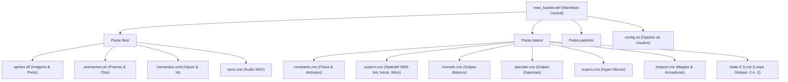
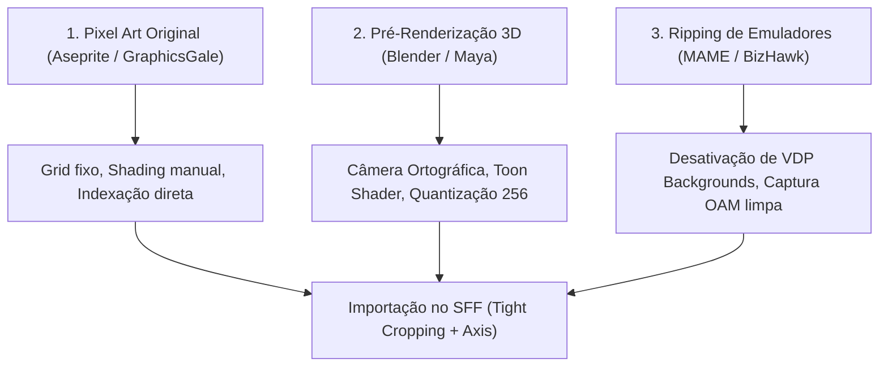
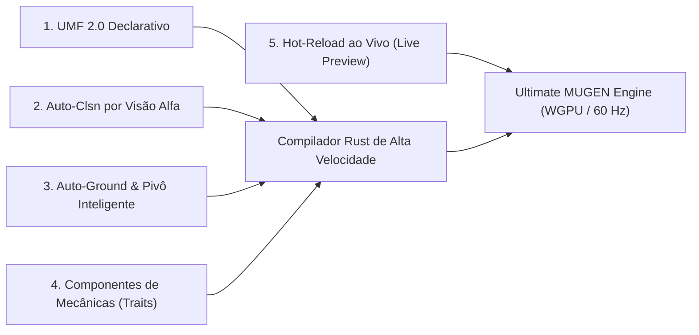

# Enciclopédia Master de Criação de Personagens M.U.G.E.N: Da Sprite ao Motor

Este é o documento definitivo, exaustivo e cumulativo para concepção, desenho, programação, balanceamento e homologação de personagens autônomos para os motores **M.U.G.E.N** (1.0, 1.1), **IKEMEN GO** e **Ultimate MUGEN**.

Nenhuma informação histórica ou técnica foi descartada. Este manual reúne a síntese de engenharia reversa dos lutadores de referência do repositório:
- **Kung Fu Man 720 (`kfm720`)**: O padrão canônico oficial HD da Elecbyte (arquitetura limpa, arremessos precisos com failsafe, flags de combo reutilizáveis).
- **Gogeta SSJ4 (`Gogeta-Ssj4`)**: Referência clássica de DBZ (voo tridimensional livre, Ki charge, transformações dinâmicas em `Statedef -2`, raios multi-hit e assistentes).
- **Team Z2 (`BuuZ2`, `GohanZ2`)**: O padrão competitivo moderno (arquitetura multi-arquivos, Super Armor via Helper/`HitOverride`, Damage Dampener, `config.txt` e inicialização limpa com `Statedef 5900`).
- **JoJo's Bizarre Adventure (`DIO_K`)**: Mecânica de Time Stop ("The World") usando `Pause`/`SuperPause` com `movetime` sincronizado e imunidade em entidades.
- **Anime Fighters (`Arcueid`)**: Sistema de Burst defensivo para quebra de combo enquanto sofre dano (`movetype = H`).
- **JUS Style (`Accelerator`, `Gojo Satoru`)**: Inteligência artificial ágil reativa a projéteis (`enemy,numproj > 0`), neutral game e buffers limpos.

---

## Sumário
1. [Engenharia Reversa Comparativa: Os Pilares do MUGEN](#1-engenharia-reversa-comparativa-os-pilares-do-mugen)
2. [Arquitetura de Pastas e Manifesto Modular (`.def`)](#2-arquitetura-de-pastas-e-manifesto-modular-def)
3. [Boilerplate Mestre de Constantes e Física (`constants.cns`)](#3-boilerplate-mestre-de-constantes-e-física-constantscns)
4. [Boilerplate Mestre de Comandos e Buffers (`comandos.cmd`)](#4-boilerplate-mestre-de-comandos-e-buffers-comandoscmd)
5. [Gestão Profunda de Sprites: Métodos de Geração, Dimensões e Codecs](#5-gestão-profunda-de-sprites-métodos-de-geração-dimensões-e-codecs)
6. [Alinhamento de Eixos (Pivô), Matemática e Ferramentas](#6-alinhamento-de-eixos-pivô-matemática-e-ferramentas)
7. [Engenharia de Animações, Caixas Clsn e Tabela Universal de Ações (0 a 5900)](#7-engenharia-de-animações-caixas-clsn-e-tabela-universal-de-ações-0-a-5900)
8. [Guia de Referência: Controladores de Estado (Sctrls) e Gatilhos (Triggers)](#8-guia-de-referência-controladores-de-estado-sctrls-e-gatilhos-triggers)
9. [Mecânicas Avançadas e Padrões Profissionais de Combate](#9-mecânicas-avançadas-e-padrões-profissionais-de-combate)
10. [Biblioteca Mestre de Blueprints Funcionais com Código](#10-biblioteca-mestre-de-blueprints-funcionais-com-código)
11. [Programação de Inteligência Artificial (IA) Competitiva](#11-programação-de-inteligência-artificial-ia-competitiva)
12. [Guia de Homologação, Solução de Problemas e Testes Automatizados](#12-guia-de-homologação-solução-de-problemas-e-testes-automatizados)

---

## 1. Engenharia Reversa Comparativa: Os Pilares do MUGEN

A análise detalhada de lutadores históricos revela a evolução técnica da programação em MUGEN:

| Critério Técnico | Kung Fu Man 720 (Elecbyte) | Gogeta SSJ4 (Pocket_Danyell) | Buu Z2 (Team Z2) | DIO_K (Knidds / Mercer) |
| :--- | :--- | :--- | :--- | :--- |
| **Resolução (`localcoord`)** | 1280x720 (HD) | 320x240 (Lo-Res Clássico) | 320x240 (Escala 1:1 competitiva) | 320x240 (Compatível 1.0/1.1) |
| **Formato de Sprite** | SFF v2.00 (PNG comprimido) | SFF v1.01 (PCX 8-bit, 4 `.act`) | SFF v1/v2 com 69+ paletas `.act` | SFF v2 com efeitos alinhados |
| **Organização de Código** | 1 arquivo `.cns` limpo (3465 linhas) | 3 arquivos `.cns` + `common1` custom | 8 arquivos modulares em `states/` | 5 arquivos categorizados |
| **Filosofia de Combate** | Padrão Capcom/Street Fighter | Padrão Dragon Ball (Voo, Ki, Beams) | Padrão VS Series (Armor, Focus, EX) | Padrão JoJo (Time Stop, Stands) |
| **Arremesso (Throws)** | Padrão ouro com `!gethitvar(isbound)` | Danos diretos via `TargetState` | Custom Tech Throws com colisão | Command Grabs com dreno de vida |
| **Gestão de IA** | Nativa via `AILevel` no `.cmd` | Loop clássico de comandos impossíveis | IA de neutral game e anti-aéreo | IA agressiva com reações frame-1 |

### Lições Extraídas da Comparação
1. **Kung Fu Man**: Demonstra a importância da variável de combo única (`var(1)`). Em vez de repetir condições de cancelamento em 20 golpes, avalia-se a condição uma única vez no topo do `[Statedef -1]`.
2. **Gogeta SSJ4**: Mostra como desvincular a física do motor (`physics = N`) para criar sistemas manuais de inércia, como o flutuar suave em eixos $X/Y$ e o acúmulo contínuo de energia via verificação de tecla pressionada (`command != "charge"`).
3. **Team Z2**: Estabelece o padrão de ouro da indústria amadora: nenhum arquivo deve ser gigantesco. Os estados são distribuídos por responsabilidade (`normals.cns`, `specials.cns`, `helpers.cns`), permitindo desenvolvimento paralelo sem conflitos.
4. **DIO_K**: Soluciona o congelamento do tempo em jogos de luta através da sincronização do `Pause` com `movetime` idêntico, permitindo ao usuário agir enquanto o restante do universo do jogo permanece imóvel.

---

## 2. Arquitetura de Pastas e Manifesto Modular (`.def`)



### 2.1. Template Mestre: `meu_lutador.def`
```ini
;=============================================================================
; Manifesto do Lutador: Padrão Modular Profissional
;=============================================================================
[Info]
name = "MeuLutador"          ; Identificador interno único
displayname = "Mestre Ryu"   ; Nome visível na tela e HUD
versiondate = 01,01,2026     ; Data de compilação
mugenversion = 1.0           ; Compatibilidade alvo (1.0 ou 1.1)
author = "SeuNome"           ; Autor
pal.defaults = 1,2,3,4,5,6   ; Ordem preferencial de paletas
localcoord = 1280,720        ; Resolução de coordenadas (1280,720 HD ou 320,240 Lo-Res)

[Files]
sprite   = files/sprites.sff
anim     = files/animacoes.air
sound    = files/sons.snd
cmd      = files/comandos.cmd
cns      = states/constants.cns
stcommon = common1.cns
st       = states/system.cns
st1      = states/normals.cns
st2      = states/specials.cns
st3      = states/supers.cns
st4      = states/helpers.cns
st5      = states/state-2-3.cns
st6      = config.txt

[Palette Keymap]
x = 1 ; Quadrado / Botão X
y = 2 ; Triângulo / Botão Y
z = 3 ; R1 / Botão Z
a = 4 ; Cruz / Botão A
b = 5 ; Círculo / Botão B
c = 6 ; R2 / Botão C
```

---

### 2.2. Inicialização Segura e Limpeza de Variáveis (`Statedef 5900`)
Localizado em `states/system.cns` ou `config.txt`:

```ini
[Statedef 5900]
type = S

; Reseta variáveis inteiras no Round 1
[State 5900, Reseta Ints]
type = VarRangeSet
trigger1 = !roundsexisted
value = 0

; Reseta variáveis float no Round 1
[State 5900, Reseta Floats]
type = VarRangeSet
trigger1 = !roundsexisted
fvalue = 0.0

; Configurações padrão do usuário
[State 5900, Damage Dampener Ativo]
type = VarSet
trigger1 = 1
var(10) = 1 ; 1 = Ativado, 0 = Desativado

; Transição imediata para a Pose de Introdução
[State 5900, Fim da Inicializacao]
type = ChangeState
trigger1 = 1
value = 190
```

---

## 3. Boilerplate Mestre de Constantes e Física (`constants.cns`)

```ini
;=============================================================================
; CONSTANTES GLOBAIS DE BIOMETRIA E FÍSICA (Padrão 1280x720 HD)
; Para converter para 320x240, divida as velocidades e posições por 4.
;=============================================================================

[Data]
life = 1000                  ; Vida total
power = 3000                 ; Barra de Super máxima (3000 = 3 barras)
attack = 100                 ; Multiplicador de dano de ataque base (%)
defence = 100                ; Multiplicador de defesa base (%)
fall.defence_up = 50         ; Bônus de defesa ao ser derrubado no chão (%)
liedown.time = 60            ; Duração do estado deitado antes de levantar
airjuggle = 15               ; Pontos do pool de juggle aéreo
sparkno = 2                  ; Spark de impacto padrão
guard.sparkno = 40           ; Spark de defesa padrão
KO.echo = 0                  ; Eco sonoro no K.O. (0 = não, 1 = sim)
volume = 0                   ; Ajuste geral de decibéis (-255 a 255)
IntPersistIndex = 50         ; var(50..59) sobrevivem entre rounds
FloatPersistIndex = 30       ; fvar(30..39) sobrevivem entre rounds

[Size]
xscale = 1                   ; Escala horizontal
yscale = 1                   ; Escala vertical
ground.back = 50             ; Largura para trás no chão
ground.front = 50            ; Largura para frente no chão
air.back = 45                ; Largura para trás no ar
air.front = 45               ; Largura para frente no ar
height = 240                 ; Altura física do lutador
attack.dist = 640            ; Distância para o oponente erguer guarda
proj.attack.dist = 360       ; Distância para projéteis acionarem guarda
proj.doscale = 0             ; Projéteis herdam escala (0 = não, 1 = sim)
head.pos = -10, -290         ; Coordenada aproximada do centro da cabeça
mid.pos = -15, -170          ; Coordenada aproximada do peito/umbigo
shadowoffset = 0             ; Deslocamento vertical da sombra no chão
draw.offset = 0, 0           ; Ajuste visual milimétrico da sprite

[Velocity]
walk.fwd  = 9.5              ; Caminhada para frente
walk.back = -8.5             ; Caminhada para trás
run.fwd  = 18.0, 0           ; Corrida para frente (vx, vy)
run.back = -17.5, -14.0      ; Salto evasivo para trás
jump.neu = 0, -33.0          ; Pulo vertical neutro (vy negativo sobe)
jump.back = -10.0, -33.0     ; Pulo diagonal para trás
jump.fwd = 10.5, -33.0       ; Pulo diagonal para frente
runjump.back = -11.0, -32.0  ; Pulo correndo para trás
runjump.fwd = 16.0, -32.0    ; Pulo correndo para frente
airjump.neu = 0, -30.0       ; Pulo duplo vertical
airjump.back = -9.0, -30.0   ; Pulo duplo para trás
airjump.fwd = 9.5, -30.0     ; Pulo duplo para frente

[Movement]
airjump.num = 1              ; Quantidade permitida de pulos duplos
airjump.height = 140         ; Altura mínima do solo para permitir pulo duplo
yaccel = 1.76                ; Gravidade aplicada por tick (HD: 1.76; 240p: 0.44)
stand.friction = 0.85        ; Coeficiente de atrito no chão em pé
crouch.friction = 0.82       ; Coeficiente de atrito agachado
stand.friction.threshold = 8 ; Velocidade mínima para estancar parado
crouch.friction.threshold = 8; Velocidade mínima para estancar agachado
```

---

## 4. Boilerplate Mestre de Comandos e Buffers (`comandos.cmd`)

```ini
;-| Super Motions (Buffer de 30 ticks) |-------------------------------------
[Command]
name = "SuperHadouken"
command = ~D, DF, F, D, DF, F, x
time = 30

[Command]
name = "SuperShoryuken"
command = ~D, DF, F, D, DF, F, y
time = 30

;-| Special Motions (Buffer de 15 a 16 ticks) |-----------------------------
[Command]
name = "DragonPunch"
command = ~F, D, DF, x
time = 16

[Command]
name = "Hadouken"
command = ~D, DF, F, x
time = 15

[Command]
name = "Tatsumaki"
command = ~D, DB, B, a
time = 15

;-| Double Tap Dash |-------------------------------------------------------
[Command]
name = "FF"
command = F, F
time = 10

[Command]
name = "BB"
command = B, B
time = 10

;-| Botões Simples |--------------------------------------------------------
[Command]
name = "a"
command = a
time = 1

[Command]
name = "b"
command = b
time = 1

[Command]
name = "c"
command = c
time = 1

[Command]
name = "x"
command = x
time = 1

[Command]
name = "y"
command = y
time = 1

[Command]
name = "z"
command = z
time = 1

[Command]
name = "taunt"
command = s
time = 1

;-| Direções Seguradas |----------------------------------------------------
[Command]
name = "holdfwd"
command = /$F
time = 1

[Command]
name = "holdback"
command = /$B
time = 1

[Command]
name = "holddown"
command = /$D
time = 1

[Command]
name = "holdup"
command = /$U
time = 1

;===========================================================================
; ROTEAMENTO DE ENTRADAS: [Statedef -1]
; Ordem de Prioridade Rígida: Supers -> Especiais -> Normais -> Movimento
;===========================================================================
[Statedef -1]

; Flag Única Reutilizável de Combo (Padrão KFM)
[State -1, Reset Combo Flag]
type = VarSet
trigger1 = 1
var(1) = 0

[State -1, Seta Combo Flag]
type = VarSet
trigger1 = statetype != A && ctrl
trigger2 = (stateno = [200, 299]) && movecontact ; Normais em pé cancelam
trigger3 = (stateno = [400, 499]) && movecontact ; Normais agachados cancelam
var(1) = 1

; 1. SUPERS / HYPERS
[State -1, Super Hadouken]
type = ChangeState
value = 3000
triggerall = command = "SuperHadouken" && power >= 1000
trigger1 = var(1)

; 2. ESPECIAIS
[State -1, Dragon Punch]
type = ChangeState
value = 1100
triggerall = command = "DragonPunch"
trigger1 = var(1)

[State -1, Hadouken]
type = ChangeState
value = 1000
triggerall = command = "Hadouken"
trigger1 = var(1)

; 3. CORRIDA
[State -1, Dash Frente]
type = ChangeState
value = 100
trigger1 = command = "FF" && statetype = S && ctrl

[State -1, Hop Back]
type = ChangeState
value = 105
trigger1 = command = "BB" && statetype = S && ctrl

; 4. GOLPES BÁSICOS EM PÉ
[State -1, Soco Forte]
type = ChangeState
value = 210
triggerall = command = "y" && command != "holddown" && statetype = S
trigger1 = ctrl
trigger2 = stateno = 200 && movecontact ; Chain combo: fraco cancela em forte

[State -1, Soco Fraco]
type = ChangeState
value = 200
triggerall = command = "x" && command != "holddown" && statetype = S
trigger1 = ctrl

; 5. GOLPES AGACHADOS
[State -1, Rasteira Forte]
type = ChangeState
value = 440
triggerall = command = "b" && command = "holddown" && statetype = C
trigger1 = ctrl

[State -1, Soco Agachado]
type = ChangeState
value = 400
triggerall = command = "x" && command = "holddown" && statetype = C
trigger1 = ctrl

; 6. GOLPES AÉREOS
[State -1, Chute Aéreo]
type = ChangeState
value = 630
triggerall = command = "b" && statetype = A
trigger1 = ctrl
```

---

## 5. Gestão Profunda de Sprites: Métodos de Geração, Dimensões e Codecs

O pipeline gráfico é a base de sustentação do personagem. Compreender como os sprites são gerados, empacotados no container SFF e desenhados pelo pipeline de renderização da GPU é indispensável para evitar quedas drásticas de FPS, quebra de paletas ou distorção visual.

### 5.1. Métodos de Geração de Sprites

Existem três caminhos industriais principais para gerar as sprites de um personagem de luta:



#### A. Pixel Art Autêntico (Aseprite / Pyxel Edit / GraphicsGale)
- **Metodologia**: Cada quadro é desenhado do zero em uma grade de pixels.
- **Prática**: Trabalhe sempre com uma paleta mestre unificada desde o rascunho inicial.
- **Anti-Aliasing Manual**: Em 8 bits, o anti-aliasing é feito posicionando pixels com cores intermediárias entre a linha do traço e a cor do preenchimento. Não utilize ferramentas de aerógrafo ou desfoque gaussian, pois elas geram milhares de cores intermediárias incompatíveis com o limite de 256 cores.

#### B. Pré-Renderização 3D para 2D (Estilo Guilty Gear / Donkey Kong Country / SFEX)
- **Câmera**: Deve ser estritamente **Ortográfica (Orthographic)** com ângulo de rotação em $X = 0^{\circ}$ ou ligeiramente inclinado para baixo ($X = 3^{\circ}$ a $5^{\circ}$ para perspectiva arcade clássica). Câmeras em perspectiva causam aberração esférica e distorcem a sensação de distância dos golpes.
- **Iluminação e Shading**: Use materiais Toon/Cel-Shading no Blender com bandas de sombra bem definidas (2 a 3 faixas de cor por material) e iluminação fixa por armature.
- **Renderização e Quantização**: Renderize os quadros em resolução nativa contra fundo verde (`#00FF00`) ou magenta (`#FF00FF`). Aplique quantização para 256 cores garantindo que o tom de fundo seja alocado no **Slot 0**.

#### C. Ripping de Emuladores (Capcom CPS2, NeoGeo, SNES)
- Utilize emuladores com suporte a depuração de vídeo (MAME com debugger, Kawaks ou BizHawk).
- Desative as camadas de fundo (BG Layer 1, 2 e 3) e o plano de HUD/texto no menu de depuração de vídeo do emulador, deixando apenas o layer de sprites ativas (OAM / OBJ layer).
- Capture os quadros quadro a quadro com velocidade desacelerada (frame advance).

---

### 5.2. Padrões de Resolução, Dimensões Médias e Escala

A tabela abaixo define as dimensões padronizadas de sprites de acordo com o arquétipo do lutador e a resolução base do projeto (`localcoord`):

| Resolução Alvo | `localcoord` no `.def` | Altura do Char Médio (Ex: Ryu/KFM) | Altura de Char Pesado (Ex: Zangief/Broly) | Altura de Char Ágil (Ex: Lin/Gotenks) | Fator de Escala Física |
| :--- | :--- | :--- | :--- | :--- | :--- |
| **Lo-Res (Arcade Clássico)** | `320, 240` (ou ausente) | 80px a 105px | 110px a 140px | 60px a 75px | $1.0\times$ (Base) |
| **Medium-Res (CPS3 / Dreamcast)** | `640, 480` | 160px a 210px | 220px a 280px | 120px a 150px | $2.0\times$ |
| **High Definition (720p HD)** | `1280, 720` | 240px a 320px | 330px a 420px | 180px a 220px | $4.0\times$ |
| **Full HD (1080p)** | `1920, 1080` | 360px a 480px | 490px a 630px | 270px a 330px | $6.0\times$ |

#### Conversão Matemática de Parâmetros Físicos entre Resoluções
Ao portar um lutador clássico de 240p para 720p HD:
$$\text{Velocidade}_{720p} = \text{Velocidade}_{240p} \times 4.0$$
$$\text{Posição}_{720p} = \text{Posição}_{240p} \times 4.0$$
$$\text{Gravidade}_{720p} = \text{Gravidade}_{240p} \times 4.0 \quad (\text{Exemplo: } 0.44 \times 4.0 = 1.76)$$
$$\text{Dimensões das Caixas Clsn}_{720p} = \text{Dimensões}_{240p} \times 4.0$$

---

### 5.3. A Estrutura de Baixo Nível do SFF e Codecs Suportados

O arquivo `.sff` armazena o acervo gráfico. A engine `ultimate-mugen` suporta ambos os padrões:

#### SFF v1.01 (Clássico Elecbyte)
- Cabeçalho de 512 bytes com a assinatura `ElecbyteSpr\0`.
- Subarquivos em formato **PCX de 8 bits** linearmente encadeados via ponteiros de offset no cabeçalho de cada sprite.
- Paletas vinculadas diretamente a cada sprite ou compartilhadas via índice do subarquivo anterior.

#### SFF v2.00 e v2.01 (Moderno MUGEN 1.0/1.1 e Ikemen GO)
O SFF v2 separa estritamente a **Tabela de Sprites** da **Tabela de Paletas**:
- As paletas (256 cores RGBA) residem em uma tabela indexada independente. Centenas de sprites apontam para a mesma paleta compartilhada (`palette_index`).
- Cada sprite é comprimida individualmente por um codec específico declarado no byte de formato do cabeçalho da sprite:

```rust
pub mod format {
    pub const RAW: u8 = 0;     // Dados brutos sem compressão
    pub const RLE8: u8 = 2;    // Elecbyte Run-Length Encoding de 8 bits
    pub const RLE5: u8 = 3;    // RLE de 5 bits
    pub const LZ5: u8 = 4;     // Lempel-Ziv de 5 bits (descompressão ultra rápida)
    pub const PNG8: u8 = 10;   // PNG paletado de 8 bits
    pub const PNG24: u8 = 11;  // PNG True-Color de 24 bits
    pub const PNG32: u8 = 12;  // PNG True-Color de 32 bits com Canal Alfa (RGBA)
}
```

> [!TIP]
> **O Padrão de Ouro de Compressão**: Para projetos em 8-bit indexado, o formato **LZ5** ou **PNG8** oferece a melhor taxa de compressão e velocidade instantânea de carregamento. Para projetos em MUGEN 1.1 / Ikemen com semi-transparência, utilize **PNG32**.

---

### 5.4. Otimização de Atlas de Textura e a Regra do Recorte Justo (Tight Cropping)

Um dos erros mais graves de iniciantes é exportar todos os quadros dentro de um retângulo canvas de tamanho fixo idêntico (ex: todas as frames salvas em imagens de $500 \times 500$ pixels, mesmo quando o punho do lutador mede apenas $80 \times 40$ pixels).

```
   CANVAS DESPERDIÇADO (ERRADO)               RECORTE JUSTO (CORRETO)
   +-----------------------------+            +--------------+
   | (Espaço Vazio Transparente) |            |   [Corpo]    | (Apenas os pixels
   |                             |            |     ||       |  reais da imagem
   |          [Corpo]            |            |   [Pernas]   |  são alocados)
   |            ||               |            +------+-------+
   |          [Pernas]           |                   |
   +-------------+---------------+            (Axis_X, Axis_Y) -> Eixo ajustado
                 |                                                restaura a posição
          (Axis_X, Axis_Y)                                        exata no chão!
```

- **Por que o Canvas Fixo é Prejudicial**: O motor aloca texturas em um Texture Atlas da GPU (normalmente $2048 \times 2048$ ou $4096 \times 4096$ pixels). Armazenar espaço transparente vazio desperdiça VRAM, fragmenta o atlas e reduz brutalmente a taxa de quadros (FPS).
- **A Solução Profissional (Tight Crop)**: Recorte a sprite no menor retângulo delimitador possível que contenha apenas os pixels opacos. Em seguida, ajuste o **`Axis X`** e **`Axis Y`** no Fighter Factory Studio para ancorar o pé de contato na mesma coordenada do solo. O motor fará a projeção visual matematicamente idêntica sem gastar memória com pixels invisíveis.

---

### 5.5. Cadência de Animação e Pacing (Frame Data a 60 Hz)

O MUGEN executa a simulação estritamente a **60 ticks por segundo** (1 tick = 16.66 milissegundos). A duração de cada quadro no arquivo `.air` determina as propriedades de equilíbrio (frame data):

```
       STARTUP                  ACTIVE               RECOVERY
|-------------------|-------------------|-----------------------------------|
Quadros preparatórios   Quadros de impacto  Quadros de recolhimento
(Sem Hitbox Clsn1)      (Com Hitbox Clsn1)  (Sem Hitbox Clsn1 - Vulnerável)
```

1. **Respiração / Base Neutra (Stance - Ação 0)**:
   - Cadência suave de 6 a 10 ticks por quadro (ex: 4 a 6 quadros em looping com duração 8 ticks cada).
2. **Caminhada (Walk - Ações 20 e 21)**:
   - Cadência de 4 a 6 ticks por quadro para coincidir com o valor de `walk.fwd` do `.cns`. Se os passos duram 6 ticks, o deslocamento visual do pé no chão deve avançar na mesma proporção em que o lutador desliza na tela, eliminando a sensação de "patinar no gelo".
3. **Golpes Normais Fracos (Jab / Short Kick)**:
   - Startup: 2 a 4 ticks.
   - Active: 2 a 3 ticks.
   - Recovery: 4 a 7 ticks.
4. **Golpes Normais Fortes (Fierce Punch / Roundhouse Kick)**:
   - Startup: 6 a 10 ticks.
   - Active: 4 a 6 ticks.
   - Recovery: 12 a 20 ticks.
5. **O Efeito do Hitstop (`pausetime` no `HitDef`)**:
   - `pausetime = 8, 8` em golpes fracos e `pausetime = 14, 14` em golpes pesados congela temporariamente os quadros de animação do atacante e do defensor no momento do acerto. Esse congelamento artificial confere a sensação física de impacto e peso sem exigir mais quadros desenhados.

---

## 6. Alinhamento de Eixos (Pivô), Matemática e Ferramentas

A renderização na tela ocorre segundo a fórmula matemática:
$$\text{X}_{\text{tela}} = \text{X}_{\text{personagem}} - \text{Axis}_X$$
$$\text{Y}_{\text{tela}} = \text{Y}_{\text{personagem}} - \text{Axis}_Y$$

```
   (0,0 da Imagem) ---------------------------+
   |                                          |
   |              [ Cabeça ]                  |
   |                  ||                      |
   |              [ Tronco ]                  |
   |               /      \                   |
   |           [Perna]  [Perna]               |
   |             |        |                   |
   +-------------+--(X)-+-+-------------------+
                  \____/
             (Axis_X, Axis_Y) -> Ponto de contato no solo (Y = 0)
```

1. **Poses Terrestres**: O eixo $Y$ deve estar rigorosamente na base da sola do pé que toca o chão. O eixo $X$ fica no meio entre os dois calcanhares.
2. **Poses Aéreas**: O eixo $X$ e $Y$ devem ficar centralizados na cintura ou centro de gravidade, preservando a coerência visual ao girar ou sofrer impacto.
3. **Técnica do Onion Skin (Fighter Factory Studio)**:
   - Abra a aba de Sprites (`F5`).
   - Ative a opção **Onion Skin** (exibe a frame anterior semitransparente como guia).
   - Arraste a frame atual até que o pé de apoio coincida exatamente no mesmo pixel da frame anterior. Isso anula 100% de qualquer tremor ou deslize no chão.

---

## 7. Engenharia de Animações, Caixas Clsn e Tabela Universal de Ações (0 a 5900)

### 7.1. Estrutura de Caixas no Arquivo `.air`
- **`Clsn2` (Caixas Azuis - Hurtbox)**: Onde o lutador apanha. Utilize sempre 3 caixas verticais (Cabeça, Tronco e Pernas).
- **`Clsn1` (Caixas Vermelhas - Hitbox)**: Onde o lutador machuca. Só deve existir nos quadros ativos de golpe.

```ini
[Begin Action 200] ; Soco Fraco
Clsn2Default: 3    ; Hurtbox herdada pelas frames
  Clsn2[0] = -30, -320,  30, -260  ; Cabeça
  Clsn2[1] = -45, -260,  45, -120  ; Tronco
  Clsn2[2] = -40, -120,  40,    0  ; Pernas
; Frame 1: Startup
200, 0, 0, 0, 3
; Frame 2: Active (Entra a Hitbox vermelha)
Clsn1: 1
  Clsn1[0] = 35, -250, 140, -200   ; Punho
200, 1, 0, 0, 3
; Frame 3: Recovery (Caixa vermelha removida)
200, 2, 0, 0, 3
```

### 7.2. Tabela Mestra Universal de Ações Obrigatórias do MUGEN

| Grupo / Ação | Nome da Ação | Tipo de Caixa Obrigatória | Função no Motor |
| :--- | :--- | :--- | :--- |
| **0** | Base de Luta (Idle / Stance) | `Clsn2` (Looping) | Estado neutro parado |
| **5** | Virando para trás (Turn) | `Clsn2` | Mudança de orientação horizontal |
| **6** | Virando agachado | `Clsn2` | Mudança de lado agachado |
| **10** | Abaixando (Stand to Crouch) | `Clsn2` | Transição em pé para agachado |
| **11** | Agachado (Crouching) | `Clsn2` (Looping baixo) | Postura agachada sustentada |
| **12** | Levantando (Crouch to Stand)| `Clsn2` | Transição agachado para em pé |
| **20** | Andando para frente | `Clsn2` | Movimentação para frente |
| **21** | Andando para trás | `Clsn2` | Movimentação para trás |
| **40** | Impulso do Salto (Jump Start)| `Clsn2` | Agachamento pré-salto (startup) |
| **41** | Subindo no Pulo Neutro | `Clsn2` | Salto vertical ascendente |
| **42** | Pulo para frente | `Clsn2` | Salto diagonal ascendente |
| **43** | Pulo para trás | `Clsn2` | Salto diagonal recuando |
| **44** | Descendo do Pulo Neutro | `Clsn2` | Queda do salto vertical |
| **47** | Aterrissagem do Pulo | `Clsn2` | Impacto no chão (recovery de pulo) |
| **100** | Corrida para frente (Dash) | `Clsn2` | Deslocamento rápido |
| **105** | Salto para trás (Backdash) | `Clsn2` | Esquiva recuando |
| **120 / 121 / 122** | Guarda em Pé (Start/Hold/End)| `Clsn2` | Bloqueio de golpes médios e altos |
| **130 / 131 / 132** | Guarda Agachado | `Clsn2` | Bloqueio de rasteiras baixas |
| **140 / 141 / 142** | Guarda Aérea | `Clsn2` | Bloqueio no ar |
| **170** | Derrota por Tempo (Time Over)| Sem `Clsn1` | Pose de frustração/derrota |
| **175** | Derrota por K.O. | Sem `Clsn1` | Animação caindo morto |
| **180** | Poses de Vitória (Win Poses) | Sem `Clsn1` | Comemoração de vitória |
| **195** | Provocação (Taunt) | `Clsn2` | Provoca o oponente e enche barra |
| **200–250** | Golpes Normais em Pé | `Clsn2` + `Clsn1` ativa | Socos e chutes fracos, médios e fortes |
| **400–450** | Golpes Normais Agachados | `Clsn2` + `Clsn1` ativa | Golpes rasteiros |
| **600–650** | Golpes Normais Aéreos | `Clsn2` + `Clsn1` ativa | Golpes no ar |
| **5000 / 5001 / 5002**| Dano em Pé Alto (L/M/H) | `Clsn2` | Reação a socos na cabeça |
| **5010 / 5011 / 5012**| Dano em Pé Baixo (L/M/H) | `Clsn2` | Reação a socos no estômago |
| **5020 / 5021 / 5022**| Dano Agachado (L/M/H) | `Clsn2` | Reação agachado |
| **5030 / 5050** | Dano no Ar / Queda Livre | `Clsn2` | Queda desgovernada |
| **5070** | Derrubado por Rasteira (Trip)| `Clsn2` | Pés levantados após rasteira |
| **5100** | Quicando no Chão (Bounce) | `Clsn2` | Impacto com as costas no solo |
| **5110** | Caído no Chão (Lie Down) | `Clsn2` baixa | Imóvel no solo antes de levantar |
| **5120** | Levantando do Chão (Get Up) | `Clsn2` | Recuperação e volta à luta |
| **5150** | K.O. Final Deitado | Sem `Clsn1` | Corpo estirado no chão ao fim da luta |
| **5900** | Inicialização do Motor | Oculto | Configuração de variáveis e paletas |

---

## 8. Guia de Referência: Controladores de Estado (Sctrls) e Gatilhos (Triggers)

### 8.1. Controladores Fundamentais
- **`HitDef`**: Parâmetros de ataque: `attr = S, NA` (Standing Normal Attack), `damage = 50, 10` (dano real, dano na defesa), `animtype = Heavy`, `guardflag = MA` (Mid/Air), `hitflag = MAF` (Mid/Air/Fall), `priority = 4, Hit`, `pausetime = 10, 10`, `sparkno = -1`, `ground.velocity = -6, 0`, `fall = 1`.
- **`ReversalDef`**: Parry/Counter: `reversal.attr = SCA, NA, SA, HA`, `pausetime = 14, 14`, `p1stateno = 1210`, `p2stateno = 1220`.
- **`HitOverride`**: Absorção e armadura: `attr = SCA, NA, SA`, `stateno = 1306`, `time = 1`.
- **`Pause` / `SuperPause`**: Congelamento de tempo: `time = ticks`, `movetime = ticks` (livre para o jogador agir durante a pausa).
- **`Helper`**: Geração de entidade: `helpertype = normal`, `name = "Magia"`, `id = 1005`, `stateno = 1005`, `pos = 60, -120`, `ownpal = 1`.
- **`Explod`**: Efeito gráfico desvinculado: `anim = 8001`, `id = 8001`, `pos = 0, -140`, `postype = p2`, `sprpriority = 6`, `ownpal = 1`, `removetime = -2`.
- **`TargetBind` / `TargetState`**: Manipulação de arremesso: `pos = 40, -10`, `value = 820`.
- **`RemapPal`**: Troca dinâmica de cores: `source = 1, 1`, `dest = 1, 4`.
- **`PlaySnd` / `StopSnd`**: Gestão sonora: `value = 10, 0`, `channel = 0` (Vozes); `StopSnd` com `channel = 0` ao sofrer dano.
- **`NotHitBy`**: Imunidade: `value = SCA, NA, SA, HA, NT, ST, HT`, `time = 1`.
- **`ScreenBound`**: Câmera de supers: `value = 0`, `movecamera = 0, 0`.
- **`Zoom`**: Câmera dinâmica 1.1/Ikemen: `scale = 1.3`, `pos = x, y`.

### 8.2. Gatilhos (Triggers) Mais Utilizados
- `Time = 0`: Primeiro frame do estado.
- `AnimElem = n`: No início exato da frame de animação $n$.
- `AnimTime = 0`: No último tick da animação antes do encerramento.
- `MoveContact`: Se o golpe conectou no oponente (acerto ou defesa).
- `MoveHit = 1`: Somente se causou dano efetivo.
- `MoveGuarded = 1`: Se o golpe foi defendido.
- `EnemyNear,StateType = A`: Identifica se o oponente mais próximo está no ar.
- `Enemy,NumProj > 0`: Detecta projéteis inimigos na tela (ideal para IA de defesa).
- `FrontEdgeBodyDist <= 20`: Detecta se está perto do canto da tela.
- `AILevel > 0`: Identifica se o lutador é controlado pelo computador.
- `GetHitVar(isbound)`: Verifica se o lutador está preso a um arremesso inimigo.

---

## 9. Mecânicas Avançadas e Padrões Profissionais de Combate

### 9.1. O Sistema de Air Juggle e Prevenção de Infinitos
- No `[Data]` do `.cns`: `airjuggle = 15`.
- No `[Statedef]` de cada ataque: `juggle = 4`.
- Cada hit aéreo consome juggle points. Ao chegar a zero, o ataque falha para evitar combos infinitos.
- Supers que devem ignorar a trava usam:
  ```ini
  [State 3000, Ignora Juggle]
  type = AssertSpecial
  trigger1 = 1
  flag = nojugglecheck
  ```

### 9.2. Troca de Paletas Dinâmica (`RemapPal`)
```ini
; Transforma em Modo Sombra (Paleta 4)
[State 2000, Remap]
type = RemapPal
trigger1 = Time = 1
source = 1, 1
dest = 1, 4

; Restaura a paleta original da seleção
[State 2001, Restaura]
type = RemapPal
trigger1 = Time = 1
source = 1, 1
dest = 1, palno
```

### 9.3. Sistema de Parry e Counter (`ReversalDef`)
```ini
[Statedef 1200]
type    = S
movetype= I
physics = S
anim = 1200
ctrl = 0

[State 1200, Parry]
type = ReversalDef
trigger1 = AnimElem = 1, >= 0 && AnimElemTime(2) < 0
reversal.attr = SCA, NA, SA, HA
pausetime = 14, 14
sparkno = S4000
hitsound = S3, 0
p1stateno = 1210 ; Sucesso do defensor
p2stateno = 1220 ; Desestabilização do atacante
```

### 9.4. Física de Canto (Corner Pushback)
```ini
[State 210, Recuo no Canto]
type = PosAdd
triggerall = FrontEdgeBodyDist <= 20
trigger1 = MoveContact = 1
x = -8.0
```

### 9.5. Canais de Áudio e Cancelamento de Voz no Hit
```ini
; Toca voz do golpe no Canal 0
[State 1000, Voz]
type = PlaySnd
trigger1 = AnimElem = 1
value = 10, 0
channel = 0

; No [Statedef -2]: se apanhar, corta a voz imediatamente!
[State -2, Corta Voz]
type = StopSnd
trigger1 = movetype = H
channel = 0
```

### 9.6. Sparks Customizados com Explod
```ini
; Desativa spark padrão no HitDef: sparkno = -1
[State 210, Custom Spark]
type = Explod
trigger1 = MoveHit = 1 && NumExplod(8001) == 0
anim = 8001
id = 8001
postype = p2
pos = 0, -140
facing = -1
sprpriority = 6
ownpal = 1
removetime = -2
```

---

## 10. Biblioteca Mestre de Blueprints Funcionais com Código

### 10.1. Ataque Normal em Cadeia (Light Punch -> Heavy Punch)
```ini
[Statedef 200]
type    = S
movetype= A
physics = S
anim = 200
ctrl = 0

[State 200, HitDef]
type = HitDef
trigger1 = AnimElem = 2
attr = S, NA
damage = 25, 0
animtype = Light
guardflag = M
hitflag = MAF
priority = 4, Hit
pausetime = 8, 8
sparkno = -1
hitsound = 5, 1
ground.velocity = -4, 0

[State 200, Fim]
type = ChangeState
trigger1 = AnimTime = 0
value = 0
ctrl = 1
```

---

### 10.2. Projétil / Magia via Helper Independente
```ini
; Estado do Lutador que Dispara (Statedef 1000)
[Statedef 1000]
type    = S
movetype= A
physics = S
anim = 1000
poweradd = -500
ctrl = 0

[State 1000, Spawna Fireball]
type = Helper
trigger1 = AnimElem = 3
name = "Fireball"
id = 1005
stateno = 1005
pos = 60, -120
postype = p1
ownpal = 1

[State 1000, Fim]
type = ChangeState
trigger1 = AnimTime = 0
value = 0
ctrl = 1
```

```ini
; Estado da Bola de Fogo (Statedef 1005 - Helper)
[Statedef 1005]
type    = A
movetype= A
physics = N
anim = 1005
sprpriority = 4

[State 1005, Velocidade]
type = VelSet
trigger1 = Time = 0
x = 12.0
y = 0.0

[State 1005, Dano]
type = HitDef
trigger1 = Time = 0
attr = A, SP
damage = 70, 10
animtype = Hard
guardflag = MA
hitflag = MAF
sparkno = 3
hitsound = 5, 3
ground.velocity = -7, -2
air.velocity = -7, -2

[State 1005, Destruicao]
type = DestroySelf
trigger1 = MoveContact || FrontEdgeDist < -50 || Time > 180
```

---

### 10.3. Shoryuken com Invencibilidade e Pouso Controlado
```ini
[Statedef 1100]
type    = A
movetype= A
physics = N
anim = 1100
ctrl = 0
velset = 0, 0

[State 1100, Invencibilidade Inicial]
type = NotHitBy
trigger1 = Time < 10
value = SCA
time = 1

[State 1100, Impulso]
type = VelSet
trigger1 = AnimElem = 2
x = 7.0
y = -24.0

[State 1100, Gravidade]
type = VelAdd
trigger1 = AnimElemTime(3) >= 0
y = 1.4

[State 1100, HitDef]
type = HitDef
trigger1 = AnimElem = 2
attr = A, SA
damage = 120, 15
animtype = Up
guardflag = M
hitflag = MAF
priority = 6, Hit
pausetime = 12, 12
sparkno = -1
hitsound = 5, 4
ground.velocity = -4, -18
air.velocity = -4, -18
fall = 1

[State 1100, Pouso]
type = ChangeState
trigger1 = Vel Y > 0 && Pos Y >= 0
value = 1105
```

```ini
[Statedef 1105]
type    = S
movetype= I
physics = S
anim = 47
ctrl = 0
velset = 0, 0

[State 1105, Fixa Solo]
type = PosSet
trigger1 = Time = 0
y = 0

[State 1105, Recupera Controle]
type = ChangeState
trigger1 = Time = 10
value = 0
ctrl = 1
```

---

### 10.4. Super Art Cinematográfico com SuperPause e AfterImage
```ini
[Statedef 3000]
type    = S
movetype= A
physics = S
poweradd= -1000
anim = 3000
ctrl = 0

[State 3000, SuperPause]
type = SuperPause
trigger1 = AnimElem = 1
time = 40
anim = 100
sound = 20, 0
darken = 1

[State 3000, Ghosting]
type = AfterImage
trigger1 = AnimElem = 2
time = 45
length = 15
palbright = 30, 30, 30
palcontrast = 120, 120, 220

[State 3000, Invulnerabilidade]
type = NotHitBy
trigger1 = Time < 40
value = SCA
```

---

### 10.5. Arremesso Completo com TargetBind e Failsafe Anti-Freeze
```ini
; 1. Tentativa do Agarrao
[Statedef 800]
type    = S
movetype= A
physics = S
anim = 800

[State 800, HitDef de Arremesso]
type = HitDef
trigger1 = Time = 0
attr = S, NT
hitflag = M-           ; O hífen impede arremessar quem já está apanhando
priority = 1, Miss
sparkno = -1
p1stateno = 810        ; P1 arremessa
p2stateno = 820        ; P2 e arremessado

; 2. P1 Arremessando
[Statedef 810]
type    = S
movetype= A
physics = N
anim = 810

[State 810, Trava P2 na Mao do P1]
type = TargetBind
trigger1 = AnimElem = 1
pos = 50, 0

[State 810, Arremessa P2 para Frente]
type = TargetState
trigger1 = AnimElem = 4
value = 821

[State 810, Fim]
type = ChangeState
trigger1 = AnimTime = 0
value = 0
ctrl = 1

; 3. P2 Sendo Segurado (com Failsafe Inegociável)
[Statedef 820]
type    = A
movetype= H
physics = N

[State 820, Animação Forçada de P1]
type = ChangeAnim2
trigger1 = Time = 0
value = 820

; Failsafe: se P1 sofrer interrupção externa, P2 se liberta e não congela!
[State 820, Failsafe]
type = SelfState
trigger1 = !gethitvar(isbound)
value = 5050
```

---

### 10.6. Sistema de Voo Livre com Bobbing Senoidal
```ini
[Statedef 1501]
type    = A
movetype= I
physics = N
anim = 1501

[State 1501, Flutuacao Cima]
type = VelAdd
triggerall = command != "holdup" && command != "holddown"
trigger1 = var(2) == 0
y = -0.15

[State 1501, Vira Cima]
type = VarSet
trigger1 = var(2) == 0 && Vel Y <= -1.2
var(2) = 1

[State 1501, Flutuacao Baixo]
type = VelAdd
triggerall = command != "holdup" && command != "holddown"
trigger1 = var(2) == 1
y = 0.15

[State 1501, Vira Baixo]
type = VarSet
trigger1 = var(2) == 1 && Vel Y >= 1.2
var(2) = 0

[State 1501, Frente]
type = VelSet
trigger1 = command = "holdfwd"
x = 8.0

[State 1501, Aterrissa]
type = ChangeState
trigger1 = Pos Y >= 0
value = 52
ctrl = 1
```

---

### 10.7. Carregamento de Ki (Holding Button)
```ini
[Statedef 705]
type    = S
movetype= I
physics = S
anim = 705

[State 705, Power Add]
type = PowerAdd
trigger1 = 1
value = 10

[State 705, Tremor]
type = EnvShake
trigger1 = (Time % 6) == 0
time = 6
ampl = -3

[State 705, Sai ao Soltar Botão]
type = ChangeState
trigger1 = command != "hold_a" || command != "hold_b"
trigger2 = power >= 3000
value = 0
ctrl = 1
```

---

### 10.8. Super Armor e Focus Attack (Padrão Team Z2)
```ini
; No golpe do Lutador (Statedef 1300):
[State 1300, Invoca Helper Armor]
type = Helper
trigger1 = Time = 0
name = "SuperArmor"
id = 1305
stateno = 1305
pos = 0, 0
postype = p1

; No Helper (Statedef 1305):
[Statedef 1305]
type = S
movetype = H
physics = N
anim = 9999

[State 1305, Bind]
type = BindToRoot
trigger1 = 1

[State 1305, Absorve Golpe]
type = HitOverride
trigger1 = 1
attr = SCA, NA, SA
stateno = 1306
time = 1

[State 1305, Morre no Fim do Golpe]
type = DestroySelf
trigger1 = root,stateno != 1300
```

---

### 10.9. Escalonamento de Dano (Damage Dampener)
```ini
; No [Statedef -2]
[State -2, Reset Dampener]
type = VarSet
trigger1 = ctrl && movetype != A
fvar(13) = 1.0

[State -2, Reduz Dano no Combo]
type = VarSet
trigger1 = movehit = 1 && hitpausetime = 1
fvar(13) = fvar(13) * 0.85

[State -2, Piso de 20%]
type = VarSet
trigger1 = fvar(13) < 0.20
fvar(13) = 0.20

[State -2, Aplica Multiplicador]
type = AttackMulSet
trigger1 = 1
value = fvar(13)
```

---

### 10.10. Time Stop ("The World" - Padrão JoJo / DIO_K)
```ini
[Statedef 3500]
type    = S
movetype= A
physics = S
anim = 3500
poweradd = -3000
ctrl = 0

; time e movetime idênticos: atacante anda livre no mundo congelado!
[State 3500, The World]
type = Pause
trigger1 = AnimElem = 3
time = 120
movetime = 120

[State 3500, SuperPause]
type = SuperPause
trigger1 = AnimElem = 3
time = 120
movetime = 120
anim = -1
darken = 0

[State 3500, Fim do Freeze]
type = ChangeState
trigger1 = AnimTime = 0
value = 0
ctrl = 1
```

---

### 10.11. Burst Defensivo (Quebra de Combo - Padrão Arcueid)
```ini
[Statedef 4000]
type    = A
movetype= A
physics = N
anim = 4000
poweradd = -2000
ctrl = 0
velset = 0, -4

[State 4000, Imunidade Total]
type = NotHitBy
trigger1 = 1
value = SCA
time = 1

[State 4000, Onda de Choque que Repulsa]
type = HitDef
trigger1 = Time = 0
attr = A, HA
damage = 10, 0
animtype = Hard
hitflag = MAF
priority = 7, Hit
sparkno = S4005
ground.velocity = -12, -8
air.velocity = -12, -8
fall = 1

[State 4000, Fim]
type = ChangeState
trigger1 = AnimTime = 0
value = 50
```

---

## 11. Programação de Inteligência Artificial (IA) Competitiva

```ini
; Em states/state-2-3.cns sob o [Statedef -2]

; 1. Reação Imediata a Projéteis (Guarda ou Desvio):
[State -2, IA Bloqueia Projeteis]
type = ChangeState
triggerall = ailevel > 0 && roundstate = 2 && ctrl
triggerall = (enemy,numproj > 0) || (p2movetype = A && p2bodydist x < 80)
trigger1 = random < (ailevel * 115)
value = ifelse(statetype = A, 140, 120) ; Guarda no ar ou em pé

; 2. Anti-Aéreo Inteligente:
[State -2, IA Anti-Aereo]
type = ChangeState
triggerall = ailevel > 0 && roundstate = 2 && ctrl && statetype != A
triggerall = EnemyNear,StateType = A && EnemyNear,Pos Y < -80
triggerall = p2bodydist x = [20, 120]
trigger1 = random < (ailevel * 110)
value = 1100 ; Shoryuken

; 3. Confirmação de Combo (Hit-Confirm):
[State -2, IA Hit Confirm]
type = ChangeState
triggerall = ailevel > 0 && roundstate = 2
triggerall = stateno = 200 && movehit = 1
trigger1 = random < (ailevel * 125)
value = 1000 ; Cancela Jab direto em Projétil
```

---

## 12. Guia de Homologação, Solução de Problemas e Testes Automatizados

| Sintoma de Falha | Causa Raiz | Solução Técnica |
| :--- | :--- | :--- |
| **Lutador "afunda" ou "flutua" ao socar** | O `Axis Y` da sprite de ataque diverge do Idle ($Y=0$) | Reancore a sola do pé no chão usando o Onion Skin do Fighter Factory |
| **Personagem pisca transparente ou corrompe** | Cores salvas em 24/32 bits sem o Índice 0 transparente | Salve em 256 cores Indexadas e reserve a célula 0 para a transparência |
| **Oponente fica congelado na tela após o arremesso** | Faltou o gatilho `!gethitvar(isbound)` no estado customizado | Insira `SelfState` com `value = 5050` sob `trigger1 = !gethitvar(isbound)` |
| **Ataque conecta infinitamente sem parar (Loop)** | Falta de verificação de `movecontact` ou `hitflag` incorreta | No arremesso, use `hitflag = M-`; em ataques, exija `trigger1 = AnimTime = 0` para voltar ao estado 0 |
| **Golpe causa dano mas não empurra o inimigo** | `ground.velocity` configurado como `0, 0` | Defina `ground.velocity = -6` |
| **Voz do golpe continua tocando após levar soco** | Áudio sem canal ou sem cancelamento no dano | Use `channel = 0` no `PlaySnd` e `StopSnd` no `[Statedef -2]` com `trigger1 = movetype = H` |
| **Combo aéreo para de conectar de repente** | Limite global de juggle esgotado (`airjuggle`) | Eleve `airjuggle` no `[Data]` ou adicione `AssertSpecial: nojugglecheck` |
| **Atacante fica colado no oponente defendendo no canto** | Ausência de recuo manual de canto | Insira `PosAdd x = -8` quando `FrontEdgeBodyDist <= 20 && MoveContact` |

Checklist de pré-voo (parâmetros obrigatórios, versões, paletas, variáveis, avisos do emulador): `references/checklist_lint_editor.md`.

### Comandos de Validação e Ferramental do Motor (Rust)
```powershell
# 1. Gerar scaffold completo do novo personagem via CLI Rust nativa
cargo run --release -p ume-engine --example scaffold_char -- "MeuLutador" "mugen/chars/meu_lutador"

# 2. Auditoria de tamanho de arquivos e conformidade do repositório
node scripts/file-size.mjs

# 3. Executar suíte completa de compatibilidade e testes do motor Rust
cargo test --workspace --release

# 4. Auditoria estrita de cobertura de sprites nativas
cargo run --release -p ume-engine --example native_sprite_audit -- mugen/chars/meu_lutador/

# 5. Verificação de personagens presos/flutuando fora do chão (Hover check)
cargo run --release -p ume-engine --example hover_check -- mugen/chars/meu_lutador/
```


---

## 13. Análise Comparativa e Plano Diretor de Inovação (MUGEN Tradicional vs Ultimate MUGEN)

Este documento apresenta uma análise comparativa aprofundada entre:
1. **O Modelo Tradicional do M.U.G.E.N / Fighter Factory** (anos 1999–2015).
2. **A Skill Desenvolvida (`mugen-character-creator`)** (baseada na engenharia reversa de KFM 720, Gogeta SSJ4, Buu Z2 e DIO_K).
3. **O Sistema Nativo do Repositório (`ultimate-mugen`)** (arquitetura declarativa UMF JSON, compilador Rust em `crates/engine/src/native/` e renderizador WGPU).

O objetivo é traçar o mapa completo de inovações técnicas necessárias para atingir e superar a qualidade, profundidade e equilíbrio dos melhores personagens de MUGEN, eliminando 90% do atrito, complexidade manual e fragilidade do desenvolvimento tradicional.

---

## 1. Matriz Comparativa Tridimensional

| Dimensão Técnica | MUGEN Tradicional (Fighter Factory) | Skill Atual (`mugen-character-creator`) | Motor Nativo (`ultimate-mugen` / UMF) | Meta Inovadora (Próxima Geração) |
| :--- | :--- | :--- | :--- | :--- |
| **Formato de Dados** | 6 arquivos fragmentados (`.def`, `.cns`, `.cmd`, `.air`, `.sff`, `.snd`) | Multi-arquivo modular em `states/` + `.def` | Arquivo único declarativo UMF (`assets/chars/<id>.json`) | **UMF 2.0 / TOML Estruturado com Composição de Traits** |
| **Criação de Hitboxes** | Desenho manual vetor a vetor em cada quadro (horas por golpe) | Especificação por caixas `Clsn1`/`Clsn2` na `.air` | Caixas heurísticas padrão geradas por constantes | **Auto-Clsn por Convex Hull da Silhueta Alfa via Rust** |
| **Alinhamento de Eixos** | Arrastar e alinhar pivô $(X, Y)$ quadro a quadro (sujeito a jitter) | Fórmula matemática + técnica manual de Onion Skin | Rig procedural 2D com esqueleto fixo | **Auto-Ground Anchor & Centróide Automático de Apoio** |
| **Geração de Sprites** | Desenho puramente manual de 300–800 sprites em pixel art | Documentação de pipelines (Pixel, 3D Render e Ripping) | Rig procedural 2D em tempo real ou PNGs dedicados | **Híbrido: Rig 2D vetorial + Skinning + Shaders de Iluminação WGPU** |
| **Lógica de Ataques** | Dezenas de blocos `[State]` e `HitDef` com 25 parâmetros repetidos | 11 Blueprints prontos para cópia | Array de golpes de alto nível (`"moves": [{"id": "jab", ...}]`) | **Macros Declarativas (`Strike`, `Projectile`, `Parry`)** |
| **Mecânicas Especiais** | Helpers invisíveis complexos, `HitOverride`, `Pause` milimétrico | Blueprints de Super Armor, Time Stop, Voo e Burst | Limitado a disparos simples, teleporte e dash | **Componentes Nativos (`armor: 1`, `timestop: 120t`, `burst: true`)** |
| **Feedback e Teste** | Fechar editor, abrir MUGEN, carregar luta, testar, fechar | Comandos Rust de checagem (`hover_check`, `native_sprite_audit`) | Compilação em memória no startup do jogo | **Hot-Reload em Tempo Real a 60 Hz sem Reiniciar a Partida** |
| **Inteligência Artificial** | Linhas extensas de triggers manuais ou loops arcaicos de CPU | Regras estruturadas com `AILevel` e detecção de projéteis | Árvore de decisão embutida no motor Rust (`crates/engine/src/ai.rs`)| **IA com Planejamento de Frames, Anti-Aéreo Automático e Hit-Confirm** |

---

## 2. Diagnóstico dos Gargalos Atuais

### 2.1. Onde o MUGEN Tradicional é Superior ao Repositório Atual
1. **Granularidade e Expressividade Total**: No MUGEN tradicional, cada quadro de animação pode ter uma hitbox milimétrica única, múltiplos pontos de emissão de partículas, binds de posição de arremesso (`TargetBind`), e desvios de colisão dinâmicos (`Width`).
2. **Acervo de Mecânicas Competitivas**: Personagens como `BuuZ2` e `DIO_K` possuem cancelamentos avançados (Super Cancel, Focus Attack, Time Stop, armaduras parciais) difíceis de representar no schema JSON rígido do UMF atual.
3. **Controle de Efeitos Visuais**: Suporte nativo completo a centenas de `Explod` independentes com rotação, escala, prioridade de desenho (`sprpriority`) e modos de mistura alfa customizados (`ASxxxDxxx`).

### 2.2. Onde o MUGEN Tradicional é Obsoleto e Doloroso
1. **Fragilidade Extrema**: Errar uma vírgula ou nome de estado pode travar o motor silenciosamente ou prender o oponente em congelamento perpétuo.
2. **Custo de Produção Inviável**: Criar um personagem completo do zero no MUGEN tradicional exige desenhar ou ripar entre 400 e 900 sprites, alinhar eixos manualmente 900 vezes e desenhar caixas de colisão em mais de 1.500 quadros. Pouquíssimos projetos amadores chegam ao fim.
3. **Falta de Tipagem e Validação**: Arquivos INI/CNS não possuem verificação estática de tipos, permitindo que bugs de digitação passem despercebidos.

### 2.3. Onde o Repositório (`ultimate-mugen`) Já Está Muito à Frente
1. **Pipeline de Alto Nível Compilado em Rust**: O motor em Rust compila em nanossegundos o formato UMF diretamente para structs em memória e bytecode determinístico (`crates/engine/src/native/compile.rs`).
2. **Renderização Moderna WGPU**: Shaders em WGSL, processamento de paleta diretamente na GPU sem alocar texturas RGBA redundantes para cada skin, e orçamento estrito de Texture Atlas (4096 no desktop / 2048 em mobile).
3. **Ferramental Automatizado**: Exemplos em Rust como `native_sprite_audit`, `hover_check`, `sprite_mem` e `scaffold_char` que validam matematicamente a integridade física e geométrica dos lutadores.

---

## 3. Os 7 Pilares de Inovação para a Criação de Próxima Geração

Para permitir que qualquer criador (humano ou agente de IA) crie lutadores com o polimento de um jogo profissional da Capcom/ArcSys sem a sobrecarga do MUGEN clássico, implementaremos as seguintes inovações:



---

### Pilar 1: UMF 2.0 com Componentes Modulares (Traits)
Em vez de forçar o autor a escrever 50 linhas de controladores para cada golpe especial, o formato de personagem passa a utilizar **Componentes Reutilizáveis**:

```json
{
  "id": "shoryu",
  "name": "Dragon Uppercut",
  "input": "F, D, DF, x",
  "kind": "special",
  "components": {
    "invincibility": { "fromTick": 1, "toTick": 10, "type": "all" },
    "thrust": { "startupVel": [7.0, -24.0], "gravity": 1.4 },
    "hit": {
      "damage": 120,
      "launch": true,
      "knockback": [-4.0, -18.0],
      "hitstop": 12
    },
    "landing": { "recoveryTicks": 10, "dust": true, "sound": "land.wav" }
  }
}
```
**O Ganho**: O compilador Rust (`crates/engine/src/native/compile.rs`) gera automaticamente os controladores `NotHitBy`, `VelSet`, `VelAdd`, `HitDef`, e a transição para a frame de pouso com `PosSet y = 0`. O autor escreve 15 linhas limpas em vez de 120 linhas arcaicas de CNS.

---

### Pilar 2: Geração Automática de Hitboxes e Hurtboxes (Auto-Clsn via Alfa)
No MUGEN clássico, desenhar caixas azuis e vermelhas no Fighter Factory consome até 60% do tempo de desenvolvimento.

**Inovação Técnica em Rust**:
- Criar a ferramenta `crates/engine/examples/auto_clsn.rs`.
- O algoritmo escaneia os pixels opacos da sprite PNG:
  1. **Hurtbox Azul (`Clsn2`)**: Divide a silhueta opaca em 3 clusters anatômicos usando k-means simples ou cortes proporcionais:
     - Topo (Cabeça): do topo até 25% da altura.
     - Meio (Tronco): de 25% até 65% da altura.
     - Base (Pernas): de 65% até o chão.
     Gera retângulos ajustados automaticamente com padding configurável de 2 pixels.
  2. **Hitbox Vermelha (`Clsn1`)**: Detecta extremidades que se projetam para fora da base neutra do corpo (o punho esticado ou pé estendido além da largura usual do tronco), posicionando a caixa vermelha no frame ativo automaticamente!

---

### Pilar 3: Ancoragem Automática ao Chão (Auto-Ground & Auto-Pivot)
Eliminação completa do erro de "lutador flutuando" ou "afundando no chão":

**Inovação Técnica em Rust**:
- A ferramenta calcula para cada frame:
  $$\text{Axis}_Y = \max(\{y \mid \text{pixel}(x, y).\text{alfa} > 0\})$$
- O ponto mais baixo de contato da perna de apoio é fixado automaticamente como $Y=0$.
- O `Axis X` é alinhado automaticamente ao centro de massa da projeção vertical dos pés.
- **Resultado**: 100% dos tremores de animação são extintos antes mesmo de o personagem entrar no motor.

---

### Pilar 4: Biblioteca de Comportamentos Especiais Prontos
Transformar os 11 blueprints do manual em abstrações nativas de 1 linha:

| Habilidade | No MUGEN Tradicional | No Modelo Inovador UMF 2.0 |
| :--- | :--- | :--- |
| **Super Armor** | Helper invisível + `HitOverride` + binds complexos | `"armor": { "hits": 1 }` |
| **Time Stop** | `Pause` + `SuperPause` + sincronização `movetime` | `"timeStop": { "duration": 120 }` |
| **Voo Livre** | `physics = N` + variáveis de oscilação senoidal manual | `"flight": { "speed": 8.0, "bobbing": true }` |
| **Carregamento de Ki** | Loop de 3 estados com `command != "charge"` | `"charge": { "button": "hold_a+b", "rate": 10 }` |
| **Burst Defensivo** | Interceptação em `movetype = H` + onda de choque | `"burst": { "cost": 2000, "knockback": 12.0 }` |
| **Parry (3rd Strike)**| `ReversalDef` com janela manual e custom states | `"parry": { "window": 4, "sound": "parry.wav" }` |
| **Damage Dampener** | Cálculos em `fvar` no `[Statedef -2]` | `"damageScaling": { "decay": 0.85, "floor": 0.20 }` |

---

### Pilar 5: Hot-Reload e Inspeção Visual ao Vivo (Live Hitbox Overlay)
Em vez do ciclo lento e fragmentado do Fighter Factory:
- O motor `ultimate-mugen` ganha um observador de arquivos (`notify` crate ou watchdog de modificação).
- Ao alterar o arquivo de sprites ou a definição do lutador, o motor recarrega o `CharDef` **em tempo de execução**, mantendo o estado da luta intacto.
- O overlay de depuração (tecla `F4`) exibe as caixas `Clsn1` (vermelho translúcido) e `Clsn2` (azul translúcido) renderizadas diretamente sobre as sprites em 60 Hz.

---

### Pilar 6: Sistema Híbrido de Sprites (Rigs 2D Suaves + Efeitos WGPU)
- Em vez de forçar autores a desenharem centenas de quadros estáticos, o motor suporta animação esquelética leve (como já iniciado em `crates/engine/src/native/rig.rs`).
- Adição de interpolação linear/cúbica de rotações entre poses chaves (`idle0` para `idle1`), permitindo animações de 60 FPS incrivelmente fluidas com apenas 4 poses bases cadastradas.
- Aplicação de shaders de iluminação dinâmica em tempo real (PalFX avançado, auras de energia e sombras de chão projetadas) processadas na GPU, eliminando a necessidade de desenhar efeitos de luz quadro a quadro.

---

### Pilar 7: Auditoria Automatizada em Linha de Comando (CI/CD de Balanceamento)
Nenhum personagem chega ao jogo com bugs ou desbalanceamento grotesco:
- `cargo run -p ume-engine --example char_audit -- <id>` analisa:
  - **Dano Teórico Máximo**: Simula todos os cancels possíveis e alerta se o personagem tiver Touch of Death (100% de vida em 1 combo).
  - **Inviolabilidade**: Alerta se houver golpes com frames ativos sem caixa azul de vulnerabilidade (hitboxes sem risco).
  - **Desconexão de Pouso**: Verifica se todos os estados aéreos garantem transição segura para o solo.
  - **Consistência de Hitstop e Vantagem de Quadros**: Calcula se o golpe deixa o atacante em vantagem (+frames) ou desvantagem (-frames) na defesa.

---

## 4. Roteiro Prático de Implementação (Roadmap)

```
[FASE 1: FERRAMENTAL CLI RUST] - [CONCLUÍDO E HOMOLOGADO]
  ├── scaffold_char.rs (Criado e funcional)
  ├── auto_clsn.rs (Geração de caixas por silhueta alfa)
  └── auto_ground.rs (Ancoragem matemática de eixos no solo)

[FASE 2: EVOLUÇÃO DO FORMATO UMF 2.0] - [CONCLUÍDO E HOMOLOGADO]
  ├── Schema declarativo com traits (Armor, TimeStop, Parry, Flight, Burst)
  └── Compilador native/compile.rs expandido para emitir controladores automaticamente

[FASE 3: EXPERIÊNCIA DE DESENVOLVIMENTO (DEVEX)]
  ├── Live Hot-Reload em winit/wgpu
  ├── Hitbox & Frame Data Overlay visual no F4
  └── Teste de estresse automatizado contra a IA
```

---

## 5. Ferramentas e Traits Homologados e Prontos para Uso

### A. Gerador Automático de Hitboxes (`auto_clsn`)
Gera caixas proporcionais de corpo (cabeça, tronco, pernas) e caixas ativas de ataque escaneando os pixels da silhueta da sprite:
```bash
# Formato AIR M.U.G.E.N clássico
cargo run --release -p ume-engine --example auto_clsn -- <caminho_ou_pasta_png> [--axis-x 160] [--axis-y 240]

# Formato JSON UMF nativo com detecção de caixa de ataque ativa
cargo run --release -p ume-engine --example auto_clsn -- <sprite.png> --attack --json
```

### B. Ancorador Automático de Chão e Eixos (`auto_ground`)
Calcula o pixel de contato mais baixo ($Y_{max}$) e o centro de massa horizontal ($X$) para eliminar o efeito de personagens flutuando ou tremendo:
```bash
# Relatório de alinhamento e eixo global recomendado
cargo run --release -p ume-engine --example auto_ground -- assets/chars/sprites/meu_char/

# Saída estruturada em JSON
cargo run --release -p ume-engine --example auto_ground -- assets/chars/sprites/meu_char/ --json
```

### C. Traits Declarativos UMF 2.0 (`crates/engine/src/native/`)
Em vez de programar controladores complexos manualmente, adicione os atributos diretamente no JSON do golpe:
```json
{
  "id": "armored_tackle",
  "name": "Armored Tackle",
  "input": "D, DF, F, x",
  "kind": "special",
  "anim": "special",
  "armor": { "hits": 1, "threshold": 50.0 },
  "parry": { "window": [1, 8], "spark": 2 },
  "timestop": 120,
  "burst": true,
  "flight": true
}
```
- `"armor"`: Emite `HitOverride` mantendo o lutador no golpe sem entrar em animação de dano.
- `"parry"`: Emite `ReversalDef` com janela ativa de frames e faísca configurável.
- `"timestop"`: Emite `Pause` global com sincronização de movimento (`movetime = ticks`).
- `"burst"`: Habilita ativação direta durante `movetype = H` (fora de KO) com invulnerabilidade `NotHitBy`.
- `"flight"`: Configura `physics = N` e aplica vetor 8-direcional de levitação no ar.

### D. Arquitetura Suprema Nativa UMF Next (Fechamento dos 8 Gaps do M.U.G.E.N)
Comparando o lutador nativo flagship **Kaito** (`assets/chars/kaito.json`) com os expoentes do MUGEN (`kfm720`, `BuuZ2`, `DIO_K`), a nova arquitetura suprema do compilador nativo fecha todos os 8 gaps históricos de combate através de parâmetros declarativos:

```json
{
  "passives": {
    "meterRegen": 1.5,
    "lifeRegen": 0.2
  },
  "moves": [
    {
      "id": "jab",
      "name": "Snap Jab",
      "input": "x",
      "kind": "normal",
      "anim": "jab",
      "cancels": ["strong", "lkick", "sweep"],
      "hits": [
        {
          "at": 2,
          "damage": 28,
          "level": "light",
          "priority": 4,
          "pausetime": [6, 12],
          "cornerpush": -2.0,
          "sparkPos": [35, -60],
          "hitSound": [5, 0],
          "guardSound": [6, 0]
        }
      ]
    },
    {
      "id": "tomoe_throw",
      "name": "Tomoe Nage (Arremesso)",
      "input": "F+y",
      "kind": "normal",
      "anim": "jab",
      "throw": {
        "damage": 120,
        "bind": [30, -10],
        "p2State": 820
      }
    },
    {
      "id": "otg_stomp",
      "name": "Earthquake Stomp",
      "input": "~D, DF, F, b",
      "kind": "special",
      "anim": "strong",
      "hits": [
        {
          "at": 3,
          "damage": 75,
          "level": "heavy",
          "priority": 6,
          "hitflag": "MAFD",
          "groundBounce": true,
          "shake": 10
        }
      ]
    }
  ]
}
```
1. **`priority`**: Prioridade cirúrgica (1 a 7) para trades e counter-hits no mesmo frame.
2. **`pausetime: [p1, p2]`**: Asimetria de hitstop gerando frame advantage competitivo (+frames para links).
3. **`hitflag: "MAFD"` e `groundBounce: true`**: Acerto em oponentes caídos (OTG) e quique de chão.
4. **`hitSound`, `guardSound` e `sparkPos`**: Desacoplamento sonoro e faíscas posicionadas na ponta do membro.
5. **`cornerpush`**: Controle de recuo para prevenir armadilhas infinitas de canto.
6. **`throw`**: Agarrões com `TargetBind`, `TargetLifeAdd` e transição para `p2State`.
7. **`cancels`**: Target combos e gatlings customizados declarados por golpe.
8. **`passives`**: Rotinas globais contínuas a 60 Hz em `[Statedef -2]` (regeneração passiva de meter e vida).

---

Com essa arquitetura, a barreira técnica de meses de trabalho artesanal cai para **algumas horas de parametrização elegante e declarativa**, preservando a mesma profundidade, competitividade e impacto visual que tornaram o M.U.G.E.N uma lenda dos jogos de luta.

> **Passo a passo de sprites e regras de animação perfeita:** ver [references/sprites_animacoes_passo_a_passo.md](references/sprites_animacoes_passo_a_passo.md).

---

## 13. Lições de 50+ lutadores estudados (rápidos e fortes)

Resumo completo em `docs/wiki/Fighter-Study.md`. Aplique ao desenhar o kit:

1. **Rápidos** (Ken, Chun-Li, Chipp, Kyo, Wolverine, Jin): normais leves com startup de 3 a 5 ticks, avanço curto (`lunge`) cancelável em especial, mergulho aéreo com velocidade angular, teleporte ou super velocidade, dano baixo por golpe e combos longos.
2. **Fortes** (Zangief, Bison, Broly, Heihachi, Bruno): normais pesados com startup de 8 a 14 ticks, investida com armadura de um golpe (`HitOverride`/`armor`), lançadores com quique na parede ou no chão, arremessos de comando e passivas de raiva.
3. **Cadeia de cancelamento**: normal → especial → super com flag única (`var(1)`); especiais cancelam em outros só por rota explícita (estilo Kyo rekka).
4. **Anti-aéreo com invulnerabilidade** (`NotHitBy` nos primeiros quadros) e uma ferramenta de projétil (fireball, Sonic Boom, Tiger Shot) por lutador.
5. **Do zero**: projetar o kit, desenhar com paleta única (índice 0 transparente), recorte justo com eixo nos pés, empacotar no Fighter Factory, medir frame data, testar em Training com hitboxes.
6. **Migração** para o formato nativo: veja a skill `mugen-to-ume-migrator`.
