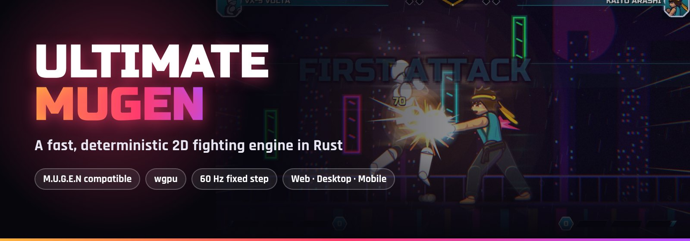
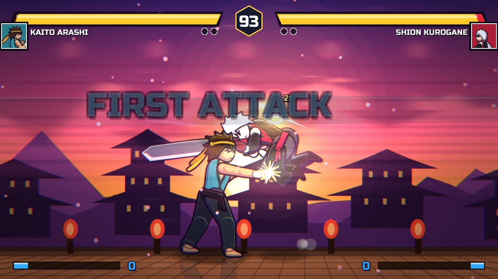
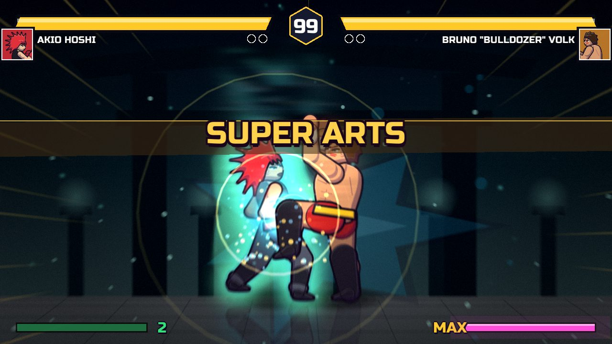
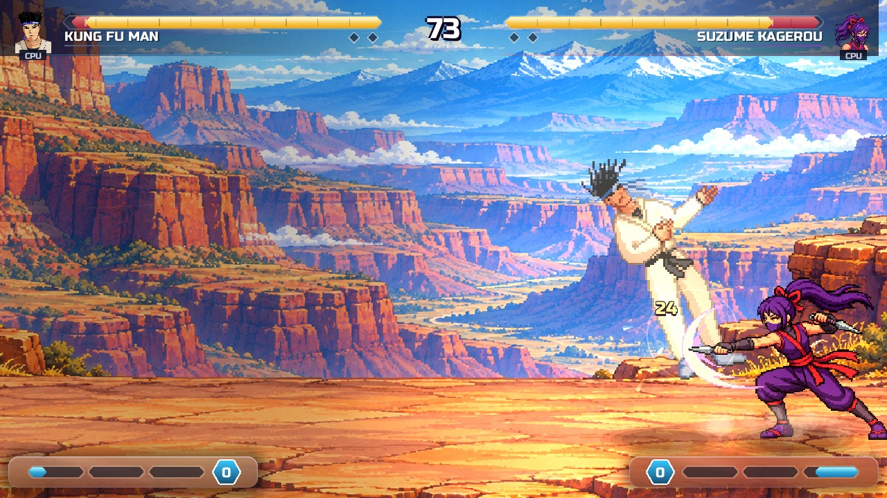
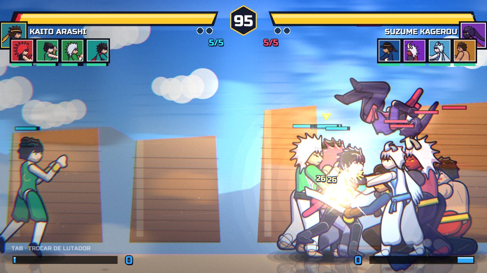
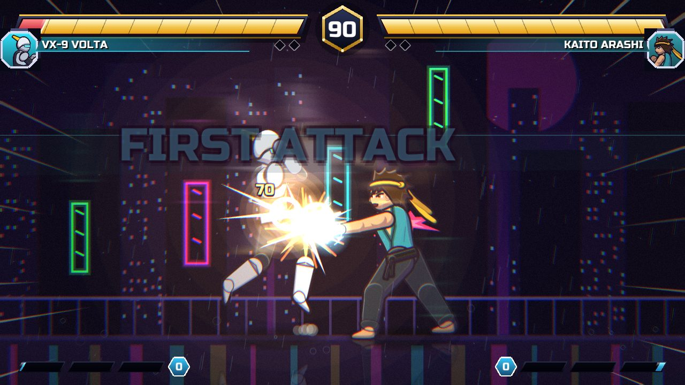
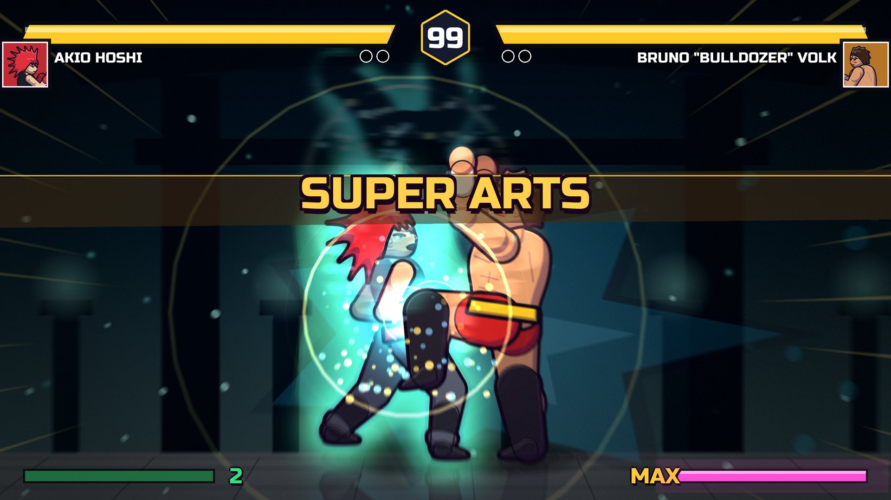
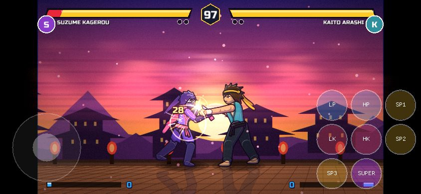

<p align="center">
  
</p>

<p align="center">
  <a href="https://juninmd.github.io/ultimate-mugen/"></a>
  <a href="https://github.com/juninmd/ultimate-mugen/releases/latest"></a>
</p>

<p align="center">
  <a href="https://github.com/juninmd/ultimate-mugen/actions/workflows/ci.yml"></a>
  <a href="LICENSE"></a>
  
  
  
</p>

<p align="center">
  <b>English</b> · <a href="README.pt-BR.md">Português (BR)</a>
</p>

<p align="center">
  <b>A modern 2D fighting game engine built from scratch in Rust.</b><br>
  Runs classic M.U.G.E.N characters and stages, ships its own declarative fighter format,<br>
  and puts performance and determinism first, on desktop, mobile and the web.
</p>

---

## ✨ At a glance

<table>
<tr>
<td width="33%" valign="top">

### ⚡ Fast
Parallel SFF decode and sprite conversion, palettes applied on the GPU, frame pacing locked to your refresh rate and **zero allocations per simulation tick**.

</td>
<td width="33%" valign="top">

### 🎯 Deterministic
Fixed 60 Hz simulation, deterministic PRNG and no garbage collector. The same inputs always give the same fight, which powers **replays and rollback netplay**.

</td>
<td width="33%" valign="top">

### 🕹️ Compatible
`.def`, `.sff` v1/v2, `.air`, `.cmd`, `.cns`, `.snd`, `.act` and stages. Expression VM, **90+ state controllers**, helpers, projectiles and HD `localcoord`.

</td>
</tr>
<tr>
<td valign="top">

### 🌍 Everywhere
One codebase on **wgpu + winit**: Vulkan, Metal, DX12, GLES and WebGL2. Windows, Linux, macOS, browser (WASM, ~3 MB), Android and iOS.

</td>
<td valign="top">

### 🎨 Polished
True 4K, bloom, chromatic aberration, cinematic supers, particles, floor reflections, animated HUD and an option to reduce effects for accessibility.

</td>
<td valign="top">

### 🎮 Great to play
Keyboard, touch, Xbox, DualShock 4 and DualSense with **rumble and lightbars**. Arcade, Versus, Training, Sequence 3v3 and Parallel up to **5v5**.

</td>
</tr>
</table>

<p align="center">
  
</p>

| | |
|---|---|
|  |  |
|  |  |
|  |  |

---

## 🚀 Performance first

Speed is a feature here, and every claim below is measurable from the repo.

| Area | What the engine does |
|---|---|
| **Loading** | SFF v2 payloads (LZ5, RLE5, RLE8, PNG) and palette conversion run on all cores; linked sprites share pixels and GPU uploads. Characters load on a background thread behind the VS screen. |
| **GPU memory** | Indexed M.U.G.E.N sprites live in an 8-bit atlas and get their colors from a palette row in the WGSL shader: **4× less upload and atlas space** than RGBA. `RemapPal` just swaps the row. |
| **Smooth frames** | `Pacer` snaps frame time to the display period, so 60 Hz screens get exactly one tick per frame. Fighter sprites and sounds are prefetched before the round starts. |
| **Simulation** | Fixed step with a cap of 5 ticks per frame (no spiral of death) and a test that guards **zero allocations per tick**. |
| **Big rosters** | The select screen draws only visible rows and loads only the portrait under the cursor, with an LRU cache. Hundreds of imported characters register in seconds. |

Reference (4 cores, release): `kfm720` loads in **27 ms** (was 85 ms), `kfm` in **7 ms**.

```bash
cargo run --release -p ume-engine --example mugen_load_bench   # M.U.G.E.N load time
cargo test -p ume-engine --release --test tick_alloc           # zero allocations per tick
```

Details in the [Performance wiki page](docs/wiki/Performance.md).

---

## 🏁 Quick start

**Play now:** open the [web build](https://juninmd.github.io/ultimate-mugen/) and drag a character `.zip` into the window.

**Desktop:**

```bash
git clone https://github.com/juninmd/ultimate-mugen
cd ultimate-mugen
cargo run --release
```

Linux needs a few system packages first:

```bash
sudo apt-get install -y pkg-config libudev-dev libasound2-dev libx11-dev libxi-dev libgl1-mesa-dev
```

**Bring your M.U.G.E.N content:** put characters in `mugen/chars/` (folder or `.zip`) and stages in `mugen/stages/`, or point `UME_MUGEN_DIR` to an existing install.

<details>
<summary><b>More build targets and flags</b></summary>

```bash
cargo run --release -- --4k             # 3840×2160 window (or --res 2560x1440, --fullscreen)
cargo run --release -- --touch          # on-screen touch controls
cargo run --release -- --mute           # start without audio
cargo run --release -- --shots out/     # automated tour that saves screenshots
cargo test --workspace --release
```

**Web / PWA**

```bash
rustup target add wasm32-unknown-unknown
./scripts/build-web.sh
python3 -m http.server -d web/dist 8080
```

**Android**

```bash
cargo install cargo-apk --version 0.9.6 --locked
cargo apk build -p ultimate-mugen --lib --release --target aarch64-linux-android
```

**iOS**: `cargo install cargo-bundle`, then `cargo bundle --release --target aarch64-apple-ios` on macOS with Xcode.

</details>

---

## 🎮 Controls

Keyboard, multiple gamepads and touch work at the same time. Move lists show the real key or button of the device in use.

<details>
<summary><b>Full controls table</b></summary>

| Action | Keyboard (P1) | Keyboard (P2) | DualShock 4 / DualSense / XInput | Touch |
|---|---|---|---|---|
| **Move / Jump / Crouch** | Arrow keys | `I` `K` `J` `L` | D-Pad or left stick | Virtual stick |
| **Light Punch** | `Q` (or `V`) | Numpad `4` | `□` / `X` | **LP** |
| **Heavy Punch** | `W` (or `B`) | Numpad `5` | `△` / `Y` | **HP** |
| **Extra Punch (Z)** | `E` (or `N`) | Numpad `6` | `R1` / `RB` | — |
| **Light Kick** | `A` (or `Z`) | Numpad `1` | `✕` / `A` | **LK** |
| **Heavy Kick** | `S` (or `X`) | Numpad `2` | `○` / `B` | **HK** |
| **Extra Kick (C)** | `D` (or `C`) | Numpad `3` | `R2` / `RT` | — |
| **Quick specials** | `1`, `2`, `3` | Numpad `7`, `8`, `9` | `L1`, `L2` | **ESPECIAL**, **SUPER** |
| **Super** | `1` + `2` | Numpad `7` + `8` | `L1` + `L2` | **SUPER** |
| **Transformation** | `T` | Numpad `0` | Right stick / `SELECT` | — |
| **Pause / Hitboxes** | `Esc` / `F2` | `Esc` / `F2` | `OPTIONS` / `START` | `❚❚` |
| **Fullscreen / FPS** | `F11` / `F3` | — | — | — |
| **Switch fighter (parallel team)** | `Tab` | — | — | — |

DualShock 4 and DualSense get native USB and Bluetooth HID reports: proportional rumble for hits, blocks, supers and KOs, and a lightbar that is blue for P1, red for P2 and flashes white during a super.

</details>

---

## 🧱 Architecture

A Cargo workspace that keeps parsing, simulation and presentation apart:

```
crates/
├── formats/   pure M.U.G.E.N parsers and decoders (SFF, AIR, SND, ACT, stages, VFS over folders and zips)
├── engine/    deterministic fight VM, expressions, 90+ controllers, collisions, AI, UMF compiler
├── netplay/   rollback netcode
├── render/    wgpu renderer: atlases, batched sprites, palettes in WGSL, post-processing
└── shell/     winit window, input, text, audio, frame pacing
src/           screens, HUD, gamepads and HID, audio synthesis
web/           HTML shell, PWA and JS glue
```

M.U.G.E.N characters and native **UMF** fighters (one declarative JSON file each, hitboxes generated from the skeleton) compile to the **same state machine**, so both fight under identical rules. See the [UMF guide](docs/CHARACTER_FORMAT.md).

---

## 📚 Documentation

- **[Wiki](docs/wiki/Home.md)**: installation, configuration, UMF characters, CNS scripts, stages, screenpacks, netplay and performance.
- [Roadmap](docs/ROADMAP.md) · [AAA features](docs/AAA_FEATURES.md) · [Roster](docs/ROSTER.md) · [Format research](docs/research-mugen-en.md)

---

## 🤝 Contributing

Contributions are welcome. Before opening a PR:

```bash
cargo fmt --check
cargo clippy --workspace --tests
cargo test --workspace
cargo check --target wasm32-unknown-unknown
```

Use [Conventional Commits](https://www.conventionalcommits.org/) (`feat:`, `fix:`, `perf:` …), since they drive automatic releases. Code, commits and docs are in English; Portuguese lives in `*.pt-BR.md` and `docs/wiki/pt-BR/`.

<details>
<summary><b>Releases and update check</b></summary>

The git tag is the source of truth for the version. On every push to `master`, the `Release` workflow plans the bump from commits (`feat` → minor, `fix`/`perf` → patch), builds Linux, Windows and macOS, uploads packages with `latest.json` and `SHA256SUMS.txt`, verifies the draft and publishes it.

The desktop game checks `latest.json` in the background (HTTPS only, silent when offline) and only shows a notice on the title screen. Nothing is downloaded or run automatically. Disable it with `--no-update-check` or `UME_NO_UPDATE_CHECK=1`.

</details>

---

## 🙏 Acknowledgments

Thanks to the [Ikemen GO](https://github.com/ikemen-engine/Ikemen-GO) team and to Elecbyte, creator of M.U.G.E.N, for the inspiration.

## 📄 License

Ultimate MUGEN is released under the [MIT License](LICENSE). Bundled fonts (*Russo One*, *Rajdhani*) are under the SIL Open Font License.

Copyrighted third-party characters are **not included or distributed** with the engine. Ultimate MUGEN loads M.U.G.E.N content that users import themselves.
