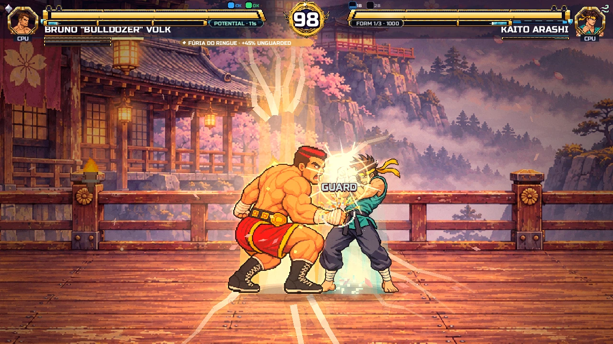
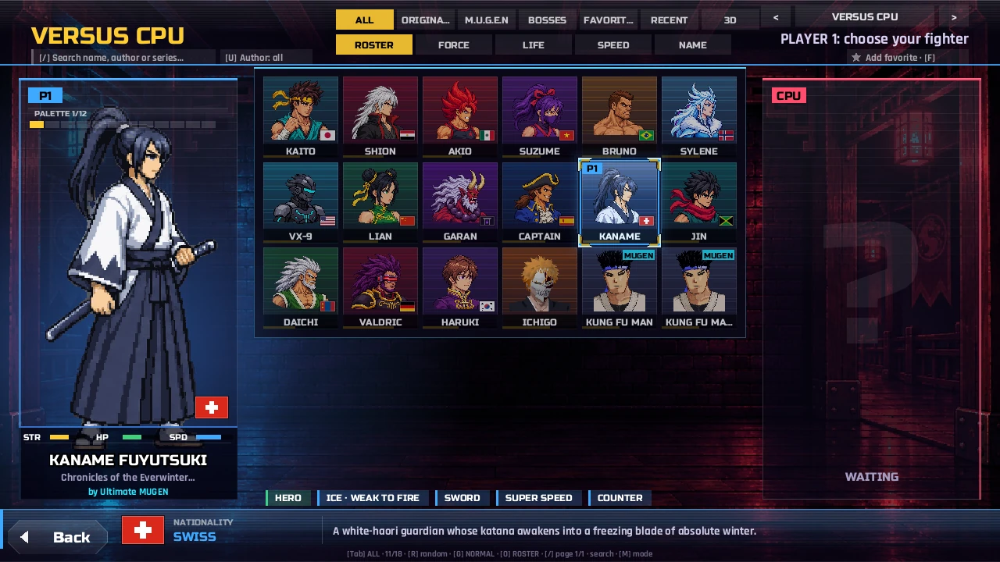
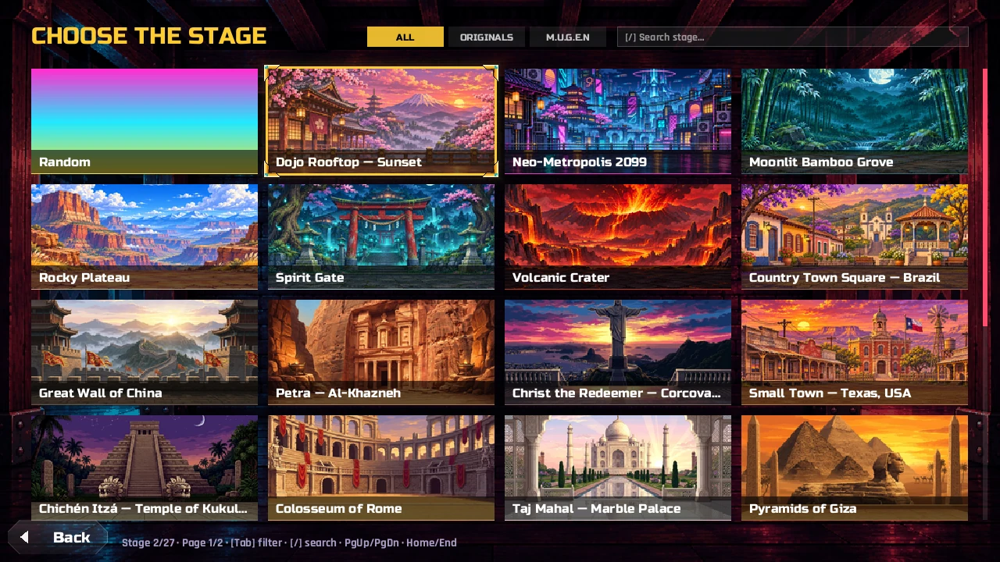
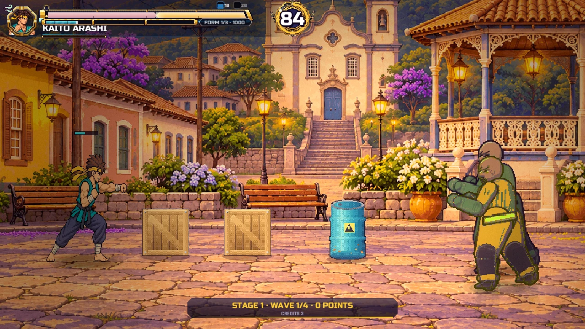

# Ultimate MUGEN

An open-source 2D fighting game engine written in Rust. Play with the original pixel-art roster, import M.U.G.E.N fighters and stages, or create your own fighters in UMF.

**[Play in your browser](https://juninmd.github.io/ultimate-mugen/)** · **[Download for desktop](https://github.com/juninmd/ultimate-mugen/releases/latest)** · [Wiki](https://juninmd.github.io/ultimate-mugen/wiki/) · [Português (BR)](README.pt-BR.md)



## How to play

- **Browser.** Open the web build and choose a mode from the main menu. To add a character, drop a `.zip` onto the window or use **Import M.U.G.E.N**.
- **Desktop.** Download the release for Windows, Linux or macOS. Add characters to `mugen/chars/` and stages to `mugen/stages/`, or point `UME_MUGEN_DIR` to an existing installation. [Installation guide](docs/wiki/Installation.md)
- **Controls.** Play with a keyboard, gamepad or touch. On keyboard, player 1 moves with the arrow keys, punches with `Q` and `W`, and kicks with `A` and `S`. [Controls table](#controls)

## In-game screenshots

These screenshots come from the desktop and browser builds.

| Fighter select | Stage select |
| --- | --- |
|  |  |



## Game modes and creation tools

- **Matches and training.** Arcade, Versus CPU, 2 Players, Training, CPU vs CPU, Survival, Tower, Power Arena, and Sequence, Parallel and Tag teams. The game also includes online rollback, replays, Combo Trials and Photo Mode. [Game modes](docs/wiki/Game-Modes.md) · [Netplay and replays](docs/wiki/Netplay-and-Replays.md)
- **Story Mode.** Progress through five side-scrolling stages with enemy waves, bosses, breakable objects and bonus rounds. Each native fighter has a dedicated epilogue. [Story Mode](docs/wiki/Story-Mode.md)
- **Community content.** Import M.U.G.E.N fighters and stages and use the GitHub Marketplace to install characters, stages and music from public repositories. [M.U.G.E.N content](docs/wiki/MUGEN-Content.md) · [Marketplace](docs/wiki/Marketplace.md)
- **Fighter creation.** UMF defines moves, animations, passives and transformations in JSON and uses PNG sprites. The `mugen2umf` converter provides a CLI, an MCP server and parity checks against the source character. [UMF guide](docs/wiki/UMF-Character.md)

## Build from source

Install the [stable Rust toolchain](https://rustup.rs/) to build from source. On Debian or Ubuntu, install the system dependencies first.

```bash
sudo apt-get install -y pkg-config libudev-dev libasound2-dev libx11-dev libxi-dev libgl1-mesa-dev
```

```bash
git clone https://github.com/juninmd/ultimate-mugen
cd ultimate-mugen
cargo run --release
```

<details>
<summary><b>More build targets and flags</b></summary>

```bash
cargo run --release -- --4k             # 3840×2160 window (or --res 2560x1440, --fullscreen)
cargo run --release -- --touch          # on-screen touch controls
cargo run --release -- --mute           # start without audio
cargo run --release -- --shots out/     # automated tour that saves screenshots
cargo test --workspace --release
```

**Web / PWA**

```bash
rustup target add wasm32-unknown-unknown
cargo install wasm-bindgen-cli --locked --version "$(awk '/^name = "wasm-bindgen"$/{getline; gsub(/"/,"",$3); print $3}' Cargo.lock)"
./scripts/build-web.sh
python3 -m http.server -d web/dist 8080
```

**Android**

```bash
cargo install cargo-apk --version 0.9.6 --locked
cargo apk build -p ultimate-mugen --lib --release --target aarch64-linux-android
```

**iOS.** `cargo install cargo-bundle`, then `cargo bundle --release --target aarch64-apple-ios` on macOS with Xcode.

</details>

---

## Controls

Keyboard, multiple gamepads and touch work at the same time. Move lists show the real key or button of the device in use.

<details>
<summary><b>Full controls table</b></summary>

| Action | Keyboard (P1) | Keyboard (P2) | DualShock 4 / DualSense / XInput | Touch |
|---|---|---|---|---|
| **Move / Jump / Crouch** | Arrow keys | `I` `K` `J` `L` | D-Pad or left stick | Virtual stick |
| **Light Punch** | `Q` | Numpad `4` | `□` / `X` | **LP** |
| **Heavy Punch** | `W` | Numpad `5` | `△` / `Y` | **HP** |
| **Extra Punch (Z)** | `E` | Numpad `6` | — | — |
| **Light Kick** | `A` | Numpad `1` | `✕` / `A` | **LK** |
| **Heavy Kick** | `S` | Numpad `2` | `○` / `B` | **HK** |
| **Extra Kick (C)** | `D` | Numpad `3` | — | — |
| **Quick specials** | `V`, `B`, `N` | Numpad `7`, `8`, `9` | — | **ESPECIAL**, **SUPER** |
| **Move shortcuts** (bind in the pause menu) | `1`, `2`, `3`, `4` | — | `L1`, `L2`, `R1`, `R2` | — |
| **Transformation** | `T` | Numpad `0` | `L3` + `R3` / `SELECT` | — |
| **Charge ki** | `R` | Numpad `.` | `R3` (alone) | — |
| **Pause / Hitboxes** | `Esc` / `Enter` / `F2` | `Esc` / `Enter` / `F2` | `OPTIONS` / `START` | `❚❚` |
| **Fullscreen / FPS** | `F11` / `F3` | — | — | — |
| **Switch fighter (parallel team)** | `Tab` | — | — | — |

DualShock 4 and DualSense get native USB and Bluetooth HID reports: proportional rumble for hits, blocks, supers and KOs, and a lightbar that is blue for P1, red for P2 and flashes white during a super.

</details>

---

## Architecture

The deterministic simulation runs at 60 Hz and powers replays and rollback. The Rust workspace separates M.U.G.E.N parsers (`crates/formats`), the simulation (`crates/engine`), the UMF compiler (`crates/native`), the wgpu renderer (`crates/render`) and windowing, audio and input (`crates/shell`).

The same combat engine runs M.U.G.E.N and UMF fighters in a single match. The renderer looks up palettes on the GPU when drawing indexed sprites. [Engine architecture](docs/wiki/Engine.md) · [Compatibility decisions](docs/wiki/Compatibility-Decisions.md)

## Performance

Sprite decoding runs in parallel on desktop. In the browser, ZIP import spreads work across frames to keep progress visible and allow cancellation. Engine tests check that the simulation runs without allocations per tick. [Performance guide](docs/wiki/Performance.md)

```bash
cargo run --release -p ume-engine --example mugen_load_bench
cargo test -p ume-engine --release --test it tick_alloc::
```

## 📚 Documentation

- **[Wiki site](https://juninmd.github.io/ultimate-mugen/wiki/)** ([sources](docs/wiki/Home.md)): installation, configuration, UMF characters, CNS scripts, stages, screenpacks, netplay and performance.
- [Contributing guide](CONTRIBUTING.md) · [Architecture](docs/wiki/Architecture.md) · [ADRs](docs/wiki/adr/README.md)
- [Roadmap](docs/ROADMAP.md) · [AAA features](docs/AAA_FEATURES.md) · [Roster](docs/ROSTER.md) · [Format research](docs/research-mugen-en.md)

---

## 🤝 Contributing

Contributions are welcome. Read the [contributing guide](CONTRIBUTING.md) first. Before opening a PR:

```bash
cargo clippy --workspace --tests
cargo test --workspace
cargo check --target wasm32-unknown-unknown
```

Use [Conventional Commits](https://www.conventionalcommits.org/) (`feat:`, `fix:`, `perf:` …), since they drive automatic releases. Code, commits and docs are in English; Portuguese lives in `*.pt-BR.md` and `docs/wiki/pt-BR/`.

<details>
<summary><b>Releases and automatic updates</b></summary>

The git tag is the source of truth for the version. On every push to `master`, the `Release` workflow plans the bump from commits (`feat` → minor, `fix`/`perf` → patch), builds Linux, Windows and macOS, uploads the packages, a raw executable per platform plus `latest.json` and `SHA256SUMS.txt`, verifies the draft and publishes it.

The installed desktop build checks `latest.json` at boot (HTTPS only) and shows an update panel with the installed and the available versions; downloading the raw executable for its platform starts only after the player accepts. Accepting verifies the manifest `sha256` and the downloaded binary's `--version`, then replaces the executable and restarts on the title/menu screen. Progress and failures show on the title screen; offline, a failed check or an unwritable install directory leave the running build untouched. Hide the prompt with `--no-auto-update` / `UME_NO_AUTO_UPDATE=1`, or skip the check itself with `--no-update-check` / `UME_NO_UPDATE_CHECK=1`. `--check-update` only prints the available version and `--update` downloads and installs from a terminal.

</details>

---

## 🙏 Acknowledgments

Thanks to the [Ikemen GO](https://github.com/ikemen-engine/Ikemen-GO) team and to Elecbyte, creator of M.U.G.E.N, for the inspiration.

## 📄 License

Ultimate MUGEN is released under the [MIT License](LICENSE). Bundled fonts (*Russo One*, *Rajdhani*) are under the SIL Open Font License.

Copyrighted third-party characters are **not included or distributed** with the engine. Ultimate MUGEN loads M.U.G.E.N content that users import themselves.
