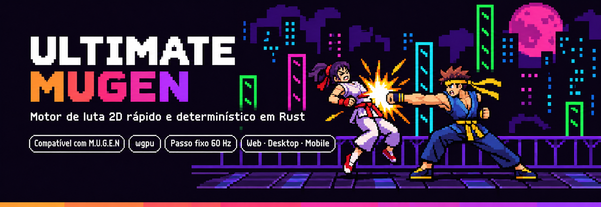
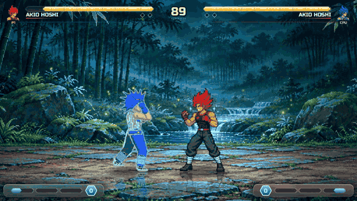
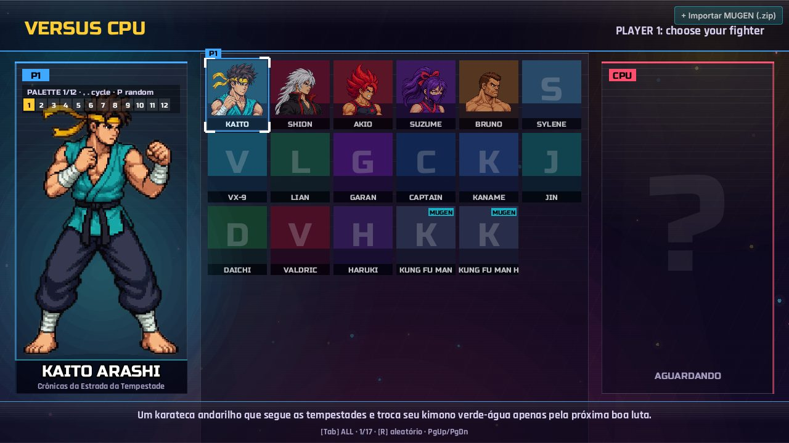
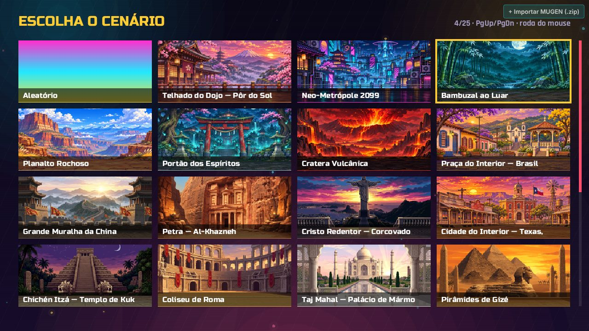
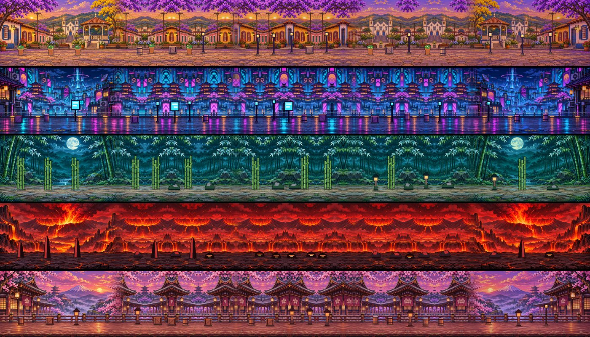
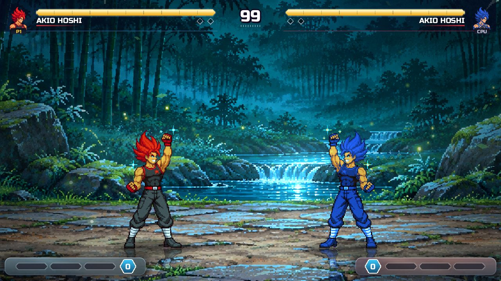
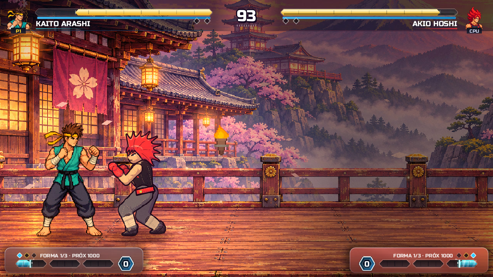

<p align="center">
  
</p>

<p align="center">
  <a href="https://juninmd.github.io/ultimate-mugen/"></a>
  <a href="https://github.com/juninmd/ultimate-mugen/releases/latest"></a>
</p>

<p align="center">
  <a href="https://github.com/juninmd/ultimate-mugen/actions/workflows/ci.yml"></a>
  <a href="LICENSE"></a>
  
  
  
</p>

<p align="center">
  <a href="README.md">English</a> · <b>Português (BR)</b>
</p>

<p align="center">
  <b>Um motor moderno de luta 2D escrito do zero em Rust.</b><br>
  Roda personagens e cenários clássicos do M.U.G.E.N, tem seu próprio formato declarativo de lutadores<br>
  e coloca desempenho e determinismo em primeiro lugar, no desktop, no celular e na web.
</p>

---

## ✨ Em resumo

<table>
<tr>
<td width="33%" valign="top">

### ⚡ Rápido
Decodificação de SFF e conversão de sprites em paralelo, paletas aplicadas na GPU, ritmo de quadros travado na taxa do monitor e **zero alocações por tick de simulação**.

</td>
<td width="33%" valign="top">

### 🎯 Determinístico
Simulação fixa a 60 Hz, PRNG determinístico e sem coletor de lixo. As mesmas entradas sempre geram a mesma luta, base para **replays e netplay com rollback**.

</td>
<td width="33%" valign="top">

### 🕹️ Compatível
`.def`, `.sff` v1/v2, `.air`, `.cmd`, `.cns`, `.snd`, `.act` e cenários. VM de expressões, **90+ state controllers**, helpers, projéteis e `localcoord` HD.

</td>
</tr>
<tr>
<td valign="top">

### 🌍 Em todo lugar
Um só código com **wgpu + winit**: Vulkan, Metal, DX12, GLES e WebGL2. Windows, Linux, macOS, navegador (WASM, ~3 MB), Android e iOS.

</td>
<td valign="top">

### 🎨 Caprichado
4K de verdade, bloom, aberração cromática, supers cinematográficos, partículas, reflexos no chão, HUD animado e opção de reduzir efeitos para acessibilidade.

</td>
<td valign="top">

### 🎮 Gostoso de jogar
Teclado, toque, Xbox, DualShock 4 e DualSense com **vibração e lightbar**. Arcade, Versus, Treino, Sequência 3v3 e Paralelo até **5v5**.

</td>
</tr>
</table>

---

## 🖼️ Elenco em pixel art, mapas e jogabilidade

<p align="center">
  
</p>

<p align="center"><i>Jogabilidade real capturada da versão web (renderização por software, por isso o GIF roda abaixo da taxa de quadros nativa).</i></p>

### Lutadores em pixel art

O elenco nativo é desenhado em pixel art arcade de 32 bits, com um conjunto de poses dedicado por lutador, paletas, especiais de ki, voo, teletransporte e transformações. Cada personagem é declarado em um único JSON UMF.



### Mapas

21 arenas ilustradas, do telhado do dojo ao pôr do sol e uma metrópole neon até as maravilhas do mundo (Petra, Taj Mahal, Cristo Redentor, Coliseu, Grande Muralha, Chichén Itzá e mais), cada uma com camadas de ambiente vivas e sua própria trilha embutida.



O **modo História** traz cinco extensões longas e roláveis das arenas (Brasil, Neon, Bambu, Vulcão e Dojo): um trecho por luta, quatro ondas de capangas mais um chefe de fase, com a vida carregada entre as lutas. Veja o [guia do modo História](docs/wiki/Story-Mode.md).



<table>
<tr>
<td width="50%"></td>
<td width="50%"></td>
</tr>
</table>

---

## 🆕 Novidades

- **Modo História:** cinco fases de ondas, capangas com traços próprios e um chefe por fase, com cutscenes e finais. [Guia](docs/wiki/Story-Mode.md)
- **Música e áudio:** uma trilha embutida por cenário, sons de golpe em níveis, música abaixando nos impactos e torcida no KO. [Áudio](docs/wiki/Audio.md)
- **Atalhos de golpe:** ligue qualquer golpe da lista de pausa em `1`-`4` (gamepad `L1`/`L2`/`R1`/`R2`); `L3` + `R3` transforma e `R3` sozinho carrega ki. [Controles](docs/wiki/pt-BR/Configuracao.md#controles)
- **Golpes mais ricos:** todo lutador nativo tem especiais EX, hyper nível 3, explosão de escape, forma ascendida com hyper próprio e versões aéreas dos especiais. [Kit compartilhado](docs/wiki/Characters.md#shared-toolkit)
- **Atualização automática e releases:** cada merge no `master` publica uma release e a versão desktop avisa, pergunta e só então se atualiza. [Atualização automática](docs/wiki/pt-BR/Atualizacao-Automatica.md)
- **Compatibilidade M.U.G.E.N:** correções achadas ao carregar personagens reais da comunidade (saídas de andar e defesa, provocações, intros, ações AIR duplicadas). [Decisões de compatibilidade](docs/wiki/pt-BR/Decisoes-de-Compatibilidade.md)

---

## 🚀 Desempenho em primeiro lugar

Velocidade é funcionalidade aqui, e tudo abaixo pode ser medido no próprio repositório.

| Área | O que o motor faz |
|---|---|
| **Carregamento** | Payloads SFF v2 (LZ5, RLE5, RLE8, PNG) e conversão de paleta usam todos os núcleos; sprites ligados compartilham pixels e uploads na GPU. Personagens carregam numa thread em segundo plano atrás da tela de VS. |
| **Memória de GPU** | Sprites indexados do M.U.G.E.N ficam num atlas de 8 bits e recebem as cores de uma linha de paleta no shader WGSL: **4× menos upload e espaço de atlas** que RGBA. `RemapPal` só troca a linha. |
| **Quadros suaves** | O `Pacer` alinha o tempo de quadro ao período da tela, então monitores de 60 Hz recebem exatamente um tick por quadro. Sprites e sons dos lutadores são pré-carregados antes do round. |
| **Simulação** | Passo fixo com limite de 5 ticks por quadro (sem espiral da morte) e um teste que garante **zero alocações por tick**. |
| **Elencos grandes** | A tela de seleção desenha só as linhas visíveis e carrega só o retrato sob o cursor, com cache LRU. Centenas de personagens importados são registrados em segundos. |

Referência (4 núcleos, release): `kfm720` carrega em **27 ms** (antes 85 ms), `kfm` em **7 ms**.

```bash
cargo run --release -p ume-engine --example mugen_load_bench   # tempo de carga M.U.G.E.N
cargo test -p ume-engine --release --test tick_alloc           # zero alocações por tick
```

Detalhes na [página de Desempenho da wiki](docs/wiki/pt-BR/Desempenho.md).

---

## 🏁 Começo rápido

**Jogue agora:** abra a [versão web](https://juninmd.github.io/ultimate-mugen/) e arraste um `.zip` de personagem para a janela.

**Desktop:**

```bash
git clone https://github.com/juninmd/ultimate-mugen
cd ultimate-mugen
cargo run --release
```

No Linux, instale alguns pacotes antes:

```bash
sudo apt-get install -y pkg-config libudev-dev libasound2-dev libx11-dev libxi-dev libgl1-mesa-dev
```

**Traga seu conteúdo M.U.G.E.N:** coloque personagens em `mugen/chars/` (pasta ou `.zip`) e cenários em `mugen/stages/`, ou aponte `UME_MUGEN_DIR` para uma instalação existente. Também dá para instalar personagens, cenários e músicas de qualquer repositório público do GitHub em **Mercado GitHub** (menu principal); veja o [guia do mercado](docs/wiki/pt-BR/Mercado.md).

<details>
<summary><b>Outros alvos de build e flags</b></summary>

```bash
cargo run --release -- --4k             # janela 3840×2160 (ou --res 2560x1440, --fullscreen)
cargo run --release -- --touch          # controles de toque na tela
cargo run --release -- --mute           # inicia sem áudio
cargo run --release -- --shots out/     # tour automático que salva capturas
cargo test --workspace --release
```

**Web / PWA**

```bash
rustup target add wasm32-unknown-unknown
./scripts/build-web.sh
python3 -m http.server -d web/dist 8080
```

**Android**

```bash
cargo install cargo-apk --version 0.9.6 --locked
cargo apk build -p ultimate-mugen --lib --release --target aarch64-linux-android
```

**iOS**: `cargo install cargo-bundle` e depois `cargo bundle --release --target aarch64-apple-ios` no macOS com Xcode.

</details>

---

## 🎮 Controles

Teclado, vários controles e toque funcionam ao mesmo tempo. As listas de golpes mostram a tecla ou botão real do dispositivo em uso.

<details>
<summary><b>Tabela completa de controles</b></summary>

| Ação | Teclado (P1) | Teclado (P2) | DualShock 4 / DualSense / XInput | Toque |
|---|---|---|---|---|
| **Mover / Pular / Agachar** | Setas | `I` `K` `J` `L` | D-Pad ou analógico esquerdo | Analógico virtual |
| **Soco fraco** | `Q` | Numpad `4` | `□` / `X` | **LP** |
| **Soco forte** | `W` | Numpad `5` | `△` / `Y` | **HP** |
| **Soco extra (Z)** | `E` | Numpad `6` | — | — |
| **Chute fraco** | `A` | Numpad `1` | `✕` / `A` | **LK** |
| **Chute forte** | `S` | Numpad `2` | `○` / `B` | **HK** |
| **Chute extra (C)** | `D` | Numpad `3` | — | — |
| **Especiais rápidos** | `V`, `B`, `N` | Numpad `7`, `8`, `9` | — | **ESPECIAL**, **SUPER** |
| **Atalhos de golpe** (ligue no menu de pausa) | `1`, `2`, `3`, `4` | — | `L1`, `L2`, `R1`, `R2` | — |
| **Transformação** | `T` | Numpad `0` | `L3` + `R3` / `SELECT` | — |
| **Carregar ki** | `R` | Numpad `.` | `R3` (sozinho) | — |
| **Pausa / Hitboxes** | `Esc` / `F2` | `Esc` / `F2` | `OPTIONS` / `START` | `❚❚` |
| **Tela cheia / FPS** | `F11` / `F3` | — | — | — |
| **Trocar lutador (time paralelo)** | `Tab` | — | — | — |

DualShock 4 e DualSense usam relatórios HID nativos por USB e Bluetooth: vibração proporcional a golpes, defesas, supers e KOs, e lightbar azul para o P1, vermelha para o P2 e piscando em branco durante um super.

</details>

---

## 🧱 Arquitetura

Um workspace Cargo que separa leitura de formatos, simulação e apresentação:

```
crates/
├── formats/   parsers e decodificadores M.U.G.E.N puros (SFF, AIR, SND, ACT, cenários, VFS sobre pastas e zips)
├── engine/    VM de luta determinística, expressões, 90+ controllers, colisões, IA, compilador UMF
├── netplay/   netcode com rollback
├── render/    renderizador wgpu: atlas, sprites em lote, paletas em WGSL, pós-processamento
└── shell/     janela winit, entrada, texto, áudio, ritmo de quadros
src/           telas, HUD, controles e HID, síntese de áudio
web/           shell HTML, PWA e cola JS
```

Personagens M.U.G.E.N e lutadores nativos **UMF** (um arquivo JSON declarativo cada, hitboxes geradas do esqueleto) compilam para a **mesma máquina de estados**, então os dois lutam sob as mesmas regras. Veja o [guia UMF](docs/CHARACTER_FORMAT.md).

---

## 📚 Documentação

- **[Wiki](docs/wiki/pt-BR/Home.md)**: instalação, configuração, personagens UMF, scripts CNS, cenários e desempenho.
- [Roadmap](docs/ROADMAP.pt-BR.md) · [Recursos AAA](docs/AAA_FEATURES.md) · [Elenco](docs/ROSTER.md) · [Pesquisa](docs/PESQUISA.md)

---

## 🤝 Como contribuir

Contribuições são bem-vindas. Antes de abrir um PR:

```bash
cargo fmt --check
cargo clippy --workspace --tests
cargo test --workspace
cargo check --target wasm32-unknown-unknown
```

Use [Conventional Commits](https://www.conventionalcommits.org/) (`feat:`, `fix:`, `perf:` …), pois eles geram os releases automáticos. Código, commits e docs são em inglês; o português fica em `*.pt-BR.md` e `docs/wiki/pt-BR/`.

<details>
<summary><b>Releases e verificação de atualização</b></summary>

A tag git é a fonte da verdade da versão. A cada push na `master`, o workflow `Release` calcula o bump a partir dos commits (`feat` → minor, `fix`/`perf` → patch), compila Linux, Windows e macOS, sobe os pacotes com `latest.json` e `SHA256SUMS.txt`, verifica o draft e publica.

O jogo no desktop lê o `latest.json` em segundo plano (só HTTPS, silencioso offline) e mostra um painel com a versão instalada e a disponível. Nada é baixado nem executado até você aceitar "Atualizar agora"; "Agora não" mantém a versão atual até o próximo boot. Desative a pergunta com `--no-auto-update` / `UME_NO_AUTO_UPDATE=1` ou a checagem inteira com `--no-update-check` / `UME_NO_UPDATE_CHECK=1`.

</details>

---

## 🙏 Agradecimentos

Obrigado à equipe do [Ikemen GO](https://github.com/ikemen-engine/Ikemen-GO) e à Elecbyte, criadora do M.U.G.E.N, pela inspiração.

## 📄 Licença

O Ultimate MUGEN é distribuído sob a [Licença MIT](LICENSE). As fontes incluídas (*Russo One*, *Rajdhani*) usam a SIL Open Font License.

Personagens de terceiros protegidos por direitos autorais **não são incluídos nem distribuídos** com o motor. O Ultimate MUGEN carrega conteúdo M.U.G.E.N importado pelos próprios usuários.
