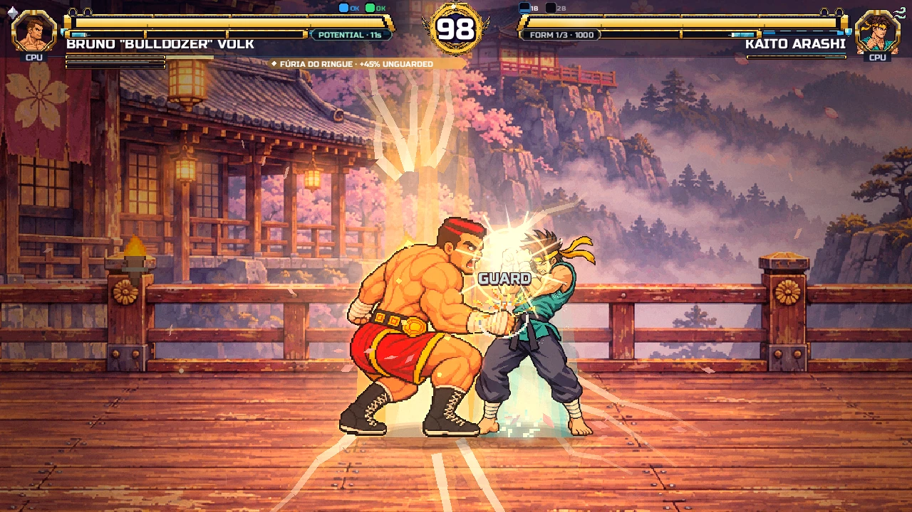
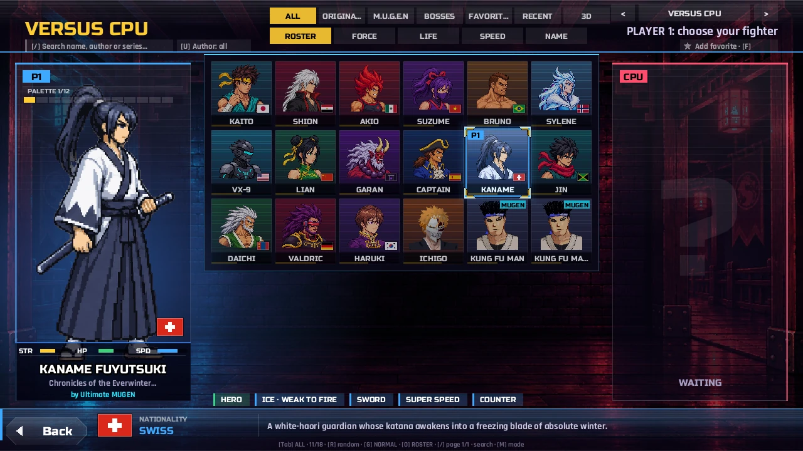
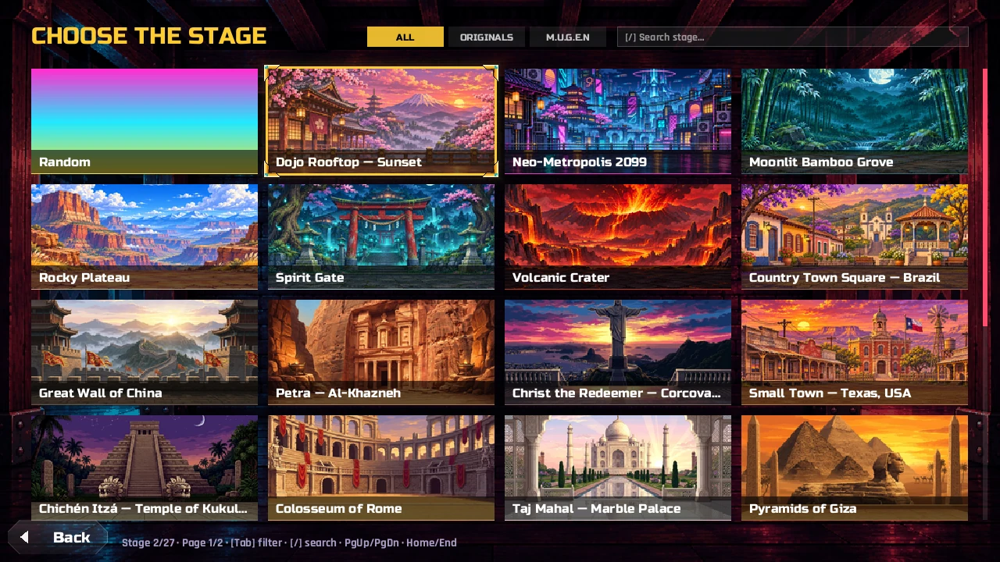
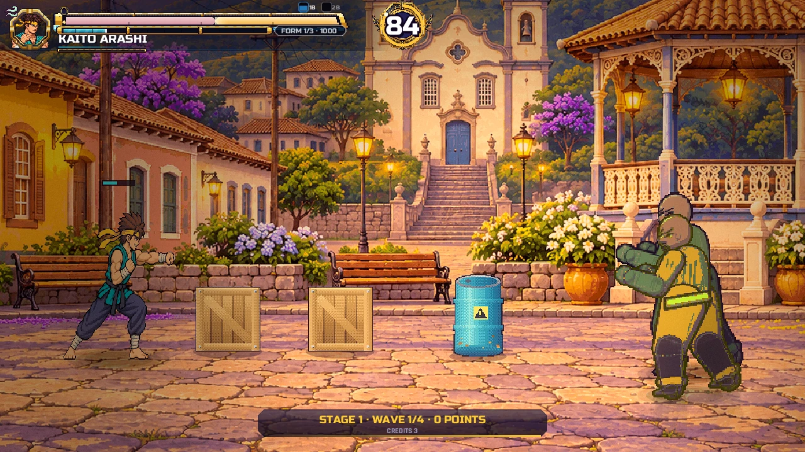

# Ultimate MUGEN

Motor de jogos de luta 2D de código aberto, escrito em Rust. Jogue com o elenco original em pixel art, importe lutadores e cenários do M.U.G.E.N ou crie seus próprios personagens no formato UMF.

**[Jogar no navegador](https://juninmd.github.io/ultimate-mugen/)** · **[Baixar para desktop](https://github.com/juninmd/ultimate-mugen/releases/latest)** · [Wiki](https://juninmd.github.io/ultimate-mugen/wiki/) · [English](README.md)



## Como jogar

- **Navegador.** Abra a versão web e escolha um modo no menu principal. Para adicionar um personagem, arraste o arquivo `.zip` para a janela ou use **Importar M.U.G.E.N**.
- **Desktop.** Baixe a versão para Windows, Linux ou macOS. Você pode adicionar personagens em `mugen/chars/` e cenários em `mugen/stages/`, ou apontar `UME_MUGEN_DIR` para uma instalação existente. [Guia de instalação](docs/wiki/pt-BR/Instalacao.md)
- **Controles.** Jogue com teclado, controle ou toque. No teclado, o jogador 1 usa as setas para se mover, `Q` e `W` para socos e `A` e `S` para chutes. [Tabela de controles](#controles)

## Capturas do jogo

As capturas foram feitas no próprio jogo, nas versões para desktop e navegador.

| Seleção de lutadores | Seleção de arenas |
| --- | --- |
|  |  |



## Modos de jogo e criação

- **Partidas e treino.** Arcade, Versus CPU, 2 Jogadores, Treino, CPU vs CPU, Sobrevivência, Torre, Arena do Poder e equipes em Sequência, Paralelo e Tag. O jogo também inclui rollback online, replays, Desafios de Combo e Modo Foto. [Modos de jogo](docs/wiki/pt-BR/Modos-de-Jogo.md) · [Rede e replays](docs/wiki/pt-BR/Replays-Rede.md)
- **História.** Avance por cinco fases com rolagem lateral, ondas de inimigos, chefes, objetos quebráveis e rodadas bônus. Cada lutador nativo tem seu próprio epílogo. [Modo História](docs/wiki/Story-Mode.md)
- **Conteúdo da comunidade.** Importe lutadores e cenários M.U.G.E.N e use o Mercado GitHub para instalar personagens, cenários e músicas de repositórios públicos. [Importação](docs/wiki/MUGEN-Content.md) · [Mercado GitHub](docs/wiki/pt-BR/Mercado.md)
- **Criação de lutadores.** O UMF define golpes, animações, passivas e transformações em JSON e usa sprites PNG. O conversor `mugen2umf` oferece CLI, servidor MCP e verificações de paridade com o personagem de origem. [Guia UMF](docs/wiki/pt-BR/Personagem-UMF.md)

## Compilar do código-fonte

Instale a [versão estável do Rust](https://rustup.rs/) para compilar o projeto. No Debian ou Ubuntu, instale primeiro as dependências do sistema.

```bash
sudo apt-get install -y pkg-config libudev-dev libasound2-dev libx11-dev libxi-dev libgl1-mesa-dev
```

```bash
git clone https://github.com/juninmd/ultimate-mugen
cd ultimate-mugen
cargo run --release
```

<details>
<summary><b>Outros alvos de build e flags</b></summary>

```bash
cargo run --release -- --4k             # janela 3840×2160 (ou --res 2560x1440, --fullscreen)
cargo run --release -- --touch          # controles de toque na tela
cargo run --release -- --mute           # inicia sem áudio
cargo run --release -- --shots out/     # tour automático que salva capturas
cargo test --workspace --release
```

**Web / PWA**

```bash
rustup target add wasm32-unknown-unknown
cargo install wasm-bindgen-cli --locked --version "$(awk '/^name = "wasm-bindgen"$/{getline; gsub(/"/,"",$3); print $3}' Cargo.lock)"
./scripts/build-web.sh
python3 -m http.server -d web/dist 8080
```

**Android**

```bash
cargo install cargo-apk --version 0.9.6 --locked
cargo apk build -p ultimate-mugen --lib --release --target aarch64-linux-android
```

**iOS.** `cargo install cargo-bundle` e depois `cargo bundle --release --target aarch64-apple-ios` no macOS com Xcode.

</details>

---

## Controles

Teclado, vários controles e toque funcionam ao mesmo tempo. As listas de golpes mostram a tecla ou botão real do dispositivo em uso.

<details>
<summary><b>Tabela completa de controles</b></summary>

| Ação | Teclado (P1) | Teclado (P2) | DualShock 4 / DualSense / XInput | Toque |
|---|---|---|---|---|
| **Mover / Pular / Agachar** | Setas | `I` `K` `J` `L` | D-Pad ou analógico esquerdo | Analógico virtual |
| **Soco fraco** | `Q` | Numpad `4` | `□` / `X` | **LP** |
| **Soco forte** | `W` | Numpad `5` | `△` / `Y` | **HP** |
| **Soco extra (Z)** | `E` | Numpad `6` | — | — |
| **Chute fraco** | `A` | Numpad `1` | `✕` / `A` | **LK** |
| **Chute forte** | `S` | Numpad `2` | `○` / `B` | **HK** |
| **Chute extra (C)** | `D` | Numpad `3` | — | — |
| **Especiais rápidos** | `V`, `B`, `N` | Numpad `7`, `8`, `9` | — | **ESPECIAL**, **SUPER** |
| **Atalhos de golpe** (ligue no menu de pausa) | `1`, `2`, `3`, `4` | — | `L1`, `L2`, `R1`, `R2` | — |
| **Transformação** | `T` | Numpad `0` | `L3` + `R3` / `SELECT` | — |
| **Carregar ki** | `R` | Numpad `.` | `R3` (sozinho) | — |
| **Pausa / Hitboxes** | `Esc` / `F2` | `Esc` / `F2` | `OPTIONS` / `START` | `❚❚` |
| **Tela cheia / FPS** | `F11` / `F3` | — | — | — |
| **Trocar lutador (time paralelo)** | `Tab` | — | — | — |

DualShock 4 e DualSense usam relatórios HID nativos por USB e Bluetooth: vibração proporcional a golpes, defesas, supers e KOs, e lightbar azul para o P1, vermelha para o P2 e piscando em branco durante um super.

</details>

---

## Arquitetura

A simulação determinística roda a 60 Hz e alimenta os replays e o rollback. O workspace Rust separa os parsers M.U.G.E.N (`crates/formats`), a simulação (`crates/engine`), o compilador UMF (`crates/native`), o renderizador wgpu (`crates/render`) e a camada de janela, áudio e entrada (`crates/shell`).

O mesmo motor de combate executa lutadores M.U.G.E.N e UMF em uma única partida. O renderizador consulta a paleta na GPU para desenhar sprites indexados. [Arquitetura da engine](docs/wiki/pt-BR/Engine.md) · [Decisões de compatibilidade](docs/wiki/pt-BR/Decisoes-de-Compatibilidade.md)

## Desempenho

A decodificação de sprites acontece em paralelo no desktop. No navegador, a importação de ZIP distribui o trabalho entre quadros para manter o progresso visível e permitir o cancelamento. Os testes da engine verificam que a simulação roda sem alocações por tick. [Desempenho na wiki](docs/wiki/pt-BR/Desempenho.md)

```bash
cargo run --release -p ume-engine --example mugen_load_bench
cargo test -p ume-engine --release --test it tick_alloc::
```

## 📚 Documentação

- **[Site da wiki](https://juninmd.github.io/ultimate-mugen/wiki/pt-BR/Home.html)** ([fontes](docs/wiki/pt-BR/Home.md)) · [Guia de contribuição](CONTRIBUTING.pt-BR.md) · [Arquitetura](docs/wiki/pt-BR/Arquitetura.md): instalação, configuração, personagens UMF, scripts CNS, cenários e desempenho.
- [Roadmap](docs/ROADMAP.pt-BR.md) · [Recursos AAA](docs/AAA_FEATURES.md) · [Elenco](docs/ROSTER.md) · [Pesquisa](docs/PESQUISA.md)

---

## 🤝 Como contribuir

Contribuições são bem-vindas. Antes de abrir um PR:

```bash
cargo clippy --workspace --tests
cargo test --workspace
cargo check --target wasm32-unknown-unknown
```

Use [Conventional Commits](https://www.conventionalcommits.org/) (`feat:`, `fix:`, `perf:` …), pois eles geram os releases automáticos. Código, commits e docs são em inglês; o português fica em `*.pt-BR.md` e `docs/wiki/pt-BR/`.

<details>
<summary><b>Releases e verificação de atualização</b></summary>

A tag git é a fonte da verdade da versão. A cada push na `master`, o workflow `Release` calcula o bump a partir dos commits (`feat` → minor, `fix`/`perf` → patch), compila Linux, Windows e macOS, sobe os pacotes com `latest.json` e `SHA256SUMS.txt`, verifica o draft e publica.

O jogo no desktop lê o `latest.json` em segundo plano (só HTTPS, silencioso offline) e mostra um painel com a versão instalada e a disponível. Nada é baixado nem executado até você aceitar "Atualizar agora"; "Agora não" mantém a versão atual até o próximo boot. Desative a pergunta com `--no-auto-update` / `UME_NO_AUTO_UPDATE=1` ou a checagem inteira com `--no-update-check` / `UME_NO_UPDATE_CHECK=1`.

</details>

---

## 🙏 Agradecimentos

Obrigado à equipe do [Ikemen GO](https://github.com/ikemen-engine/Ikemen-GO) e à Elecbyte, criadora do M.U.G.E.N, pela inspiração.

## 📄 Licença

O Ultimate MUGEN é distribuído sob a [Licença MIT](LICENSE). As fontes incluídas (*Russo One*, *Rajdhani*) usam a SIL Open Font License.

Personagens de terceiros protegidos por direitos autorais **não são incluídos nem distribuídos** com o motor. O Ultimate MUGEN carrega conteúdo M.U.G.E.N importado pelos próprios usuários.
