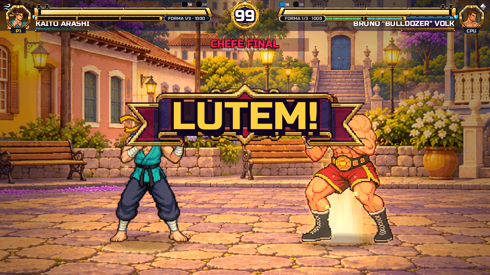

# Arcade route stage evidence

The browser smoke drove the web build into the first Arcade fight using a Kaito route that names `brazil` for Bruno.

- Result: `WEB ROUTE STAGE OK fight=1 stage=native:brazil`
- The fight began in the real browser on Praça do Interior — Brasil.
- Validation commands: `cargo test --bin ultimate-mugen route_stage_matches_ids_names_and_random_selection`, `cargo test --bin ultimate-mugen arcade_replays_do_not_advance_the_ladder`, `scripts/build-web.sh`, `node scripts/web-route-stage-smoke.js web/dist`, and `node scripts/file-size.mjs`.

