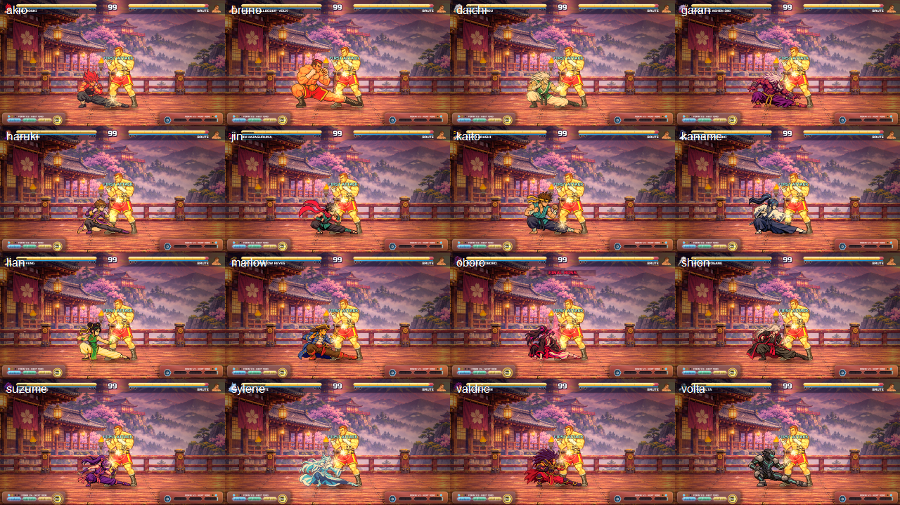
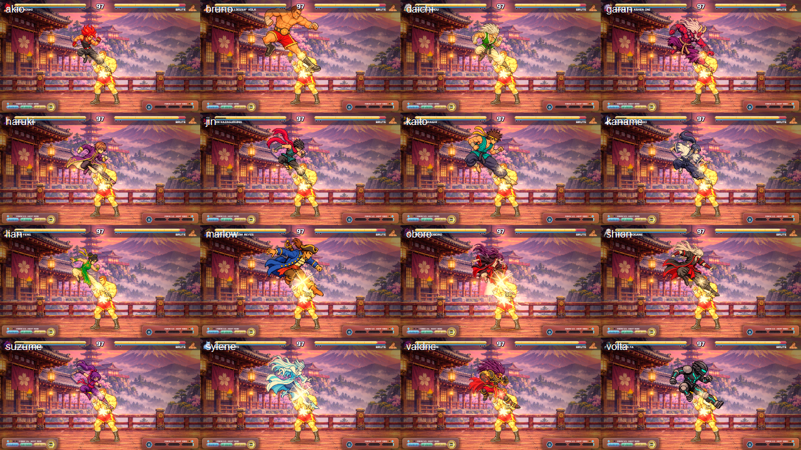

# Native roster low kick audit

This evidence covers the 16 playable native fighters. Each ground and air low kick was captured in a fresh desktop process against `npc_brute` on `dojo` so earlier matches could not exhaust the capture session.

## Results

- All 16 ground low kicks and all 16 air low kicks connected in runtime at the showcase spacing of 24 units.
- Every fighter has a dedicated ground `lowKick.png` strike pose, with crouch windup, recovery, and settle sprites around it.
- The animation resolver audit covers 21 native packs (16 playable fighters and 5 NPCs), with 76–87 declared animation families per pack and zero missing, idle-reused, or fallback-idle frames.
- All 2,175 combat PNGs pass the 400×400 canvas, binary alpha, and 48-color ceiling checks.
- All 681 authored attack entries across the 16 playable fighters and five story NPCs resolve to at least three distinct rendered body images in the refreshed inventory. Every native character resolves four ground-low-kick and four air-low-kick body images.

## Validation

- `native_sprite_audit --require-complete` — passed after regenerating all five story NPC JSON files from their current base fighters; all 21 packs report zero uncovered requirements.
- Current pixel-art payload audit — all 2,175 combat PNGs are 400×400, have at most 48 colors, and contain no partial-alpha pixels.
- Runtime low-kick showcase — all 16 playable ground and air low kicks connected at the recorded spacing.
- `native_attack_keyframes` and the expanded all-roster low-kick unit tests — pending final test run after the sprite correction pass.
- Whole-roster gameplay suites and browser smoke — pending final validation.

## Scope note

All combat PNGs were screened in per-character contact sheets. That review found identity mismatches in seven packs; the evidence and defect inventory are in `../roster-family-audit/`. This low-kick change does not resolve those unrelated families, so the full roster is not yet approved as visually standardized.
