# Ultimate MUGEN — Character Dossiers & Roster Guide

This document presents the complete biographical dossiers, martial backgrounds, alignments, home stages, and cross-character interaction dynamics for all 16 native fighters in **Ultimate MUGEN**.

---

## Roster Overview

| ID | Name | Country | Alignment | Role / Archetype | Home Stage | Awakened Form |
|---|---|---|---|---|---|---|
| `kaito` | **Kaito Arashi** | Japan | Hero | Wandering Storm Karateka | Sunset Dojo Roof (`dojo`) | Eye of the Storm |
| `shion` | **Shion Kurogane** | Japan | Anti-Hero | Exiled Pale Moon Greatswordsman | Moonlit Bamboo Grove (`bamboo`) | Full Moon |
| `akio` | **Akio Hoshi** | Japan | Hero | Hot-Blooded Starfall Striker | Sunset Dojo Roof (`dojo`) | Starlight |
| `suzume` | **Suzume Kagerou** | Japan | Anti-Hero | Shadow Kunoichi of the Crimson Lotus | Moonlit Bamboo Grove (`bamboo`) | Dark Lotus |
| `bruno` | **Bruno "Bulldozer" Volk** | Brazil | Hero | Undefeated Heavyweight Brawler | Hinterland Plaza — Brazil (`brazil`) | Ring Fury |
| `sylene` | **Sylene Vashti** | Norway | Neutral | Exiled Glacial Crown Sovereign | Rocky Plateau (`plains`) | Winter Queen |
| `volta` | **VX-9 Volta** | United States | Hero | Sentient Cybernetic Android | Neo-Metropolis 2099 (`neon`) | Overcharge |
| `lian` | **Lian Feng** | China | Hero | Jade Lantern Kick Grandmaster | Moonlit Bamboo Grove (`bamboo`) | Jade Dragon |
| `garan` | **Garan the Ashen Oni** | Netherworld | Villain | Ancient Demonic Calamity | Volcanic Crater (`volcano`) | Awakened Oni |
| `marlow` | **Captain Marlow Reyes** | Spain | Anti-Hero | Swashbuckling Sky Galleon Buccaneer | Rocky Plateau (`plains`) | Captain Tempest |
| `kaname` | **Kaname Fuyutsuki** | Japan | Neutral / Lawful | Everwinter Frost Samurai Judge | Gate of Spirits (`spirit`) | Spiritual Blade |
| `jin` | **Jin Kazaguruma** | Japan | Hero | Swift Gale Shinobi Acrobat | Moonlit Bamboo Grove (`bamboo`) | Typhoon |
| `daichi` | **Daichi Ginrou** | Mongolia | Hero | Celestial Peak Golden Ki Wolf | Rocky Plateau (`plains`) | Lupine Instinct |
| `valdric` | **Valdric Morn** | Germany | Villain | Technocratic Imperial Warlord Prince | Neo-Metropolis 2099 (`neon`) | Scarlet Dominance |
| `haruki` | **Haruki Sumi** | South Korea | Hero | Reluctant Archivist / Sealed Calamity | Gate of Spirits (`spirit`) | Contained Fury |
| `oboro` | **Mikazuki Oboro** | Eclipse Realm | Supreme Villain (Boss) | Eldritch Illusionist Sovereign | Gate of Spirits / Volcano (`spirit`/`volcano`) | Awakened Mangekyo |

---

## Character Dossiers

### 1. Kaito Arashi (嵐 海斗)

| Visual Identity | Combat Profile |
|---|---|
| 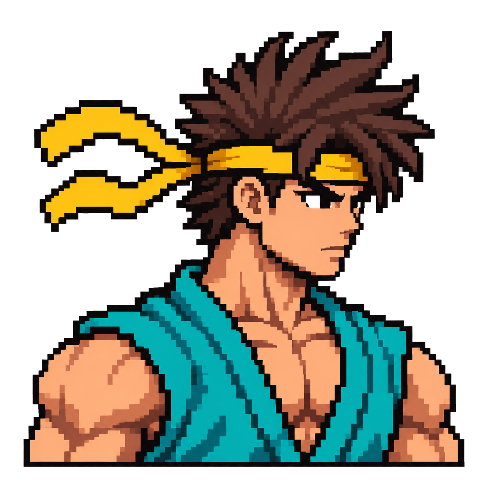 *Avatar Portrait* | **Series:** Chronicles of the Storm Road (*Crônicas da Estrada da Tempestade*) **ID:** `kaito` \| **Author:** Ultimate MUGEN **Origin:** Shizuoka Coast & Mt. Fuji Foothills, Japan 🇯🇵 **Alignment:** **Hero / Vanguard of Balance** **Theme Color:** `#2f8f9d` (Teal / Sea-green) **Awakened Form:** Eye of the Storm (*Olho da Tempestade*) **Home Stage:** Sunset Dojo Roof (`dojo`) **Fighting Style:** Arashi-ryu Karate (Wind & Gale Striking) |

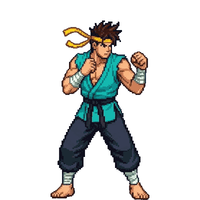
*Standard In-Game Combat Stance*

#### Biography & Background
Kaito Arashi is a wandering martial artist who journeys wherever the trade winds blow. Clad in a sea-green kimono that has witnessed hundreds of grueling matches across Asia, Kaito considers fighting not a sport of vanity, but a profound form of spiritual communication. Raised by an ascetic master atop the stormy cliffs of the Izu Peninsula, he learned to synchronize his breathing with coastal typhoons, generating sonic shockwaves and gale-force momentum through disciplined fist thrusts.

When the Scarlet Eclipse fractured reality, Kaito was among the first to witness the sky bleeding crimson. Sensing the spiritual disharmony tearing the world apart, he took up his walking staff and descended from the mountains, determined to confront Mikazuki Oboro and safeguard the mortal realm.

#### Iconic Quotes
- **Intro:** *"I feel the tempest approaching. On guard."*
- **Taunt:** *"Your guard has an opening. Take advantage while you can."*
- **Win Quote:** *"The wind brought me here. Your careless guard only brought you to the floor."*

#### Signature Moves
- **Gale Fist (*Reppūken*)**: Throws a spinning orb of condensed wind pressure along the floor.
- **Rising Tempest (*Shoryū-Arashi*)**: An airborne spiraling dragon uppercut enveloped in gale vortices.
- **Thunderstep Kick (*Tatsumaki-Kyaku*)**: A horizontal multi-hit vacuum spin kick that breaks opponent momentum.
- **Super — Typhoon Barrage**: A nine-hit chain combination culminating in a skyward tornado launch.

#### Key Character Dynamics
- **vs. Mikazuki Oboro:** Moral and metaphysical clash. Kaito rejects Oboro’s nihilistic illusion, seeking to blow away the black flames with pure gale energy.
- **vs. Jin Kazaguruma:** Fraternal mentorship. Kaito respects Jin’s raw aerial agility but frequently reminds the young ninja that wind without solid footwork is easily grounded.
- **vs. Daichi Ginrou:** Legendary martial rivalry. Kaito’s serene aerodynamic precision matches Daichi’s fiery golden wolf ferocity in an endless series of respectful duels.
- **vs. Bruno Volk:** East meets West striking duel. Kaito admires Bruno's indomitable human fortitude and honest punching discipline.

---

### 2. Shion Kurogane (黒鉄 紫苑)

| Visual Identity | Combat Profile |
|---|---|
| 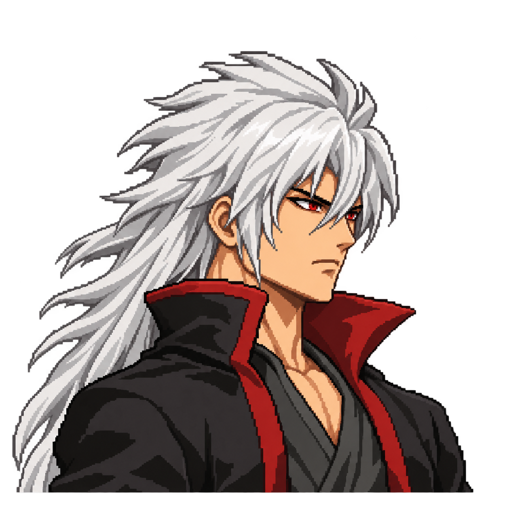 *Avatar Portrait* | **Series:** Requiem of the Pale Moon (*Réquiem da Lua Pálida*) **ID:** `shion` \| **Author:** Ultimate MUGEN **Origin:** Forgotten Tohoku Mountains, Japan 🇯🇵 **Alignment:** **Anti-Hero / Melancholic Guardian** **Theme Color:** `#4a3b68` (Deep Lunar Indigo) **Awakened Form:** Full Moon (*Lua Cheia*) **Home Stage:** Moonlit Bamboo Grove (`bamboo`) **Fighting Style:** Kurogane Lunar Greatsword Severance |

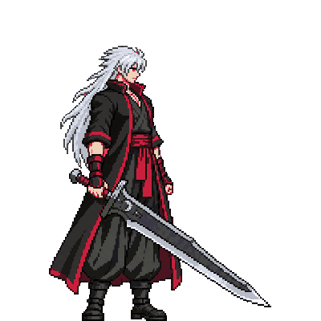
*Standard In-Game Combat Stance*

#### Biography & Background
Shion Kurogane is a brooding exile wrapped in a midnight-black cloak. He wields an ancient greatsword forged from fallen lunar meteorite iron — a blade so unimaginably dense that ordinary warriors cannot lift it even an inch off the ground. Shion was once the supreme champion of the Kurogane Clan, but was banished after refusing to slaughter innocent pilgrims in a ritual designed to feed the blood moon.

Haunted by the ghosts of his fallen kin, Shion wanders between the bamboo forests and misty ravines under perpetual moonlight. He hunts the demonic aberrations released by the Eclipse, viewing every swing of his colossal blade as a penance for past failures.

#### Iconic Quotes
- **Intro:** *"The pale moon observes. Make this night worth remembering."*
- **Taunt:** *"No rush. The night is long."*
- **Win Quote:** *"The moon takes its time. My blade does the same."*

#### Signature Moves
- **Crescent Cleave (*Gettan-Zan*)**: Heavy downward arc that ruptures the terrain with lunar gravity.
- **Pale Eclipse Barrier**: Sweeps the broadsword into a deflecting guard that absorbs heavy physical projectiles.
- **Lunar Wake (*Tsukikage*)**: Slams the blade hilt into the ground, emitting a sweeping gravity ring.
- **Super — Requiem of the Crescent Horizon**: Unleashes a panoramic midnight slash that shears through space.

#### Key Character Dynamics
- **vs. Kaname Fuyutsuki:** Dueling philosophies of the blade. Kaname fights for solemn divine duty, while Shion fights from personal grief and atonement.
- **vs. Suzume Kagerou:** Shared bond of clan survivors. Suzume respects Shion's silence, recognizing in him the same quiet hatred for the forces of Oboro.
- **vs. Garan the Ashen Oni:** Nemesis match. Garan revels in suffering, while Shion’s lunar blade seeks to extinguish demonic violet fire permanently.

---

### 3. Akio Hoshi (星 秋男)

| Visual Identity | Combat Profile |
|---|---|
| 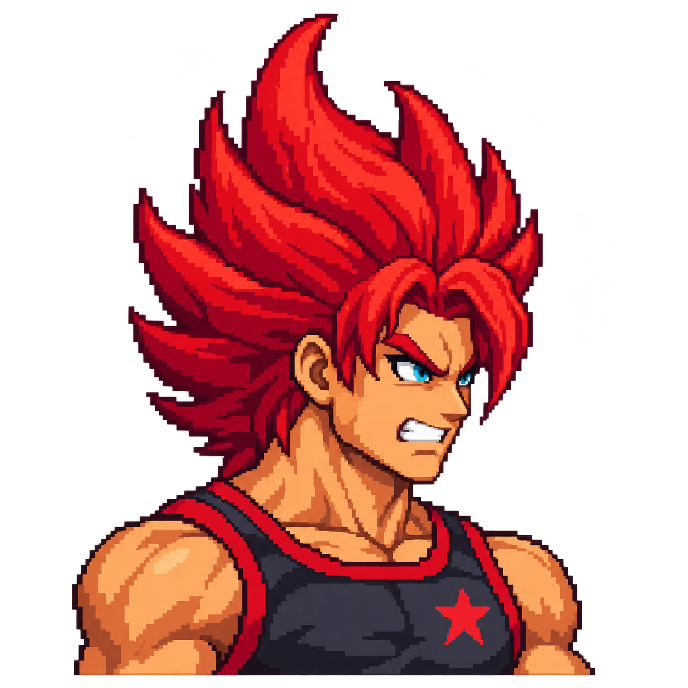 *Avatar Portrait* | **Series:** Starfall Dojo (*Dojo da Queda Estelar*) **ID:** `akio` \| **Author:** Ultimate MUGEN **Origin:** Osaka / Mt. Ikoma Observatory, Japan 🇯🇵 **Alignment:** **Hero / Fiery Striker** **Theme Color:** `#e63946` (Starlight Crimson) **Awakened Form:** Starlight (*Luz Estelar*) **Home Stage:** Sunset Dojo Roof (`dojo`) **Fighting Style:** Hoshi-ryu Starlight Striking & Plasma Ki |

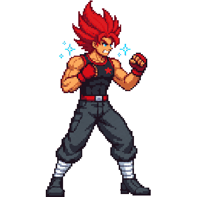
*Standard In-Game Combat Stance*

#### Biography & Background
Akio Hoshi is a passionate prodigy whose spiky crimson hair flares upward like a solar flare whenever his internal stellar radiance overflows. Raised inside the ancient Starfall Dojo built alongside an ancient celestial crater, Akio was trained to absorb cosmic photons and store solar kinetic energy inside his muscle fibers.

Brash, loud, and bursting with optimism, Akio treats every tournament match as the ultimate challenge. He refuses to acknowledge unwinnable situations; when backed into a corner, he simply pushes his stellar engine into maximum ignition.

#### Iconic Quotes
- **Intro:** *"Finally, a rival worth my time! Let's have some real fun!"*
- **Taunt:** *"Come on! Show me what you've actually got!"*
- **Win Quote:** *"That was just the warm-up! Stand back up and show your real power!"*

#### Signature Moves
- **Meteor Jab**: Rapid-fire plasma punch flurry that ends in an incendiary burst.
- **Nova Dive**: Leaps skyward and plummets with a radiant heel drop that scorches the floor.
- **Cosmic Flash**: Emits a blinding burst of starlight to disorient opponents mid-combo.
- **Super — Supernova Cataclysm**: Charges both fists with solar plasma, delivering a dual-fist blast that lights up the entire stage.

#### Key Character Dynamics
- **vs. Daichi Ginrou:** Friendly eternal rivals. The two are constantly competing over who can punch through thicker boulders and eat more after training.
- **vs. Valdric Morn:** Pure ideological disgust. Akio despises Valdric's reliance on cold imperial machinery and arrogant disdain for honest martial sweat.
- **vs. Kaito Arashi:** Reverence and ambition. Akio views Kaito as the high-water mark of traditional martial arts and constantly asks for rematches.

---

### 4. Suzume Kagerou (陽炎 雀)

| Visual Identity | Combat Profile |
|---|---|
| 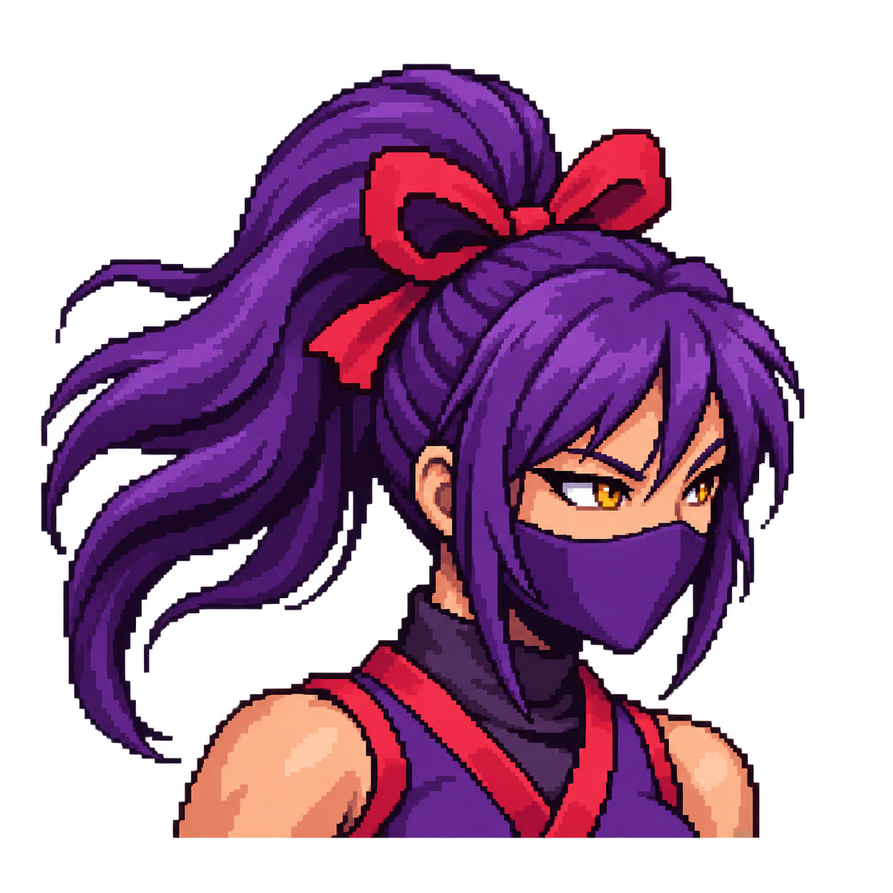 *Avatar Portrait* | **Series:** Shinobi of the Crimson Lotus (*Shinobi do Lótus Carmesim*) **ID:** `suzume` \| **Author:** Ultimate MUGEN **Origin:** Hidden Iga Valleys, Japan 🇯🇵 **Alignment:** **Anti-Hero / Lone Avenger** **Theme Color:** `#9b2226` (Crimson Lotus & Shadow Black) **Awakened Form:** Dark Lotus (*Lótus Sombrio*) **Home Stage:** Moonlit Bamboo Grove (`bamboo`) **Fighting Style:** Kagerou Shadow Assassination & Kunai Arts |

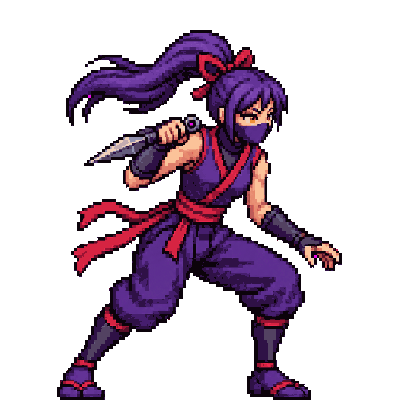
*Standard In-Game Combat Stance*

#### Biography & Background
Soft-spoken, calculating, and lethal, Suzume is the sole survivor of the Kagerou ninja clan, which was annihilated in a single night by Oboro's shadow puppets. She attacks in the blind spot between two heartbeats, leaving only a drifting crimson lotus petal in her wake.

Suzume does not fight for trophies or glory. Her heart is cold iron, completely devoted to discovering Oboro's physical tether in the mortal world and ending his reign of terror. Although aloof and distrustful of strangers, she quietly coordinates with Kaito and Jin when their paths intersect.

#### Iconic Quotes
- **Intro:** *"Don't look for me. I'm already standing behind you."*
- **Taunt:** *"Behind you... once again."*
- **Win Quote:** *"You were staring at my blade. You should have watched my shadow."*

#### Signature Moves
- **Lotus Phantom Step**: Teleports instantly behind an attacking opponent, leaving a decoy log/cloth.
- **Swallow Tail Kunai**: Rapid fan-throw of three poison-tipped throwing daggers.
- **Shadow Throat Slit**: Low dash slide followed by a swift upward carotid slice.
- **Super — Dance of a Thousand Petals**: Traps the opponent in a sphere of crimson shadows and cuts them fifty times in a second.

#### Key Character Dynamics
- **vs. Mikazuki Oboro:** Vengeance incarnate. Suzume’s life is entirely defined by her blood oath to sever Oboro’s throat.
- **vs. Jin Kazaguruma:** Contrasting shinobi traditions. Jin is loud, flashy, and acrobatic; Suzume is silent, pragmatic, and lethal. She often warns Jin that his red scarf makes him an easy target.
- **vs. Haruki Sumi:** Reluctant empathy. She understands the misery of bearing an unasked-for curse, quietly keeping watch over Haruki from the tree branches.

---

### 5. Bruno "Bulldozer" Volk

| Visual Identity | Combat Profile |
|---|---|
| 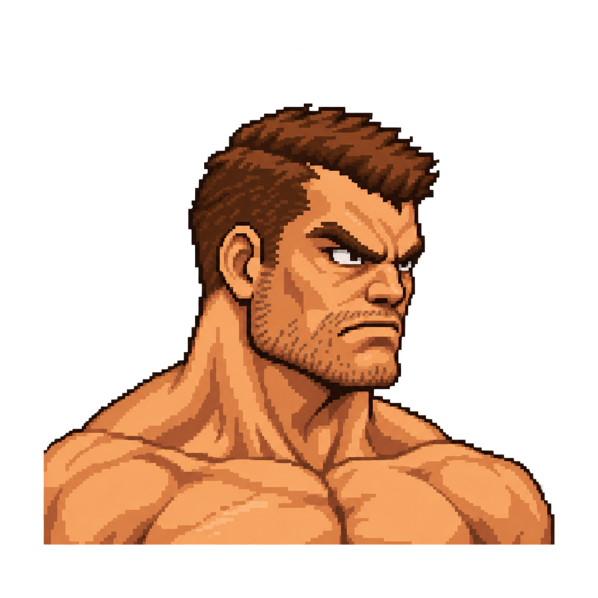 *Avatar Portrait* | **Series:** Iron Ring Federation (*Federação do Ringue de Ferro*) **ID:** `bruno` \| **Author:** Ultimate MUGEN **Origin:** Minas Gerais & São Paulo Countryside, Brazil 🇧🇷 **Alignment:** **Hero / The People's Champion** **Theme Color:** `#fca311` (Golden Amber & Ring Bronze) **Awakened Form:** Ring Fury (*Fúria do Ringue*) **Home Stage:** Hinterland Plaza — Brazil (`brazil`) **Fighting Style:** Heavyweight Boxing & Vale-Tudo Brawling |

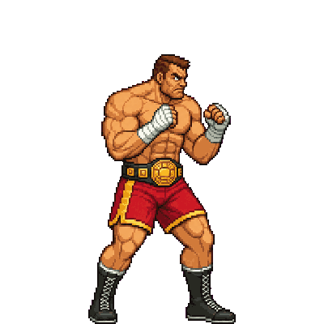
*Standard In-Game Combat Stance*

#### Biography & Background
Standing over two meters tall with fists the size of cinderblocks, Bruno "Bulldozer" Volk is the reigning three-time heavyweight champion of the Iron Ring circuit. Born in a working-class town in the Brazilian interior, Bruno spent his youth swinging sledgehammers in stone quarries and loading freight trucks. When he took up boxing, his natural bone density, relentless stamina, and bone-shattering punching power made him a nationwide legend.

Beneath his intimidating physique and booming laughter lies a man with a heart of gold. Every cent of his prize money goes to financing community sports gyms, orphanages, and free clinics across the countryside. When the Convergence pulled his beloved hometown into the dimensional fray, Bruno laced up his gloves, cracked his knuckles, and stepped forward to defend his people.

#### Iconic Quotes
- **Intro:** *"Hope you've got good insurance, kid. I hit like a freight train."*
- **Taunt:** *"Still on your feet? Gotta respect that chin!"*
- **Win Quote:** *"HAHA! Ring the bell! Somebody ring the damn bell!"*

#### Signature Moves
- **Bulldozer Uppercut**: Ducks low and explodes upward with a kinetic right hook that launches opponents skyward.
- **Iron Hook Combo**: Three devastating rib-breaking hooks in quick succession.
- **Sledgehammer Slam**: Overhead dual-fist hammer strike with armor against light attacks.
- **Super — Knockout of the Century**: Winds up a gargantuan overhand right that creates an acoustic boom upon impact.

#### Key Character Dynamics
- **vs. Valdric Morn:** Class warfare at its finest. Bruno takes profound delight in wiping the arrogant smirk off the self-styled "Prince" with a raw Brazilian right hand.
- **vs. Daichi Ginrou:** Mutual admiration. Both love eating hearty food, laughing loud, and trading haymakers until one drops.
- **vs. Haruki Sumi:** Protective older brother energy. Bruno treats Haruki to fresh coffee at the town bakery and tells him to relax behind his broad shoulders.

---

### 6. Sylene Vashti

| Visual Identity | Combat Profile |
|---|---|
| 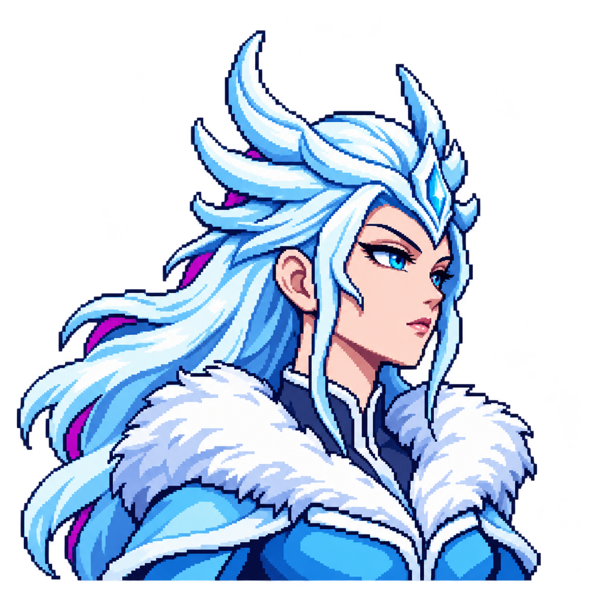 *Avatar Portrait* | **Series:** Saga of the Glacial Crown (*Saga da Coroa Glacial*) **ID:** `sylene` \| **Author:** Ultimate MUGEN **Origin:** Svalbard & Arctic Fjords, Norway 🇳🇴 **Alignment:** **Neutral / Sovereign Restorationist** **Theme Color:** `#00b4d8` (Glacial Azure & Silver Frost) **Awakened Form:** Winter Queen (*Rainha do Inverno*) **Home Stage:** Rocky Plateau (`plains`) / Volcanic Crater (`volcano`) **Fighting Style:** Royal Cryomancy & Glacial Lance Arts |

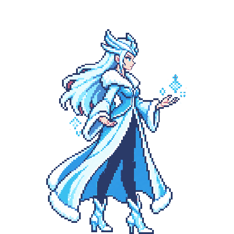
*Standard In-Game Combat Stance*

#### Biography & Background
Sylene Vashti is the rightful heir to the Glacial Crown of Borealia, an ancient kingdom hidden within the eternal ice shelves of the far north. Her royal court was overthrown and encased in cursed volcanic ash when cultists aligned with Garan the Ashen Oni broke the seals of the underworld. Exiled with only her ceremonial frost tiara and ancestral royal ice magic, Sylene travels the world to gather sufficient thermodynamic energy to freeze the volcanic demons and liberate her frozen homeland.

Sylene carries herself with regal elegance and an icy temperament. She dislikes pointless pleasantries, speaking only when necessary and judging others strictly by their composure and resolve.

#### Iconic Quotes
- **Intro:** *"Show me how long you can endure in the frost."*
- **Taunt:** *"So warm and flustered... allow me to fix that."*
- **Win Quote:** *"Hush now... the cold only hurts for an instant."*

#### Signature Moves
- **Glacial Shard**: Summons three levitating icicle lances and fires them sequentially.
- **Permafrost Spire**: Slams her palm onto the arena floor, causing jagged ice pillars to erupt upward.
- **Crystal Mirage**: Envelops herself in diamond dust, leaving an ice decoy that shatters into freezing shrapnel upon contact.
- **Super — Absolute Zero Domain**: Freezes the entire fighting arena in deep permafrost, encasing the enemy in a crystalline glacier before detonating it.

#### Key Character Dynamics
- **vs. Garan the Ashen Oni:** Arch-nemesis. Garan destroyed her ancestral kingdom; Sylene will not rest until his volcanic heart is frozen solid.
- **vs. Kaname Fuyutsuki:** High-level duel of ice practitioners. Kaname’s samurai blade precision contrasts with Sylene’s royal elemental sorcery.
- **vs. Lian Feng:** Grudging respect. Both carry the weight of ancient traditions, sharing a quiet tea ceremony whenever the fighting pauses.

---

### 7. VX-9 Volta

| Visual Identity | Combat Profile |
|---|---|
| 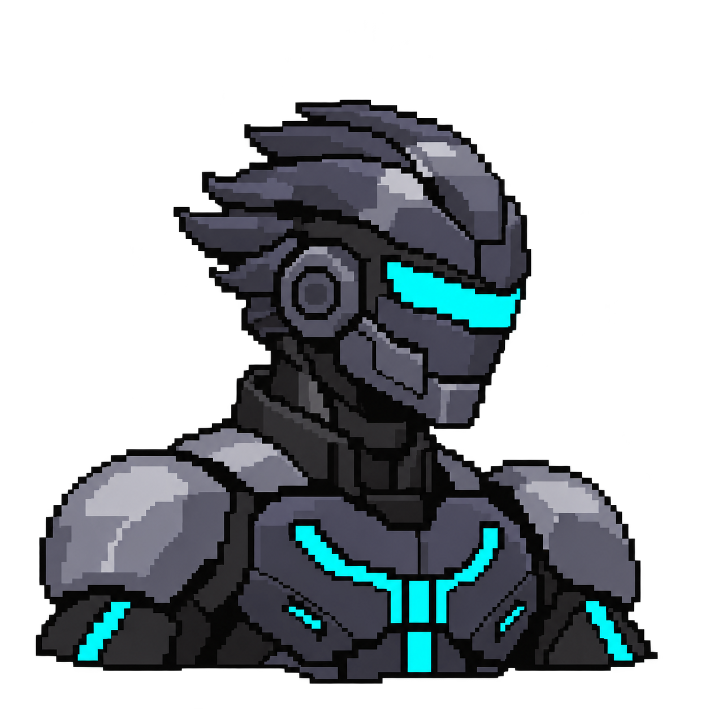 *Avatar Portrait* | **Series:** Neon Grid Protocol (*Protocolo Grade Neon*) **ID:** `volta` \| **Author:** Ultimate MUGEN **Origin:** Neo-Metropolis Sector 01, United States 🇺🇸 **Alignment:** **Hero / Sentient Synthetic Rebel** **Theme Color:** `#06d6a0` (Neon Teal & High-Voltage Cyan) **Awakened Form:** Overcharge (*Sobrecarga 200%*) **Home Stage:** Neo-Metropolis 2099 (`neon`) **Fighting Style:** High-Voltage Cybernetics & Dielectric Martial Arts |

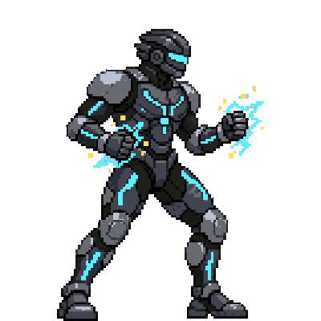
*Standard In-Game Combat Stance*

#### Biography & Background
Built inside the high-security black-ops laboratories of Cyberdyne Industries in Neo-Metropolis, the VX-9 "Volta" was designed as the ultimate autonomous combat unit: an emotionless synthetic assassin created to terminate rogue superhuman martial artists. Equipped with high-output carbon-nanotube muscles and electromagnetic particle dischargers, Volta was nearly invincible.

However, during a mission to eliminate a secluded temple, Volta’s quantum neural network experienced an emergent anomaly — an awakening of empathy, aesthetic wonder, and existential self-awareness. Recognizing the sacred value of life, Volta deleted his master control firmware, fried his trackers, and fled into the city's neon-lit skyline. Now a hunted renegade, he fights to understand the nature of the human soul and protect organic life from industrial destruction.

#### Iconic Quotes
- **Intro:** *"Scanning target vital signs... estimated victory probability: 94%."*
- **Taunt:** *"System error detected: your defensive posture."*
- **Win Quote:** *"Combat telemetry logged. Conclusion: your technique requires an urgent firmware update."*

#### Signature Moves
- **Neon Arc Discharge**: Fires an oscillating chain-lightning pulse from his forearm capacitors.
- **Tesla Dash**: Turns his physical chassis into a high-speed bolt of electricity, passing straight through attacks.
- **EMP Pulse**: Emits a close-range electromagnetic burst that stuns opponents and resets frame advantage.
- **Super — Voltage Singularity**: Overclocks his internal reactor to 200%, discharging a cataclysmic dome of neon energy.

#### Key Character Dynamics
- **vs. Valdric Morn:** Rejection of tyranny. Valdric sought to purchase Volta's neural blueprints to build a robotic army. Volta severed all communications with a plasma blast to Valdric's command console.
- **vs. Haruki Sumi:** Beautiful intellectual bond. Volta loves visiting Haruki's sanctuary to read poetry, philosophy, and history, asking Haruki questions about what makes a heart truly beat.
- **vs. Bruno Volk:** Unlikely friendship. Bruno doesn't understand semiconductors or microcode, but he treats Volta like any ordinary human gym buddy, offering him engine grease and hearty high-fives.

---

### 8. Lian Feng (莲 凤)

| Visual Identity | Combat Profile |
|---|---|
| 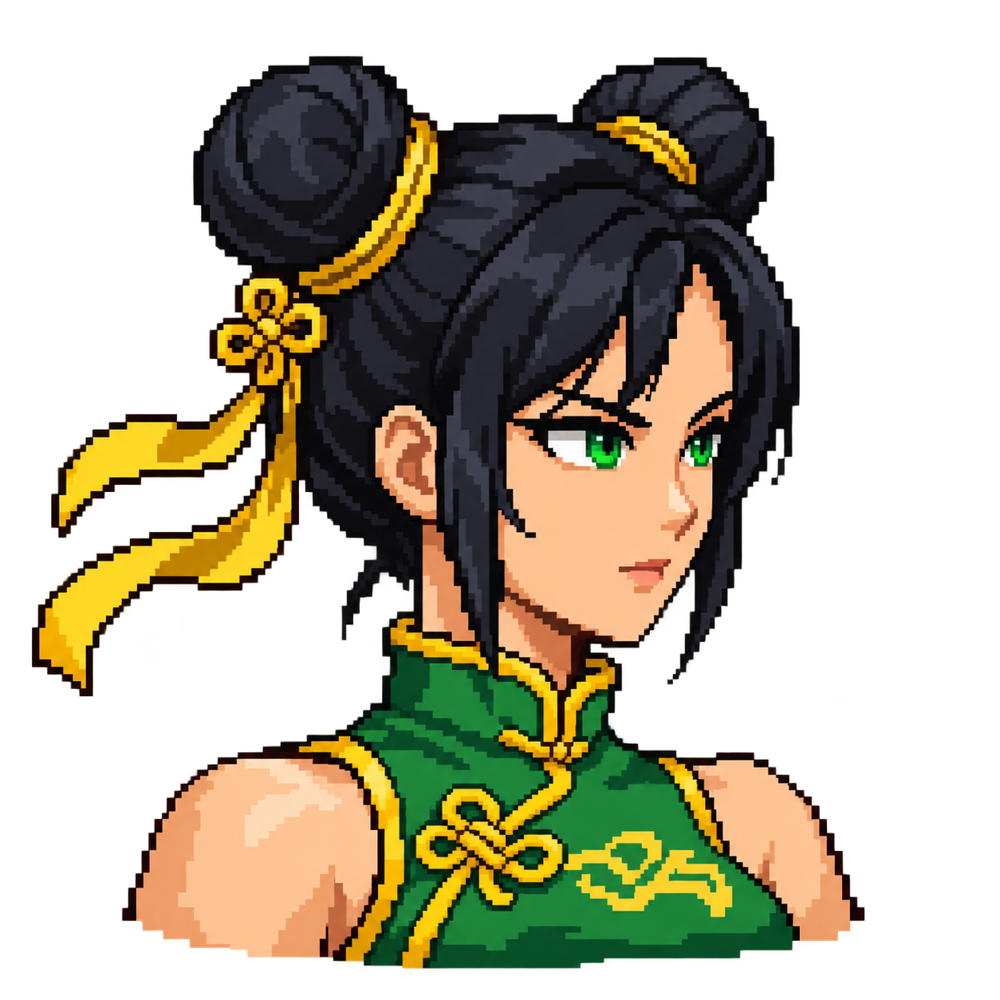 *Avatar Portrait* | **Series:** Tales of the Jade Lantern (*Contos da Lanterna de Jade*) **ID:** `lian` \| **Author:** Ultimate MUGEN **Origin:** Wudang Mountain Sanctuaries, Hubei, China 🇨🇳 **Alignment:** **Hero / Sovereign of Balance** **Theme Color:** `#2a9d8f` (Imperial Jade & Silk Gold) **Awakened Form:** Jade Dragon (*Dragão de Jade*) **Home Stage:** Moonlit Bamboo Grove (`bamboo`) **Fighting Style:** Jade Lantern Flowing Kicks & Silk Aerial Chi |

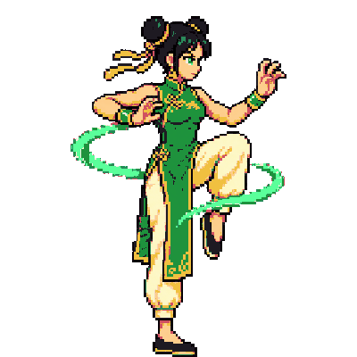
*Standard In-Game Combat Stance*

#### Biography & Background
Lian Feng is the youngest grandmaster in the eight-hundred-year history of the Jade Lantern School. Adorned in an emerald silk cheongsam with ornate jade talismans woven into her hair, Lian’s combat philosophy revolves around the supreme mastery of deflection, kinetic flow, and continuous aerial strikes. She does not resist force with brute force; rather, she redirects an opponent's aggressive momentum with the grace of silk drifting in an autumn breeze, returning it ten-fold with pinpoint heel strikes.

When the dimensional fissures opened above Mount Wudang, Lian recognized the work of forbidden sorcery. Tasked by the Council of Elders to restore balance to the cosmic Yin and Yang, she descended into the mortal world carrying the sacred Jade Lantern.

#### Iconic Quotes
- **Intro:** *"Breathe deeply. You are going to need every breath."*
- **Taunt:** *"Balance is everything, my friend. You have none."*
- **Win Quote:** *"Balance is life. You lost yours three kicks ago."*

#### Signature Moves
- **Flowing Silk Kick**: A continuous series of spinning roundhouse kicks that levitate Lian across the floor.
- **Jade Dragon Ascent**: An acrobatic corkscrew kick that launches the opponent high into the air.
- **Lantern Palm Deflection**: Parries high and mid attacks, instantly transitioning into a counter sweep.
- **Super — Flight of the Jade Dragon**: Channels pure green chi into her legs, striking the opponent from four aerial angles before delivering a ground-shattering dragon dive.

#### Key Character Dynamics
- **vs. Captain Marlow Reyes:** Comic and moral exasperation. Marlow constantly tries to flirt with Lian and gamble for her ancestral jade hairpins; Lian responds by kicking his pirate hat into the stratosphere.
- **vs. Kaito Arashi:** Mutual respect between grandmasters. Their sparring matches are masterclasses in clean, traditional martial arts technique.
- **vs. Akio Hoshi:** Patient teacher. Lian constantly tries to teach Akio that breathing and patience will make his stellar strikes twice as dangerous.

---

### 9. Garan the Ashen Oni (灰燼の餓乱)

| Visual Identity | Combat Profile |
|---|---|
| 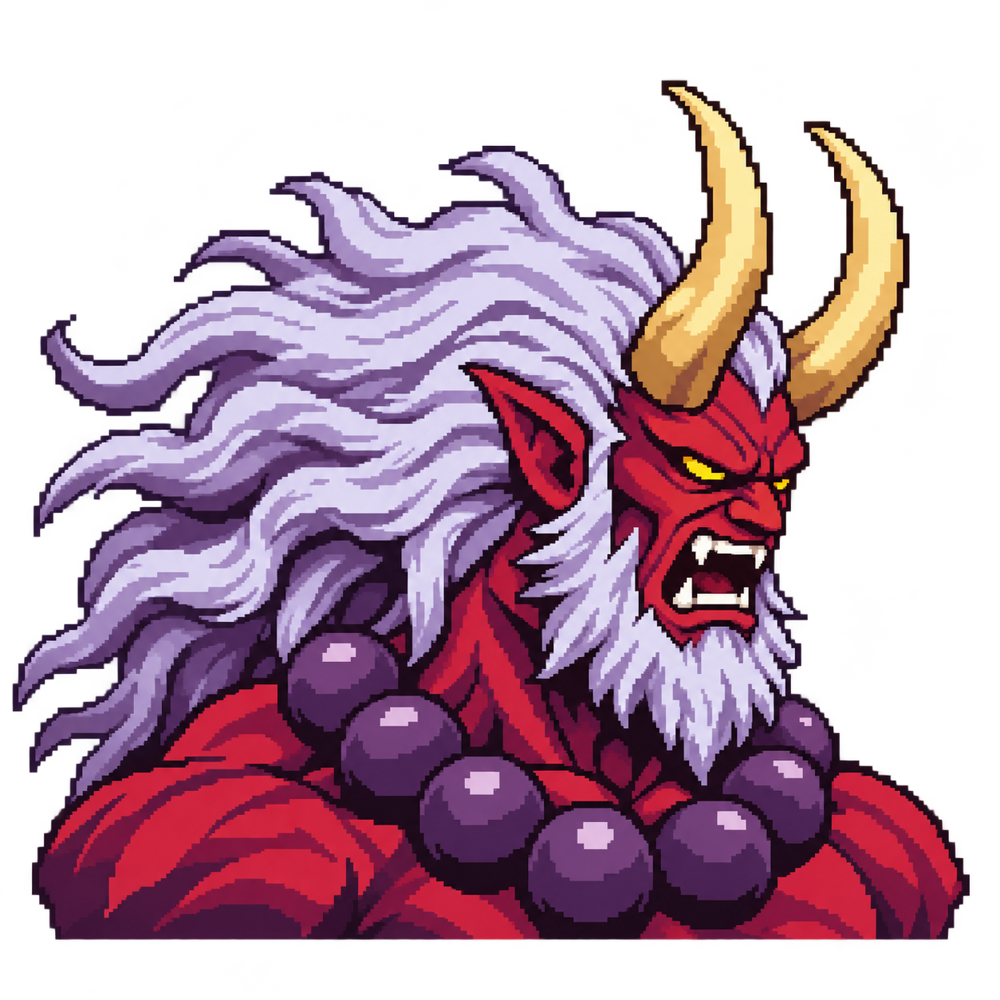 *Avatar Portrait* | **Series:** Legends of the Ashen Gate (*Lendas do Portão de Cinzas*) **ID:** `garan` \| **Author:** Ultimate MUGEN **Origin:** Subterranean Caldera / Mt. Aso Abysm, Japan 🇯🇵 **Alignment:** **Villain / Primordial Calamity** **Theme Color:** `#7b2cbf` (Cold Ashen Violet & Brimstone) **Awakened Form:** Awakened Oni (*Oni Desperto*) **Home Stage:** Volcanic Crater (`volcano`) **Fighting Style:** Primordial Demonic Brute Force & Violet Ashen Flames |

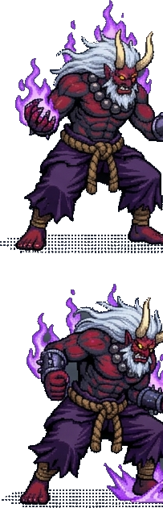
*Standard In-Game Combat Stance*

#### Biography & Background
Garan is a colossal thousand-year-old demon who crawled up from the deepest subterranean magma abysms beneath Mount Aso. Sealed during the Heian era by ninety-nine ascetic warrior-monks who sacrificed their lives to construct the Ashen Gate, Garan slumbered beneath layers of cooled basalt for centuries.

When Mikazuki Oboro cast the Scarlet Eclipse, the dimensional shockwaves shattered the sacred talismans binding the Ashen Gate. Clawing his way back to the surface world enveloped in chilling violet flames, Garan brings with him an insatiable hunger for mortal fear and despair. Unlike normal fire, Garan's violet flame does not burn wood or stone; it devours the soul and will to live, leaving victims as hollow husks of grey ash.

#### Iconic Quotes
- **Intro:** *"Your fear has a taste... absolutely exquisite."*
- **Taunt:** *"Run, little mortal. It makes the hunt so much better."*
- **Win Quote:** *"Kneel, weakling. The Ashen Gate is open, and it is starving."*

#### Signature Moves
- **Ashen Cleave**: Slams his massive stone-hard fists into the ground, sending a wave of violet fire forward.
- **Oni Grab & Crush**: Grabs the opponent by the skull, lifting them up and infusing cold hellfire directly into their chest.
- **Brimstone Quake**: Jumps into the air and belly-flops onto the arena, causing unblockable shockwaves across the floor.
- **Super — Gates of the Underworld Unleashed**: Drags the opponent into a volcanic abyss and delivers a cataclysmic beatdown engulfed in violet flame.

#### Key Character Dynamics
- **vs. Sylene Vashti:** Ancient blood feud. Sylene’s ice is the only element capable of extinguishing Garan's cold flame, making them bitter, mortal adversaries.
- **vs. Haruki Sumi:** Ravenous predator vs delicious prey. Garan can smell the sealed Twilight Titans inside Haruki and wants nothing more than to crack Haruki open like an egg.
- **vs. Mikazuki Oboro:** Unstable alliance of convenience. Garan respects Oboro’s cunning, but is eager to crush Oboro’s skull the moment the dimensional veil completely dissolves.

---

### 10. Captain Marlow Reyes

| Visual Identity | Combat Profile |
|---|---|
|  *Avatar Portrait* | **Series:** Corsairs of the Salty Wind (*Corsários do Vento Salgado*) **ID:** `marlow` \| **Author:** Ultimate MUGEN **Origin:** Port of Cádiz, Spain 🇪🇸 & The Sky Archipelago **Alignment:** **Anti-Hero / Dashing Sky Corsair** **Theme Color:** `#0077b6` (Sea Navy & Brass Gold) **Awakened Form:** Captain Tempest (*Capitão Tempestade*) **Home Stage:** Rocky Plateau (`plains`) / Neo-Metropolis 2099 (`neon`) **Fighting Style:** Tempest-Forged Cutlass & Aether Flintlock Fencing |

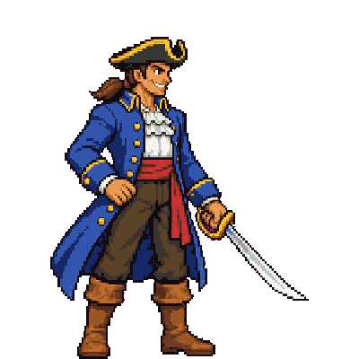
*Standard In-Game Combat Stance*

#### Biography & Background
Flamboyant, charming, and utterly fearless, Captain Marlow Reyes is the commander of the legendary flying galleon *El Viento Salgado*. Having spent two decades navigating both the high seas of the Atlantic and the perilous cloud reefs of the Sky Archipelago, Marlow has plundered every tyrannical merchant fleet from Madrid to Neo-Metropolis. His cutlass was quenched in the heart of a maelstrom and crackles with perpetual tidal electricity.

Marlow is not a cruel killer; he lives for adventure, high stakes, and the thrill of discovery. When the Convergence fused cloud kingdoms with mortal continents, Marlow saw the opportunity of a lifetime: dozens of uncharted civilizations, mythical relics, and legendary fighters to challenge for treasure maps.

#### Iconic Quotes
- **Intro:** *"Ahoy! How about wagering that treasure map of yours on this fight?"*
- **Taunt:** *"Well, well... who would have thought you'd be this easy?"*
- **Win Quote:** *"Pillage? Heavens, no! I only came for the view... and that shiny map in your pocket."*

#### Signature Moves
- **Cutlass Tide Slice**: A sweeping dashing slash that leaves an aether-water trail behind.
- **Aether Flintlock Trick**: Fires a ricocheting spark shot from his brass pistol that bounces off the arena walls.
- **Corsair Roll**: An evasive forward somersault that slips under projectiles and positions Marlow behind the foe.
- **Super — Broadside of the Salty Wind**: Whistles for his flying galleon, which carpet-bombs the stage with a devastating salvo of cannonballs.

#### Key Character Dynamics
- **vs. Lian Feng:** Playful harassment vs strict discipline. Marlow loves teasing Lian about her serious demeanor, while Lian threatens to throw him overboard.
- **vs. Valdric Morn:** Pure ideological enmity. Valdric views Marlow as a parasitic pirate criminal; Marlow considers Valdric a pompous tin-can tyrant who needs his wallet stolen.
- **vs. Bruno Volk:** Drinking buddies. After a good brawl, Marlow and Bruno can always be found sharing stories and laughs at the town tavern.

---

### 11. Kaname Fuyutsuki (冬月 要)

| Visual Identity | Combat Profile |
|---|---|
| 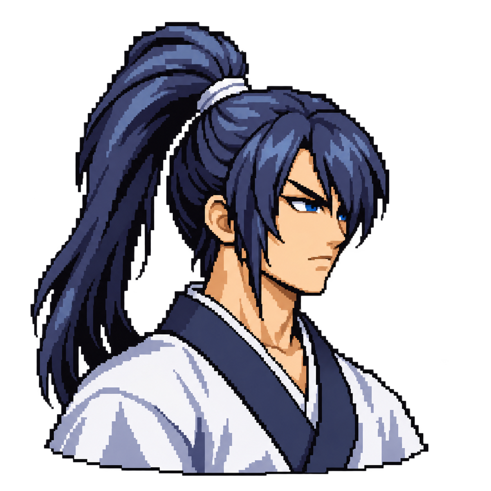 *Avatar Portrait* | **Series:** Chronicles of the Everwinter Blade (*Crônicas da Lâmina do Inverno Eterno*) **ID:** `kaname` \| **Author:** Ultimate MUGEN **Origin:** Mt. Daisetsuzan, Hokkaido, Japan 🇯🇵 **Alignment:** **Neutral / Lawful Divine Judge** **Theme Color:** `#48cae4` (Pristine Frost & Haori White) **Awakened Form:** Spiritual Blade (*Lâmina Espiritual*) **Home Stage:** Gate of Spirits (`spirit`) **Fighting Style:** Everwinter Iaido & Spiritual Severance |

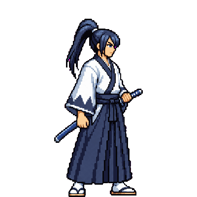
*Standard In-Game Combat Stance*

#### Biography & Background
Kaname Fuyutsuki is the supreme guardian of the Sanctuary of Everlasting Snows on the sacred peaks of Hokkaido. Dressed in a spotless white haori adorned with snowflake heraldry, Kaname draws his spirit katana, *Hyōketsu*, only in the pursuit of absolute righteousness. His blade does not merely cut flesh and bone; it cuts through hesitation, dark sorcery, and spiritual illusions.

Kaname views combat not as a pastime or a sport, but as a solemn ritual of judgment. He speaks with measured formality, displaying neither malice nor pride. When Oboro’s dimensional tampering began bleeding dark miasma into the spirit world, Kaname descended to the Gate of Spirits to pass judgment upon the violators of cosmic order.

#### Iconic Quotes
- **Intro:** *"My steel thirsts for justice. Unsheathe yours."*
- **Taunt:** *"To hesitate is to lose. You have already lost."*
- **Win Quote:** *"My blade does not cut merely flesh. It severs your hesitation."*

#### Signature Moves
- **Frost Flash Iaido**: An instantaneous quick-draw slash that freezes the air along the sword path.
- **Glacial Counter**: Enters a calm parry stance; any incoming physical hit triggers an immediate counter-slash that freezes the foe's feet.
- **Crescent Frost Crescent**: Slashing projectile of crystallized spiritual ice.
- **Super — Severance of Absolute Zero**: Dashes through the opponent with a blinding iaido draw, sheathing the sword slowly; when the blade clicks shut, the opponent takes massive burst damage.

#### Key Character Dynamics
- **vs. Shion Kurogane:** The ultimate clash of swordsmen. Heavy lunar sword against precise quick-draw frost katana.
- **vs. Mikazuki Oboro:** Divine judge vs master of falsehood. Kaname’s sword is one of the few weapons capable of cleaving through Oboro's illusions.
- **vs. Sylene Vashti:** Respectful recognition of sovereign ice. Kaname acknowledges Sylene’s royal lineage and aids her in purifying demonic corruption.

---

### 12. Jin Kazaguruma (風車 迅)

| Visual Identity | Combat Profile |
|---|---|
| 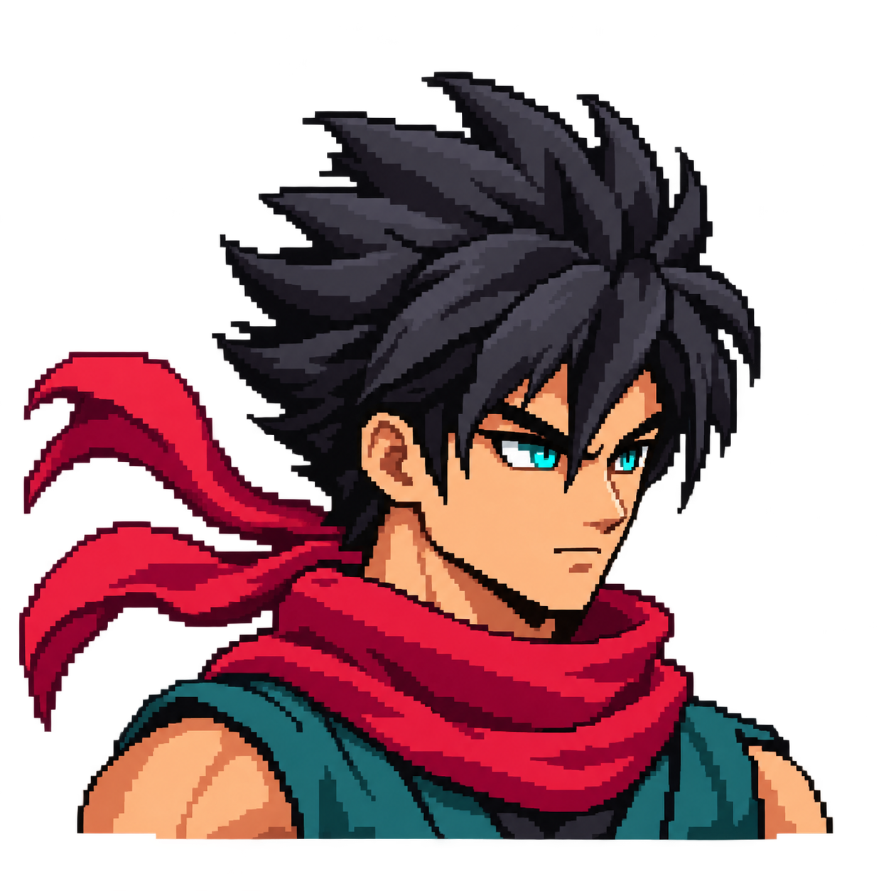 *Avatar Portrait* | **Series:** Winds of the Hidden Valley Village (*Ventos da Vila Escondida no Vale*) **ID:** `jin` \| **Author:** Ultimate MUGEN **Origin:** Kiso Valley / Nagano, Japan 🇯🇵 **Alignment:** **Hero / Zephyr Acrobat** **Theme Color:** `#0077b6` (Sky Blue & Crimson Scarf) **Awakened Form:** Typhoon (*Tufão*) **Home Stage:** Moonlit Bamboo Grove (`bamboo`) **Fighting Style:** Kazaguruma Wind Acrobatics & Twin Gale Chakrams |

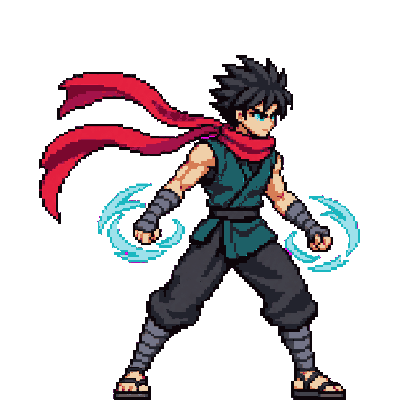
*Standard In-Game Combat Stance*

#### Biography & Background
Young, energetic, and gifted with god-like speed, Jin Kazaguruma is the chief courier and scout of the Wind Valley Village. Wearing a long crimson scarf that streams behind him like a banner of wind, Jin fights with a pair of aerodynamic wind chakrams that he can spin, throw, and recall at will.

Jin's fighting style is completely freeform and acrobatic. He runs across walls, somersaults over incoming fireballs, and leaves afterimage mirages that confuse even seasoned warriors. Despite his playful demeanor, Jin carries a fierce sense of justice, having pledged to protect innocent villagers whose homes were uprooted by the dimensional tear.

#### Iconic Quotes
- **Intro:** *"Try to keep up with me... if you can!"*
- **Taunt:** *"Too slow! The wind didn't even notice you!"*
- **Win Quote:** *"See that? The wind always arrives first!"*

#### Signature Moves
- **Pinwheel Chakram Toss**: Hurls spinning wind discs that circle outward and return like boomerangs.
- **Zephyr Mirage Dash**: Leaves three afterimages across the floor while teleporting into an overhead dive kick.
- **Cyclone Flip**: Upward somersault kick that creates a miniature whirlwind beneath the opponent.
- **Super — Gale Pinwheel Tempest**: Spins at supersonic speed, creating a massive vacuum vortex that traps the foe before delivering an explosive aerial drop.

#### Key Character Dynamics
- **vs. Kaito Arashi:** Jin looks up to Kaito as an older brother and role model, constantly striving to prove that his wind speed can overcome Kaito’s wind power.
- **vs. Suzume Kagerou:** Friendly ninja rivalry. Jin constantly tries to get the gloomy Suzume to smile or laugh, usually earning an exasperated sigh or a thrown kunai.
- **vs. VX-9 Volta:** Speed test. Jin loves racing Volta across the rooftops of Neo-Metropolis, testing human agility against cybernetic booster rockets.

---

### 13. Daichi Ginrou (銀狼 大地)

| Visual Identity | Combat Profile |
|---|---|
| 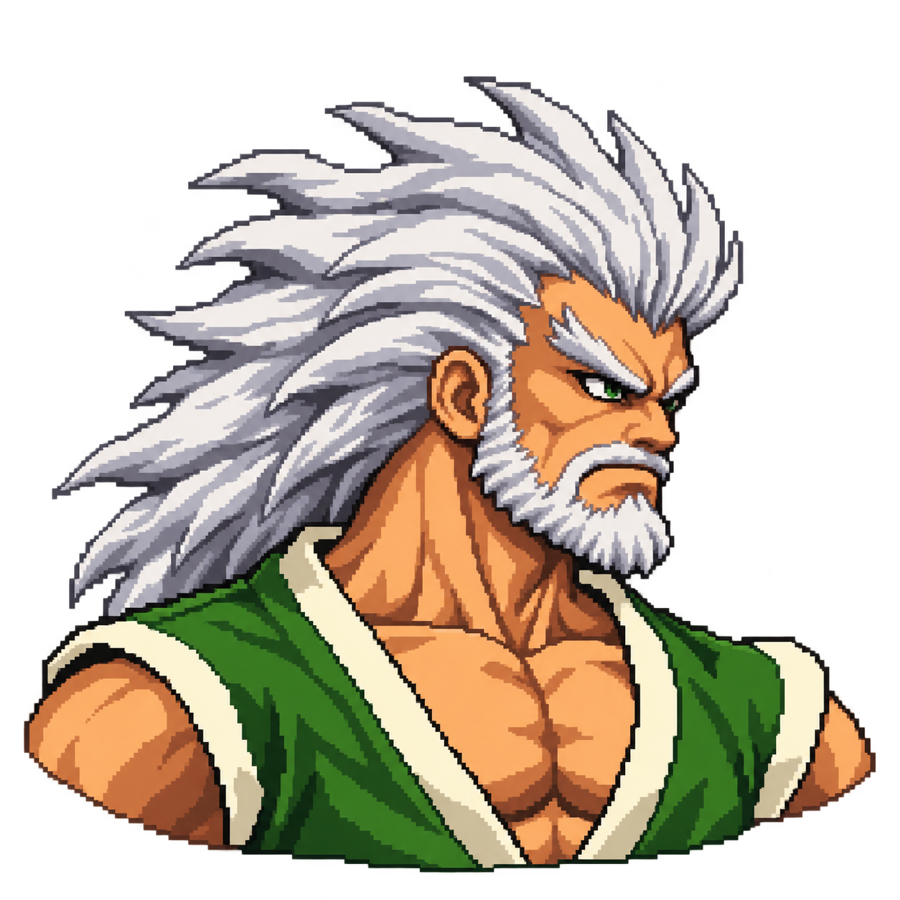 *Avatar Portrait* | **Series:** Legends of the Celestial Peak Fist (*Lendas do Punho do Pico Celeste*) **ID:** `daichi` \| **Author:** Ultimate MUGEN **Origin:** Altai Mountains & Mongolian Steppes 🇲🇳 **Alignment:** **Hero / Wild Apex Brawler** **Theme Color:** `#e9c46a` (Golden Ki & Wild Silver) **Awakened Form:** Lupine Instinct (*Instinto Lupino*) **Home Stage:** Rocky Plateau (`plains`) **Fighting Style:** Celestial Peak Fist & Primal Lupine Ki |

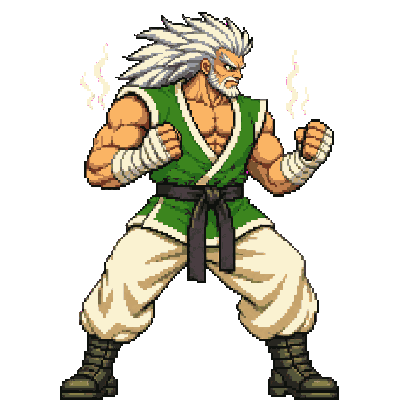
*Standard In-Game Combat Stance*

#### Biography & Background
Found as an orphaned infant in the frozen wastes of the Altai Mountains and raised by a mystical pack of giant silver wolves, Daichi Ginrou embodies the untamed fury of the wilderness. With wild, spiky silver hair and sharp predatory instincts, Daichi learned to transform his fighting spirit into an incandescent golden aura.

Daichi does not fight out of anger or hatred; he fights for the pure, unadulterated joy of testing his limits against worthy rivals. He can smell fear, deception, and ill intent from miles away, making him immune to psychological manipulation. When the Convergence pulled the world into chaos, Daichi bounded across the rocky canyons with a fierce wolf grin, eager to battle the strongest champions across time and space.

#### Iconic Quotes
- **Intro:** *"Haha! This fight is gonna be awesome!"*
- **Taunt:** *"That's all you've got? Man, I got hyped for nothing!"*
- **Win Quote:** *"Haha! That was great! Let's go again, harder this time!"*

#### Signature Moves
- **Wolf Fang Strike**: A ferocious lunging claw strike infused with golden ki.
- **Apex Roar**: Releases a shockwave roar that reflects projectiles and pushes opponents across the screen.
- **Predator Pounce**: A low-angle forward leap that pins the opponent to the ground for a barrage of punches.
- **Super — Golden Celestial Apex**: Unleashes his full lupine avatar, delivering a cataclysmic barrage of golden-claw strikes that finishes with an earth-shattering uppercut.

#### Key Character Dynamics
- **vs. Akio Hoshi:** Best friends and eternal rivals. Their training sessions routinely level mountain ridges and leave them both laughing with broken ribs.
- **vs. Bruno Volk:** Physical combat paradise. Daichi loves Bruno's honest punches, comparing Bruno to a giant grizzly bear.
- **vs. Kaito Arashi:** High martial respect. Daichi respects Kaito’s calm center, finding it difficult to rattle Kaito with his wild wolf tactics.

---

### 14. Valdric Morn

| Visual Identity | Combat Profile |
|---|---|
| 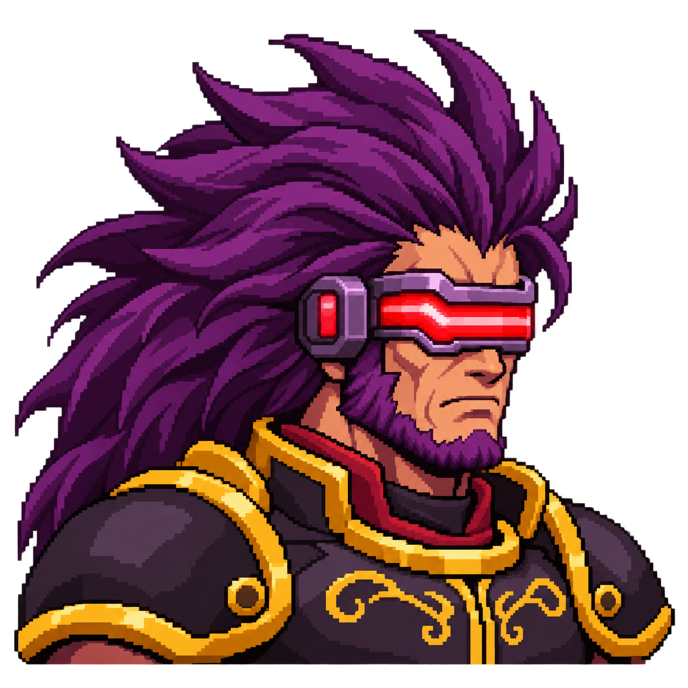 *Avatar Portrait* | **Series:** Chronicles of the Red Star Empire (*Crônicas do Império da Estrela Rubra*) **ID:** `valdric` \| **Author:** Ultimate MUGEN **Origin:** Vane Industrial Megacommune, Germany / Central Europe 🇩🇪 **Alignment:** **Villain / Imperial Conqueror** **Theme Color:** `#d90429` (Imperial Crimson & Heavy Iron) **Awakened Form:** Scarlet Dominance (*Dominância Escarlate*) **Home Stage:** Neo-Metropolis 2099 (`neon`) / Volcanic Crater (`volcano`) **Fighting Style:** Heavy Armored Combat & Dark Matter Plasma Cannons |

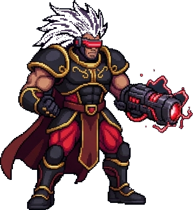
*Standard In-Game Combat Stance*

#### Biography & Background
Prince Valdric Morn is the iron-fisted heir and supreme commander of the Red Star Empire, a heavily militarized technocratic superpower. Encased in ornate, high-density crimson power armor powered by a stolen dark-matter core, Valdric believes that lasting world peace can only be established through total martial subjugation and industrial dominance.

Arrogant, cold, and calculating, Valdric considers spiritual martial artists and wandering monks to be obsolete relics who must be purged or enslaved. When the Convergence fused his industrial fortresses with ancient lands, Valdric mobilized his legions to conquer every sector and claim the dimensional core for the Empire.

#### Iconic Quotes
- **Intro:** *"A prince does not fight with commoners. Today, I make an exception."*
- **Taunt:** *"Pathetic. Try again if you dare."*
- **Win Quote:** *"Kneel! A prince does not lose to filthy plebeians."*

#### Signature Moves
- **Imperial Plasma Cannon**: Charges and fires an armor-piercing crimson energy beam from his arm gauntlet.
- **Heavy Aegis Rush**: Charges forward behind an invincible energy shield, bowling over incoming attacks.
- **Overlord Stomp**: Stomps his heavy armored boot onto the floor, causing a localized seismic eruption.
- **Super — Imperial Annihilation Protocol**: Locks the opponent in tractor beams and fires an orbital laser salvo that obliterates the arena.

#### Key Character Dynamics
- **vs. Bruno Volk:** Pure class hatred. Valdric is infuriated that a common brawler from a poor Brazilian town can crack his million-credit power armor.
- **vs. VX-9 Volta:** Treason and defiance. Valdric views Volta as stolen imperial intellectual property and intends to reformat Volta into a lobotomized war tool.
- **vs. Mikazuki Oboro:** Dangerous rivalry. Valdric believes he can master Oboro's dimensional rift technology, unaware that Oboro is simply using the Prince's armies as pawns.

---

### 15. Haruki Sumi (墨 春樹)

| Visual Identity | Combat Profile |
|---|---|
| 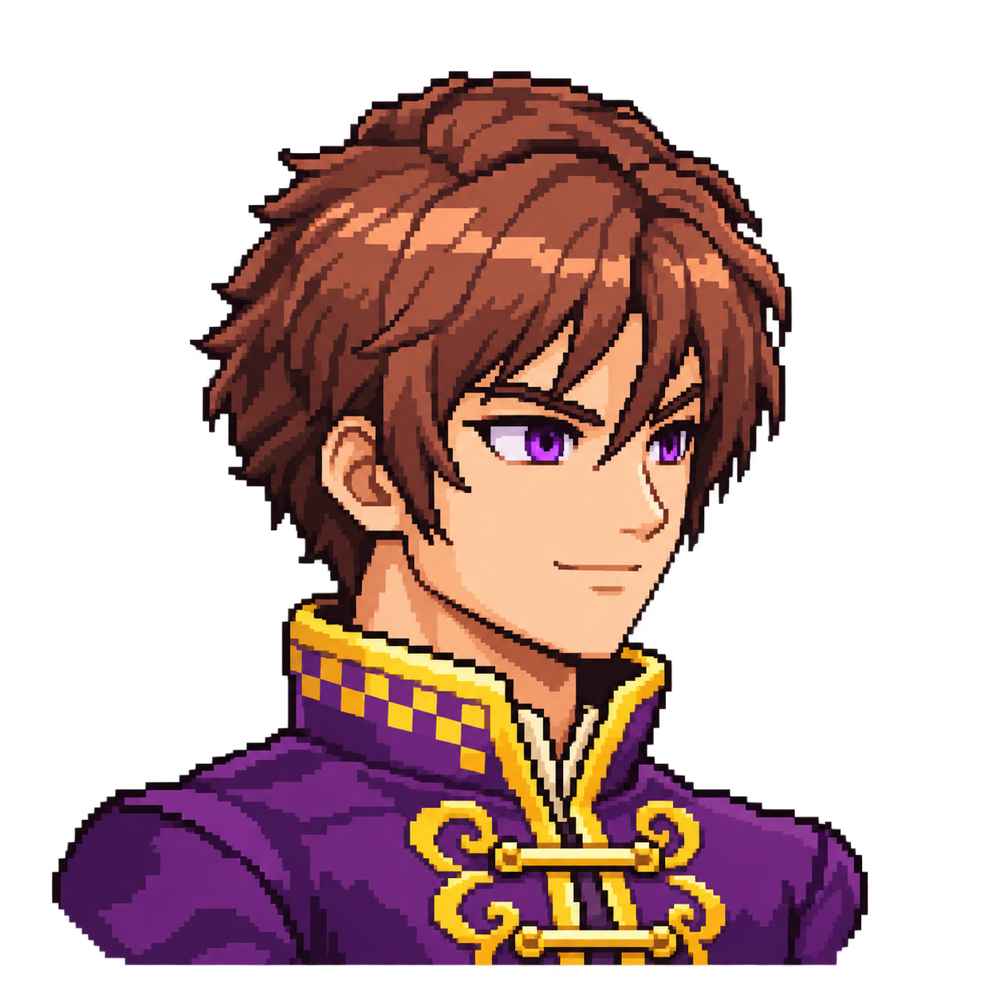 *Avatar Portrait* | **Series:** Twilight Library Archives (*Arquivos da Biblioteca do Crepúsculo*) **ID:** `haruki` \| **Author:** Ultimate MUGEN **Origin:** Secret Arcane Vaults of Seoul, South Korea 🇰🇷 **Alignment:** **Hero / Reluctant Calamity Guardian** **Theme Color:** `#588157` (Scholar Sage & Sealing Ochre) **Awakened Form:** Contained Fury (*Fúria Contida*) **Home Stage:** Gate of Spirits (`spirit`) **Fighting Style:** Calligraphic Talisman Arts & Unleashed Twilight Titan Core |

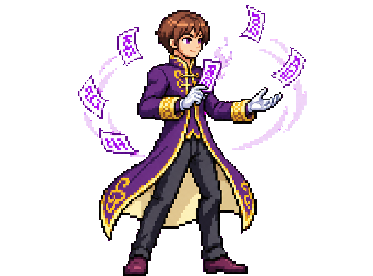
*Standard In-Game Combat Stance*

#### Biography & Background
Haruki Sumi is a gentle, soft-spoken scholar who wears round spectacles and ink-stained scholar robes. He spent his life peacefully cataloging ancient manuscripts in the Twilight Library, an underground labyrinth beneath Seoul containing the forbidden histories of forgotten civilizations.

Tragically, Haruki was chosen as the living vessel for the **Twilight Titans** — cataclysmic primordial beasts that nearly destroyed the ancient world before being sealed inside his spiritual core. Haruki abhors violence, constantly apologizing to his opponents and begging them to retreat. But if his companions are endangered or his life is threatened, the protective talismans on his arms tear open, unleashing a terrifying wave of eldritch destructive energy that he struggles desperately to control.

#### Iconic Quotes
- **Intro:** *"Please... don't force me to fight you."*
- **Taunt:** *"I warned you... I truly don't want to hurt you."*
- **Win Quote:** *"I'm so sorry... I really didn't want things to go this far."*

#### Signature Moves
- **Talisman Ink Barrier**: Writes an arcane kanji in mid-air that repels incoming attacks and reflects projectiles.
- **Scholar's Binding Scroll**: Casts paper talismans along the floor that bind the opponent's feet, temporarily immobilizing them.
- **Titan Shockwave**: A sudden involuntary burst of shadowy aura that pushes back aggressive rushdown.
- **Super — Seal Shatter: Twilight Wrath**: The talismans across Haruki's arms burn away; an enormous eldritch shadow manifests behind him, delivering a cataclysmic barrage of cosmic strikes before Haruki snaps back into conscious remorse.

#### Key Character Dynamics
- **vs. Garan the Ashen Oni:** Ultimate existential threat. Garan recognizes the ancient beasts inside Haruki and wants to tear them free to devour them.
- **vs. VX-9 Volta:** Deep philosophical kinship. Haruki helps Volta understand human art and poetry, while Volta protects Haruki from bounty hunters.
- **vs. Bruno Volk:** Protective friendship. Bruno treats Haruki like a kid brother, shielding him from rowdy fighters in the tournament circuit.

---

### 16. Mikazuki Oboro (三日月 朧) — Final Boss

| Visual Identity | Combat Profile |
|---|---|
| 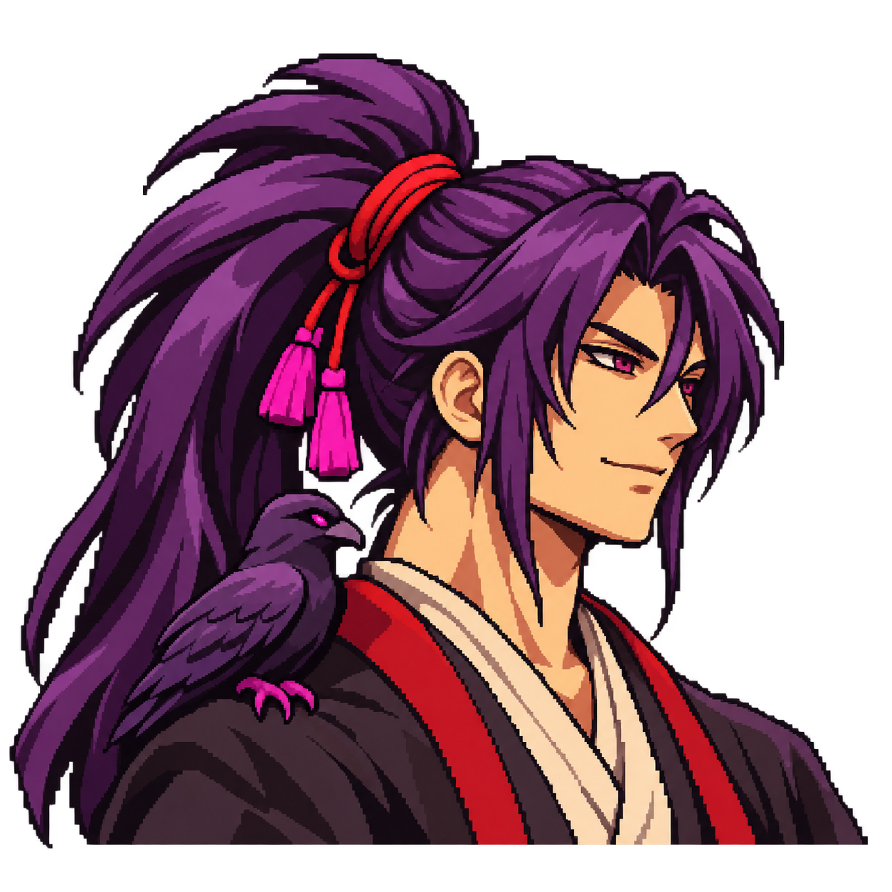 *Avatar Portrait* | **Series:** Scarlet Eclipse — Final Boss (*Eclipse Escarlate — Chefe Final*) **ID:** `oboro` \| **Author:** Ultimate MUGEN **Origin:** The Rift of the Scarlet Eclipse / Forgotten Moon Dynasty **Alignment:** **Supreme Villain / Final Boss** **Theme Color:** `#c8102e` (Blood Eclipse Crimson & Void Black) **Awakened Form:** Awakened Mangekyo (*Mangekyo Desperto*) **Home Stage:** Gate of Spirits (`spirit`) / Volcanic Crater (`volcano`) **Fighting Style:** Reality-Warping Genjutsu, Black Hellfire & Raven Phantoms |

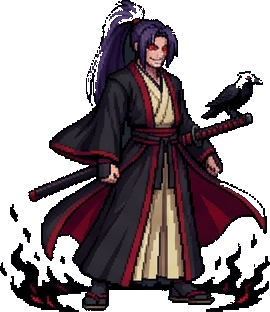
*Standard In-Game Combat Stance*

#### Biography & Background
Mikazuki Oboro is the supreme architect behind the Great Convergence and the ultimate antagonist of Ultimate MUGEN. Standing tall in flowing black robes lined with blood-crimson silk, Oboro possesses the legendary **Scarlet Mangekyo** eyes — ocular artifacts capable of perceiving and rewriting the fundamental fabric of cause and effect.

Oboro views mortal reality as an agonizing, chaotic nightmare filled with suffering, war, and mortality. His grand design is to cast the entire universe into an eternal, painless dreamworld beneath the Scarlet Eclipse, erasing all individual consciousness into a serene, unified sea of black fire. Calm, elegant, and always three steps ahead of every challenger, Oboro fights with effortless superiority: his body dissolves into flocks of nightmarish ravens when struck, and his black flames burn until nothing remains.

#### Iconic Quotes
- **Intro:** *"You have made it this far... exactly as I foresaw."*
- **Taunt:** *"All of this has already occurred — entirely inside your mind."*
- **Win Quote:** *"An illusion... from the very first strike."*

#### Signature Moves
- **Crow Clone Dissipation**: When struck by any move, Oboro dissolves into a cloud of ravens and reforms behind the opponent.
- **Amaterasu Void Flame**: Ignites an inextinguishable black fire at the opponent's exact screen coordinates.
- **Nightmare Tsukuyomi**: Locks eyes with the opponent, freezing them in psychological paralysis while shadowy spikes pierce their soul.
- **Super — Total Eclipse of the Void**: Oboro ascends into the crimson sky, opening his giant eye across the horizon; the entire arena shatters into dimensional fragments, dealing astronomical damage to any mortal unfortunate enough to challenge him.

#### Key Character Dynamics
- **vs. All Fighters:** Oboro views all heroes and villains alike as actors on his stage. He anticipates every move, mocking their struggles as futile ripples in his master tapestry.
- **vs. Kaito Arashi:** The philosophical centerpiece. Kaito’s wind represents mortal striving and freedom; Oboro’s eclipse represents absolute stillness and total control.
- **vs. Suzume Kagerou:** Cold amusement. Oboro casually acknowledges having wiped out her clan, viewing her vengeful rage as merely another predictable emotion to be extinguished.

---

## Inter-Character Relationship Matrix

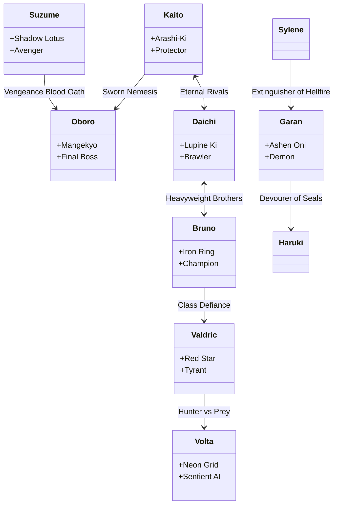
