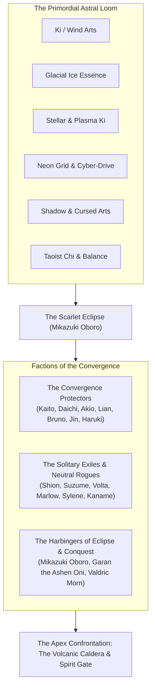

# Universe and Lore — The Great Convergence

The world of **Ultimate MUGEN** is set in an era known as **The Great Convergence** (*A Grande Convergência*), where time, geography, and dimensions have collided following the cataclysmic awakening of the **Scarlet Eclipse** (*Eclipse Escarlate*).

---

## The Genesis: The Astral Loom and The Severing

For millennia, human history unfolded along distinct cultural and martial currents. Warriors from secluded Japanese mountain shrines, Chinese Taoist sanctuaries, Nordic glacial fortresses, futuristic cyberpunk megacities, Mongolian plateaus, and dusty Latin American towns trained in isolation, oblivious to the existence of parallel realms.

Beneath the physical world hummed the **Astral Loom** (*A Trama Astral*) — a metaphysical network of cosmic leylines that regulated the flow of life force, ancestral spirits, and elemental energies.

This delicate equilibrium shattered when **Mikazuki Oboro**, an immortal sorcerer and master of illusions from an ancient forgotten dynasty, cast the forbidden ritual of the **Scarlet Eclipse**. By harnessing black flames and celestial alignment, Oboro fractured the dimensional membrane, pulling disparate epochs, technology levels, and landscapes into a singular, unstable battleground known as **The Convergence Domain**.

---

## Energy Systems & Martial Disciplines

Warriors in Ultimate MUGEN channel their fighting spirits through distinct energy sources:

1. **Primordial Wind (*Arashi-Ki*)**: Channelled by **Kaito Arashi** and **Jin Kazaguruma**. It draws power from atmospheric currents, typhoons, and aerial pressure, enabling high-speed gap-closers, vacuum strikes, and cutting gale projectiles.
2. **Stellar Plasma (*Hoshi-No-Hikari*)**: Mastered by **Akio Hoshi**. Taps into cosmic radiation and fallen meteorites, manifested as incandescent bursts, supernova impacts, and blazing plasma fist strikes.
3. **Lupine Earth & Primal Ki (*Ginrou-Ki*)**: Harnessed by **Daichi Ginrou**. Drawn directly from wild predatory instincts and mountain earth leylines, converting battle thirst into a radiant golden aura.
4. **Absolute Zero & Spirit Frost (*Hyōketsu*)**: Wielded by **Sylene Vashti** and **Kaname Fuyutsuki**. Freezes moisture in the air into crystalline blades, glacial barriers, and piercing soul-severing slashes.
5. **Taoist Chi & Wind-Silk (*Yu-Chi*)**: Practiced by **Lian Feng**. Focuses on deflection, gravitational redistribution, and fluid roundhouse kicks that ripple through kinetic space.
6. **Kinetic Iron Supremacy (*Punho de Ferro*)**: Refined by **Bruno "Bulldozer" Volk**. Pure human musculoskeletal conditioning, heavy-weight kinetic momentum, and unbreakable close-quarters boxing devastating enough to shatter mystic auras.
7. **Cyber-Drive & Overcharge (*Grade Neon*)**: The energy framework of **VX-9 Volta**. High-frequency dielectric capacitors, super-conducting servos, and digital particle beams running on artificial consciousness.
8. **Ashen Hellfire (*Oni-No-Hai*)**: Erupted from **Garan the Ashen Oni**. Cold violet flames forged in subterranean demon gates that consume spiritual fortitude rather than burning flesh.
9. **Tempest Aether (*Aether dos Mares*)**: Harnessed by **Captain Marlow Reyes**. Sky-sailor energy infused with storm lightning and tide currents, channeled through an enchanted cutlass.
10. **Imperial Scarlet Core (*Estrela Rubra*)**: Engineered by **Valdric Morn**. High-yield dark matter cannons built into heavy power armor, capable of orbital-scale shockwave blasts.
11. **Sealed Twilight Titans (*Crepúsculo Selado*)**: Locked inside **Haruki Sumi**. Forbidden eldritch power contained by paper talismans; if cracked by mortal peril, it unleashes cataclysmic calamity.
12. **Lunar Requiem (*Kurogane Tsuki*)**: Channelled by **Shion Kurogane**. Gravitational tides of the Pale Moon condensed into an impossibly heavy broadsword.
13. **Shadow Lotus Mirage (*Kagerou-Ryu*)**: Inherited by **Suzume Kagerou**. Phantom displacement, sensory blind-spot manipulation, and silent assassination daggers.
14. **The Scarlet Mangekyo (*Meikyō Escarlate*)**: The supreme illusion eye of **Mikazuki Oboro**. Bends optical perception, summons murder-crows, and rewrites the physical consequences of combat inside the victim's subconscious.

---

## The Three Factions: Heroes, Neutrals, and Villains

The warriors of the Convergence are divided into three distinct philosophical camps:

### 1. The Convergence Protectors (Heroes)
Dedicated to mending the Astral Loom, closing the dimensional fissures, and protecting innocent mortals from annihilation:
- **Kaito Arashi** (Japan): Wandering righteous karateka seeking balance through the storm.
- **Daichi Ginrou** (Mongolia): Free-spirited mountain warrior whose golden spirit protects the vulnerable.
- **Akio Hoshi** (Japan): Impetuous star-striker whose fiery heart never backs down from tyranny.
- **Lian Feng** (China): Jade Lantern Grandmaster maintaining the ancient cosmic harmony.
- **Bruno "Bulldozer" Volk** (Brazil): Heavyweight people's champion defending his hometown with thunderous fists.
- **Jin Kazaguruma** (Japan): Swift messenger of freedom fighting to preserve peace in the hidden valleys.
- **Haruki Sumi** (South Korea): Gentle archivist and scholar enduring the burden of sealed apocalyptic titans.

### 2. The Solitary Exiles & Free Rogues (Anti-Heroes / Neutrals)
Warriors driven by personal codes, vendettas, sovereign restoration, or existential self-discovery:
- **Shion Kurogane** (Japan): Tragic swordsman bearing the crushing guilt of an exiled moon clan.
- **Suzume Kagerou** (Japan): Vengeful shadow kunoichi hunting the masterminds who massacred her people.
- **VX-9 Volta** (USA / Neo-Metropolis): Escaped military android seeking the philosophical meaning of the soul.
- **Captain Marlow Reyes** (Spain / Caribbean Sky): Swashbuckling sky pirate raiding tyrants and seeking mythic loot.
- **Sylene Vashti** (Norway / Borealia): Displaced glacial princess determined to reclaim her usurped frozen kingdom.
- **Kaname Fuyutsuki** (Japan): Impartial frost samurai judge executing divine severance without emotional hesitation.

### 3. The Harbingers of Eclipse & Tyranny (Villains)
Entities seeking universal subjugation, demonic awakening, or reality erasure:
- **Mikazuki Oboro** (Eclipse Dimension — Final Boss): Master illusionist aiming to dissolve all reality into an eternal dream of black fire.
- **Garan the Ashen Oni** (Subterranean Abysm): Primordial demon unleashed to burn civilization into cold ash.
- **Valdric Morn** (Germanic Red Star Empire): Megalomaniacal prince using cybernetic plasma armaments to conquer and subjugate "inferior plebeians".

---

## The Grand Tournament: The Apex of Convergence

To sustain the dimensional tears and feast upon the combat energy of the world's greatest souls, Mikazuki Oboro manifested the **Apex Crucible** — a series of battlegrounds spanning ancient temples, futuristic sky-rises, primeval bamboo groves, rocky plateaus, spirit shrines, volcanic calderas, and peaceful village squares.

Fighters find themselves drawn together by cosmic gravity. Each battle fuels the convergence or brings the fighters one step closer to dismantling Oboro's grand illusion before reality permanently fades into the Scarlet Eclipse.
