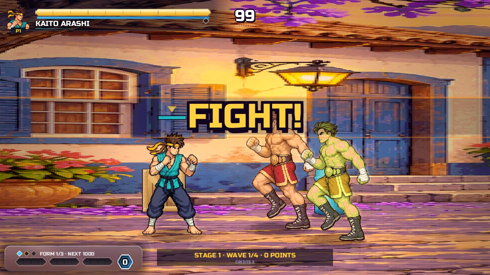
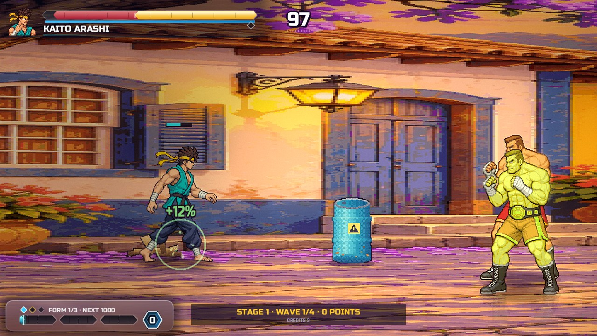
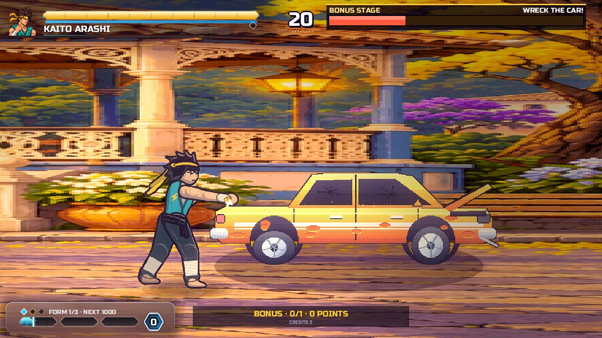

# Stage objects: breakables, food and bonus rounds

**English** · [Português (BR)](pt-BR/Objetos-de-Cenario.md)

Story stages carry arcade-style objects that live inside the simulation: crates and barrels that break when struck, food and other pickups that pop out of them, and a bonus round where the goal is to wreck everything before the clock runs out. Everything on this page is original content and is driven by one TOML file, so a new object needs art and a few lines of data, not code.



## What the player sees

- **Breakables.** Any strike or projectile that reaches a crate or barrel damages it. The sprite switches to a cracked frame as it loses life, shakes and flashes on impact, and leaves splinters or a crushed drum behind for a few seconds.
- **Pickups.** A broken object can drop one item. It pops up, bounces once and waits on the floor for 15 seconds (it blinks during the last 2.5). Walking over it collects it.
- **Bonus round.** After the boss of the Back Alleys and of the Bamboo Grove, the villain leaves and a bonus round starts in place: wreck the car (4 damage stages, smoke and sparks when badly hit) or break the whole stash before the timer ends. No enemies and no way to lose; breaking everything pays the object score plus 200 points per second left.

| Pickup | Effect | Score |
|---|---|---|
| Apple | +12 % life | 100 |
| Pizza slice | +25 % life | 200 |
| Roast | +50 % life | 400 |
| Gem | score only | 1500 |
| Battery | +34 % power | 150 |




## Rules (engine)

`crates/engine/src/stage_objects.rs` owns the state (`Match::objects`), so it is cloned with the match, hashed by the netplay checksum and never allocates during a tick.

- A `Breakable` has a position on the floor, a lane, a hurt box (`half_width`, `height`), life and an optional `PickupSpec` drop. Standing strikes pass over low objects, so the hurt box is at least 100 units tall.
- Depth: with lanes on, an attacker reaches an object when its lane is within `LANE_REACH + depth` of the object lane.
- One hit per swing: after a hit the object ignores new hits for `REHIT_TICKS` (10). The attacker gets `MoveContact`/`MoveHit` and up to 8 ticks of hit pause, so normals cancel off a crate exactly like off a fighter.
- `solid` objects (the car) push grounded fighters out of their body; jumping above the roof is free.
- Pickups are collected only by root fighters of `collector_side` (the hero side), alive, within 18 units, within twice the strike lane reach and near the floor. Healing never exceeds `life_max`.
- `start_break_all_goal(ticks)` turns the round into a bonus round: the round clock mirrors the goal clock and the round ends for side 0 when every object is broken (`Goal::Cleared`) or the clock runs out (`Goal::TimedOut`).
- Presentation reads `objects.events` (`Struck`, `Broken`, `Dropped`, `Collected`, `GoalCleared`, `GoalTimedOut`) once per tick and clears it.

## Data (`assets/story/objects.toml`)

A copy named `story-objects.toml` next to the executable (or in browser storage) replaces the bundled file.

```toml
[kinds.crate]
sprite = "crate"            # sheet in assets/props/story/, frames side by side
frames = 3                  # damage stages left to right, the last one is the remains
size = [48.0, 48.0]         # drawn size in world units
half_width = 20.0
height = 42.0
depth = 10.0
life = 120.0
score = 100.0
solid = false
debris = [0.78, 0.55, 0.3]  # particle colour
sound = "wood"              # "wood" or "metal"

[pickups.pizza]
sprite = "pizza"            # 6 frames, a shine sweeps across
heal = 0.25                 # fraction of the life bar
power = 0.0                 # fraction of the power bar
score = 200.0

[stages.brazil]
objects = [
  { fight = 0, kind = "crate", x = -78.0, lane = -22.0, drop = "apple" },
]

[stages.brazil.bonus]
seconds = 30
objects = [{ kind = "car", x = 34.0, lane = -16.0 }]
```

`fight` is the wave index inside the stage (the boss is the last one), `x` is measured from the centre of that fight's segment and `lane` is clamped to the stage floor band. A stage without a `bonus` table goes straight from the boss to the stage-clear screen.

## Art

`python3 tools/story_objects_art.py` draws every sheet from code (flat shapes, dithered ramps, one-pixel ink outline) at 2 pixels per world unit, so the art is reproducible and free of third-party assets. Replace a PNG with a sheet of the same layout to reskin an object.

## Code map

| File | Role |
|---|---|
| `crates/engine/src/stage_objects.rs` | State, goal clock, solid bodies |
| `crates/engine/src/stage_objects/strikes.rs` | Strikes and projectiles against breakables, drops |
| `crates/engine/src/stage_objects/pickups.rs` | Pickup physics and collection |
| `src/story/objects.rs` | TOML catalog, spawning per stage and per bonus round |
| `src/story/objects_art.rs` | Sprites, shadows, hit flash, depth ordering against fighters |
| `src/vfx/stage_objects.rs` | Debris, sparks, smoke, floating text, sounds |
| `src/app/story/bonus.rs`, `src/app/story/hud.rs` | Bonus round flow and its HUD |

Evidence capture: `UME_TOUR=storyobjects ultimate-mugen --shots <dir> --res 1280x720 --mute`.
