# Creating stages

There are two paths: a M.U.G.E.N stage (`.def` + `.sff` files, no programming) or a native stage (Rust code, with procedural layers and reactive effects).

## M.U.G.E.N stage

Put `my_stage.def` and `my_stage.sff` in `mugen/stages/`.

```ini
[Info]
name = "My Stage"
displayname = "My Stage"

[Camera]
startx = 0
starty = 0
boundleft = -150
boundright = 150
boundhigh = -25
boundlow = 0
verticalfollow = .2
tension = 50

[PlayerInfo]
p1startx = -70
p2startx = 70

[StageInfo]
zoffset = 210
localcoord = 320, 240

[BGdef]
spr = my_stage.sff

[BG Sky]
type = normal
spriteno = 0, 0
layerno = 0
start = 0, 0
delta = .2, .2
tile = 1, 0
velocity = .1, 0

[BG Floor]
type = normal
spriteno = 1, 0
start = 0, 160
delta = 1, 1
mask = 1

[BG Flag]
type = anim
actionno = 10
start = 80, 60
delta = .8, .8

[Begin Action 10]
2,0, 0,0, 6
2,1, 0,0, 6
```

| Section | Supported keys |
|---|---|
| `[Info]` | `name`, `displayname` |
| `[Camera]` | `startx`, `boundleft`, `boundright`, `boundhigh`, `boundlow`, `verticalfollow`, `tension` |
| `[PlayerInfo]` | `p1startx`, `p2startx` |
| `[StageInfo]` | `zoffset`, `localcoord` |
| `[BGdef]` | `spr` |
| `[BG ...]` | `type` (`normal`, `anim`), `spriteno`, `actionno`, `layerno` (0 behind, 1 in front), `start`, `delta`, `tile`, `tilespacing`, `velocity`, `trans`, `mask`, `scalestart`, `scaledelta`, `angle`, `xshear`, `window`, `maskwindow`, `windowdelta`, `spacing` |

Layer transform parameters (Ikemen / M.U.G.E.N 1.1), applied by both the live renderer and the stage-select preview:

| Key | Meaning |
|---|---|
| `scalestart = x, y` | Base scale of the sprite, anchored at its axis (default `1, 1`). |
| `scaledelta = x, y` | Scale change per stage unit of camera movement, multiplied by `delta`: `scale = scalestart + scaledelta * camera * delta`, so the layer grows or shrinks as the camera moves (default `0, 0`). |
| `angle` | Rotation in degrees around the sprite axis, counter-clockwise for positive values. |
| `xshear` | Horizontal shear: each row is shifted by `xshear` times its distance from the axis. |
| `window = x1, y1, x2, y2` | Clipping rectangle in stage units. |
| `maskwindow = x1, y1, x2, y2` | Second clipping rectangle; when both are present the layer is clipped to their intersection. |
| `windowdelta = x, y` | How fast the clipping window scrolls with the camera (defaults to the layer `delta`). |
| `spacing = x, y` | Gap between tiles; used when `tilespacing` is absent (`tilespacing` wins when both are set). |

Planned: `[Music]`, configurable shadows and reflections, `type = parallax`.

## Reading the stage from scripts

`StageVar(<name>)` returns the stage value in the stage's own `localcoord` units. The section prefix is optional: `StageVar(camera.boundleft)` and `StageVar(boundleft)` are the same query.

| Name | Value |
| --- | --- |
| `info.name`, `info.displayname`, `info.author`, `info.mugenversion` | text, compared with `StageVar(info.author) = "name"` (case-insensitive) |
| `camera.startx`, `camera.starty`, `camera.boundleft`, `camera.boundright`, `camera.boundhigh`, `camera.boundlow` | numbers |
| `camera.verticalfollow`, `camera.tension`, `camera.zoomin`, `camera.zoomout` | numbers |
| `playerinfo.p1startx`, `playerinfo.p2startx`, `playerinfo.leftbound`, `playerinfo.rightbound` | numbers |
| `playerinfo.autoturn` | 1 unless the stage sets `autoturn = 0` |
| `stageinfo.zoffset`, `stageinfo.localcoord.x`, `stageinfo.localcoord.y`, `stageinfo.roundtime` | numbers (`localcoord` alone means the width; `roundtime` is -1 when the stage does not set it) |
| `shadow.intensity`, `shadow.yscale`, `reflection.intensity` | numbers |

Text queries evaluate to 0 when used as a number. Unknown names evaluate to 0 and print one warning when the expression is compiled. On the built-in flat and native stages the values come from the engine defaults.

## Camera parameters

The `[Camera]` group accepts these extra keys. Every key is optional and its default reproduces the previous camera, so a stage that omits them behaves exactly as before.

| Key | Default | Effect |
| --- | --- | --- |
| `verticalfollow` | 0.2 | Fraction of the highest fighter's height the camera follows upward |
| `tension` | 50 | Horizontal dead zone: the camera only pans when a fighter comes closer than this to a screen edge, so a cornered fighter stays put while the opponent walks in |
| `verticalfollowdelta` | 0 | Dead zone in stage pixels: the vertical target only changes when it moved at least this much, which stops small jumps from shaking the camera |
| `yscrollspeed` | 0.3 | Share of the remaining vertical distance covered per tick (clamped to 0..1) |
| `zoominspeed`, `zoomoutspeed` | 0.04 | Share of the remaining zoom difference covered per tick when the camera zooms in or out (clamped to 0..1; 0 holds the zoom, 1 snaps in one tick) |
| `lowestcap` | 0 | When 1 the camera never sinks below `starty` |
| `dynamicboundhigh` | 0 | When 1 `boundhigh` is raised by `boundhighdelta` for every unit of zoom-out above 1x, so the sky stays reachable while zoomed out |
| `boundhighdelta` | 0 | Used by `dynamicboundhigh` |

`autoturn` in `[PlayerInfo]` (default 1) controls whether fighters turn around by themselves when the opponent crosses over them in the stand, walk and crouch states. `autoturn = 0` keeps their facing until a controller changes it (`AssertSpecial flag = noautoturn` still disables it per character). `StageVar(camera.<key>)` and `StageVar(playerinfo.autoturn)` read all of these.

## Native stage

Native stages live in `src/stages.rs` and their animated effects in `src/stagefx.rs`.

1. Write a `fn mine() -> Stage` that builds layers with `lay(...)` and the primitives from `ume_engine::raster` (`rect`, `lin`, gradients) and `texgen` (`blobs`, `grain`, `haze`). Use `dojo()` as a model.
2. Register it in `builtin()`:

```rust
StageEntry { id: "mine".into(), name: "My Stage".into(), thumb: [[10, 10, 30], [40, 40, 90], [200, 120, 60]], build: Box::new(mine) },
```

3. For reactive effects (dust, crowds, water), add a `StageKind` variant and handle it in `stagefx.rs`.
4. Capture screenshots to review: `UME_SHOTS_ONLY=stages UME_STAGE=mine cargo run --release -- --shots out/`.

Each `Layer` has `delta` (parallax), `y`, `front` (drawn in front of the fighters) and `dynamic` (no bitmap, drawn by `stagefx`).

## Built-in pixel art

The twenty-one native arenas use embedded full-color PNG artwork in `assets/stages/`: seven core realms (`dojo.png`, `neon.png`, `bamboo.png`, `plains.png`, `spirit.png`, `volcano.png` and `brazil.png`), seven world landmarks (`great_wall.png`, `petra.png`, `christ_redeemer.png`, `texas.png`, `chichen_itza.png`, `colosseum.png`, `taj_mahal.png`), and seven Ancient Wonders of the World (`pyramids_giza.png`, `hanging_gardens.png`, `temple_artemis.png`, `statue_zeus.png`, `mausoleum_halicarnassus.png`, `colossus_rhodes.png`, `lighthouse_alexandria.png`). Generation prompts and tool provenance are recorded in `assets/stages/prompts.json`. No external image service or filesystem access is needed at runtime.

`StageArt::Illustrated` draws the background with nearest-neighbor filtering, aligns the fighting floor at 85% of the image height, and clamps horizontal camera movement to the image edges. Team zoom retains the native ground proportion. Fighter shadows, reflections and combat effects remain active; the old procedural prop animations are exclusive to procedural artwork.

### Living layers

Every illustrated stage also carries an **ambience profile** (`src/stages/ambience.rs`, data in `src/stages/ambience/profiles/`): translucent mist banks that drift sideways, particles (petals, embers, fireflies, dust, leaves, sparks, birds), additive light pools anchored to lanterns, windows, fire and sun, and slanted god rays. They are drawn every frame with vertex-coloured polygons over the flat artwork (`front: true` layers pass in front of the fighters), react to camera parallax, use `Match::game_time` for motion and scale their particle count with the effects setting. A unit test caps every profile at 420 polygons per frame and checks every value range. To animate a new illustrated stage add a `Profile` for its id in `profiles/classic.rs` or `profiles/wonders.rs`; unknown ids fall back to a few drifting dust motes.

The stage selector displays the same artwork, cropped to each tile without changing its aspect ratio. Random selection and imported M.U.G.E.N stages retain their existing gradient tiles. Imported stages keep their own artwork during combat.

Set `UME_STAGE_ART=procedural` to compare the original procedural stages. The selector continues to show the default pixel-art illustrations. Capture the selector with `UME_SHOTS_ONLY=stage-select ultimate-mugen --shots out/ --res 1280x720 --mute`, or all seven fights with `UME_SHOTS_ONLY=stages`.

---

## Native Arenas, Lore & Character Affinities

Each native arena in **Ultimate MUGEN** represents a critical focal point in the convergence of dimensions. Below is the full guide to the seven native battlegrounds, their world lore, and the fighters who call them home.

### 1. Sunset Dojo Roof (`dojo`) — *Telhado do Dojo — Pôr do Sol*

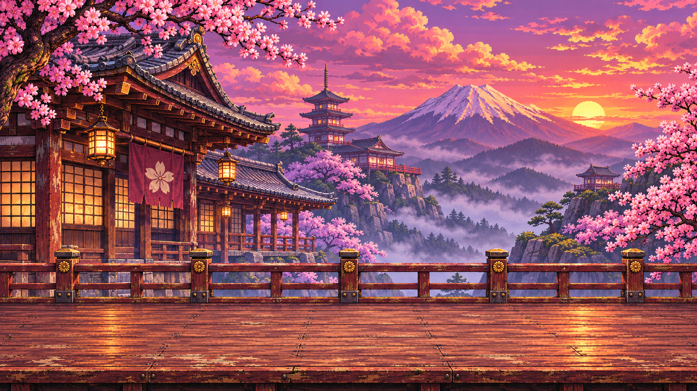

- **Atmosphere:** An ancient mountain pagoda dojo perched above misty valleys at golden hour. Cherry blossom branches frame the weathered timber deck, with warm paper lanterns flickering against amber-rose clouds.
- **Native Fighters (Home Stage):**
  - **Kaito Arashi:** The sacred training grounds where Kaito completed his Arashi-ryu mastery before beginning his wandering journey.
  - **Akio Hoshi:** Neighboring mountain summit where the Starfall Dojo observes the evening sky.
- **Key Challengers & Story Battles:**
  - **Lian Feng:** Travels from Mount Wudang for an exhibition duel between Chinese flowing silk kicks and Japanese storm karate.
  - **Jin Kazaguruma:** Arrives via the rooftops to test his wind chakrams against Kaito's gale fist.
- **Narrative Context:** Represents traditional martial honor, disciplined breathing, and the tranquil purity of combat before cosmic corruption touches the world.

---

### 2. Neo-Metropolis 2099 (`neon`) — *Neo-Metrópole 2099*

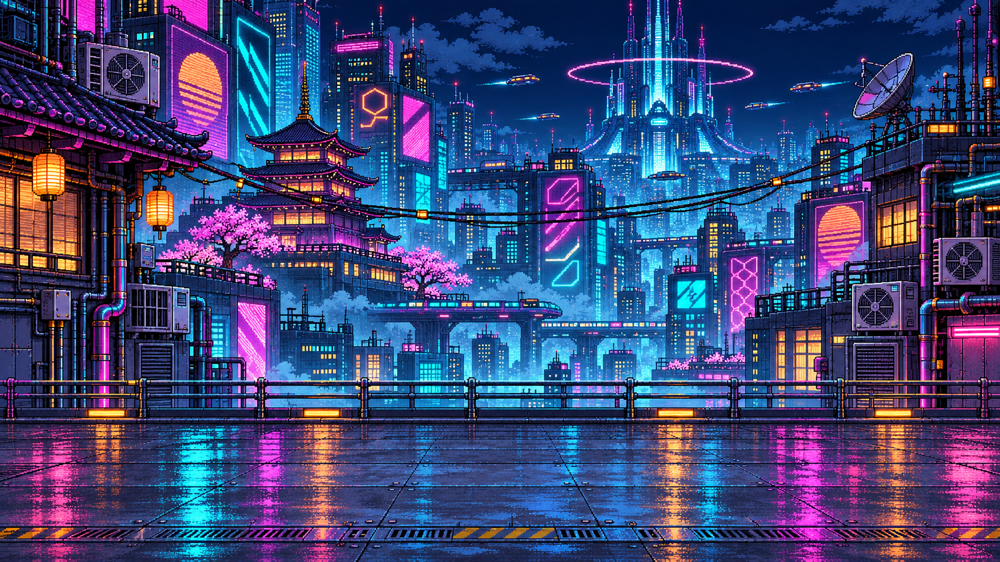

- **Atmosphere:** The rain-slicked rooftop of a mega-skyscraper in a cyberpunk metropolis. Towering holographic ads in cyan and magenta glow through the midnight mist, while aerial cruisers drift between neon-lit towers.
- **Native Fighters (Home Stage):**
  - **VX-9 Volta:** The cybernetic testing ground and rooftop escape route where Volta severed his corporate telemetry.
  - **Valdric Morn:** The industrial command sector where the Red Star Empire deploys heavy mechanized garrison units.
- **Key Challengers & Story Battles:**
  - **Captain Marlow Reyes:** Raids corporate data servers with his sky-galleon, dueling security units on the helicopter deck.
  - **Akio Hoshi:** Climbs the mega-towers to challenge Valdric's cold military technology with pure stellar plasma.
- **Narrative Context:** Symbolizes the collision of rampant technocracy with human spirit, where high-voltage capacitors and corporate tyrants clash with rogue awakenings.

---

### 3. Moonlit Bamboo Grove (`bamboo`) — *Bambuzal ao Luar*

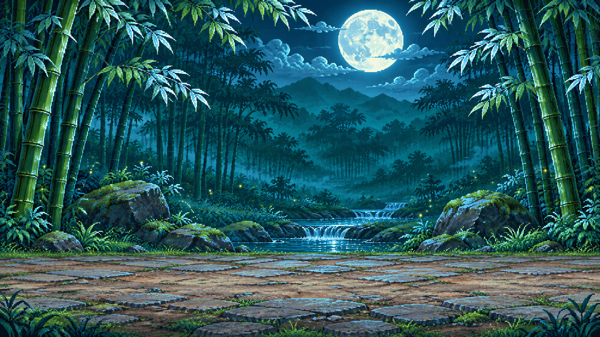

- **Atmosphere:** An ancient, whispering jade bamboo forest illuminated by a radiant full moon. Deep teal shadows, a murmuring mountain brook, glowing fireflies, and weathered stone lanterns create an aura of silent danger.
- **Native Fighters (Home Stage):**
  - **Shion Kurogane:** Shion's secluded sanctuary where he meditates under the pale moon, practicing his heavy lunar sword forms.
  - **Suzume Kagerou:** The shadow corridor through which Suzume stalks her targets, moving silently between bamboo stalks.
  - **Lian Feng:** Sacred groves surrounding the lower slopes of the Jade Lantern sanctuaries.
  - **Jin Kazaguruma:** The high canopy highways where Jin leaps between bamboo tips with his gale chakrams.
- **Key Challengers & Story Battles:**
  - **Kaname Fuyutsuki:** Dueling Shion under the full moon to determine whether sorrow or divine duty wields the truer blade.
  - **Mikazuki Oboro:** The shadows twist into nightmare ravens as Oboro sends phantom assassins to eliminate the surviving clan heirs.
- **Narrative Context:** The battleground of stealth, patience, and poetic stillness, where a single rustle of bamboo leaves heralds a lethal strike.

---

### 4. Rocky Plateau (`plains`) — *Planalto Rochoso*

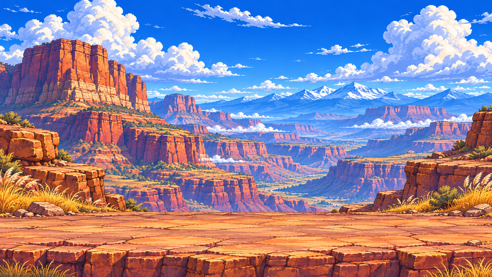

- **Atmosphere:** Immense sandstone mesas and sun-baked canyon terraces beneath a luminous azure sky. Golden steppe grasses sway along weathered geological strata, offering an expansive, unobstructed natural arena.
- **Native Fighters (Home Stage):**
  - **Daichi Ginrou:** The rugged canyon perimeter where Daichi runs with silver wolves and tests his golden ki against solid stone.
  - **Akio Hoshi:** Ancient meteorite impact sites where Akio meditates on fallen cosmic stones.
  - **Captain Marlow Reyes:** The open desert canyons where Marlow grounds his sky-galleon for repairs and duels.
  - **Sylene Vashti:** A windswept highland where Sylene practices freezing the arid air into protective glacial walls.
- **Key Challengers & Story Battles:**
  - **Bruno Volk vs. Daichi Ginrou:** A clash of titans where heavy boxing punches collide with lupine claws, shaking the mesa.
  - **Marlow Reyes vs. Lian Feng:** A high-stakes duel over ancient maps found within the sandstone ruins.
- **Narrative Context:** Represents raw, untamed natural vitality, geological endurance, and the honest joy of physical combat beneath the open sun.

---

### 5. Gate of Spirits (`spirit`) — *Portão dos Espíritos*

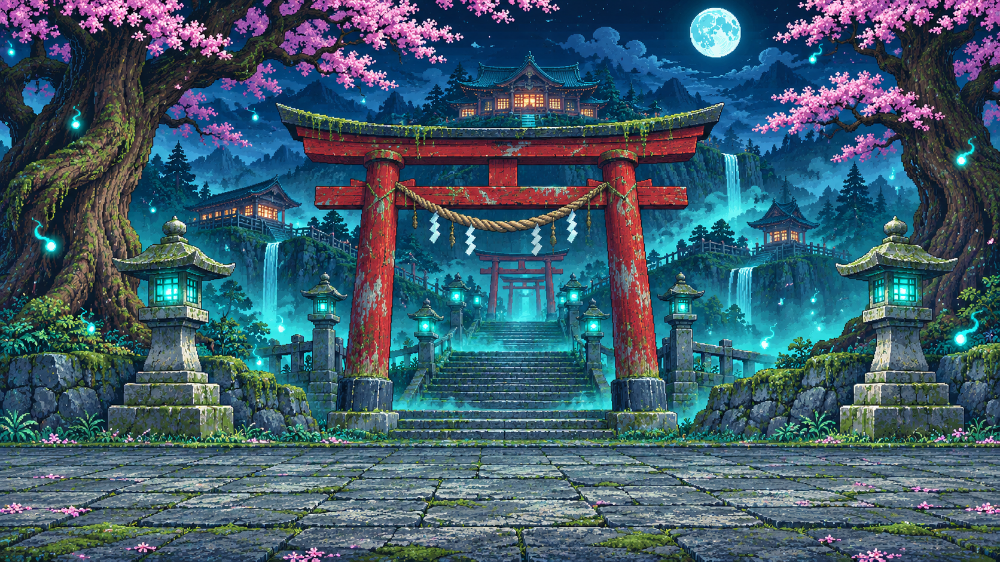

- **Atmosphere:** Weathered vermilion torii gates standing sentinel over an ancient mist-shrouded shrine courtyard. Turquoise spirit motes drift between mossy stone lanterns and colossal sacred camphor trees beneath a quiet night sky.
- **Native Fighters (Home Stage):**
  - **Kaname Fuyutsuki:** The sacred gateway protected by Kaname's Everwinter blade, serving as the border between the mortal and spirit realms.
  - **Haruki Sumi:** The ancient shrine vaults where Haruki studies forgotten sealing texts and prays to keep the Twilight Titans asleep.
- **Key Challengers & Story Battles:**
  - **Mikazuki Oboro:** Manifests his shadow illusions directly at the torii gate, seeking to tear open the veil between the living and the dead.
  - **Garan the Ashen Oni:** Stalks the shrine perimeter, seeking to shatter Haruki's paper talismans and consume the spirits within.
  - **Suzume Kagerou:** Infiltrates the sacred grounds to intercept Oboro's disciples before they desecrate ancestral graves.
- **Narrative Context:** The metaphysical heart of the world, where divine judgments are passed and the spiritual fabric of reality is either defended or corrupted.

---

### 6. Volcanic Crater (`volcano`) — *Cratera Vulcânica*

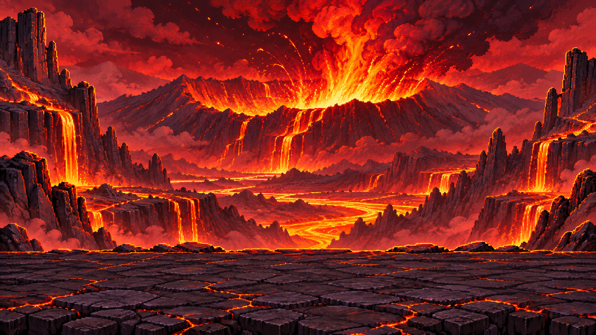

- **Atmosphere:** An active basalt caldera glowing with incandescent rivers of orange magma. Crimson volcanic smoke, floating embers, and intense amber rim lighting illuminate a solid obsidian fighting terrace laced with glowing fissures.
- **Native Fighters (Home Stage):**
  - **Garan the Ashen Oni:** The hellish subterranean threshold from which Garan crawled into the mortal realm.
  - **Mikazuki Oboro:** The convergence apex where the ritual of the Scarlet Eclipse focuses planetary cosmic energy.
  - **Valdric Morn:** The industrial geothermal smelting foundries where the Red Star Empire manufactures heavy warmachines.
- **Key Challengers & Story Battles:**
  - **Sylene Vashti:** Sylene ventures into the burning caldera to freeze the molten veins and avenge her frozen homeland.
  - **Kaito Arashi:** The climactic final confrontation against Oboro and Garan to disperse the crimson clouds with the Eye of the Storm.
- **Narrative Context:** The domain of primordial chaos, destruction, and ultimate stakes. The final testing ground where the fate of all converging realities is decided.

---

### 7. Hinterland Plaza — Brazil (`brazil`) — *Praça do Interior — Brasil*

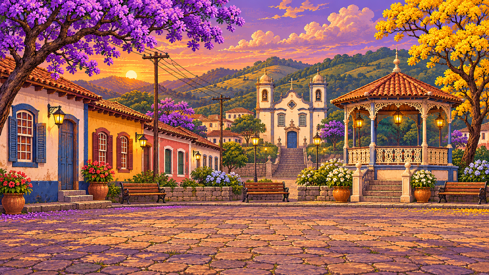

- **Atmosphere:** A warm, charming small town square in the Brazilian interior (inspired by historic Minas Gerais and São Paulo countryside) at golden hour. Pastel colonial stucco houses with aged wooden shutters, a cream-and-blue church in the background, a traditional bandstand (*coreto*), flowering ipê and jacarandá trees, and classic Portuguese stone paving (*calçada portuguesa*).
- **Native Fighters (Home Stage):**
  - **Bruno "Bulldozer" Volk:** The beloved town square where Bruno grew up, works out at the local gym, and protects his neighbors.
- **Key Challengers & Story Battles:**
  - **Haruki Sumi:** Arrives seeking quiet shelter and warm hospitality, welcomed by Bruno with fresh coffee and cheese bread (*pão de queijo*).
  - **Daichi Ginrou:** Enters the town with a wide grin, drawn by rumors of an unbeatable heavyweight champion who fights with bare fists.
  - **Valdric Morn:** An imperial scouting squad attempts to annex the town for raw resources, only to be met by Bruno and an outraged community.
- **Narrative Context:** Represents the warmth of community, the resilience of everyday working people, and the peaceful mortal lives that the heroes are fighting to protect. It uses the plains theme music and has no legacy procedural counterpart.

---

## The 7 Modern Wonders of the World

### 8. Great Wall of China (`great_wall`) — *Grande Muralha da China*

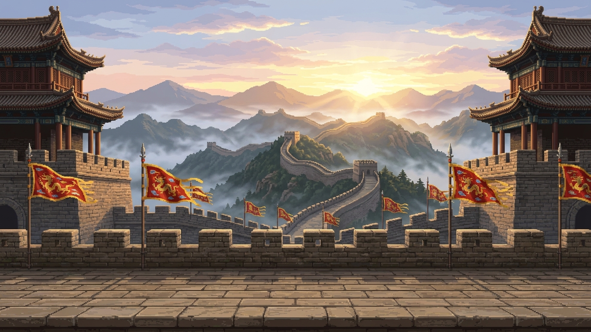

- **Atmosphere:** An ancient stone fortification winding across rugged mist-shrouded green mountain ridges at sunrise. Imposing brick watchtowers frame the battlement fighting deck, with golden morning sunlight breaking through soft clouds and fluttering imperial banners.
- **Lore & Affinities:** Sacred bastion where martial artists of the East test their endurance and footwork. Lian Feng and Jin Kazaguruma hold exhibition clashes along the winding ramparts.

---

### 9. Petra — Al-Khazneh (`petra`) — *Petra — Al-Khazneh*

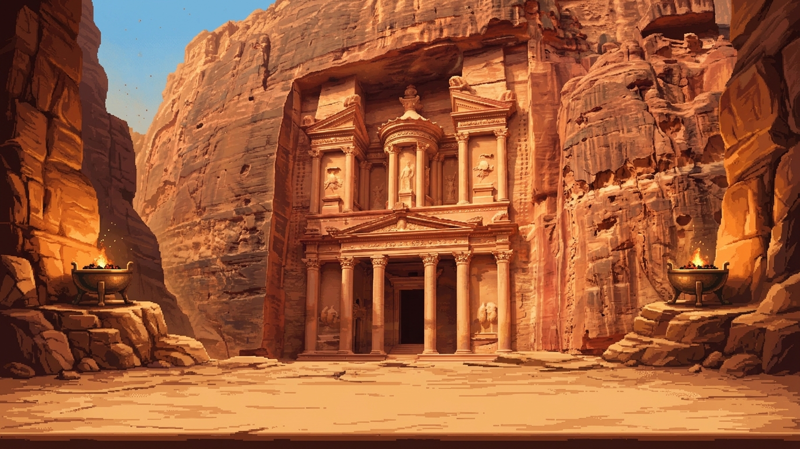

- **Atmosphere:** The monumental rose-red rock-cut Hellenistic temple facade of The Treasury carved into towering sandstone canyon walls of the Siq. Warm desert sunlight, glowing bronze braziers, and a level sandstone arena floor.
- **Lore & Affinities:** Hidden desert sanctuary of forgotten merchant princes and desert nomads. Daichi Ginrou and Marlow Reyes duel for ancient relics stored within the rock-cut vaults.

---

### 10. Christ the Redeemer (`christ_redeemer`) — *Cristo Redentor — Corcovado*

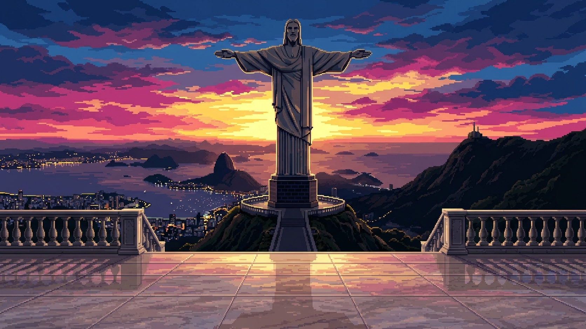

- **Atmosphere:** Perched atop Mount Corcovado in Rio de Janeiro at golden sunset. The colossal Art Deco statue opens its arms over Guanabara Bay and Sugarloaf Mountain far below as twilight colors wash across the sky and city lights flicker to life.
- **Lore & Affinities:** A beacon of divine grace and sanctuary overlooking the metropolis. Bruno Volk and Haruki Sumi clash under the sacred silhouette at dusk.

---

### 11. Inland Town — Texas, USA (`texas`) — *Cidade do Interior — Texas, EUA*

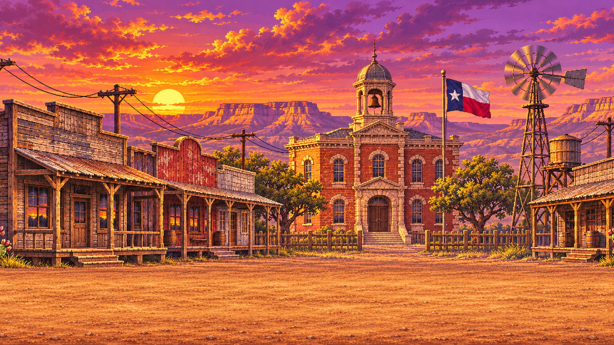

- **Atmosphere:** A historic frontier small town in inland West Texas at dusty golden sunset. Weathered wooden clapboard saloon and general store with covered boardwalk porches, an old red brick courthouse with a bell tower cupola, a spinning steel windmill water tower, telegraph poles with drooping wires, the Texas Lone Star flag fluttering in the breeze, saguaro and prickly pear cactus framing the edges, and a broad level packed sand and dirt fighting road.
- **Lore & Affinities:** The rugged heartland of lone wanderers, brawlers, and frontier lawmen. Bruno Volk and Captain Marlow Reyes duel in high-noon brawls along the dusty thoroughfare.

---

### 12. Chichén Itzá (`chichen_itza`) — *Chichén Itzá — Templo de Kukulcán*

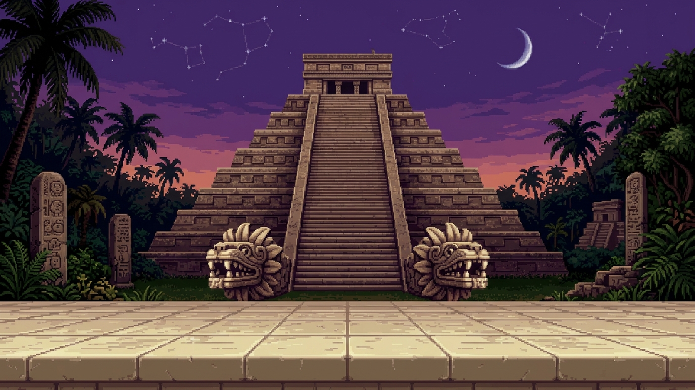

- **Atmosphere:** The grand Mesoamerican step-pyramid of El Castillo under a deep purple twilight sky scattered with ancient Mayan constellations. Carved feathered serpent heads flank the stone balustrades amid lush tropical jungle foliage.
- **Lore & Affinities:** Nexus of celestial alignments and feathered serpent deity worship. Mikazuki Oboro and Garan invoke eclipse magic on the ceremonial plaza.

---

### 13. Colosseum of Rome (`colosseum`) — *Coliseu de Roma*

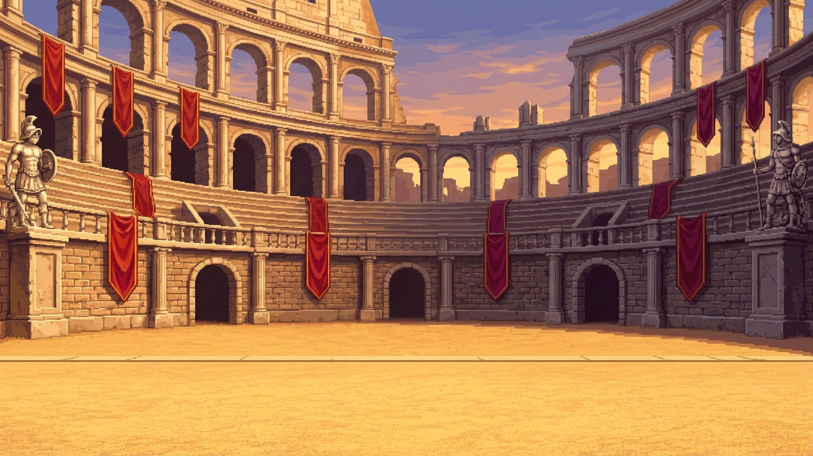

- **Atmosphere:** The monumental Roman amphitheater in late golden-hour afternoon. Multi-tiered travertine arches, weathered Corinthian columns, imperial red vexillum banners, and packed golden fighting sand.
- **Lore & Affinities:** Legendary epicenter of gladiator combat and martial glory. Bruno Volk, Daichi Ginrou, and Valdric Morn clash in ruthless exhibition duels before the imperial banners.

---

### 14. Taj Mahal (`taj_mahal`) — *Taj Mahal — Palácio de Mármore*

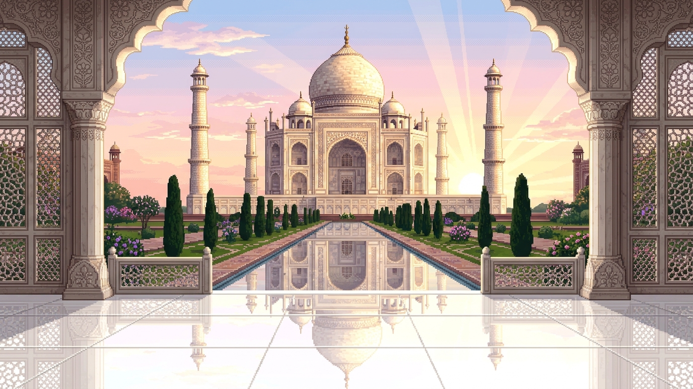

- **Atmosphere:** The radiant ivory-white marble mausoleum reflected in the tranquil Yamuna reflecting pool at pink-gold dawn. Slender cypress trees, lotus pools, and intricate carved marble jali screens frame the polished fighting deck.
- **Lore & Affinities:** Eternal monument of love and perfection. Akio Hoshi and Lian Feng exchange harmonious ki strikes across the pristine marble terrace.

---

## The 7 Ancient Wonders of the World

### 15. Great Pyramids of Giza (`pyramids_giza`) — *Pirâmides de Gizé*

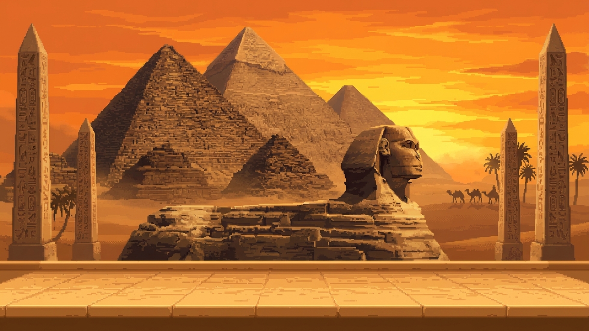

- **Atmosphere:** Colossal limestone pyramids of Khufu and Khafre rising against a burning desert sunset. The limestone profile of the Great Sphinx and distant date palm silhouettes gaze over the level sandstone terrace.
- **Lore & Affinities:** Primordial tomb complex where Pharaohs attained immortality. Garan and Marlow Reyes search for forbidden astral relics beneath the shifting dunes.

---

### 16. Hanging Gardens of Babylon (`hanging_gardens`) — *Jardins Suspensos da Babilônia*

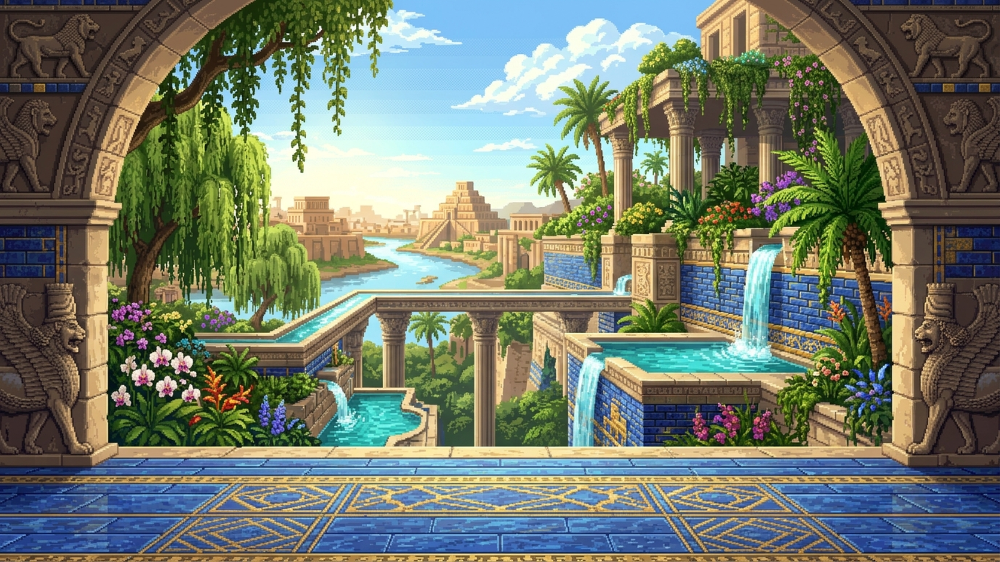

- **Atmosphere:** Monumental multi-tiered palace terraces cascading with tropical blossoms, date palms, weeping willows, and aqueduct waterfalls. Lapis lazuli glazed brick walls with gold lion reliefs overlook the Euphrates.
- **Lore & Affinities:** Mesopotamian wonder built by royal love. Haruki Sumi and Sylene Vashti duel amid fragrant jasmine and cascading mountain waters.

---

### 17. Temple of Artemis at Ephesus (`temple_artemis`) — *Templo de Ártemis em Éfeso*

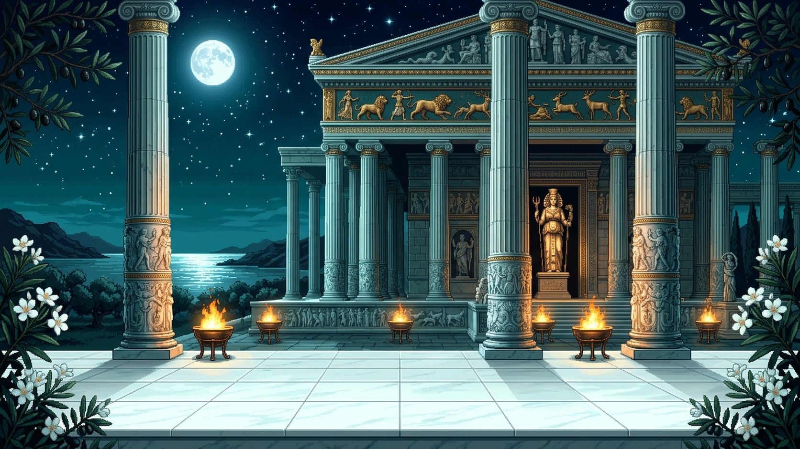

- **Atmosphere:** Colossal Greek temple colonnade of fluted Ionic marble columns under a starry Aegean night sky. Glowing bronze sacrificial braziers, olive groves, and coastal hills frame the polished marble courtyard.
- **Lore & Affinities:** Sacred sanctuary of the huntress goddess. Suzume Kagerou and Shion Kurogane cross blades under the cool lunar light.

---

### 18. Statue of Zeus at Olympia (`statue_zeus`) — *Estátua de Zeus em Olímpia*

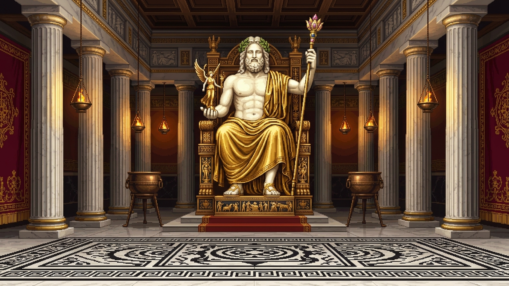

- **Atmosphere:** Sanctuary interior housing the colossal chryselephantine seated Zeus on an ornate cedarwood throne. Ivory skin, golden robes, winged Nike, and burning bronze cauldrons casting dramatic shadows across mosaic marble.
- **Lore & Affinities:** The seat of Olympian authority and thunderous power. Kaito Arashi and Valdric Morn test storm energy against imperial authority.

---

### 19. Mausoleum at Halicarnassus (`mausoleum_halicarnassus`) — *Mausoléu de Halicarnasso*

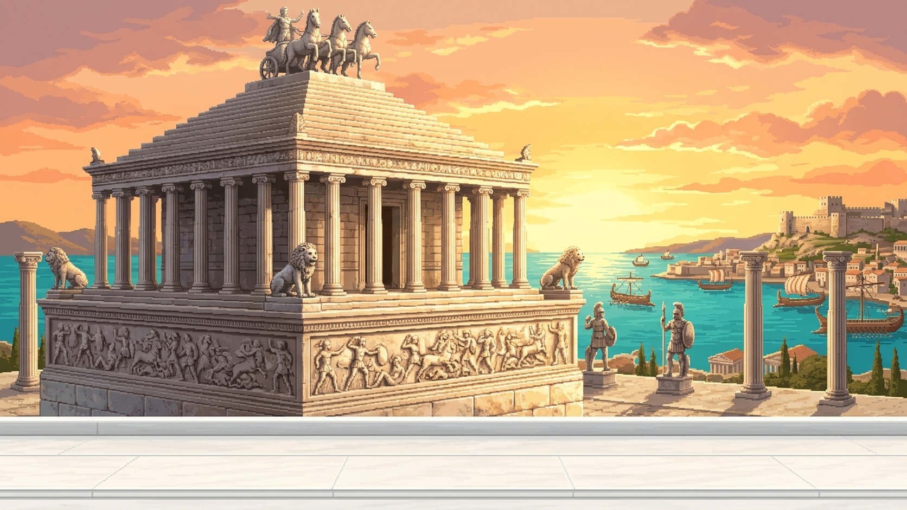

- **Atmosphere:** Monumental marble tomb with sculpted Amazonomachy friezes, 36 slender Ionic columns, a stepped pyramid roof, and a crowning marble four-horse chariot overlooking the turquoise Aegean harbor.
- **Lore & Affinities:** Splendor of Anatolian and Hellenic artistry. Kaname Fuyutsuki and Akio Hoshi duel beneath the guardian marble lions.

---

### 20. Colossus of Rhodes (`colossus_rhodes`) — *Colosso de Rodes*

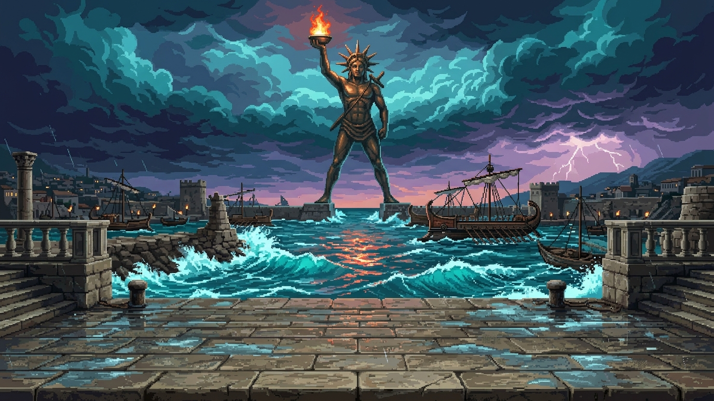

- **Atmosphere:** Titanic bronze statue of Helios crowned with a spiked solar halo standing tall over the stormy twilight harbor entrance. A blazing beacon brazier pierces violet tempest clouds while turquoise waves crash against the pier.
- **Lore & Affinities:** Guardian of the Mediterranean sea routes. VX-9 Volta and Marlow Reyes clash on the rain-swept harbor pier beneath the beacon flames.

---

### 21. Lighthouse of Alexandria (`lighthouse_alexandria`) — *Farol de Alexandria — Pharos*

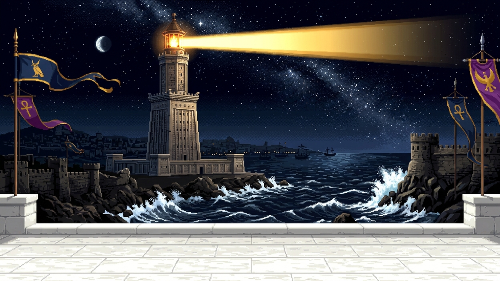

- **Atmosphere:** The monumental three-tiered Pharos tower projecting a brilliant golden light beam over churning Mediterranean waves at midnight. White limestone battlements and royal Ptolemaic banners frame the ramparts.
- **Lore & Affinities:** Guiding light across dangerous seas and cosmic crossroads. Kaito Arashi, Shion Kurogane, and Jin Kazaguruma meet at the midnight ramparts as the beacon sweeps the horizon.
