# Criar cenários

Há dois caminhos: cenário M.U.G.E.N (arquivo `.def` + `.sff`, sem programar) ou cenário nativo (código Rust, com camadas procedurais e efeitos reativos).

## Cenário M.U.G.E.N

Coloque `meu_cenario.def` e `meu_cenario.sff` em `mugen/stages/`.

```ini
[Info]
name = "Meu Cenário"
displayname = "Meu Cenário"

[Camera]
startx = 0
starty = 0
boundleft = -150
boundright = 150
boundhigh = -25
boundlow = 0
verticalfollow = .2
tension = 50

[PlayerInfo]
p1startx = -70
p2startx = 70

[StageInfo]
zoffset = 210
localcoord = 320, 240

[BGdef]
spr = meu_cenario.sff

[BG Céu]
type = normal
spriteno = 0, 0
layerno = 0
start = 0, 0
delta = .2, .2
tile = 1, 0
velocity = .1, 0

[BG Chão]
type = normal
spriteno = 1, 0
start = 0, 160
delta = 1, 1
mask = 1

[BG Bandeira]
type = anim
actionno = 10
start = 80, 60
delta = .8, .8

[Begin Action 10]
2,0, 0,0, 6
2,1, 0,0, 6
```

| Seção | Chaves suportadas |
|---|---|
| `[Info]` | `name`, `displayname` |
| `[Camera]` | `startx`, `boundleft`, `boundright`, `boundhigh`, `boundlow`, `verticalfollow`, `tension` |
| `[PlayerInfo]` | `p1startx`, `p2startx` |
| `[StageInfo]` | `zoffset`, `localcoord` |
| `[BGdef]` | `spr` |
| `[BG ...]` | `type` (`normal`, `anim`), `spriteno`, `actionno`, `layerno` (0 atrás, 1 na frente), `start`, `delta`, `tile`, `tilespacing`, `velocity`, `trans`, `mask`, `scalestart`, `scaledelta`, `angle`, `xshear`, `window`, `maskwindow`, `windowdelta`, `spacing` |

Parâmetros de transformação da camada (Ikemen / M.U.G.E.N 1.1), aplicados tanto pelo renderizador quanto pela pré-visualização na seleção de cenário:

| Chave | Significado |
|---|---|
| `scalestart = x, y` | Escala base do sprite, ancorada no eixo dele (padrão `1, 1`). |
| `scaledelta = x, y` | Variação de escala por unidade de movimento da câmera, multiplicada por `delta`: `escala = scalestart + scaledelta * câmera * delta`; a camada cresce ou encolhe conforme a câmera se move (padrão `0, 0`). |
| `angle` | Rotação em graus em torno do eixo do sprite, anti-horária para valores positivos. |
| `xshear` | Cisalhamento horizontal: cada linha é deslocada por `xshear` vezes a distância dela ao eixo. |
| `window = x1, y1, x2, y2` | Retângulo de recorte em unidades do cenário. |
| `maskwindow = x1, y1, x2, y2` | Segundo retângulo de recorte; com os dois presentes a camada é recortada pela interseção. |
| `windowdelta = x, y` | Quão rápido a janela de recorte acompanha a câmera (padrão: o `delta` da camada). |
| `spacing = x, y` | Espaço entre os ladrilhos; usado quando `tilespacing` não existe (`tilespacing` vence se ambos existirem). |

Planejado: `[Music]`, sombras e reflexos configuráveis, `type = parallax`.

## Ler o cenário a partir de scripts

`StageVar(<nome>)` devolve o valor do cenário nas unidades do `localcoord` do próprio cenário. O prefixo da seção é opcional: `StageVar(camera.boundleft)` e `StageVar(boundleft)` são a mesma consulta.

| Nome | Valor |
| --- | --- |
| `info.name`, `info.displayname`, `info.author`, `info.mugenversion` | texto, comparado com `StageVar(info.author) = "nome"` (sem diferenciar maiúsculas) |
| `camera.startx`, `camera.starty`, `camera.boundleft`, `camera.boundright`, `camera.boundhigh`, `camera.boundlow` | números |
| `camera.verticalfollow`, `camera.tension`, `camera.zoomin`, `camera.zoomout` | números |
| `playerinfo.p1startx`, `playerinfo.p2startx`, `playerinfo.leftbound`, `playerinfo.rightbound` | números |
| `playerinfo.autoturn` | 1, a menos que o cenário defina `autoturn = 0` |
| `stageinfo.zoffset`, `stageinfo.localcoord.x`, `stageinfo.localcoord.y`, `stageinfo.roundtime` | números (`localcoord` sozinho é a largura; `roundtime` é -1 quando o cenário não define) |
| `shadow.intensity`, `shadow.yscale`, `reflection.intensity` | números |

Consultas de texto valem 0 quando usadas como número. Nomes desconhecidos valem 0 e imprimem um aviso ao compilar a expressão. Nos cenários nativos e no cenário plano os valores vêm dos padrões do motor.

## Parâmetros de câmera

O grupo `[Camera]` aceita estas chaves extras. Todas são opcionais e o padrão reproduz a câmera anterior, então um cenário que as omite se comporta exatamente como antes.

| Chave | Padrão | Efeito |
| --- | --- | --- |
| `verticalfollow` | 0.2 | Fração da altura do lutador mais alto que a câmera acompanha para cima |
| `tension` | 50 | Zona morta horizontal: a câmera só se move quando um lutador chega a menos que isso de uma borda da tela, então um lutador encurralado fica parado enquanto o oponente se aproxima |
| `verticalfollowdelta` | 0 | Zona morta em pixels do cenário: o alvo vertical só muda quando se moveu pelo menos isso, evitando tremor em pequenos pulos |
| `yscrollspeed` | 0.3 | Parcela da distância vertical restante percorrida por tick (limitada a 0..1) |
| `zoominspeed`, `zoomoutspeed` | 0.04 | Parcela da diferença de zoom restante percorrida por tick ao aproximar ou afastar a câmera (limitada a 0..1; 0 mantém o zoom, 1 chega em um tick) |
| `lowestcap` | 0 | Com 1 a câmera nunca desce abaixo de `starty` |
| `dynamicboundhigh` | 0 | Com 1 o `boundhigh` sobe `boundhighdelta` por unidade de zoom-out acima de 1x, mantendo o céu alcançável com a câmera afastada |
| `boundhighdelta` | 0 | Usado por `dynamicboundhigh` |

`autoturn` em `[PlayerInfo]` (padrão 1) define se os lutadores se viram sozinhos quando o oponente passa por cima deles nos estados parado, andando e agachado. `autoturn = 0` mantém a direção até um controlador mudá-la (`AssertSpecial flag = noautoturn` continua desligando por personagem). `StageVar(camera.<chave>)` e `StageVar(playerinfo.autoturn)` leem todos esses valores.

## Cenário nativo

Cenários nativos ficam em `src/stages.rs` e os efeitos animados em `src/stagefx.rs`.

1. Escreva uma função `fn meu() -> Stage` montando as camadas com `lay(...)` e as primitivas de `ume_engine::raster` (`rect`, `lin`, gradientes) e `texgen` (`blobs`, `grain`, `haze`). Use `dojo()` como modelo.
2. Registre em `builtin()`:

```rust
StageEntry { id: "meu".into(), name: "Meu Cenário".into(), thumb: [[10, 10, 30], [40, 40, 90], [200, 120, 60]], build: Box::new(meu) },
```

3. Para efeitos reativos (poeira, multidão, água), adicione uma variante em `StageKind` e trate em `stagefx.rs`.
4. Gere capturas para revisar: `UME_SHOTS_ONLY=stages UME_STAGE=meu cargo run --release -- --shots out/`.

Cada `Layer` tem `delta` (parallax), `y`, `front` (desenhada na frente dos lutadores) e `dynamic` (sem bitmap, desenhada por `stagefx`).

## Pixel art dos cenários nativos

As vinte e uma arenas nativas usam imagens PNG coloridas incorporadas de `assets/stages/`: os sete reinos principais (`dojo.png`, `neon.png`, `bamboo.png`, `plains.png`, `spirit.png`, `volcano.png` e `brazil.png`), os sete cenários emblemáticos do mundo (`great_wall.png`, `petra.png`, `christ_redeemer.png`, `texas.png`, `chichen_itza.png`, `colosseum.png`, `taj_mahal.png`) e as sete Maravilhas do Mundo Antigo (`pyramids_giza.png`, `hanging_gardens.png`, `temple_artemis.png`, `statue_zeus.png`, `mausoleum_halicarnassus.png`, `colossus_rhodes.png`, `lighthouse_alexandria.png`). Os prompts e a ferramenta de geração estão registrados em `assets/stages/prompts.json`. O jogo não precisa de serviço externo de imagens nem de acesso a esses arquivos em execução.

`StageArt::Illustrated` desenha o fundo com filtro nearest-neighbor, alinha o piso a 85% da altura da imagem e limita o movimento horizontal da câmera às bordas da imagem. O zoom de equipes mantém a proporção nativa do chão. Sombras, reflexos dos lutadores e efeitos de combate continuam ativos; as antigas animações de objetos ficam exclusivas da arte procedural.

O seletor exibe as mesmas imagens, recortadas nos cartões sem alterar sua proporção. A seleção aleatória e os cenários M.U.G.E.N importados mantêm os cartões com gradiente. Os cenários importados preservam sua própria arte durante a luta.

Use `UME_STAGE_ART=procedural` para comparar os cenários procedurais originais. O seletor continua mostrando as ilustrações em pixel art padrão. Capture o seletor com `UME_SHOTS_ONLY=stage-select ultimate-mugen --shots out/ --res 1280x720 --mute`, ou as sete lutas com `UME_SHOTS_ONLY=stages`.

---

## Arenas Nativas, Lore e Associação de Personagens

Cada arena nativa de **Ultimate MUGEN** representa um ponto de convergência geográfico e espiritual crucial na colisão dos mundos. Abaixo encontra-se o guia completo dos sete campos de batalha, sua história e os combatentes vinculados a cada um.

### 1. Telhado do Dojo — Pôr do Sol (`dojo`)

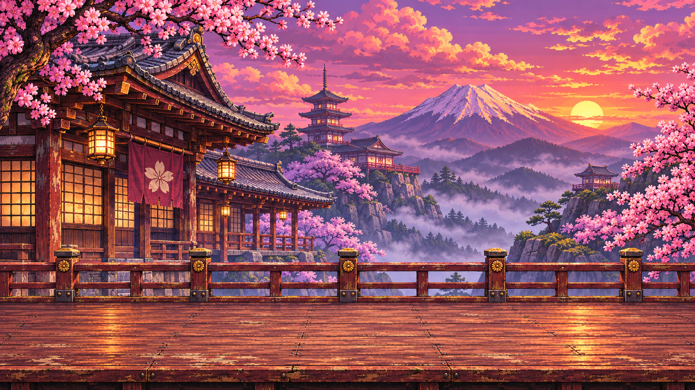

- **Atmosfera:** O cume de um dojo tradicional de madeira e telhas curvas erguido sobre montanhas cobertas de névoa ao entardecer. Galhos de cerejeira em flor emolduram o deck de combate, enquanto lanternas de papel iluminam as nuvens douradas e rosadas.
- **Lutadores Nativos (Cenário de Origem):**
  - **Kaito Arashi:** O dojo sagrado onde Kaito completou seu treinamento inicial de karatê antes de partir em peregrinação pela Estrada da Tempestade.
  - **Akio Hoshi:** Pico vizinho onde o Dojo da Queda Estelar observa os céus noturnos.
- **Desafiantes e Batalhas da História:**
  - **Lian Feng:** Viaja das montanhas de Wudang para um duelo de honra entre os chutes de seda chineses e o karatê de vendaval japonês.
  - **Jin Kazaguruma:** Salta pelos beirais para testar a velocidade de seus chakrams contra a firmeza de Kaito.
- **Significado Narrativo:** Representa a pureza das artes marciais tradicionais, a disciplina do espírito e a tranquilidade anterior à corrupção cósmica.

---

### 2. Neo-Metrópole 2099 (`neon`)

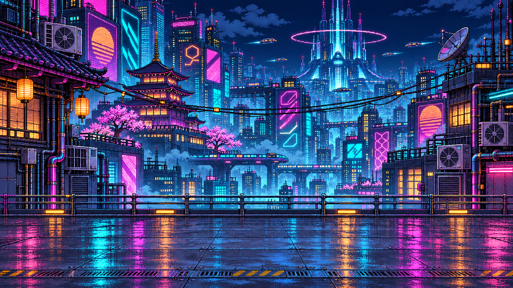

- **Atmosfera:** O heliponto molhado pela chuva ácida no topo de um arranha-céu colossal de uma metrópole futurista. Painéis holográficos em ciano e magenta brilham em meio à névoa de meia-noite, enquanto naves aéreas cruzam os céus elétricos.
- **Lutadores Nativos (Cenário de Origem):**
  - **VX-9 Volta:** O campo de testes de onde Volta escapou após quebrar seus protocolos corporativos de extermínio.
  - **Valdric Morn:** O complexo industrial militar onde o Império da Estrela Rubra mantém suas divisões de tanques e canhões de matéria escura.
- **Desafiantes e Batalhas da História:**
  - **Capitão Marlow Reyes:** Atraca seu galeão voador para saquear bancos de dados imperiais e duelar contra patrulhas de elite.
  - **Akio Hoshi:** Invade a metrópole para provar a Valdric que a coragem de um lutador supera qualquer armadura mecânica.
- **Significado Narrativo:** O palco da tecnocracia e da opressão corporativa, onde a consciência sintética de Volta luta pela liberdade contra a tirania imperial de Valdric.

---

### 3. Bambuzal ao Luar (`bamboo`)

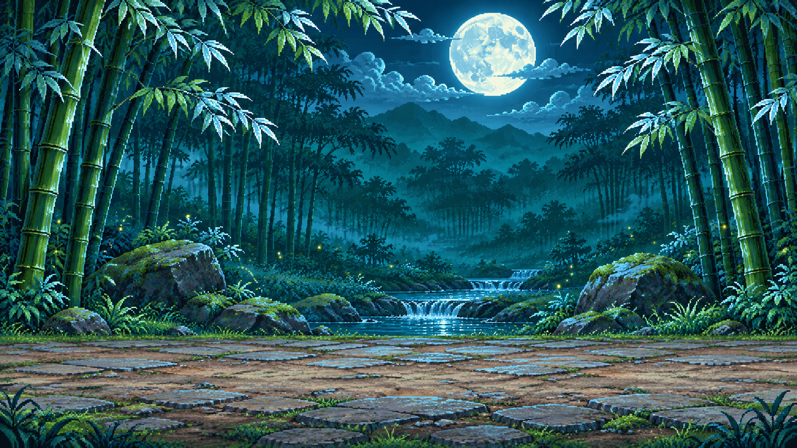

- **Atmosfera:** Um bosque milenar de bambus verde-jade sob a luz prateada de uma lua cheia imensa. Folhagens verde-azuladas, um riacho tranquilo de montanha, vagalumes e lanternas de pedra desgastadas criam um clima de silêncio mortal.
- **Lutadores Nativos (Cenário de Origem):**
  - **Shion Kurogane:** O refúgio solitário onde Shion medita empunhando sua colossal espada lunar.
  - **Suzume Kagerou:** Os corredores de sombra por onde Suzume rastreia seus alvos sem produzir um único ruído.
  - **Lian Feng:** Os bosques sagrados na base do templo da Lanterna de Jade.
  - **Jin Kazaguruma:** A copa alta dos bambus por onde Jin salta com seus chakrams de vento.
- **Desafiantes e Batalhas da História:**
  - **Kaname Fuyutsuki:** Duelo solene contra Shion sob a lua para decidir se o dever impessoal supera a dor do luto.
  - **Mikazuki Oboro:** As sombras ganham vida e corvos ilusórios atacam os sobreviventes das antigas dinastias.
- **Significado Narrativo:** O terreno da furtividade, da paciência e da contemplação poética, onde o mínimo farfalhar de folhas prenuncia um golpe letal.

---

### 4. Planalto Rochoso (`plains`)

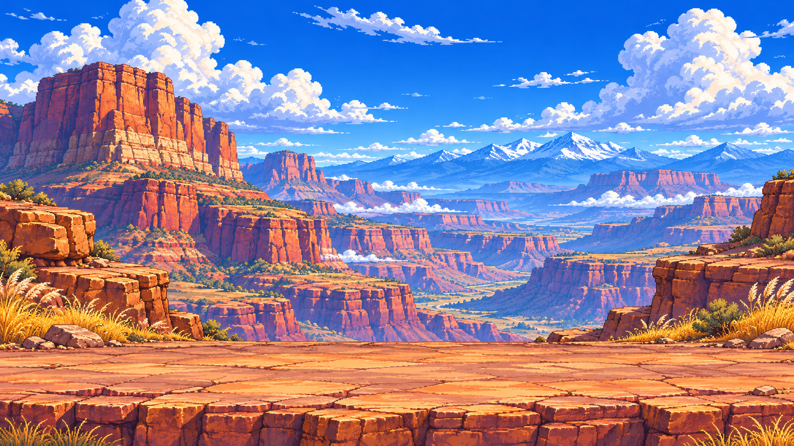

- **Atmosfera:** Gargantas monumentais de arenito dourado e platôs esculpidos por milênios de ventos sob um céu azul infinito. Gramíneas estepárias douradas ondulam ao longo de estratos rochosos imponentes.
- **Lutadores Nativos (Cenário de Origem):**
  - **Daichi Ginrou:** O território selvagem onde Daichi caça com lobos prateados e aprimora seu ki dourado contra rochedos maciços.
  - **Akio Hoshi:** Antigas crateras onde meteoritos repousam há eras.
  - **Capitão Marlow Reyes:** Os cânions abertos onde Marlow pousa sua nau para reparos náuticos e apostas.
  - **Sylene Vashti:** Terras altas e secas onde Sylene pratica condensar umidade do ar em barreiras de gelo.
- **Desafiantes e Batalhas da História:**
  - **Bruno Volk vs. Daichi Ginrou:** O choque colossal entre o boxe peso-pesado e as garras do lobo dourado, fazendo o desfiladeiro ecoar.
  - **Marlow Reyes vs. Lian Feng:** Disputa acrobática por pergaminhos escondidos em ruínas nas escarpas.
- **Significado Narrativo:** A força bruta e a vastidão da terra intocada, simbolizando a vitalidade e a alegria pura do combate aberto sem artifícios.

---

### 5. Portão dos Espíritos (`spirit`)

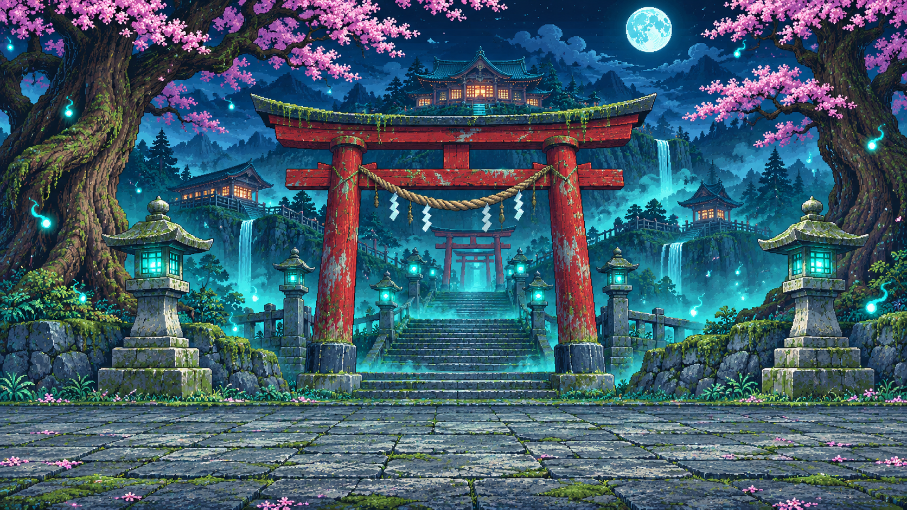

- **Atmosfera:** Portais torii vermelhos ancestrais vigiando um santuário misterioso sob a luz de tochas espectrais azul-turquesa. Lanternas de pedra cobertas de musgo e árvores milenares envolvem o pátio sob um céu estrelado pacífico.
- **Lutadores Nativos (Cenário de Origem):**
  - **Kaname Fuyutsuki:** O limiar sagrado defendido pela lâmina do inverno de Kaname para impedir a violação do mundo espiritual.
  - **Haruki Sumi:** O arquivo sagrado onde Haruki estuda fórmulas de selamento para conter os Titãs do Crepúsculo.
- **Desafiantes e Batalhas da História:**
  - **Mikazuki Oboro:** Surge entre os toriis para desestabilizar as barreiras astrais e alimentar seu eclipse de pesadelos.
  - **Garan the Ashen Oni:** Tenta invadir o pátio sagrado para devorar os espíritos ancestrais e romper os selos de Haruki.
  - **Suzume Kagerou:** Embosca os asseclas de Oboro antes que conspurquem os altares de seus antepassados.
- **Significado Narrativo:** O núcleo metafísico do mundo, onde se decide se a alma humana preservará sua dignidade ou se renderá à corrupção eterna.

---

### 6. Cratera Vulcânica (`volcano`)

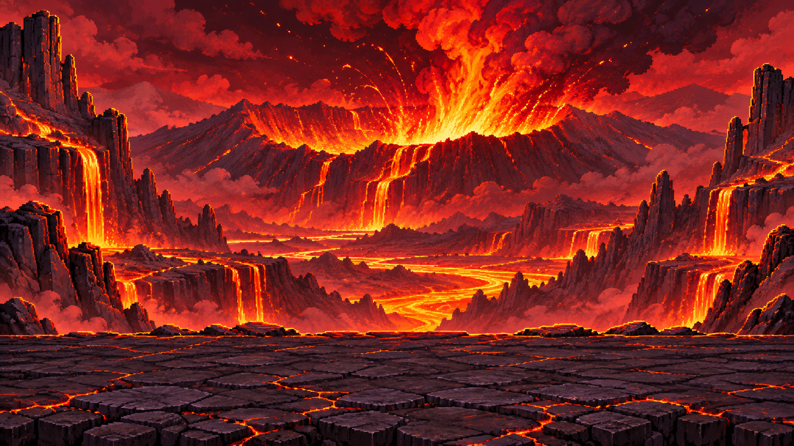

- **Atmosfera:** Uma gigantesca caldeira vulcânica em erupção contínua sobre rochedos de basalto negro e rios de lava alaranjada incandescente. Fumaça escarlate, fuligem e labaredas iluminam um terraço de obsidiana cortado por fendas brilhantes.
- **Lutadores Nativos (Cenário de Origem):**
  - **Garan the Ashen Oni:** O abismo subterrâneo infernal de onde o demônio rastejou de volta à superfície.
  - **Mikazuki Oboro:** O vórtice culminante onde o ritual do Eclipse Escarlate atinge sua potência máxima de convergência.
  - **Valdric Morn:** As fundições geotérmicas onde o império forja canhões de alta potência.
- **Desafiantes e Batalhas da História:**
  - **Sylene Vashti:** A rainha exilada marcha em direção à lava para congelar os veios magmáticos e vingar seu reino ancestral.
  - **Kaito Arashi:** A batalha decisiva contra as sombras de Oboro para dissipar o cataclismo com o Olho da Tempestade.
- **Significado Narrativo:** O ápice do caos primordial e da destruição absoluta, onde o destino do universo convergente é selado no calor da forja final.

---

### 7. Praça do Interior — Brasil (`brazil`)

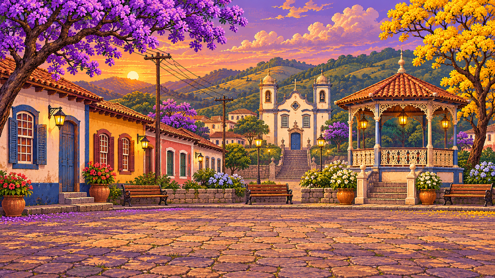

- **Atmosfera:** Uma acolhedora praça histórica no interior do Brasil (inspirada nas cidades coloniais de Minas Gerais e do interior paulista) na hora dourada do entardecer. Casarões em tons pastéis com telhados coloniais de barro, uma igreja elegante ao fundo, um coreto tradicional, ipês e jacarandás floridos e calçamento em pedra portuguesa.
- **Lutadores Nativos (Cenário de Origem):**
  - **Bruno "Bulldozer" Volk:** A praça do coração de Bruno, onde ele treina na academia do bairro e defende seus amigos e vizinhos.
- **Desafiantes e Batalhas da História:**
  - **Haruki Sumi:** Chega em busca de sossego e hospitalidade, sendo recebido por Bruno com café coado e pão de queijo quentinho no coreto.
  - **Daichi Ginrou:** Desce das montanhas atraído pelos boatos de um peso-pesado de socos estrondosos que luta rindo.
  - **Valdric Morn:** Uma expedição imperial tenta confiscar suprimentos e recursos da cidadezinha, sendo repelida pelo cruzado demolidor de Bruno e pela bravura da comunidade local.
- **Significado Narrativo:** Representa a vida pacífica, a ternura comunitária e a bondade das pessoas comuns, provando pelo que realmente vale a pena lutar e proteger. Utiliza a música tema do planalto e não possui versão procedural anterior.

---

## As 7 Maravilhas Modernas do Mundo

### 8. Grande Muralha da China (`great_wall`)

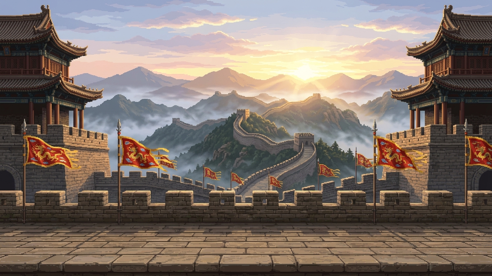

- **Atmosfera:** Uma imponente fortificação milenar de pedra serpenteando sobre montanhas verdejantes envoltas em névoa ao nascer do sol. Torres de vigia em tijolo emolduram as laterais, estandartes imperiais vermelhos e dourados e um amplo chão contínuo de pedra nas ameias.
- **Lore e Afinidades:** Bastião ancestral onde os grandes mestres marciais do oriente aprimoram sua resistência. Lian Feng e Jin Kazaguruma realizam duelos de exibição no topo dos baluartes.

---

### 9. Petra — Al-Khazneh (`petra`)

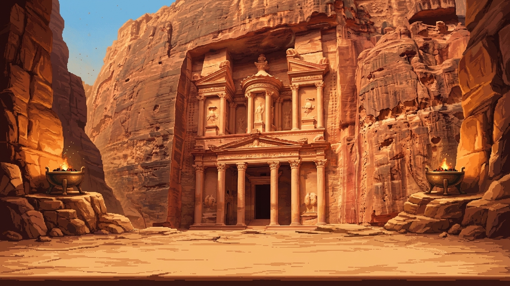

- **Atmosfera:** A monumental fachada helenística do Tesouro (Al-Khazneh) esculpida diretamente nos desfiladeiros de arenito avermelhado do cânion Siq. Luz solar quente do deserto, braseiros de bronze acesos e piso nivelado de arenito.
- **Lore e Afinidades:** Santuário sagrado de antigas caravanas mercantes e nômades do deserto. Daichi Ginrou e Marlow Reyes disputam relíquias guardadas nas câmaras subterrâneas.

---

### 10. Cristo Redentor — Corcovado (`christ_redeemer`)

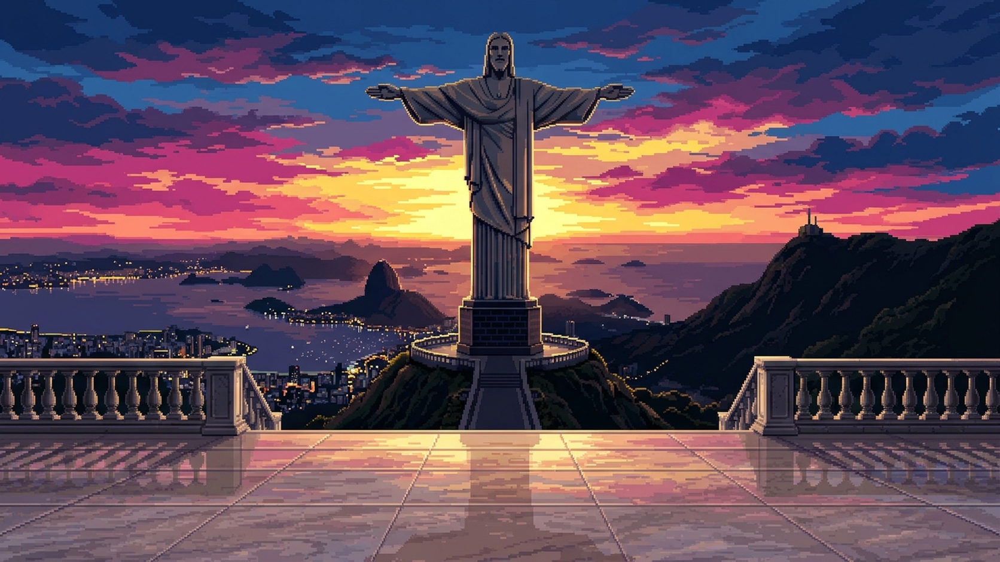

- **Atmosfera:** No cume do Morro do Corcovado no Rio de Janeiro na hora de ouro do entardecer. A gigantesca estátua Art Déco de braços abertos sobre a Baía de Guanabara e o Pão de Açúcar, com o céu em tons de magenta e dourado e as luzes da cidade cintilando ao longe.
- **Lore e Afinidades:** Farol espiritual e santuário de proteção sobre a metrópole. Bruno Volk e Haruki Sumi testam suas forças sob a benção silenciosa do monumento.

---

### 11. Cidade do Interior — Texas, EUA (`texas`)

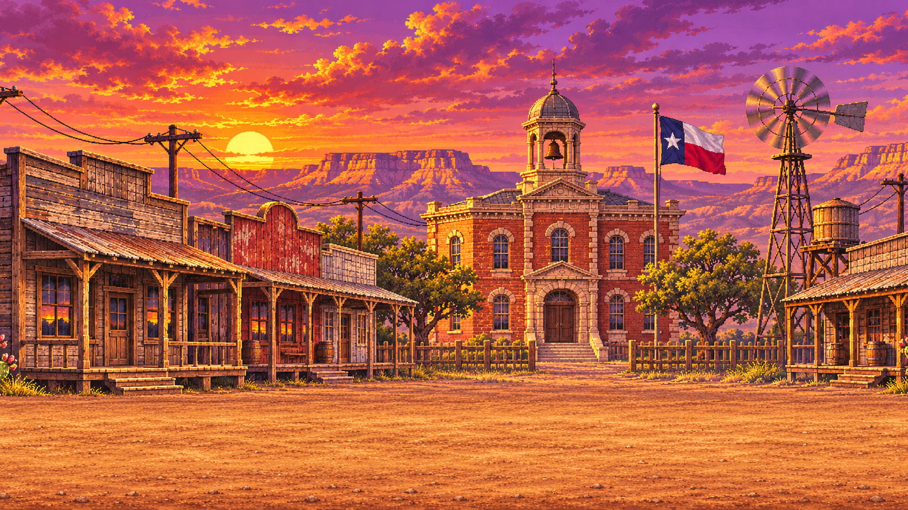

- **Atmosfera:** Uma cidade histórica no interior do Texas ao pôr do sol dourado e empoeirado. Fachadas rústicas de madeira com varandas cobertas de tábuas corridas, fórum do condado em tijolos vermelhos com torre sineira, catavento e caixa d'água de ferro silhuetados contra o crepúsculo carmesim e âmbar, postes telegráficos com fios caídos, bandeira do Texas tremulando ao vento da tarde, cactos nas laterais e uma ampla rua de terra batida nivelada para combate.
- **Lore e Afinidades:** O coração indomável dos justiceiros e forasteiros do oeste americano. Bruno Volk e Captain Marlow Reyes travam duelos de valentões ao cair da tarde na poeira da rua principal.

---

### 12. Chichén Itzá — Templo de Kukulcán (`chichen_itza`)

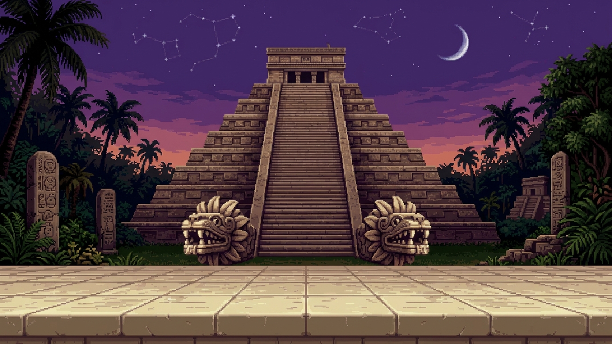

- **Atmosfera:** A imensa pirâmide em degraus de El Castillo sob um céu crepuscular púrpura salpicado de constelações maias. Cabeças talhadas da serpente emplumada na base das escadarias e densa selva tropical circundante.
- **Lore e Afinidades:** Vórtice de alinhamentos cósmicos e cultos estelares. Mikazuki Oboro e Garan canalizam energias de eclipse na praça cerimonial.

---

### 13. Coliseu de Roma (`colosseum`)

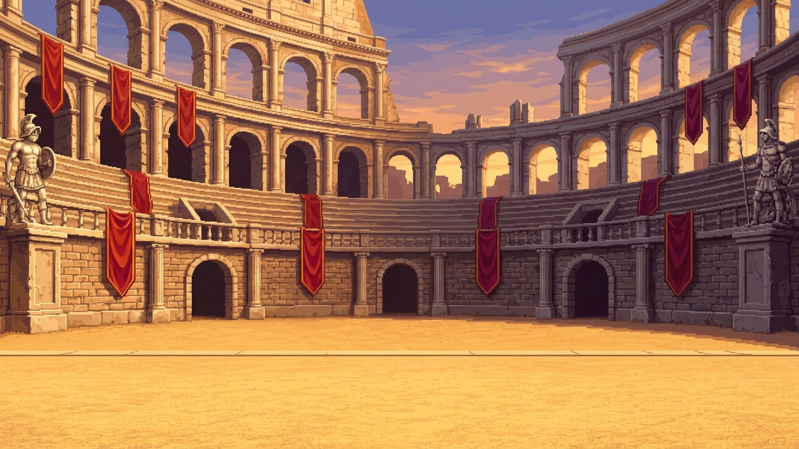

- **Atmosfera:** O anfiteatro romano sob a luz dourada do final da tarde. Arcos de travertino em múltiplos níveis, colunas coríntias imperiais, estandartes vermelhos de seda e uma ampla arena de areia batida.
- **Lore e Afinidades:** Berço histórico das batalhas de gladiadores e da coragem guerreira. Bruno Volk, Daichi Ginrou e Valdric Morn se enfrentam diante dos arcos monumentais.

---

### 14. Taj Mahal — Palácio de Mármore (`taj_mahal`)

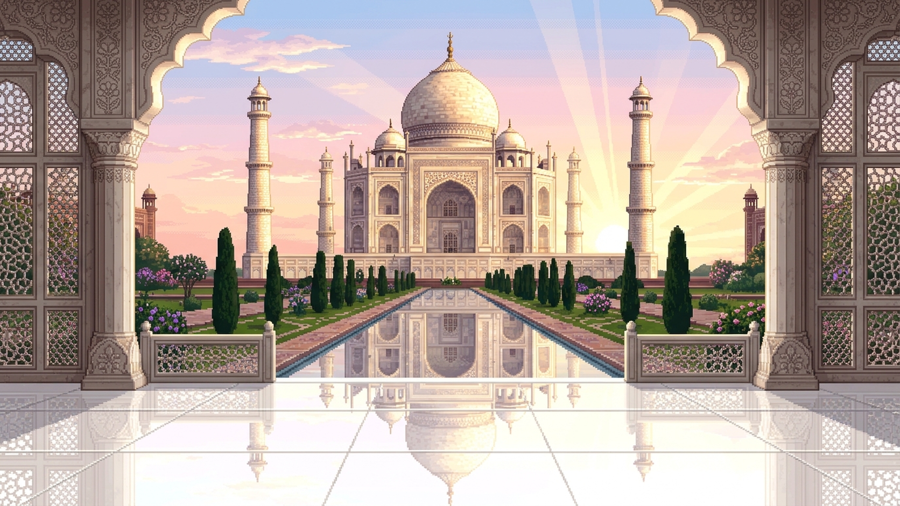

- **Atmosfera:** O deslumbrante mausoléu de mármore branco marfim refletido no espelho d'água dos jardins Charbagh à aurora. Ciprestes verde-escuros, flores de lótus e arcos com treliças de mármore entalhado emolduram o pátio de combate.
- **Lore e Afinidades:** Homenagem suprema ao amor eterno e à harmonia espiritual. Akio Hoshi e Lian Feng trocam golpes de ki sobre a pureza do piso de mármore polido.

---

## As 7 Maravilhas do Mundo Antigo

### 15. Pirâmides de Gizé (`pyramids_giza`)

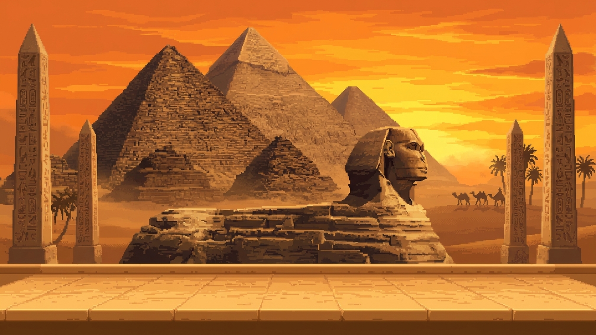

- **Atmosfera:** As colossais pirâmides de Quéops e Quéfren sob um pôr do sol incandescente no deserto do Saara. O imponente perfil da Grande Esfinge e dunas douradas cercam o amplo terraço de arenito.
- **Lore e Afinidades:** Tumbas cósmicas construídas para a eternidade dos faraós. Garan e Marlow Reyes vasculham as areias em busca de segredos astrais esquecidos.

---

### 16. Jardins Suspensos da Babilônia (`hanging_gardens`)

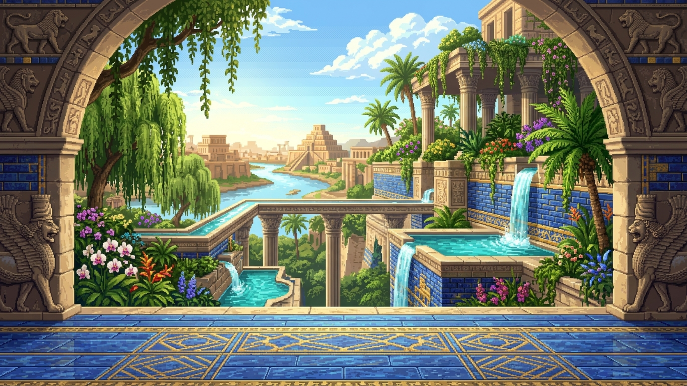

- **Atmosfera:** Terraços palacianos monumentais repletos de vegetação tropical exótica, palmeiras, salgueiros e cascatas de aquedutos fluindo para espelhos d'água. Paredes de tijolos azuis vidrados com relevos de leões dourados avistando o rio Eufrates.
- **Lore e Afinidades:** Maravilha construída pelo amor de um rei mesopotâmico. Haruki Sumi e Sylene Vashti duelam entre flores perfumadas e fontes cristalinas.

---

### 17. Templo de Ártemis em Éfeso (`temple_artemis`)

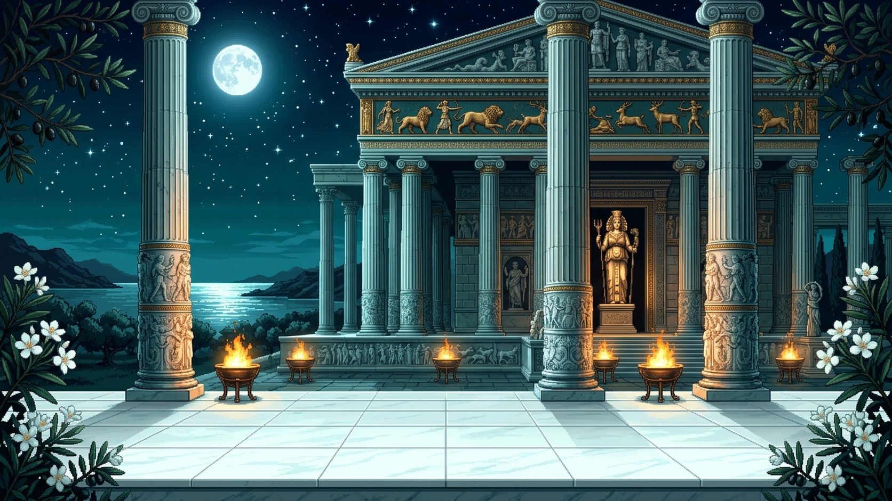

- **Atmosfera:** Grande colunata de mármore jônico sob um límpido céu noturno e mar Egeu ao luar. Braseiros sagrados com chamas âmbar, relevos esculpidos e olivedos emolduram o pátio cerimonial.
- **Lore e Afinidades:** O templo inviolável da deusa da caça e das florestas. Suzume Kagerou e Shion Kurogane cruzam suas lâminas sob o brilho da lua cheia.

---

### 18. Estátua de Zeus em Olímpia (`statue_zeus`)

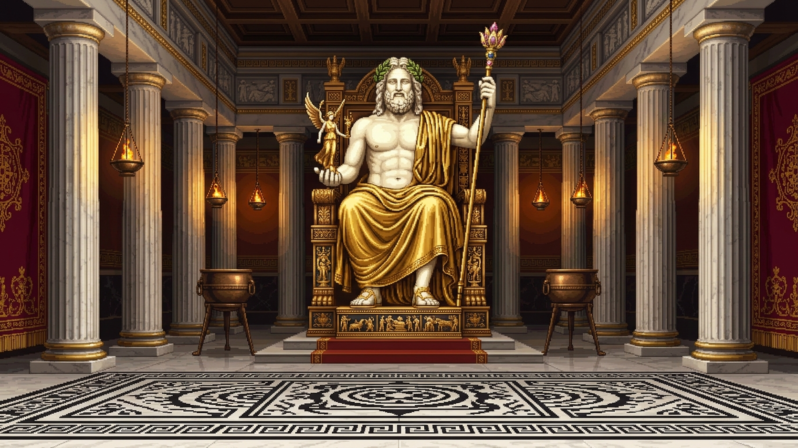

- **Atmosfera:** O interior sagrado do templo abrigando a colossal estátua de ouro e marfim de Zeus em seu trono entalhado em cedro e pedras preciosas. Tochas fumegantes, tapeçarias vermelhas e piso de mosaico de mármore.
- **Lore e Afinidades:** A morada do relâmpago e do juízo divino. Kaito Arashi e Valdric Morn medem forças perante o olhar imortal do senhor do Olimpo.

---

### 19. Mausoléu de Halicarnasso (`mausoleum_halicarnassus`)

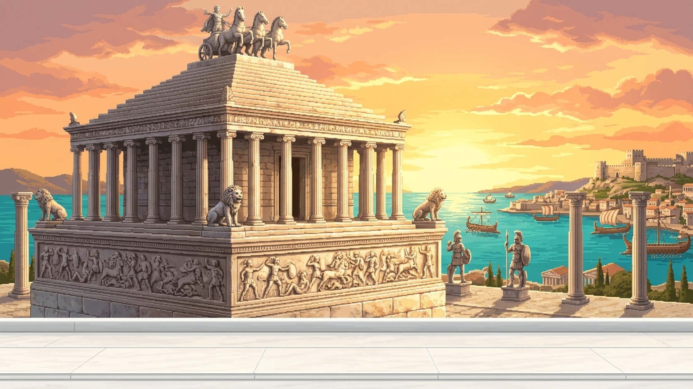

- **Atmosfera:** Tumba monumental de mármore em múltiplos níveis, com frisos da Amazonomaquia, 36 colunas jônicas, teto piramidal coroado por uma quadriga de quatro cavalos de mármore e vista para o porto do mar Egeu.
- **Lore e Afinidades:** Apogeu da escultura e arquitetura da Antiguidade clássica. Kaname Fuyutsuki e Akio Hoshi duelam entre os leões guardiões de mármore.

---

### 20. Colosso de Rodes (`colossus_rhodes`)

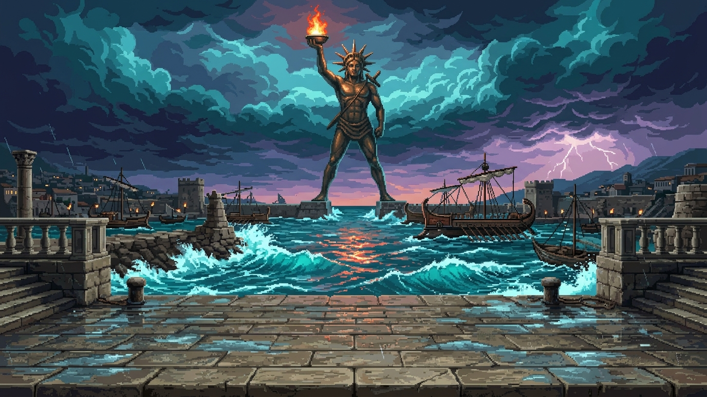

- **Atmosfera:** A titânica estátua de bronze do deus Hélio erguendo sua tocha acesa sobre a entrada do porto na tempestade crepuscular. Ondas furiosas arrebentam no quebra-mar de pedra molhada enquanto triremes gregas balançam na baía.
- **Lore e Afinidades:** Guardião dos mares e farol da liberdade egeia. VX-9 Volta e Marlow Reyes enfrentam o vento e a chuva no cais de pedra sob o archote de chamas ardentes.

---

### 21. Farol de Alexandria — Pharos (`lighthouse_alexandria`)

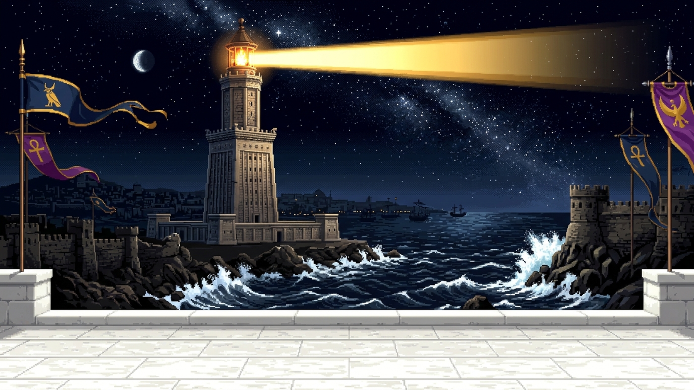

- **Atmosfera:** A imensa torre de três estágios de Pharos projetando um feixe de luz dourada varrendo o mar revolto à meia-noite sob um céu repleto de estrelas. Muralhas brancas de calcário e estandartes ptolemaicos ao vento.
- **Lore e Afinidades:** Guia supremo de marinheiros e estudiosos de Alexandria. Kaito Arashi, Shion Kurogane e Jin Kazaguruma se reúnem nas muralhas enquanto o facho de luz corta as trevas oceânicas.
