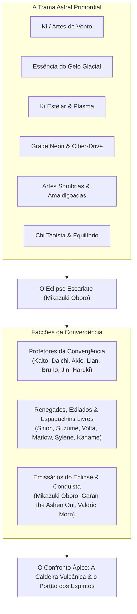

# Universo e Lore — A Grande Convergência

O universo de **Ultimate MUGEN** se passa na era da **Grande Convergência**, onde tempo, geografia e dimensões colidiram após o cataclismo provocado pelo despertar do **Eclipse Escarlate** (*Scarlet Eclipse*).

---

## A Gênese: A Trama Astral e a Ruptura

Por milênios, a história humana fluiu em correntes marciais e culturais isoladas. Guerreiros de santuários montanhosos no Japão, templos taoistas na China, fortalezas glaciais nórdicas, megacidades cyberpunk futuristas, planaltos agrestes da Mongólia e pacatas cidades históricas brasileiras treinavam em isolamento, sem suspeitar da existência de outras realidades.

Sob o mundo material pulsava a **Trama Astral** (*The Astral Loom*) — uma rede metafísica de linhas de força cósmicas que regulava o equilíbrio espiritual, as forças da natureza e as energias primordiais.

Esse equilíbrio milenar foi rompido quando **Mikazuki Oboro**, um feiticeiro imortal e mestre supremo das ilusões pertencente a uma dinastia esquecida, realizou o ritual proibido do **Eclipse Escarlate**. Canalizando chamas negras e o alinhamento de astros proibidos, Oboro fraturou o véu dimensional, arrastando épocas, níveis de tecnologia e territórios inteiros para um único plano compartilhado: o **Domínio da Convergência**.

---

## Sistemas de Energia e Disciplinas Marciais

Os combatentes de Ultimate MUGEN canalizam sua determinação e poder através de vertentes energéticas distintas:

1. **Ventos Primordiais (*Arashi-Ki*)**: Canalizado por **Kaito Arashi** e **Jin Kazaguruma**. Extrai poder das correntes atmosféricas, ciclones e pressão do ar, permitindo aproximações instantâneas, golpes de vácuo cortante e rajadas de vento devastadoras.
2. **Plasma Estelar (*Hoshi-No-Hikari*)**: Dominado por **Akio Hoshi**. Absorve a radiação de meteoritos antigos caídos na Terra, manifestando-se em explosões incandescentes, punhos de plasma ardente e aceleração de supernovas.
3. **Ki Lupino da Terra (*Ginrou-Ki*)**: Despertado por **Daichi Ginrou**. Nascido do instinto selvagem de predador alfa e das correntes telúricas das montanhas, convertendo a empolgação do combate em uma aura dourada impenetrável.
4. **Gelo Absoluto e Geada Espiritual (*Hyōketsu*)**: Empunhado por **Sylene Vashti** e **Kaname Fuyutsuki**. Condensa a umidade do ar em lâminas cristalinas, barreiras glaciais e cortes congelantes capazes de ceifar a própria hesitação da alma.
5. **Chi Taoista e Seda Aérea (*Yu-Chi*)**: Praticado por **Lian Feng**. Focado na deflexão de forças, controle gravitacional e chutes circulares acrobáticos que dobram o ar com a fluidez da seda e a dureza do jade.
6. **Supremacia Cinética do Ferro (*Punho de Ferro*)**: Aperfeiçoado por **Bruno "Bulldozer" Volk**. Condicionamento físico humano levado ao limite absoluto, peso cinético devastador e boxe de curta distância potente o suficiente para despedaçar auras arcanas.
7. **Ciber-Drive & Sobrecarga (*Grade Neon*)**: O núcleo biomecânico de **VX-9 Volta**. Capacitores dielétricos de alta voltagem, servomotores supercondutores e feixes de partículas digitais energizados por uma consciência sintética senciente.
8. **Chamas Frias de Cinzas (*Oni-No-Hai*)**: Erompidas por **Garan the Ashen Oni**. Fogo violeta e gélido forjado no portão do submundo, que consome a alma e a coragem dos mortais em vez de meramente queimar sua carne.
9. **Aether dos Mares e Tempestades (*Vento Salgado*)**: Canalizado pelo **Capitão Marlow Reyes**. Energia dos marinheiros celestes infundida com raios de tormenta e força das marés, disparada através de sua espada curta encantada.
10. **Núcleo Imperial da Estrela Rubra (*Dominância Escarlate*)**: Desenvolvido por **Valdric Morn**. Canhões de plasma escarlate de alta potência integrados em armaduras energéticas pesadas, projetados para subjugação militar em larga escala.
11. **Titãs do Crepúsculo Selados (*Crepúsculo Selado*)**: Aprisionados no corpo de **Haruki Sumi**. Poder arcano cataclísmico contido por pergaminhos e talismãs sagrados; quando o estudioso perde o controle, a fúria ancestral devasta o campo de batalha.
12. **Réquiem da Lua Pálida (*Kurogane Tsuki*)**: Conduzido por **Shion Kurogane**. A atração gravitacional e a melancolia da Lua Pálida fundidas em uma montante colossal que homem comum algum consegue erguer.
13. **Miragem do Lótus Carmesim (*Kagerou-Ryu*)**: Herdado por **Suzume Kagerou**. Deslocamento em pontos cegos sensoriais, clones ilusórios e adagas de assassinato velozes como o bater de asas de um pardal.
14. **Mangekyo Escarlate (*Meikyō Escarlate*)**: O olho de ilusão supremo de **Mikazuki Oboro**. Distorce a percepção óptica, invoca corvos espectrais de pesadelo e reescreve as consequências da luta diretamente na mente do oponente.

---

## As Três Grandes Facções: Heróis, Neutros e Vilões

Os combatentes da Convergência dividem-se em três grandes posturas filosóficas perante o colapso dimensional:

### 1. Os Protetores da Convergência (Heróis)
Guerreiros honrados empenhados em restaurar a Trama Astral, fechar as fendas dimensionais e defender vidas inocentes da tirania e da destruição:
- **Kaito Arashi** (Japão): Karateca andarilho justo em busca de equilíbrio e evolução interior através da tempestade.
- **Daichi Ginrou** (Mongólia): Guerreiro selvagem dos picos gelados cuja aura dourada protege os mais vulneráveis.
- **Akio Hoshi** (Japão): Jovem prodígio da luz estelar cuja impetuosidade e coragem jamais se curvam diante da tirania.
- **Lian Feng** (China): Grã-mestra da Lanterna de Jade dedicada à preservação do equilíbrio cósmico.
- **Bruno "Bulldozer" Volk** (Brasil): Campeão invicto dos ringues, gigante gentil que luta pelo futuro de seu povo e de sua cidade natal.
- **Jin Kazaguruma** (Japão): Shinobi veloz e bem-humorado que age como mensageiro da liberdade entre as vilas ocultas.
- **Haruki Sumi** (Coreia do Sul): Bibliotecário erudito e guardião pacífico que suporta o terrível fardo de selos titânicos.

### 2. Os Renegados, Exilados & Espadachins Livres (Anti-Heróis / Força Neutra)
Guerreiros guiados por códigos de honra próprios, vinganças ancestrais, busca pela própria alma ou restauração de reinos perdidos:
- **Shion Kurogane** (Japão): Exilado melancólico que carrega o luto de seu clã lunar e caça as sombras que maculam a noite.
- **Suzume Kagerou** (Japão): Kunoichi sobrevivente que ataca na escuridão para exterminar os mandantes do massacre de seu clã.
- **VX-9 Volta** (EUA / Neo-Metrópole): Androide de combate desertor que desafia seus programadores em busca do significado de possuir um coração.
- **Capitão Marlow Reyes** (Espanha / Céus do Caribe): Corsário aéreo carismático que saqueia impérios tiranos em busca de mapas arcanos e glória.
- **Sylene Vashti** (Noruega / Borealia Ártica): Princesa exilada do reino do gelo empenhada em reconquistar seu trono das mãos de cultistas das cinzas.
- **Kaname Fuyutsuki** (Japão): Juiz estóico do Santuário das Neves cuja katana congela a hesitação e pune a corrupção sem piedade.

### 3. Os Emissários do Eclipse & Conquista (Inimigos / Vilões)
Forças malignas empenhadas na aniquilação da realidade, no retorno de demônios ancestrais ou na dominação militar tirânica:
- **Mikazuki Oboro** (Dimensão do Eclipse — Chefe Final): Mestre ilusionista supremo que planeja consumir toda a existência em um sonho eterno de fogo negro.
- **Garan the Ashen Oni** (Abismo Subterrâneo): Oni milenar libertado dos selos vulcânicos para devorar o medo e transformar a Terra em cinzas frias.
- **Valdric Morn** (Império Estelar de Vane / Europa Central): Príncipe tecnocrata bélico que considera guerreiros espirituais "plebeus inferiores" que devem ser esmagados pelo poder do império.

---

## O Torneio Ápice: O Ponto de Ruptura

Para alimentar as fendas da realidade com a essência marcial dos seres vivos mais poderosos, Mikazuki Oboro manifestou o **Cadinho Ápice** (*The Apex Crucible*) — arenas de combate que entrelaçam templos ancestrais, terraços futuristas, bosques iluminados pela lua, planaltos desérticos, santuários de espíritos, caldeiras vulcânicas e praças ensolaradas.

Cada embate aproxima os guerreiros do centro do vórtice dimensional. Somente superando suas próprias fraquezas e derrotando o arquiteto do Eclipse os combatentes poderão restaurar as linhas do mundo antes que o tecido da realidade se desfaça para sempre.
