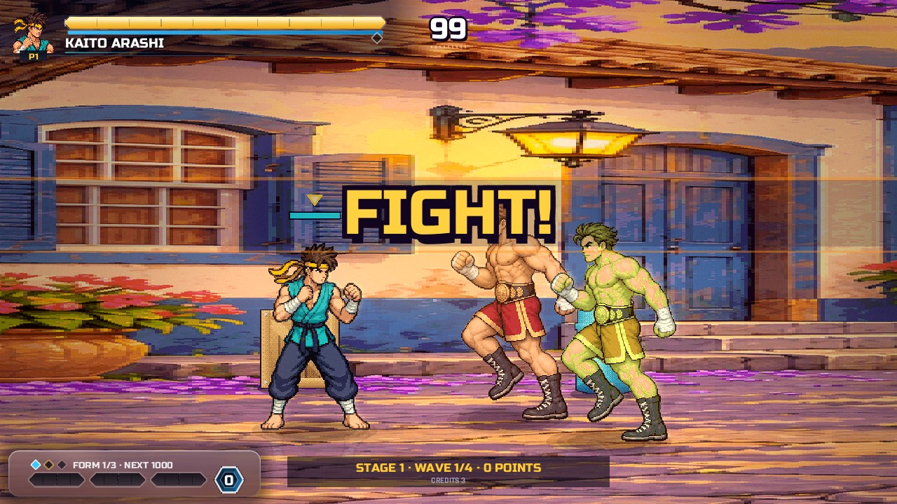
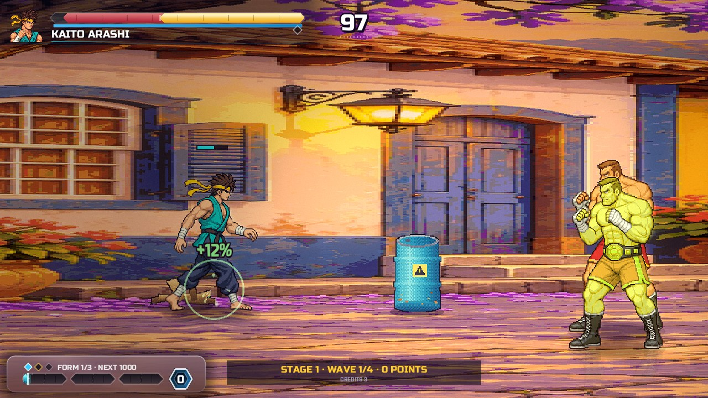
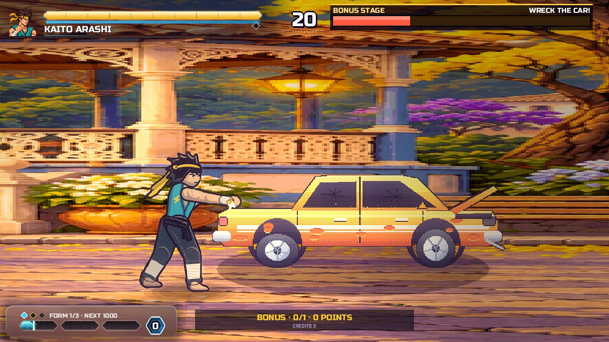

# Objetos de cenário: quebráveis, comida e fases bônus

[English](../Stage-Objects.md) · **Português (BR)**

As fases do modo História têm objetos no estilo fliperama que vivem dentro da simulação: caixotes e barris que quebram ao serem golpeados, comida e outros itens que saem deles, e uma fase bônus em que o objetivo é destruir tudo antes do tempo acabar. Todo o conteúdo desta página é original e vem de um único arquivo TOML, então um objeto novo precisa de arte e de algumas linhas de dados, não de código.



## O que o jogador vê

- **Quebráveis.** Qualquer golpe ou projétil que alcance um caixote ou barril causa dano. O sprite troca para um quadro rachado conforme perde vida, treme e pisca no impacto e deixa lascas ou um tambor amassado por alguns segundos.
- **Itens.** Um objeto quebrado pode soltar um item. Ele salta, quica uma vez e fica no chão por 15 segundos (pisca nos últimos 2,5). Basta andar por cima para coletar.
- **Fase bônus.** Depois do chefe dos Becos da Cidade e do Bambuzal, o vilão sai de cena e a fase bônus começa no mesmo lugar: destrua o carro (4 estágios de dano, fumaça e faíscas quando está muito avariado) ou quebre todo o estoque antes do tempo acabar. Não há inimigos nem como perder; quebrar tudo paga a pontuação dos objetos mais 200 pontos por segundo restante.

| Item | Efeito | Pontos |
|---|---|---|
| Maçã | +12 % de vida | 100 |
| Fatia de pizza | +25 % de vida | 200 |
| Assado | +50 % de vida | 400 |
| Gema | só pontos | 1500 |
| Bateria | +34 % de energia | 150 |




## Regras (engine)

`crates/engine/src/stage_objects.rs` é dono do estado (`Match::objects`): ele é clonado junto com a partida, entra no checksum do netplay e nunca aloca durante um tick.

- Um `Breakable` tem posição no chão, faixa (lane), caixa de dano (`half_width`, `height`), vida e um `PickupSpec` opcional. Golpes em pé passam por cima de objetos baixos, então a caixa de dano tem pelo menos 100 unidades de altura.
- Profundidade: com faixas ligadas, o atacante alcança o objeto quando sua faixa está a até `LANE_REACH + depth` da faixa do objeto.
- Um acerto por golpe: depois de um acerto o objeto ignora novos acertos por `REHIT_TICKS` (10). O atacante recebe `MoveContact`/`MoveHit` e até 8 ticks de hit pause, então os golpes normais cancelam em um caixote como cancelariam em um lutador.
- Objetos `solid` (o carro) empurram lutadores no chão para fora do seu corpo; pular por cima do teto é livre.
- Itens só são coletados por lutadores principais do `collector_side` (o lado do herói), vivos, a até 18 unidades, a até duas vezes o alcance de faixa de um golpe e perto do chão. A cura nunca passa de `life_max`.
- `start_break_all_goal(ticks)` transforma o round em fase bônus: o relógio do round espelha o relógio do objetivo e o round termina para o lado 0 quando tudo está quebrado (`Goal::Cleared`) ou o tempo acaba (`Goal::TimedOut`).
- A apresentação lê `objects.events` (`Struck`, `Broken`, `Dropped`, `Collected`, `GoalCleared`, `GoalTimedOut`) uma vez por tick e limpa a lista.

## Dados (`assets/story/objects.toml`)

Uma cópia chamada `story-objects.toml` ao lado do executável (ou no armazenamento do navegador) substitui o arquivo embutido.

```toml
[kinds.crate]
sprite = "crate"            # folha em assets/props/story/, quadros lado a lado
frames = 3                  # estágios de dano da esquerda para a direita, o último são os restos
size = [48.0, 48.0]         # tamanho desenhado em unidades de mundo
half_width = 20.0
height = 42.0
depth = 10.0
life = 120.0
score = 100.0
solid = false
debris = [0.78, 0.55, 0.3]  # cor das partículas
sound = "wood"              # "wood" ou "metal"

[pickups.pizza]
sprite = "pizza"            # 6 quadros, um brilho atravessa o item
heal = 0.25                 # fração da barra de vida
power = 0.0                 # fração da barra de energia
score = 200.0

[stages.brazil]
objects = [
  { fight = 0, kind = "crate", x = -78.0, lane = -22.0, drop = "apple" },
]

[stages.brazil.bonus]
seconds = 30
objects = [{ kind = "car", x = 34.0, lane = -16.0 }]
```

`fight` é o índice da onda dentro da fase (o chefe é o último), `x` é medido a partir do centro do segmento daquela luta e `lane` é limitado à faixa de chão da fase. Uma fase sem tabela `bonus` vai direto do chefe para a tela de fase concluída.

## Arte

`python3 tools/story_objects_art.py` desenha todas as folhas por código (formas chapadas, rampas com dithering, contorno de um pixel) a 2 pixels por unidade de mundo, então a arte é reproduzível e não usa assets de terceiros. Troque um PNG por uma folha com o mesmo layout para dar outra aparência a um objeto.

## Mapa do código

| Arquivo | Papel |
|---|---|
| `crates/engine/src/stage_objects.rs` | Estado, relógio do objetivo, corpos sólidos |
| `crates/engine/src/stage_objects/strikes.rs` | Golpes e projéteis contra quebráveis, itens soltos |
| `crates/engine/src/stage_objects/pickups.rs` | Física e coleta dos itens |
| `src/story/objects.rs` | Catálogo TOML, criação por fase e por fase bônus |
| `src/story/objects_art.rs` | Sprites, sombras, flash de impacto, ordem de profundidade com os lutadores |
| `src/vfx/stage_objects.rs` | Destroços, faíscas, fumaça, texto flutuante, sons |
| `src/app/story/bonus.rs`, `src/app/story/hud.rs` | Fluxo da fase bônus e seu HUD |

Captura de evidências: `UME_TOUR=storyobjects ultimate-mugen --shots <dir> --res 1280x720 --mute`.
