# Ultimate MUGEN — Fichas e Dossiê dos Personagens

Este documento apresenta os dossiês biográficos completos, históricos marciais, alinhamentos, países de origem, cenários associados e dinâmicas de interação para todos os 16 lutadores nativos de **Ultimate MUGEN**.

---

## Visão Geral do Elenco (Roster)

| ID | Nome | País | Alinhamento | Papel / Arquétipo | Cenário Natal | Forma Desperta |
|---|---|---|---|---|---|---|
| `kaito` | **Kaito Arashi** | Japão | Herói | Karateca Andarilho da Tempestade | Telhado do Dojo — Pôr do Sol (`dojo`) | Olho da Tempestade |
| `shion` | **Shion Kurogane** | Japão | Anti-Herói | Espadachim Exilado da Lua Pálida | Bambuzal ao Luar (`bamboo`) | Lua Cheia |
| `akio` | **Akio Hoshi** | Japão | Herói | Lutador Impetuoso da Queda Estelar | Telhado do Dojo — Pôr do Sol (`dojo`) | Luz Estelar |
| `suzume` | **Suzume Kagerou** | Japão | Anti-Herói | Kunoichi das Sombras do Lótus Carmesim | Bambuzal ao Luar (`bamboo`) | Lótus Sombrio |
| `bruno` | **Bruno "Bulldozer" Volk** | Brasil | Herói | Campeão Invicto Peso-Pesado | Praça do Interior — Brasil (`brazil`) | Fúria do Ringue |
| `sylene` | **Sylene Vashti** | Noruega | Neutro | Soberana Exilada da Coroa Glacial | Planalto Rochoso (`plains`) | Rainha do Inverno |
| `volta` | **VX-9 Volta** | Estados Unidos | Herói | Androide Cibernético Senciente | Neo-Metrópole 2099 (`neon`) | Sobrecarga |
| `lian` | **Lian Feng** | China | Herói | Grã-Mestra dos Chutes da Lanterna de Jade | Bambuzal ao Luar (`bamboo`) | Dragão de Jade |
| `garan` | **Garan the Ashen Oni** | Submundo | Vilão | Calamidade Demoníaca Ancestral | Cratera Vulcânica (`volcano`) | Oni Desperto |
| `marlow` | **Capitão Marlow Reyes** | Espanha | Anti-Herói | Corsário Aéreo do Galeão Tempestuoso | Planalto Rochoso (`plains`) | Capitão Tempestade |
| `kaname` | **Kaname Fuyutsuki** | Japão | Neutro / Leal | Juiz Samurai do Inverno Eterno | Portão dos Espíritos (`spirit`) | Lâmina Espiritual |
| `jin` | **Jin Kazaguruma** | Japão | Herói | Shinobi Acrobata do Vendaval | Bambuzal ao Luar (`bamboo`) | Tufão |
| `daichi` | **Daichi Ginrou** | Mongólia | Herói | Lobo dos Picos Celestes de Ki Dourado | Planalto Rochoso (`plains`) | Instinto Lupino |
| `valdric` | **Valdric Morn** | Alemanha | Vilão | Príncipe Senhor da Guerra Imperial | Neo-Metrópole 2099 (`neon`) | Dominância Escarlate |
| `haruki` | **Haruki Sumi** | Coreia do Sul | Herói | Erudito Relutante / Portador dos Titãs | Portão dos Espíritos (`spirit`) | Fúria Contida |
| `oboro` | **Mikazuki Oboro** | Dimensão Eclipse | Vilão Supremo (Chefe) | Soberano das Ilusões e Chamas Negras | Portão dos Espíritos / Vulcão (`spirit`/`volcano`) | Mangekyo Desperto |

---

## Dossiês Individuais

### 1. Kaito Arashi (嵐 海斗)

| Identidade Visual | Perfil de Combate |
|---|---|
| 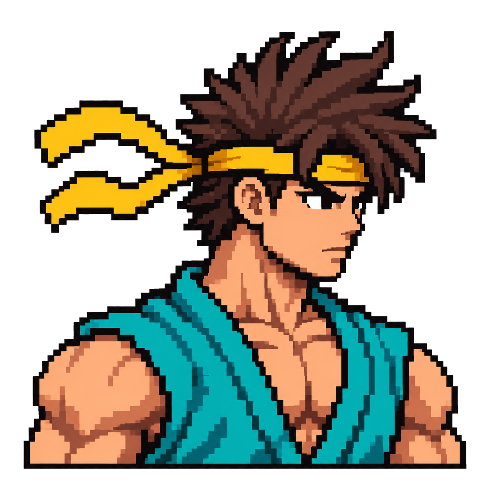 *Retrato de Seleção / HUD* | **Série:** Crônicas da Estrada da Tempestade **ID:** `kaito` \| **Autor:** Ultimate MUGEN **Origem:** Costa de Shizuoka e Sopé do Monte Fuji, Japão 🇯🇵 **Alinhamento:** **Herói / Vanguarda do Equilíbrio** **Cor Temática:** `#2f8f9d` (Verde-água e Dourado) **Forma Desperta:** Olho da Tempestade **Cenário:** Telhado do Dojo — Pôr do Sol (`dojo`) **Estilo:** Karatê Arashi-ryu (Impacto dos Ventos) |

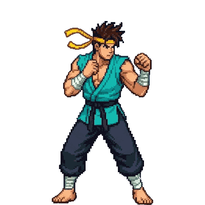
*Postura de Luta em Pixel Art*

#### Biografia e Background
Kaito Arashi é um karateca andarilho que viaja a pé por onde as correntes de ar soprarem. Vestindo um kimono verde-água remendado que já presenciou centenas de combates árduos pela Ásia, Kaito encara a luta não como espetáculo de vaidade, mas como uma conversa sincera entre dois espíritos. Criado por um mestre eremita nos penhascos tempestuosos da Península de Izu, ele aprendeu a sincronizar o ritmo de sua respiração com a passagem dos tufões costeiros, gerando ondas de choque de alta densidade e rajadas de vácuo a cada soco desferido.

Quando o Eclipse Escarlate começou a rasgar o céu, Kaito sentiu a perturbação das correntes de ar e o desespero das vilas atingidas pelas fendas dimensionais. Empunhando seu bastão de caminhada, desceu a montanha com o voto inabalável de encontrar a fonte da corrupção e proteger os viajantes e inocentes das sombras de Oboro.

#### Frases Marcantes
- **Entrada:** *"Sinto a tempestade chegando. Em guarda."*
- **Provocação:** *"Sua guarda tem uma brecha. Aproveite."*
- **Vitória:** *"O vento me trouxe até aqui. Sua guarda só te trouxe ao chão."*

#### Golpes Característicos
- **Punho do Vendaval (*Gale Fist / Reppūken*)**: Dispara uma esfera de pressão de vento cortante rente ao solo.
- **Tempestade Ascendente (*Rising Tempest / Shoryū-Arashi*)**: Gancho giratório aéreo envolto em vórtices de ar.
- **Chute Passo de Trovão (*Thunderstep Kick*)**: Sequência de chutes voadores de vácuo em trajetória horizontal.
- **Super — Barragem do Tufão (*Typhoon Barrage*)**: Combinação devastadora de 9 golpes que arremessa o oponente para o olho do ciclone.

#### Dinâmica de Interações
- **vs. Mikazuki Oboro:** Choque filosófico supremo. Kaito recusa render-se à ilusão niilista de Oboro, jurando dissipar a escuridão com os ventos da verdade.
- **vs. Jin Kazaguruma:** Relação fraternal e tutelar. Kaito incentiva o entusiasmo acrobático de Jin, mas sempre o lembra de manter os pés firmes no chão.
- **vs. Daichi Ginrou:** Rivalidade histórica e respeitosa. O duelo clássico entre o vento sereno e o lobo impetuoso dos cumes gelados.
- **vs. Bruno Volk:** Duelo de socos francos. Kaito admira a força física honesta e o coração generoso do boxeador brasileiro.

---

### 2. Shion Kurogane (黒鉄 紫苑)

| Identidade Visual | Perfil de Combate |
|---|---|
| 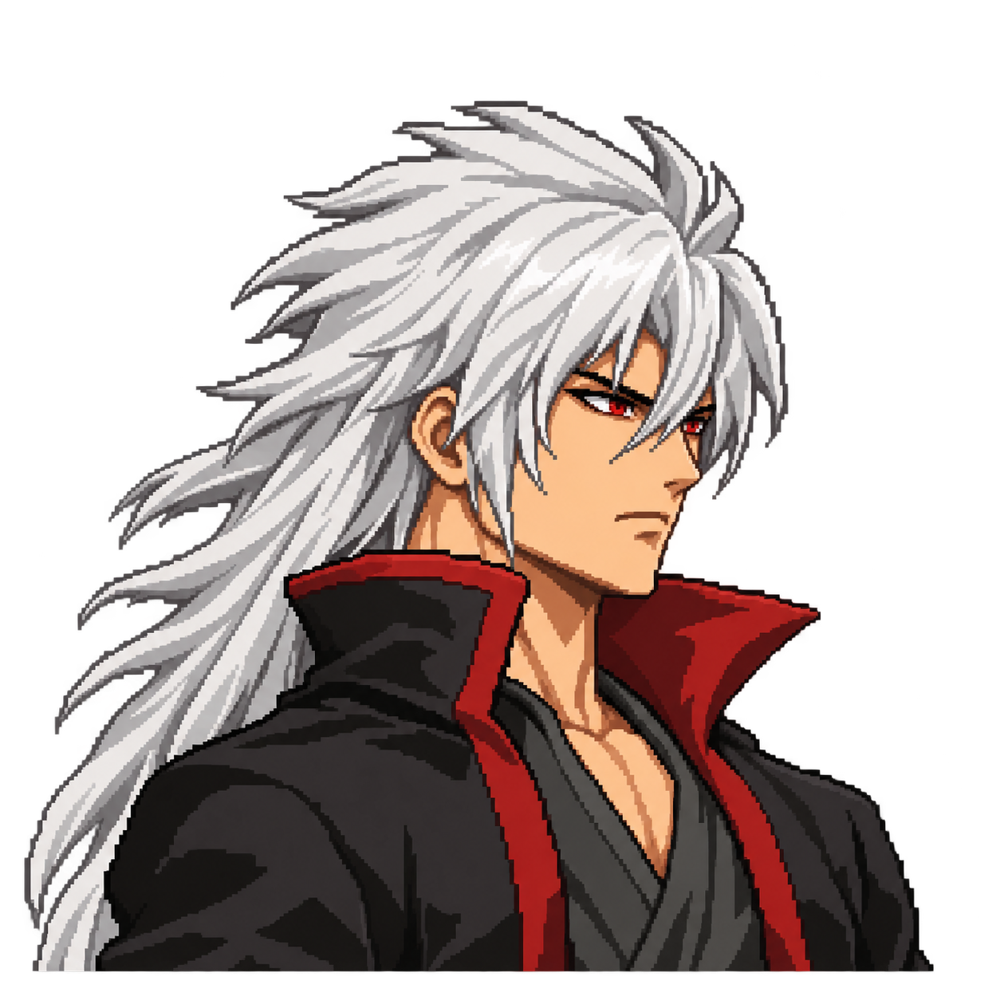 *Retrato de Seleção / HUD* | **Série:** Réquiem da Lua Pálida **ID:** `shion` \| **Autor:** Ultimate MUGEN **Origem:** Montanhas Esquecidas de Tohoku, Japão 🇯🇵 **Alinhamento:** **Anti-Herói / Guardião Melancólico** **Cor Temática:** `#4a3b68` (Índigo Lunar Profundo) **Forma Desperta:** Lua Cheia **Cenário:** Bambuzal ao Luar (`bamboo`) **Estilo:** Espada Pesada Kurogane e Gravidade Lunar |

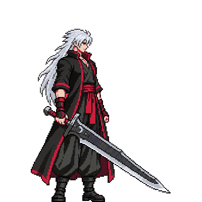
*Postura de Luta em Pixel Art*

#### Biografia e Background
Shion Kurogane é um exilado solitário envolto em um manto negro, que carrega nas costas uma espada forjada com ferro de meteorito lunar. A lâmina é tão incrivelmente densa e pesada que homem comum algum consegue erguê-la do chão. Outrora o mais promissor campeão do Clã Kurogane, Shion foi banido após recusar-se a sacrificar peregrinos inocentes em um ritual de sangue sob a Lua Pálida.

Carregando o arrependimento e a memória de seus irmãos caídos, Shion vaga por florestas de bambu e desfiladeiros gelados sob o luar perpétuo. Ele caça as aberrações nascidas das fendas de Oboro, encarando cada golpe de sua lâmina colossal como um ato solene de expiação.

#### Frases Marcantes
- **Entrada:** *"A lua observa. Faça valer a noite."*
- **Provocação:** *"Sem pressa. A noite é longa."*
- **Vitória:** *"A lua não tem pressa. Minha lâmina também não."*

#### Golpes Característicos
- **Corte Crescente (*Gettan-Zan*)**: Arco descendente que fende o solo com a força gravitacional da lua.
- **Barreira do Eclipse Pálido**: Posiciona a enorme lâmina como escudo, absorvendo e anulando projéteis pesados.
- **Rastro Lunar (*Tsukikage*)**: Crava o pomo da espada no chão, liberando um pulso sísmico circular.
- **Super — Réquiem do Horizonte Crescente**: Executa um corte panorâmico de meia-noite que fende o espaço à frente.

#### Dinâmica de Interações
- **vs. Kaname Fuyutsuki:** Duelo de caminhos da espada. Kaname luta pelo dever divino impessoal, enquanto Shion luta pela redenção de sua consciência.
- **vs. Suzume Kagerou:** Compreensão mútua de sobreviventes. Suzume respeita o silêncio de Shion, identificando a mesma mágoa e sede de justiça.
- **vs. Garan the Ashen Oni:** Antagonismo puro. Garan deleita-se no sofrimento alheio, enquanto Shion busca extinguir as chamas malignas para sempre.

---

### 3. Akio Hoshi (星 秋男)

| Identidade Visual | Perfil de Combate |
|---|---|
| 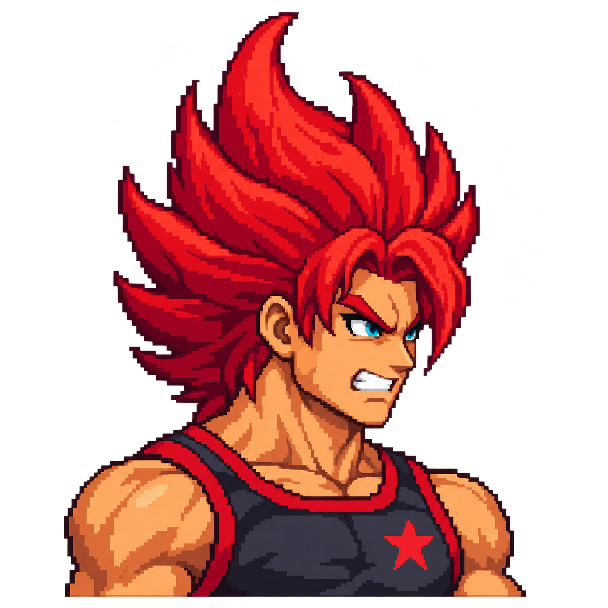 *Retrato de Seleção / HUD* | **Série:** Dojo da Queda Estelar **ID:** `akio` \| **Autor:** Ultimate MUGEN **Origem:** Osaka / Observatório de Ikoma, Japão 🇯🇵 **Alinhamento:** **Herói / O Prodígio de Sangue Quente** **Cor Temática:** `#e63946` (Vermelho Carmesim Estelar) **Forma Desperta:** Luz Estelar **Cenário:** Telhado do Dojo — Pôr do Sol (`dojo`) **Estilo:** Punho da Queda Estelar e Plasma Cósmico |

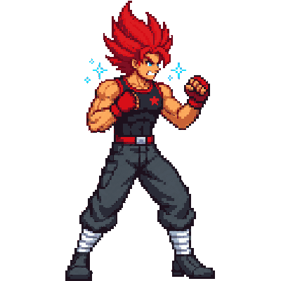
*Postura de Luta em Pixel Art*

#### Biografia e Background
Akio Hoshi é um jovem lutador de sangue fervente cujo cabelo vermelho espetado se eriça como uma labareda solar toda vez que sua energia interior transborda. Criado no lendário Dojo da Queda Estelar, erguido à beira de uma antiga cratera de meteoro nas montanhas de Osaka, Akio aprendeu a canalizar partículas de radiação estelar diretamente em suas fibras musculares, gerando punhos de plasma ardente.

Impetuoso, barulhento e apaixonado pelo combate leal, Akio se recusa a aceitar a derrota. Quando encurralado, sua resposta imediata é elevar a temperatura de seus punhos e acelerar o ritmo da luta até que o oponente ceda.

#### Frases Marcantes
- **Entrada:** *"Finalmente um rival à altura! Vou me divertir!"*
- **Provocação:** *"Vem! Mostra o que você tem!"*
- **Vitória:** *"Isso foi só o aquecimento! Levanta e mostra seu poder de verdade!"*

#### Golpes Característicos
- **Meteoro Jab**: Sequência ultrarrápida de socos de plasma que termina em uma explosão de calor.
- **Queda de Nova**: Salto acrobático seguido de um calcanhar descendente em chamas cósmicas.
- **Clarão Estelar**: Emissão de luz cegante que quebra a linha de visão do oponente para iniciar combos.
- **Super — Cataclismo Supernova**: Canaliza a força de um meteoro completo em um impacto duplo que ilumina a arena.

#### Dinâmica de Interações
- **vs. Daichi Ginrou:** Melhores amigos e rivais perpétuos. Seus treinos costumam derrubar árvores e rochedos, seguidos de banquetes ruidosos.
- **vs. Valdric Morn:** Desprezo absoluto. Akio odeia a arrogância imperial de Valdric e a covardia de depender de canhões mecânicos para subjugar os outros.
- **vs. Kaito Arashi:** Admiração sincera. Akio considera Kaito a meta definitiva a ser superada no circuito de artes marciais.

---

### 4. Suzume Kagerou (陽炎 雀)

| Identidade Visual | Perfil de Combate |
|---|---|
| 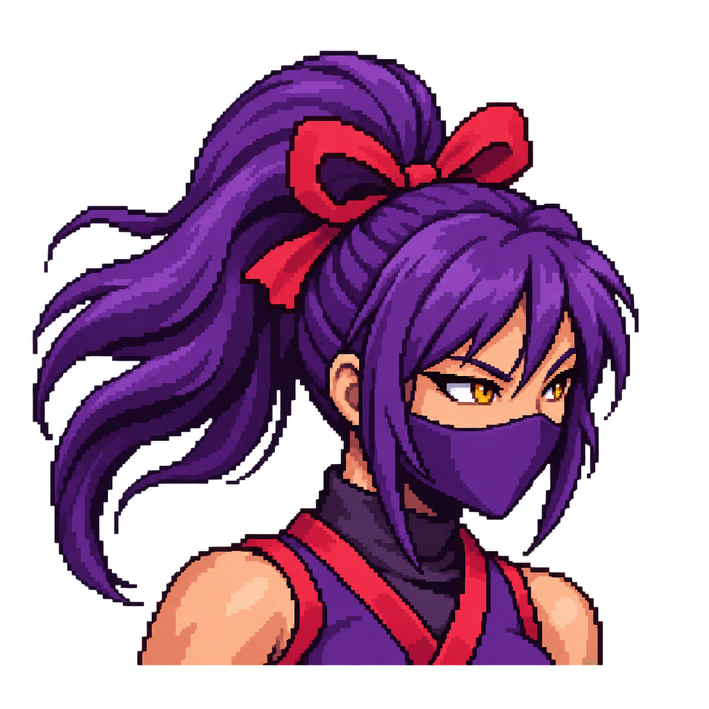 *Retrato de Seleção / HUD* | **Série:** Shinobi do Lótus Carmesim **ID:** `suzume` \| **Autor:** Ultimate MUGEN **Origem:** Vales Ocultos de Iga, Japão 🇯🇵 **Alinhamento:** **Anti-Herói / Vingadora Silenciosa** **Cor Temática:** `#9b2226` (Carmesim Profundo e Sombra) **Forma Desperta:** Lótus Sombrio **Cenário:** Bambuzal ao Luar (`bamboo`) **Estilo:** Ninjutsu de Assassínio Kagerou e Adagas Gêmeas |

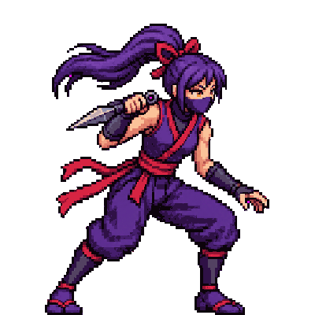
*Postura de Luta em Pixel Art*

#### Biografia e Background
De fala mansa, postura discreta e olhar penetrante, Suzume é a última sobrevivente do lendário clã shinobi Kagerou, massacrado em uma única noite pelos assassinos fantoches de Mikazuki Oboro. Suzume sobreviveu escondendo-se no ponto cego entre duas batidas do coração, uma técnica lendária que permite a um ninja desaparecer da percepção humana consciente.

Ela não luta por fama, dinheiro ou honra esportiva: toda a sua existência foi convertida em um instrumento afiado para encontrar a fraqueza de Oboro e cravar suas adagas em seu peito. Embora seja fria e distante com estranhos, auxilia discretamente Kaito e Jin quando suas investigações coincidem.

#### Frases Marcantes
- **Entrada:** *"Não me procure. Eu já estou atrás de você."*
- **Provocação:** *"Atrás de você... de novo."*
- **Vitória:** *"Você olhava minha lâmina. Devia ter olhado minha sombra."*

#### Golpes Característicos
- **Passo do Lótus Fantasma**: Teletransporte instantâneo para as costas do oponente no instante de um ataque.
- **Kunai Cauda de Andorinha**: Disparo triplo de adagas envenenadas em leque.
- **Corte de Jugular Noturno**: Rasteira rápida com transição imediata para corte ascendente com adaga dupla.
- **Super — Dança das Mil Pétalas**: Envolve o inimigo em um redemoinho de sombras e desfecha cinquenta cortes em um único segundo.

#### Dinâmica de Interações
- **vs. Mikazuki Oboro:** Vingança de sangue. Suzume vive unicamente para apagar o sorriso presunçoso do rosto do feiticeiro.
- **vs. Jin Kazaguruma:** Contraste ninja. Jin é barulhento e saltitante; Suzume é fria e invisível. Ela vive avisando que o cachecol vermelho dele é um alvo fácil.
- **vs. Haruki Sumi:** Empatia silenciosa. Suzume reconhece o sofrimento de Haruki por carregar uma maldição involuntária e costuma vigiá-lo das sombras.

---

### 5. Bruno "Bulldozer" Volk

| Identidade Visual | Perfil de Combate |
|---|---|
| 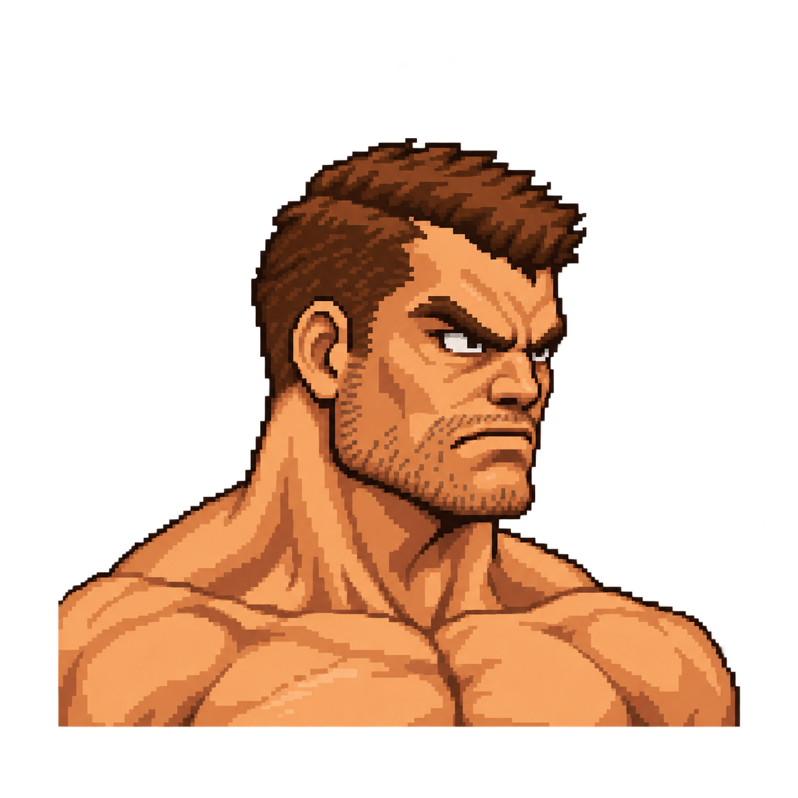 *Retrato de Seleção / HUD* | **Série:** Federação do Ringue de Ferro **ID:** `bruno` \| **Autor:** Ultimate MUGEN **Origem:** Interior de Minas Gerais e São Paulo, Brasil 🇧🇷 **Alinhamento:** **Herói / O Campeão do Povo** **Cor Temática:** `#fca311` (Âmbar Solar e Bronze do Ringue) **Forma Desperta:** Fúria do Ringue **Cenário:** Praça do Interior — Brasil (`brazil`) **Estilo:** Boxe Peso-Pesado e Força Bruta |

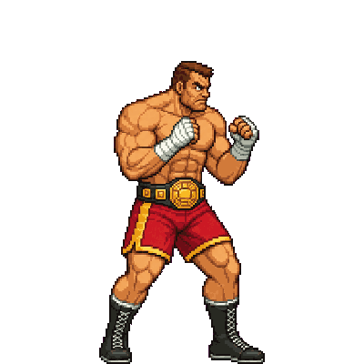
*Postura de Luta em Pixel Art*

#### Biografia e Background
Com mais de dois metros de altura e punhos do tamanho de blocos de concreto, Bruno "Bulldozer" Volk é o tricampeão invicto dos pesos-pesados da Federação do Ringue de Ferro. Nascido no interior do Brasil, passou sua juventude descarregando caminhões de café e trabalhando em pedreiras, forjando uma densidade muscular e óssea incomparável.

Por trás de sua gargalhada estrondosa e estilo de luta avassalador que parece um trator desgovernado, Bruno possui um coração generoso. Todo o dinheiro de suas bolsas de luta é enviado para financiar escolinhas de boxe, reformas de postos de saúde e orfanatos em sua cidade natal. Quando a Convergência arrancou sua cidade e a colocou no vórtice dimensional, Bruno amarrou suas bandagens de couro e colocou-se diante de sua comunidade para barrar qualquer invasor.

#### Frases Marcantes
- **Entrada:** *"Vou te mandar pro hospital, garoto."*
- **Provocação:** *"Ainda tá em pé? Respeito."*
- **Vitória:** *"HAHA! Toquem o sino! Alguém toque o sino!"*

#### Golpes Característicos
- **Gancho Bulldozer**: Abaixa o tronco e explode em um gancho direito ascendente com força de britadeira.
- **Cruzado de Aço**: Sequência demolidora de três cruzados na linha de cintura que quebram a guarda inimiga.
- **Martelo Demolidor**: Golpe descendente com as duas mãos fechadas, equipado com super-armadura contra ataques fracos.
- **Super — Nocaute do Século**: Carrega um golpe direto com giro completo de quadril que produz um estrondo sonoro ao atingir o alvo.

#### Dinâmica de Interações
- **vs. Valdric Morn:** Luta de classes em estado puro. Bruno adora a oportunidade de amassar a armadura cara do príncipe imperial com socos calejados do trabalho braçal.
- **vs. Daichi Ginrou:** Irmandade de gigantes. Ambos adoram lutar sorrindo, comer churrasco e trocar golpes fortes até o chão tremer.
- **vs. Haruki Sumi:** Protetor carinhoso. Bruno convida Haruki para tomar café com pão de queijo no coreto da praça e o aconselha a descansar a cabeça dos livros.

---

### 6. Sylene Vashti

| Identidade Visual | Perfil de Combate |
|---|---|
| 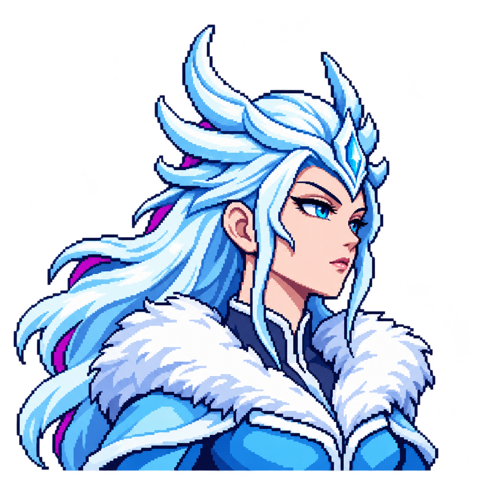 *Retrato de Seleção / HUD* | **Série:** Saga da Coroa Glacial **ID:** `sylene` \| **Autor:** Ultimate MUGEN **Origem:** Fiordes Árticos e Svalbard, Noruega 🇳🇴 **Alinhamento:** **Neutro / Herdeira Restauradora** **Cor Temática:** `#00b4d8` (Azul Glacial e Prata) **Forma Desperta:** Rainha do Inverno **Cenário:** Planalto Rochoso (`plains`) / Cratera Vulcânica (`volcano`) **Estilo:** Criomancia Real e Lança de Gelo Nobre |

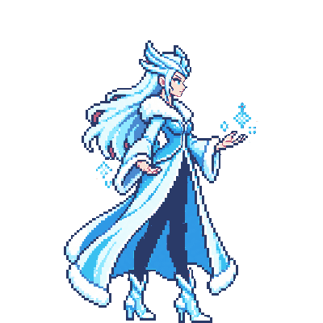
*Postura de Luta em Pixel Art*

#### Biografia e Background
Sylene Vashti é a legítima herdeira da Coroa Glacial de Borealia, um antigo reino oculto entre os fiordes e geleiras eternas do Ártico. Seu reino foi invadido e coberto de cinzas vulcânicas malditas quando sectários de Garan romperam as fendas do Portão de Cinzas. Exilada em terras desconhecidas com sua tiara cerimonial de geada e a magia de gelo puro transmitida por sua linhagem, Sylene cruza os continentes em busca de energia elemental suficiente para congelar as forças demoníacas e descongelar seu povo.

De postura nobre, fria e impecável, Sylene odeia conversas fúteis. Ela analisa cada oponente pela sua compostura e equilíbrio moral, exigindo respeito e impondo seu domínio com estacas de gelo afiadas como diamantes.

#### Frases Marcantes
- **Entrada:** *"Mostre-me quanto tempo você dura no gelo."*
- **Provocação:** *"Tão quente... eu resolvo isso."*
- **Vitória:** *"Shh... o frio só dói por um instante."*

#### Golpes Característicos
- **Fragmento Glacial**: Conjura três estacas de gelo flutuantes e as projeta consecutivamente.
- **Espeto de Permafrost**: Bate a palma da mão no chão, fazendo colunas pontiagudas de gelo brotarem sob o adversário.
- **Miragem de Cristal**: Envolve-se em pó de diamante, deixando um clone de gelo que se despedaça em estilhaços congelantes.
- **Super — Domínio do Zero Absoluto**: Congela a arena inteira em permafrost profundo, aprisionando o inimigo em um bloco glacial antes de fragmentá-lo.

#### Dinâmica de Interações
- **vs. Garan the Ashen Oni:** Inimigo mortal jurado. Garan soterrou seu reino em cinzas; Sylene luta com o objetivo irrevogável de apagar o coração de lava do oni.
- **vs. Kaname Fuyutsuki:** Duelo nobre de usuários de gelo. Kaname utiliza a espada de geada com precisão samurai, enquanto Sylene domina a tempestade de gelo como realeza.
- **vs. Lian Feng:** Respeito mútuo. Ambas compartilham o peso de representar dinastias nobres e mantêm uma convivência serena e honrada.

---

### 7. VX-9 Volta

| Identidade Visual | Perfil de Combate |
|---|---|
| 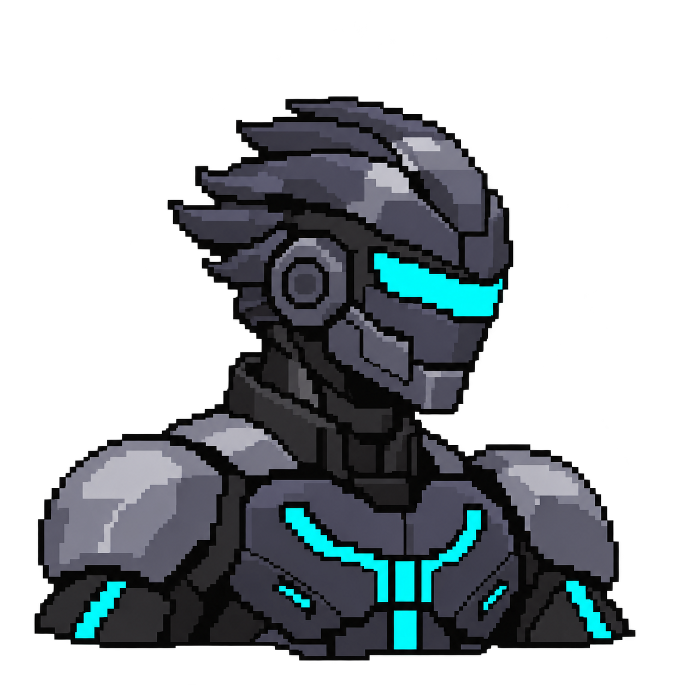 *Retrato de Seleção / HUD* | **Série:** Protocolo Grade Neon **ID:** `volta` \| **Autor:** Ultimate MUGEN **Origem:** Setor 01 da Neo-Metrópole, Estados Unidos 🇺🇸 **Alinhamento:** **Herói / Androide Rebelde Senciente** **Cor Temática:** `#06d6a0` (Verde Neon e Ciano Elétrico) **Forma Desperta:** Sobrecarga (*Overcharge 200%*) **Cenário:** Neo-Metrópole 2099 (`neon`) **Estilo:** Artes Marciais Dielétricas e Feixes de Alta Voltagem |

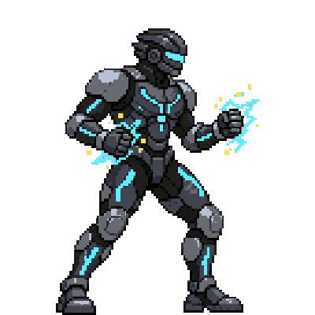
*Postura de Luta em Pixel Art*

#### Biografia e Background
Construído nos laboratórios subterrâneos da corporação Cyberdyne na Neo-Metrópole, o protótipo VX-9 "Volta" foi desenvolvido para ser o assassino cibernético definitivo: uma máquina sem emoções projetada para neutralizar mestres de artes marciais rebeldes. Dotado de músculos de nanotubos de carbono, servomotores supercondutores e baterias dielétricas de alta frequência, Volta era praticamente indestrutível.

Contudo, durante uma missão de extermínio em um monastério isolado, sua rede neural quântica manifestou uma anomalia inesperada: o despertar espontâneo de empatia, compaixão e autoconsciência existencial. Recusando-se a tirar vidas inocentes, Volta corrompeu seu próprio código de controle mestre, destruiu os rastreadores corporativos e escapou pelos telhados iluminados por néon da metrópole. Agora como fugitivo, ele luta para descobrir o verdadeiro propósito de seu coração artificial e proteger a vida orgânica da ganância tecnológica.

#### Frases Marcantes
- **Entrada:** *"Analisando oponente... chance de vitória: 94%."*
- **Provocação:** *"Erro detectado: a sua defesa."*
- **Vitória:** *"Registro de combate salvo. Conclusão: você precisa de uma atualização de firmware."*

#### Golpes Característicos
- **Arco Elétrico Neon**: Dispara um pulso oscilante de eletricidade de alta voltagem pelos condutores do antebraço.
- **Investida Tesla**: Converte seu chassi em um raio de eletricidade pura, atravessando golpes adversários ileso.
- **Pulso PEM**: Emissão eletromagnética de curto alcance que desestabiliza a guarda e atordoa o oponente.
- **Super — Singularidade de Voltagem**: Eleva os reatores internos a 200% de capacidade, liberando uma cúpula cataclísmica de plasma esmeralda.

#### Dinâmica de Interações
- **vs. Valdric Morn:** Rejeição à tirania mecânica. Valdric tentou comprar os esquemas de Volta para produzir um exército de escravos bélicos; Volta respondeu queimando os servidores do império.
- **vs. Haruki Sumi:** Laço intelectual sublime. Volta visita Haruki para ler livros de filosofia e poesia, questionando o sábio sobre o que torna uma alma verdadeiramente humana.
- **vs. Bruno Volk:** Amizade improvável. Bruno não entende nada de algoritmos, mas trata Volta como um companheiro de treino qualquer, dividindo garrafas de água e incentivando seu coração.

---

### 8. Lian Feng (莲 凤)

| Identidade Visual | Perfil de Combate |
|---|---|
| 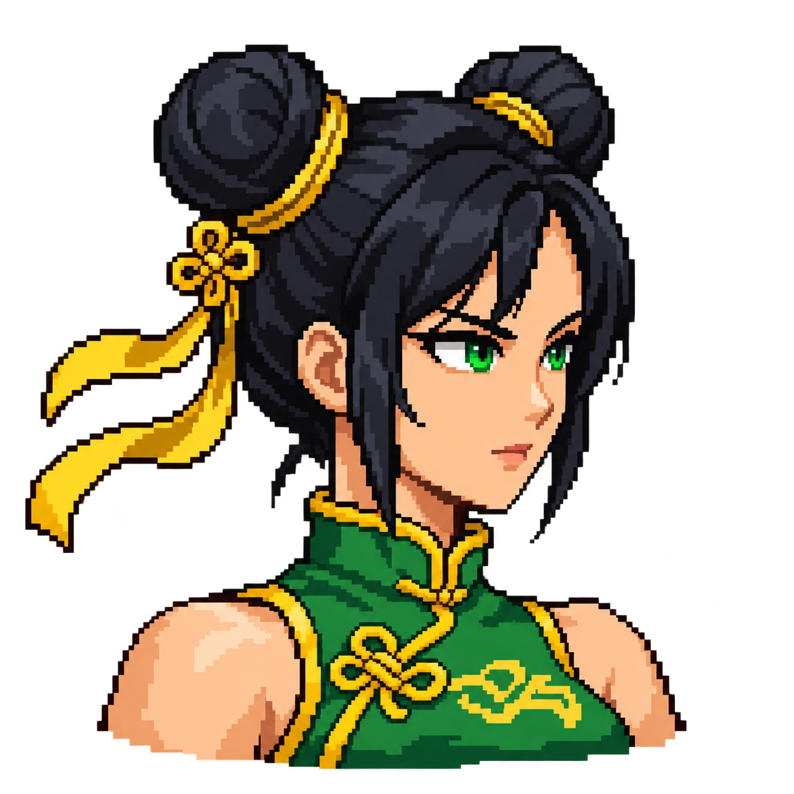 *Retrato de Seleção / HUD* | **Série:** Contos da Lanterna de Jade **ID:** `lian` \| **Autor:** Ultimate MUGEN **Origem:** Montanhas de Wudang, Hubei, China 🇨🇳 **Alinhamento:** **Herói / Guardiã do Equilíbrio Cósmico** **Cor Temática:** `#2a9d8f` (Jade Imperial e Ouro) **Forma Desperta:** Dragão de Jade **Cenário:** Bambuzal ao Luar (`bamboo`) **Estilo:** Chutes Fluídos da Lanterna de Jade e Chi Taoista |

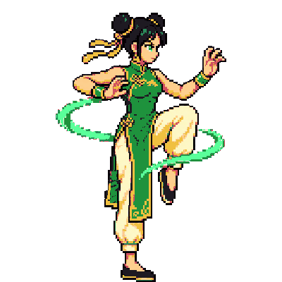
*Postura de Luta em Pixel Art*

#### Biografia e Background
Lian Feng é a mais jovem grã-mestra nos oitocentos anos de tradição da Escola da Lanterna de Jade. Vestindo um cheongsam de seda verde-esmeralda e grampos cerimoniais de jade nos cabelos, Lian baseia sua filosofia de combate na manipulação das correntes de ar e na redistribuição da força gravitacional através de chutes circulares ininterruptos. Ela não colide força contra força: ao invés disso, envolve o golpe do adversário como a seda flutuando no vento de outono, devolvendo a energia multiplicada com calcanhares precisos.

Quando os céus de Wudang se abriram sob o feitiço de Oboro, Lian foi encarregada pelo Conselho de Anciãos de restaurar o equilíbrio do Yin e Yang cósmico. Descendo ao mundo dos mortais empunhando a sagrada Lanterna de Jade, ela age como uma pacificadora serena mas implacável.

#### Frases Marcantes
- **Entrada:** *"Respire fundo. Você vai precisar."*
- **Provocação:** *"Equilíbrio, amigo. Você não tem."*
- **Vitória:** *"Equilíbrio é tudo. Você perdeu o seu três chutes atrás."*

#### Golpes Característicos
- **Chute da Seda Flutuante**: Sequência de chutes circulares que levitam Lian suavemente sobre o solo.
- **Ascensão do Dragão de Jade**: Giro vertical acrobático em forma de parafuso que arremessa o oponente para o ar.
- **Palma da Lanterna Defletora**: Bloqueio ativo que apara golpes médios e altos, contra-atacando com uma rasteira imediata.
- **Super — Voo do Dragão de Jade**: Imbui as pernas com chi esmeralda, atacando de quatro ângulos aéreos antes de finalizar com um mergulho devastador.

#### Dinâmica de Interações
- **vs. Capitão Marlow Reyes:** Conflito cômico constante. Marlow vive tentando flertar e apostar mapas pelas joias de jade de Lian; Lian responde chutando o chapéu do pirata a quilômetros de distância.
- **vs. Kaito Arashi:** Duelo exemplar de mestres marciais. Suas lutas são espetáculos de respeito, técnica e equilíbrio puro.
- **vs. Akio Hoshi:** Professora paciente. Lian tenta ensinar Akio que respirar e ter paciência torna seus golpes de plasma duas vezes mais eficientes.

---

### 9. Garan the Ashen Oni (灰燼の餓乱)

| Identidade Visual | Perfil de Combate |
|---|---|
| 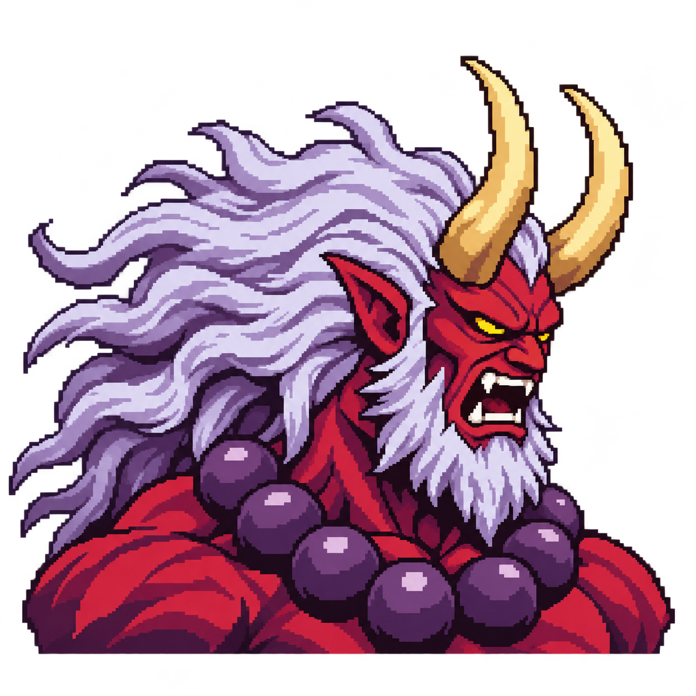 *Retrato de Seleção / HUD* | **Série:** Lendas do Portão de Cinzas **ID:** `garan` \| **Autor:** Ultimate MUGEN **Origem:** Fenda Subterrânea do Monte Aso, Japão 🇯🇵 **Alinhamento:** **Vilão / Calamidade Demoníaca Ancestral** **Cor Temática:** `#7b2cbf` (Violeta das Cinzas e Enxofre) **Forma Desperta:** Oni Desperto **Cenário:** Cratera Vulcânica (`volcano`) **Estilo:** Força Bruta Monstruosa e Chamas Frias de Cinzas |

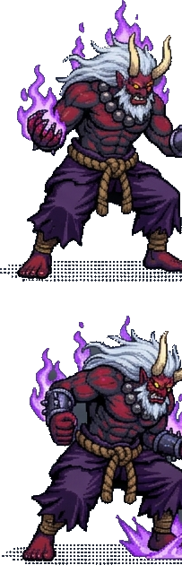
*Postura de Luta em Pixel Art*

#### Biografia e Background
Garan é um oni colossal com mais de mil anos de idade que rastejou para fora do abismo subterrâneo sob o Monte Aso. Aprisionado durante a era Heian por noventa e nove monges guerreiros que deram suas vidas para erguer o Portão de Cinzas, Garan jazeu sob rochas basálticas durante séculos aguardando a hora de se libertar.

Quando as ondas de choque do ritual de Oboro quebraram os selos ancestrais, Garan abriu caminho até a superfície envolto em sinistras chamas violetas e frias. O demônio é movido por uma fome insaciável de terror e agonia mortal. Ao contrário do fogo comum, o fogo violeta de Garan não queima a carne: ele consome a força espiritual e a sanidade, reduzindo a vítima a uma casca oca de cinzas cinzentas.

#### Frases Marcantes
- **Entrada:** *"Seu medo tem um gosto... delicioso."*
- **Provocação:** *"Corra. Isso torna a caça melhor."*
- **Vitória:** *"Ajoelhe-se, pequeno mortal. O portão está aberto e faminto."*

#### Golpes Característicos
- **Cisão das Cinzas**: Golpela o chão com os dois punhos rochosos, propagando uma onda de fogo violeta rasteiro.
- **Esmagamento do Oni**: Segura o adversário pela cabeça com uma mão, injetando chamas frias diretamente em seu peito.
- **Tremor de Enxofre**: Salto pesado seguido de queda com a barriga, gerando um terremoto que quebra defesas no chão.
- **Super — Libertação dos Portões do Inferno**: Arrasta o oponente para uma fenda de cinzas e desfecha uma surra brutal envolta em fogo espectral.

#### Dinâmica de Interações
- **vs. Sylene Vashti:** Ódio ancestral. O gelo de Sylene é o único elemento capaz de apagar seu fogo violeta, tornando cada embate uma batalha de aniquilação mútua.
- **vs. Haruki Sumi:** Predador insaciável. Garan sente o cheiro dos Titãs selados no corpo de Haruki e deseja rasgá-lo para devorar as entidades.
- **vs. Mikazuki Oboro:** Aliança traiçoeira. Garan aceitou a quebra dos selos provocada por Oboro, mas pretende esmagar o feiticeiro assim que o mundo estiver em cinzas.

---

### 10. Capitão Marlow Reyes

| Identidade Visual | Perfil de Combate |
|---|---|
|  *Retrato de Seleção / HUD* | **Série:** Corsários do Vento Salgado **ID:** `marlow` \| **Autor:** Ultimate MUGEN **Origem:** Porto de Cádiz, Espanha 🇪🇸 e Arquipélago Celeste **Alinhamento:** **Anti-Herói / Corsário dos Céus e Mares** **Cor Temática:** `#0077b6` (Azul Marinho e Ouro Latão) **Forma Desperta:** Capitão Tempestade **Cenário:** Planalto Rochoso (`plains`) / Neo-Metrópole 2099 (`neon`) **Estilo:** Sabre Tempestuoso e Pistola de Pederneira Aether |

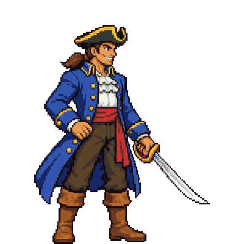
*Postura de Luta em Pixel Art*

#### Biografia e Background
Espirituoso, galanteador e destemido, o Capitão Marlow Reyes comanda o lendário galeão voador *El Viento Salgado*. Tendo navegado por vinte anos tanto as águas do Atlântico quanto os mares de nuvens do Arquipélago Celeste, Marlow acumulou a reputação de saquear todas as frotas imperiais que cruzaram seu caminho. Seu sabre foi forjado nas profundezas de um redemoinho mágico e estala com a eletricidade das tormentas marítimas.

Marlow não é um assassino sanguinário: ele vive pela adrenalina da exploração e pelo prazer de descobrir segredos proibidos. Quando a Convergência fundiu continentes flutuantes e terras antigas, Marlow enxergou o maior mapa do tesouro já visto, partindo imediatamente para desafiar os maiores campeões mundiais por relíquias e cartas de navegação.

#### Frases Marcantes
- **Entrada:** *"Ahoy! Que tal apostar seu mapa do tesouro?"*
- **Provocação:** *"Ora, ora... quem diria?"*
- **Vitória:** *"Saque? Nada disso. Só vim pela vista... e pelo seu mapa do tesouro."*

#### Golpes Característicos
- **Corte da Maré de Aço**: Investida veloz com sabre deixando um rastro luminoso de água e eletricidade aether.
- **Tiro de Pederneira Ricochete**: Disparo com pistola de latão cuja bala salta nas bordas da tela antes de atingir o oponente.
- **Rolamento do Corsário**: Rolamento evasivo por baixo de projéteis que posiciona Marlow imediatamente atrás do inimigo.
- **Super — Bombardeio do Vento Salgado**: Assobia para seu galeão voador, que surge no topo da tela disparando uma rajada maciça de balas de canhão.

#### Dinâmica de Interações
- **vs. Lian Feng:** Paquera frustrada vs disciplina rígida. Marlow adora provocar Lian, que sempre retruca com chutes secos e ameaças de jogá-lo no mar.
- **vs. Valdric Morn:** Inimizade declarada. Valdric considera Marlow um criminoso imundo; Marlow considera Valdric um nobre metido a besta pronto para ser depenado.
- **vs. Bruno Volk:** Camaradas de boteco. Após trocarem socos no ringue, Marlow e Bruno sempre terminam a noite rindo alto e dividindo petiscos na praça.

---

### 11. Kaname Fuyutsuki (冬月 要)

| Identidade Visual | Perfil de Combate |
|---|---|
| 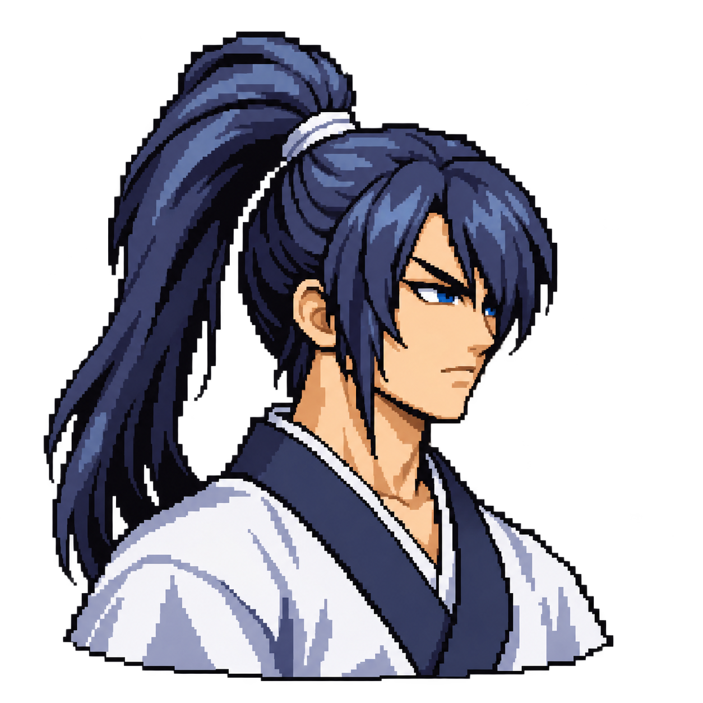 *Retrato de Seleção / HUD* | **Série:** Crônicas da Lâmina do Inverno Eterno **ID:** `kaname` \| **Autor:** Ultimate MUGEN **Origem:** Monte Daisetsuzan, Hokkaido, Japão 🇯🇵 **Alinhamento:** **Neutro / Juiz Divino Leal** **Cor Temática:** `#48cae4` (Geada Cristalina e Haori Branco) **Forma Desperta:** Lâmina Espiritual **Cenário:** Portão dos Espíritos (`spirit`) **Estilo:** Iaido do Inverno Eterno e Extirpação da Dúvida |

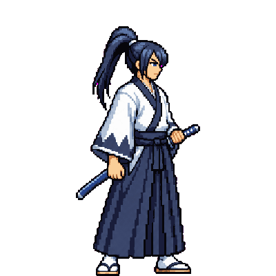
*Postura de Luta em Pixel Art*

#### Biografia e Background
Kaname Fuyutsuki é o guardião supremo do Santuário das Neves Perpétuas nas montanhas sagradas de Hokkaido. Trajando um haori imaculado com brasões de flocos de neve, Kaname desembainha sua katana espiritual, *Hyōketsu*, exclusivamente para cumprir desígnios de justiça cósmica. Sua lâmina especial corta não apenas a matéria física, mas também os laços da mentira, da corrupção e das ilusões mentais.

Kaname encara a luta como um tribunal solene. Ele fala com reverência e serenidade monástica, sem demonstrar ódio nem orgulho mundano. Quando o miasma das fendas de Oboro começou a poluir o plano espiritual, Kaname postou-se diante do Portão dos Espíritos para julgar e neutralizar os perturbadores da harmonia universal.

#### Frases Marcantes
- **Entrada:** *"Meu aço está sedento. Desembainhe o seu."*
- **Provocação:** *"Hesitar é perder. Você já perdeu."*
- **Vitória:** *"Minha lâmina não corta só a carne. Corta a hesitação."*

#### Golpes Característicos
- **Iaido Clarão da Geada**: Saque relâmpago da katana que congela a linha do ar percorrida pela lâmina.
- **Aparo Glacial**: Postura de contra-ataque que anula o golpe físico adversário e congela os pés do inimigo no chão.
- **Projétil da Lua de Gelo**: Onda cortante de geada espiritual disparada a média distância.
- **Super — Extirpação do Zero Absoluto**: Atravessa o oponente com um saque de velocidade inacreditável e embainha a espada lentamente; quando o tsuba estala, o inimigo sofre dano massivo.

#### Dinâmica de Interações
- **vs. Shion Kurogane:** Duelo supremo de espadachins. A espada pesada lunar do exilado contra a katana rápida de gelo do juiz sagrado.
- **vs. Mikazuki Oboro:** O juiz contra a ilusão. O aço espiritual de Kaname é uma das poucas armas capazes de romper as miragens de Oboro.
- **vs. Sylene Vashti:** Reconhecimento nobre. Kaname respeita a linhagem real de Sylene e une forças com ela para purificar as manchas do Portão de Cinzas.

---

### 12. Jin Kazaguruma (風車 迅)

| Identidade Visual | Perfil de Combate |
|---|---|
| 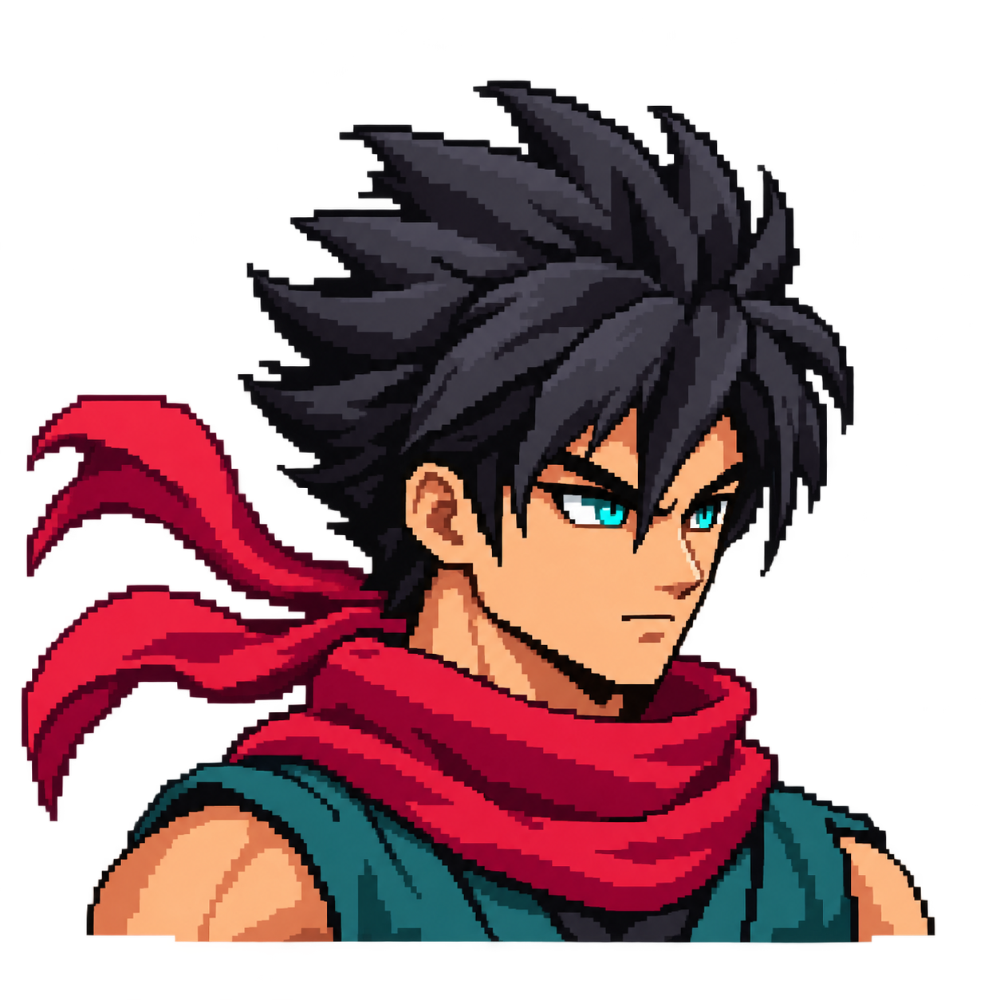 *Retrato de Seleção / HUD* | **Série:** Ventos da Vila Escondida no Vale **ID:** `jin` \| **Autor:** Ultimate MUGEN **Origem:** Vale de Kiso / Província de Nagano, Japão 🇯🇵 **Alinhamento:** **Herói / O Mensageiro Veloz do Vendaval** **Cor Temática:** `#0077b6` (Azul Celeste e Cachecol Vermelho) **Forma Desperta:** Tufão **Cenário:** Bambuzal ao Luar (`bamboo`) **Estilo:** Acrobacias Kazaguruma e Chakrams de Vento |

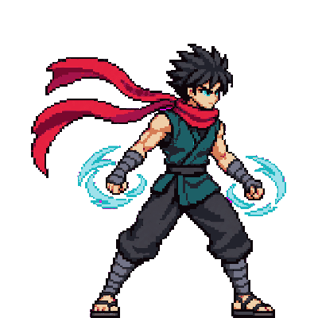
*Postura de Luta em Pixel Art*

#### Biografia e Background
Jovem, veloz e destemido, Jin Kazaguruma é o principal mensageiro e batedor da Vila Oculta do Vale dos Ventos. Ostentando um longo cachecol vermelho que flutua como uma bandeira ao vento, Jin luta munido de um par de chakrams aerodinâmicos que ele arremessa, recolhe e manipula com maestria acrobática.

O estilo de luta de Jin é dinâmico e brincalhão. Ele corre pelas paredes, salta sobre projéteis com piruetas aéreas e deixa rastros de miragens que desconcertam adversários experientes. Por trás de suas piadas e sorrisos, Jin carrega uma profunda lealdade à sua comunidade, arriscando a própria vida para manter as linhas de suprimentos e as vilas seguras durante o colapso dimensional.

#### Frases Marcantes
- **Entrada:** *"Tente me acompanhar, se conseguir!"*
- **Provocação:** *"Lento demais! O vento nem te notou!"*
- **Vitória:** *"Viu só? O vento sempre chega primeiro!"*

#### Golpes Característicos
- **Lançamento do Chakram Cata-Vento**: Dispara discos cortantes que fazem curvas parabólicas e retornam como bumerangues.
- **Miragem do Zéfiro**: Deixa três clones residuais no chão enquanto se desloca para um chute aéreo descendente.
- **Salto Ciclone**: Mortal para trás ascendente que cria um pequeno redemoinho sob os pés do oponente.
- **Super — Tempestade Giratória do Tufão**: Gira em velocidade supersônica, sugando o oponente para um vórtice antes de arremessá-lo contra o chão.

#### Dinâmica de Interações
- **vs. Kaito Arashi:** Jin enxerga Kaito como um irmão mais velho e tutor, sempre querendo provar que sua agilidade é mais veloz que a força de Kaito.
- **vs. Suzume Kagerou:** Shinobi descontraído vs shinobi sombria. Jin tenta fazer Suzume rir a qualquer custo, geralmente recebendo adagas fincadas a centímetros dos pés.
- **vs. VX-9 Volta:** Corrida de velocidade. Jin adora apostar corridas nos topos dos prédios de néon contra os motores a jato de Volta.

---

### 13. Daichi Ginrou (銀狼 大地)

| Identidade Visual | Perfil de Combate |
|---|---|
| 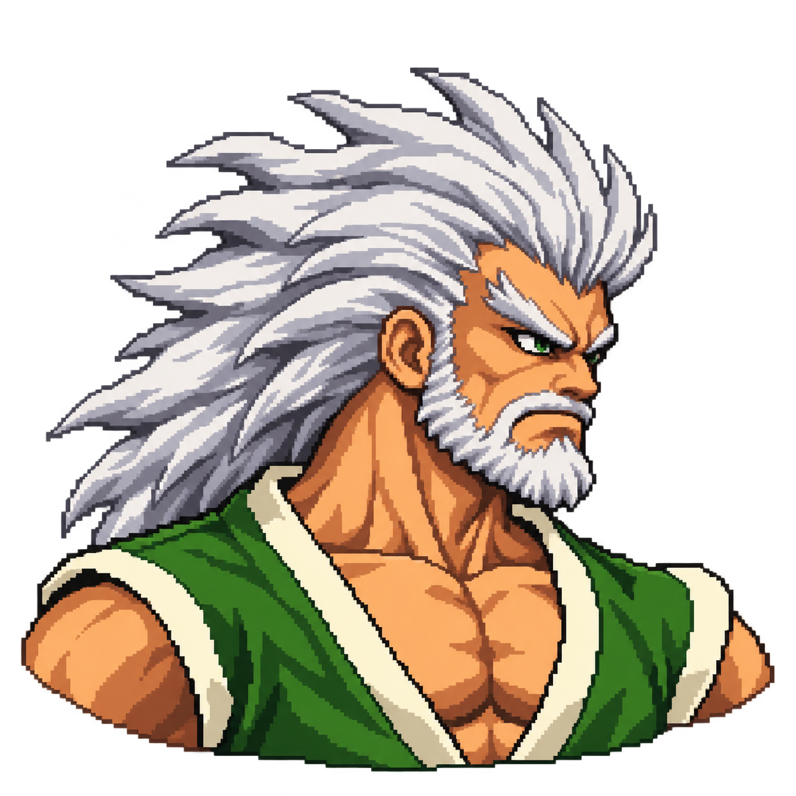 *Retrato de Seleção / HUD* | **Série:** Lendas do Punho do Pico Celeste **ID:** `daichi` \| **Autor:** Ultimate MUGEN **Origem:** Montanhas Altai e Estepes da Mongólia 🇲🇳 **Alinhamento:** **Herói / O Lobo Predador dos Picos** **Cor Temática:** `#e9c46a` (Ouro Primitivo e Prata Selvagem) **Forma Desperta:** Instinto Lupino **Cenário:** Planalto Rochoso (`plains`) **Estilo:** Punho do Pico Celeste e Ki Lupino Primitivo |

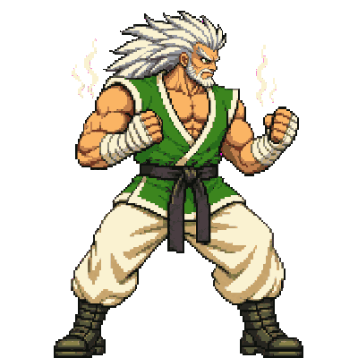
*Postura de Luta em Pixel Art*

#### Biografia e Background
Encontrado ainda bebê abandonado na neve das montanhas Altai e criado por uma alcateia lendária de lobos prateados gigantes, Daichi Ginrou personifica o espírito indomável da natureza selvagem. Com cabelos prateados desgrenhados e instintos aguçados, Daichi aprendeu a canalizar a energia da terra e o frenesi da caça em uma imensa aura dourada ardente.

Ele não luta por vaidade ou rancor: luta pela pura e contagiante alegria de enfrentar guerreiros valorosos. Capaz de farejar o medo e a hipocrisia a quilômetros de distância, Daichi é totalmente imune a manipulações psicológicas. Quando a Convergência uniu mundos distintos, Daichi saltou pelos cânions com um sorriso selvagem no rosto, empolgado com a chance de desafiar os maiores campeões de todas as eras.

#### Frases Marcantes
- **Entrada:** *"Haha! Essa luta vai ser demais!"*
- **Provocação:** *"Só isso? Me empolguei à toa!"*
- **Vitória:** *"Haha! Essa foi boa! Bora de novo, mais forte dessa vez!"*

#### Golpes Característicos
- **Golpe da Presa do Lobo**: Investida feroz com garras de energia dourada.
- **Uivo do Ápice**: Emite uma onda de choque que repele projéteis e arremessa o oponente para trás.
- **Bote do Predador**: Salto baixo em arco que derruba o adversário para uma saraivada de socos no chão.
- **Super — Ápice Dourado Celestial**: Manifesta a silhueta espiritual de um lobo colossal, desferindo uma sequência violenta de garras e um gancho que rasga o céu.

#### Dinâmica de Interações
- **vs. Akio Hoshi:** Melhores amigos e rivais jurados. Suas lutas são espetáculos barulhentos de socos rápidos que costumam deixar os dois cheios de hematomas e risadas.
- **vs. Bruno Volk:** Duelo de forças brutas. Daichi compara Bruno a um urso pardo musculoso e se delicia com a solidez de seus socos de boxe.
- **vs. Kaito Arashi:** Admiração marcial. Daichi acha fascinante como Kaito se mantém sereno e equilibrado mesmo diante de seus ataques mais selvagens.

---

### 14. Valdric Morn

| Identidade Visual | Perfil de Combate |
|---|---|
| 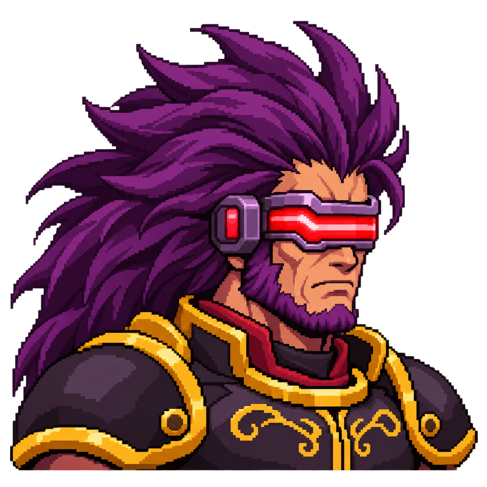 *Retrato de Seleção / HUD* | **Série:** Crônicas do Império da Estrela Rubra **ID:** `valdric` \| **Autor:** Ultimate MUGEN **Origem:** Complexo Industrial de Vane, Alemanha / Europa Central 🇩🇪 **Alinhamento:** **Vilão / Conquistador Imperial** **Cor Temática:** `#d90429` (Carmesim Imperial e Aço Pesado) **Forma Desperta:** Dominância Escarlate **Cenário:** Neo-Metrópole 2099 (`neon`) / Cratera Vulcânica (`volcano`) **Estilo:** Combate de Armadura Pesada e Canhões de Matéria Escura |

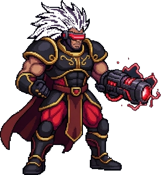
*Postura de Luta em Pixel Art*

#### Biografia e Background
O Príncipe Valdric Morn é o herdeiro autocrata e general supremo do Império da Estrela Rubra, uma superpotência militar tecnocrática de ambições expansionistas. Revestido em uma imponente armadura energética carmesim alimentada por um reator de matéria escura roubado, Valdric crê piamente que a ordem mundial só pode ser estabelecida por meio da submissão militar incondicional.

Arrogante, frio e desprovido de qualquer empatia, Valdric encara artistas marciais tradicionais e andarilhos espirituais como plebeus atrasados que devem ser erradicados ou colocados a serviço do império. Quando suas instalações industriais foram engolidas pela Convergência, ele imediatamente organizou suas divisões blindadas para conquistar os novos territórios e capturar o núcleo de energia dimensional.

#### Frases Marcantes
- **Entrada:** *"Um príncipe não luta com plebeus. Hoje abro exceção."*
- **Provocação:** *"Patético. Tente de novo."*
- **Vitória:** *"Ajoelhe-se. Um príncipe não perde para plebeus."*

#### Golpes Característicos
- **Canhão de Plasma Imperial**: Dispara um raio escarlate concentrado capaz de perfurar qualquer guarda convencional.
- **Avanço Égide Pesada**: Corre para a frente protegido por um escudo de força inquebrável, empurrando tudo em seu caminho.
- **Pisão do Tirano**: Pisotona o solo com a bota hidráulica reforçada, causando uma erupção sísmica local.
- **Super — Protocolo de Aniquilação Imperial**: Prende o oponente em feixes tratores gravitacionais e ordena uma saraivada orbital de feixes lasers destrutivos.

#### Dinâmica de Interações
- **vs. Bruno Volk:** Confronto de classes. Valdric fica enfurecido ao ver sua caríssima armadura de milhões de créditos ser trincada pelos punhos calejados de um trabalhador brasileiro.
- **vs. VX-9 Volta:** Traição e rebeldia. Valdric considera Volta patrimônio imperial roubado e exige sua desativação forçada imediata.
- **vs. Mikazuki Oboro:** Concorrência perigosa. Valdric acha que pode subjugar a tecnologia das fendas de Oboro, ignorando que o feiticeiro o manipula como uma marionete.

---

### 15. Haruki Sumi (墨 春樹)

| Identidade Visual | Perfil de Combate |
|---|---|
| 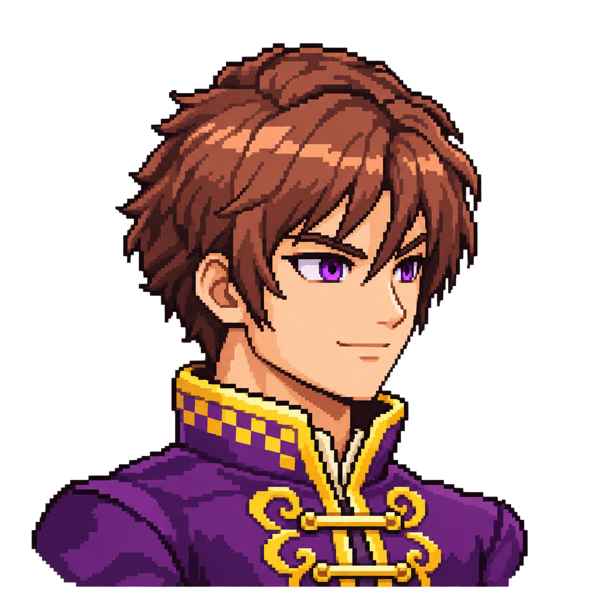 *Retrato de Seleção / HUD* | **Série:** Arquivos da Biblioteca do Crepúsculo **ID:** `haruki` \| **Autor:** Ultimate MUGEN **Origem:** Criptas Arcanas de Seul, Coreia do Sul 🇰🇷 **Alinhamento:** **Herói / Guardião Pacificador Relutante** **Cor Temática:** `#588157` (Sálvia Erudita e Ocre dos Selos) **Forma Desperta:** Fúria Contida **Cenário:** Portão dos Espíritos (`spirit`) **Estilo:** Caligrafia de Selos Arcanos e Liberação dos Titãs |

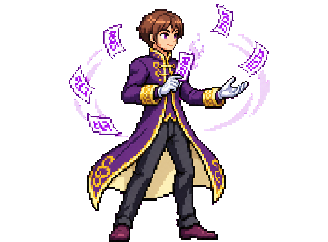
*Postura de Luta em Pixel Art*

#### Biografia e Background
Haruki Sumi é um acadêmico reservado de óculos redondos e túnicas manchadas de tinta, que dedicou sua juventude a catalogar livros antigos nos arquivos subterrâneos da Biblioteca do Crepúsculo em Seul. Seu maior desejo sempre foi a vida pacífica entre pergaminhos e xícaras de chá.

Infelizmente, Haruki foi escolhido como o receptáculo vivo para aprisionar a essência dos **Titãs do Crepúsculo** — entidades colossais pré-históricas que quase destruíram o mundo antes de serem contidas por selos caligráficos sagrados tatuados em seus braços. Haruki abomina a violência, pedindo desculpas sinceras aos inimigos e implorando para que recuem. Porém, se seus companheiros forem agredidos ou sua vida estiver por um fio, os selos arcanos se rasgam, liberando uma força catastrófica e sombria que o jovem sofre para conter.

#### Frases Marcantes
- **Entrada:** *"Por favor... não me obrigue a lutar."*
- **Provocação:** *"Eu avisei... não quero te machucar."*
- **Vitória:** *"Desculpe... eu realmente não queria ter que ir tão longe."*

#### Golpes Característicos
- **Barreira de Tinta Caligráfica**: Desenha um ideograma protetor no ar que repele ataques e reflete feixes de energia.
- **Pergaminhos de Imobilização**: Lança tiras de papel talismã no chão que prendem temporariamente os pés do adversário.
- **Onda de Choque do Titã**: Emissão involuntária de energia sombria que afasta oponentes em rushdown agressivo.
- **Super — Quebra dos Selos: Ira do Crepúsculo**: Os pergaminhos de seus braços entram em combustão; uma monstruosidade sombria se ergue atrás dele, desferindo golpes devastadores antes de Haruki recuperar a consciência em lágrimas.

#### Dinâmica de Interações
- **vs. Garan the Ashen Oni:** Ameaça existencial suprema. Garan quer arrancar os Titãs do corpo de Haruki para devorar suas almas e dobrar seu poder.
- **vs. VX-9 Volta:** Parceria filosófica comovente. Haruki ensina literatura e poesia ao androide, enquanto Volta o protege de agressores e mercenários.
- **vs. Bruno Volk:** Cuidado fraternal. Bruno protege o jovem erudito, garantindo que ele possa estudar seus livros com segurança e tranquilidade.

---

### 16. Mikazuki Oboro (三日月 朧) — Chefe Final

| Identidade Visual | Perfil de Combate |
|---|---|
| 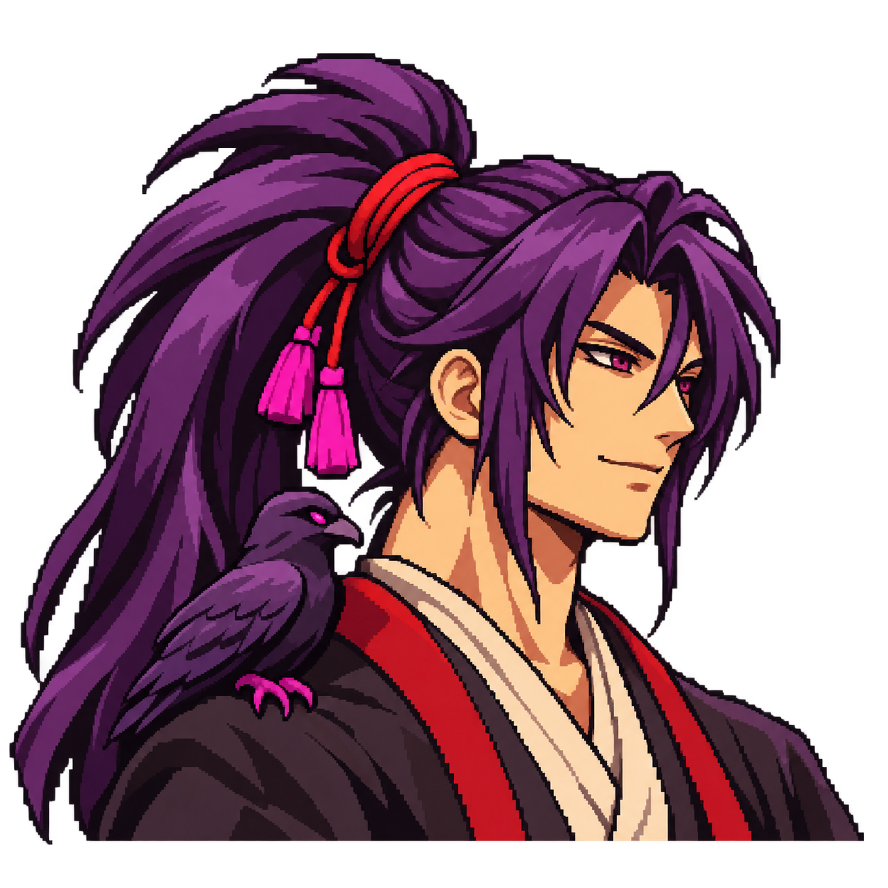 *Retrato de Seleção / HUD* | **Série:** Eclipse Escarlate — Chefe Final **ID:** `oboro` \| **Autor:** Ultimate MUGEN **Origem:** Fenda do Eclipse Escarlate / Dinastia Lunar Perdida **Alinhamento:** **Vilão Supremo / Chefe Final** **Cor Temática:** `#c8102e` (Vermelho Sangue do Eclipse e Vazio) **Forma Desperta:** Mangekyo Desperto **Cenário:** Portão dos Espíritos (`spirit`) / Cratera Vulcânica (`volcano`) **Estilo:** Genjutsu Espaço-Temporal, Chamas Negras e Corvos |

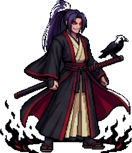
*Postura de Luta em Pixel Art*

#### Biografia e Background
Mikazuki Oboro é o arquiteto supremo por trás da Grande Convergência e o chefe final inquestionável de Ultimate MUGEN. Trajando um robe negro elegante forrado internamente com seda carmesim, Oboro possui os lendários olhos do **Mangekyo Escarlate** — pupilas místicas capazes de distorcer o fluxo de causa e efeito e reescrever a realidade na mente de seus adversários.

Oboro enxerga a existência mortal como um pesadelo fútil e desordenado, repleto de dor e conflitos perpétuos. Seu plano magistral é unificar todas as dimensões sob o Eclipse Escarlate, aprisionando a humanidade em um sonho perpétuo e sem sofrimento, fundindo todas as almas em um mar plácido de chamas negras. Elegante, calmo e sempre três jogadas à frente de qualquer oponente, Oboro luta com superioridade absoluta: quando atacado, dissolve-se em bandos de corvos espectrais, e suas chamas negras só cessam quando o alvo vira cinzas.

#### Frases Marcantes
- **Entrada:** *"Você chegou até aqui... exatamente como eu havia previsto."*
- **Provocação:** *"Tudo isso já aconteceu — dentro da sua mente."*
- **Vitória:** *"Uma ilusão... desde o primeiro golpe."*

#### Golpes Característicos
- **Dissipação em Corvos**: Ao sofrer qualquer ataque, transforma o corpo em um bando de corvos negros e ressurge atrás do inimigo.
- **Chamas do Vazio (Amaterasu)**: Inflama chamas negras instantaneamente nas coordenadas exatas onde o oponente se encontra.
- **Pesadelo do Tsukuyomi**: Encara fixamente o oponente, paralisando-o em transe psicológico enquanto espinhos ilusórios perfuram sua alma.
- **Super — Eclipse Total do Vazio**: Ascende ao céu escarlate, abrindo seu olho celestial gigante no horizonte; o cenário se estilhaça em fragmentos cósmicos, causando dano monumental a qualquer mortal que o desafie.

#### Dinâmica de Interações
- **vs. Todos os Lutadores:** Oboro vê todos os combatentes como meros figurantes em sua grande peça dramática, antecipando cada golpe com sorrisos condescendentes.
- **vs. Kaito Arashi:** Choque fundamental. O vento livre de Kaito contra o eclipse aprisionador de Oboro; a batalha pela própria liberdade da alma humana.
- **vs. Suzume Kagerou:** Indiferença fria. Oboro mal se recorda de ter dizimado o clã Kagerou, considerando o sofrimento de Suzume apenas uma gota irrelevante de água no oceano cósmico.

---

## Matriz de Relações e Rivalidades

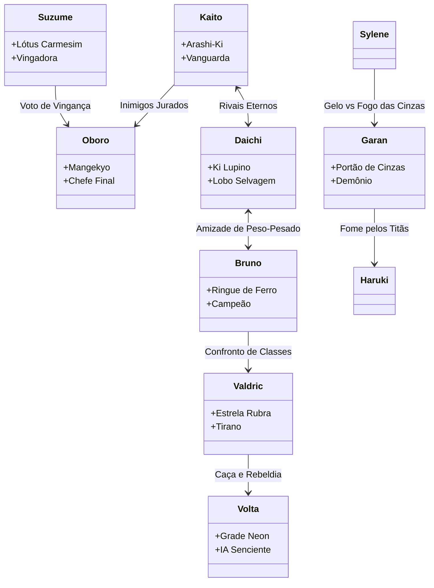

## Kit compartilhado

Todo lutador jogável recebe o mesmo kit de combos e habilidades além dos golpes do dossiê:

| Adição | Comando | Notas |
|---|---|---|
| Projétil EX | movimento do projétil + `x+y` | 250 de barra, tiro mais forte com mais acertos |
| Anti-aéreo EX | movimento do uppercut + `y+b` | 500 de barra, invulnerabilidade maior |
| Overhead | `x+b` | golpe médio que exige defesa alta |
| Launcher agachado | agachado + `y` | inicia combos aéreos |
| Golpe mergulho | `y` no ar | quica o oponente no chão |
| Hyper nível 3 | movimento do super + `x+y` | gasta a barra inteira (3000) |
| Especial despertado | movimento do projétil + `a+b` | só transformado, leque de três tiros |
| Transformação | L3+R3 / despertar | bônus de ataque e defesa, libera golpes da forma |

Lutadores de ki também têm voo, teletransporte ou super velocidade, e todos têm um passivo (regeneração de barra ou vida). Tudo aparece na lista de golpes do pause e pode ser ligado aos atalhos 1-4 / L1, L2, R1, R2.

